# ❌❌❌ Conquer Amsterdam

**Ships, windmills, ferries, secret courtyards and LEGO**

_Campaign from November 2026 · 12 zones · 1–2 zones per outing_

Amsterdam stands on thousands of wooden poles, and its coat of arms has three crosses: XXX. This is our city, but do you know its secrets? Where does a giant carry the whole world on his shoulders? Where is the bridge of three herrings? Where is the house as wide as a door? Conquer the zones in any order, collect coins and become the Admiral of Amsterdam!

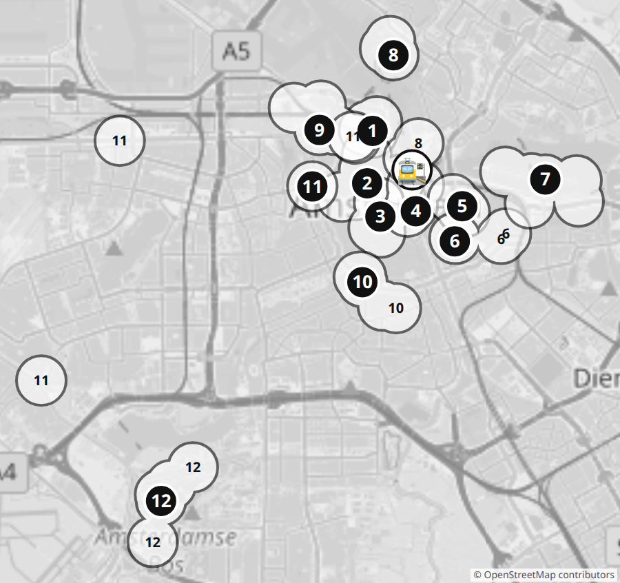

## 📜 How to play

1. We are one team against Amsterdam. 12 zones in any order, 1–2 per outing.
2. Challenge done? Tick the box ☐ and colour in the coins 🪙. You lead everyone to all the stops with the map and no hints? Another 🧭 +2.
3. Reached 🏁? The zone is CONQUERED! A sticker on the card and on its number on the big map.
4. 👑 Boss: a big challenge. It may not work the first time, so try again! ⚔️ Duel: me against the parents. I get the coins for playing either way; the last one (+1) is only for winning. ⏱ Against the clock. 📏 Measures are on the hunt card.
5. Coins add up over all the outings. Spend them whenever you like: your rank counts everything you have earned!

### 🛒 What coins buy

- 🪙×5 — A hint for a riddle
- 🪙×12 — I choose the snack
- 🪙×20 — A parent does a curse of my choice
- 🪙×35 — Ice cream or a sweet
- 🪙×60 — A small souvenir
- 🪙×120 — A big surprise from the parents

### 🌀 City curses

A curse falls when we enter a new zone and the die shows 1, or when we skip a challenge. Roll the die again: the number is the curse. It hits the whole team until we finish the next challenge.

1. We talk like pirates: "Arr!" at the end of every sentence
2. We walk like seagulls, arms as wings, until the next bridge
3. See a boat? Shout "Full steam ahead!"
4. One hand behind your back
5. The next challenge on one leg (where you can)
6. We ring like a tram: "Ding-ding!" at every corner

### 🎖️ Rank

Your rank counts ALL the coins you have earned. Spending coins does not take it away:

- **Deckhand** — under 30 coins
- **Sailor** — 🪙 30+
- **Bosun** — 🪙 65+
- **Navigator** — 🪙 105+
- **Captain** — 🪙 150+
- **Admiral** — 🪙 195+ and all 12 zones conquered

## 🎯 City-wide hunt

Look on every outing, in any zone. Fill a row and get the coins!

- ☐ ☐ ☐ ☐ ☐ XXX: three crosses on the brown posts by the road. Stand next to one: does it reach your knee or your waist? (🪙×2)
- ☐ ☐ ☐ The city's coat of arms: a shield with XXX, two lions and a crown (🪙×2)
- ☐ ☐ ☐ ☐ ☐ A bridge number (written on the bridge) (🪙×2)
- ☐ ☐ ☐ ☐ ☐ ☐ ☐ ☐ A picture stone on a house wall (they were used instead of house numbers!) (🪙×3)
- ☐ ☐ ☐ ☐ ☐ ☐ Windmills: De Gooyer · De Bloem · De Otter · De 1200 Roe · Molen van Sloten · Riekermolen (🪙×4)
- ☐ ☐ ☐ ☐ ☐ Transport: tram · metro · ferry · bus · train (🪙×3)

📏 My measures (measure at home): Step, cm ____ · Height, cm ____ · Palm, cm ____ · One floor of stairs, sec ____

## 🏝️ Zone 1: Western Islands

🚉 Walk from Centraal ~15 minutes west along the water.

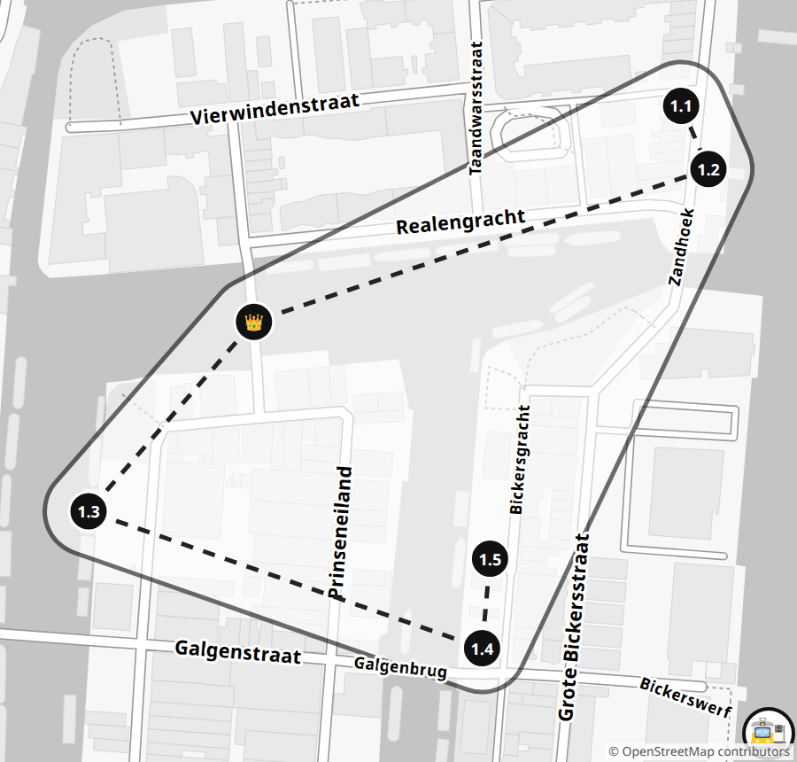

_400 years ago people built three islands here for warehouses and shipyards. Ships brought herring, salt, tar, and even cat skins!_

- [ ] 1.1 🔍 **Golden Coin** ⚔️ (🪙×1+1) — Who will be first to find, on the Zandhoek quay, the stone with a golden coin and an emperor? The coin gave its name to the Reael family, and the family gave its name to this island! 📍 [Zandhoek](https://www.google.com/maps/search/?api=1&query=52.38769,4.88993)
- [ ] 1.2 📏 **Captains' Row** (🪙×3) — Pace out the width of one captain's house. There are 13 of these houses in the row. How many steps will the whole row take? Walk it and check! 📍 [Zandhoek, row of houses](https://www.google.com/maps/search/?api=1&query=52.38745,4.8901)
- [ ] 1.3 📸 **Shipyard Birds** (🪙×2) — By the water on Prinseneiland, take a photo of two different birds in one picture: a duck, a coot, a gull, a heron, a goose… 📍 [Prinseneiland](https://www.google.com/maps/search/?api=1&query=52.38615,4.88624)
- [ ] 1.4 🏃 **⏱ Playground Minute** (🪙×2) — At the playground on Bickersgracht, touch 15 different things in 1 minute: swing, slide, bench, tree… A parent times you and counts! 📍 [Playground, Bickersgracht](https://www.google.com/maps/search/?api=1&query=52.38563,4.88869)
- [ ] 1.5 🏃 **Farm Charades** (🪙×3) — At the De Dierencapel farm, act out 5 animals you can see in the yard, without sounds. The parents must guess at least 3! 📍 [Kinderboerderij De Dierencapel, Bickersgracht 207](https://www.google.com/maps/search/?api=1&query=52.38597,4.88874)
- [ ] 👑 **Zone boss: Bridge 320** (🪙×6) — Find the bridge with number 320 and read its name. Cross it with your eyes closed without touching the railings! Touched them or opened your eyes? Start again. 📍 [Drieharingenbrug](https://www.google.com/maps/search/?api=1&query=52.38687,4.88727)

Coins needed: **12** 🏁

## 🌷 Zone 2: Jordaan and Canals

🚉 Walk from Centraal ~10 minutes.

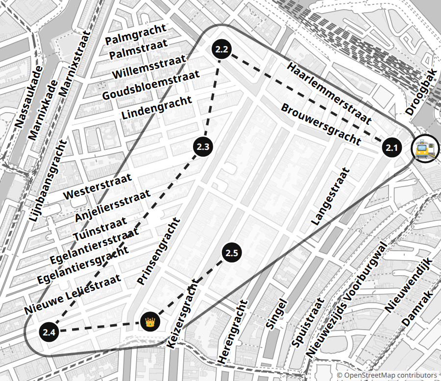

_Houses used to have no numbers, only names and stone pictures on the walls. There are lots of them here. Go find them!_

- [ ] 2.1 📸 **Three Fleets** (🪙×3) — Boats from different companies sail the canals, and the name is written on the side. Take photos of boats from three different companies! 📍 [Piers at Damrak / Prins Hendrikkade](https://www.google.com/maps/search/?api=1&query=52.3773,4.8968)
- [ ] 2.2 🔍 **Corner Warehouses** (🪙×2) — On the warehouses of the Brouwersgracht canal, find the words Vijfhoek, Vierhoek and Driehoek and translate them! And which warehouse is named after a faraway island? 📍 [Brouwersgracht 200–207](https://www.google.com/maps/search/?api=1&query=52.38161,4.88702)
- [ ] 2.3 🗣️ **Dutch Pie** (🪙×3) — At Winkel 43, order apple pie with whipped cream. What did the waiter say? Translate it for us! Then rate the pie from 1 to 10. 📍 [Winkel 43, Noordermarkt 43](https://www.google.com/maps/search/?api=1&query=52.37908,4.88623)
- [ ] 2.4 🔍 **Three Brothers** (🪙×2) — On Bloemgracht there are three brother houses. Their stones show a townsman, a farmer and a sailor. Find the sailor! 📍 [De Drie Hendricken, Bloemgracht 87–91](https://www.google.com/maps/search/?api=1&query=52.37428,4.8797)
- [ ] 2.5 ⚔️ **House of Heads** (🪙×2+1) — The legend: a maid caught six thieves, and now their heads are on the wall. Who will be first to find the head with a winged helmet? And the one with ears of wheat? 📍 [Huis met de Hoofden, Keizersgracht 123](https://www.google.com/maps/search/?api=1&query=52.37634,4.88745)
- [ ] 👑 **Zone boss: Tower Crown** (🪙×6) — Find the tallest church in Amsterdam. What colour is the crown on top? Wait for the bells to play, then dance until the music stops! 📍 [Westerkerk](https://www.google.com/maps/search/?api=1&query=52.37455,4.88399)

Coins needed: **12** 🏁

## 👑 Zone 3: Dam and Secret Courtyard

🚉 Walk from Centraal ~10 minutes along Damrak, or tram to Dam.

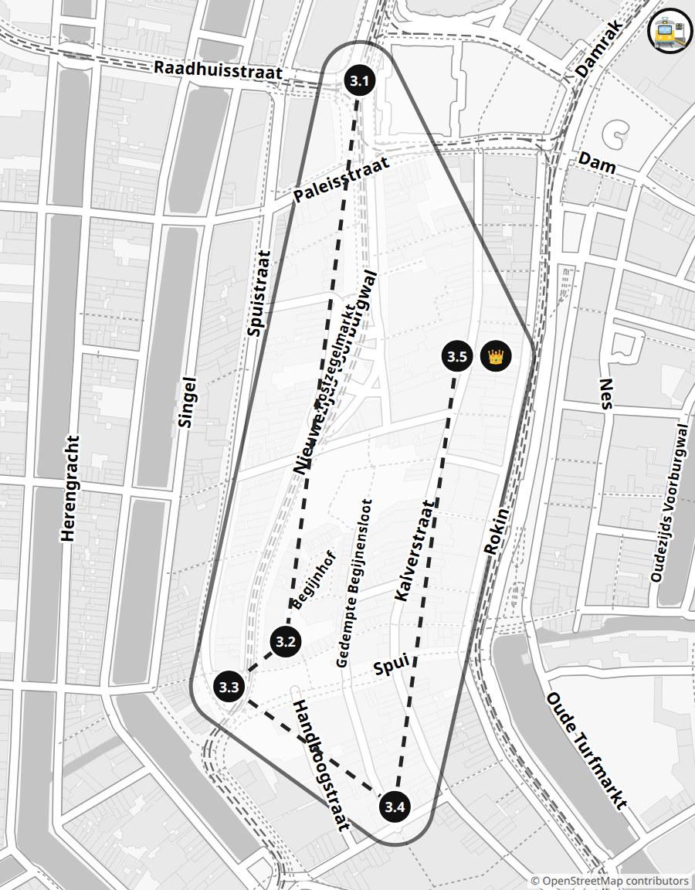

_The Royal Palace stands on 13,659 wooden poles, like a giant brush! It used to be the town hall and became a palace in 1808._

- [ ] 3.1 🔍 **Giant with a World** (🪙×3) — Walk around the back of the palace. On the roof the giant Atlas holds a ball: what colour is the giant, and what colour is the ball? Find the elephant in the triangle under the roof! 📍 [Koninklijk Paleis, rear facade (Nieuwezijds Voorburgwal)](https://www.google.com/maps/search/?api=1&query=52.37322,4.8906)
- [ ] 3.2 🧭 **Secret Courtyard** (🪙×3) — From Spui square a small door leads into a secret courtyard. Inside is the oldest wooden house in the city. Find its number! 📍 [map](https://www.google.com/maps/search/?api=1&query=52.36911,4.88971)
- [ ] 3.3 📸 **Bronze Rascal** (🪙×2) — On Spui square stands a bronze rascal of a boy. Copy his pose on one leg while a parent counts to 10. Photo! 📍 [Het Lieverdje, Spui](https://www.google.com/maps/search/?api=1&query=52.36878,4.88903)
- [ ] 3.4 🍽️ **Fries with Mayo** (🪙×2) — Try fries with mayonnaise from the little window, the way the Dutch eat them! 📍 [Vleminckx, Voetboogstraat 33](https://www.google.com/maps/search/?api=1&query=52.3679,4.89102)
- [ ] 3.5 🔍 **A Thousand Pieces** (🪙×2) — In the LEGO Store, find a set with more than 1000 but fewer than 2000 pieces. How many pieces does it have? Bonus: find an animal built from bricks! 📍 [LEGO Store, Kalverstraat 57](https://www.google.com/maps/search/?api=1&query=52.3712,4.892)
- [ ] 👑 **Zone boss: Record Tower** (🪙×6) — In the LEGO Store, build a tower from 4 different kinds of pieces, as tall as half your arm. It must stand on its own for 5 seconds! 📍 [LEGO Store, Kalverstraat 57](https://www.google.com/maps/search/?api=1&query=52.3712,4.892)

Coins needed: **12** 🏁

## 🏯 Zone 4: Nieuwmarkt and the Waag

🚉 Straight from Centraal: the Schreierstoren tower is 5 minutes away.

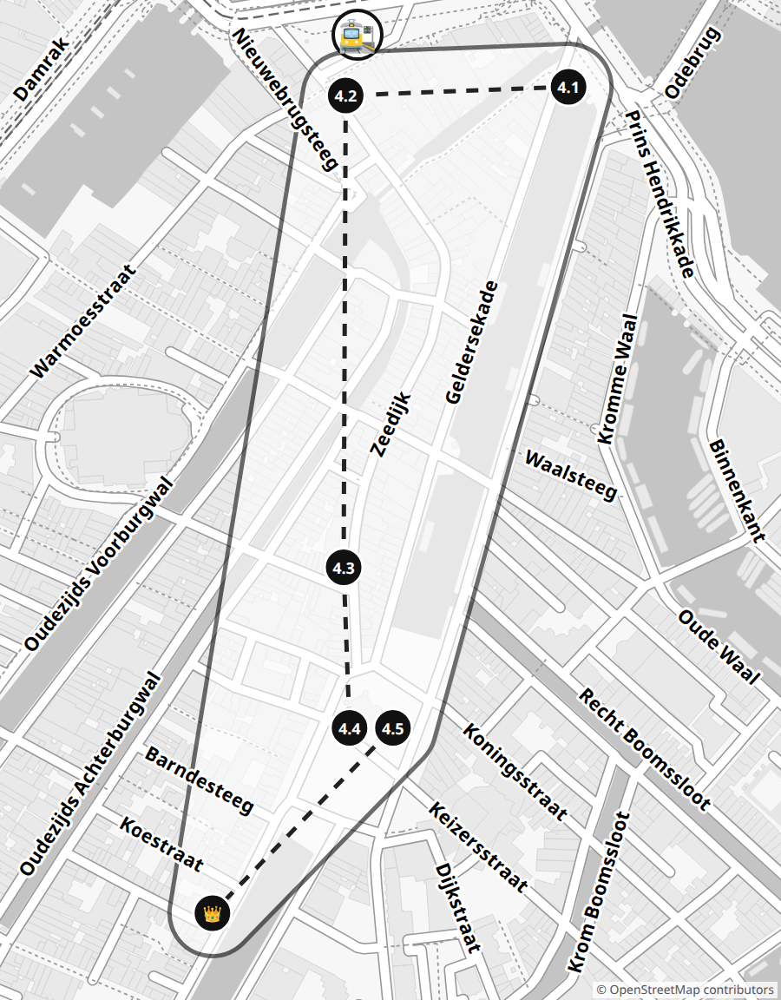

_The Waag (weigh house) was a city gate more than 500 years ago. Later goods were weighed here, and upstairs every guild of craftsmen had its own door!_

- [ ] 4.1 🔍 **Traveller's Tower** (🪙×3) — In 1609 Captain Hudson sailed from here, towards the future New York! Find the stone on the tower: a woman points at a ship but has turned away. What year is on it? 📍 [Schreierstoren](https://www.google.com/maps/search/?api=1&query=52.37636,4.90224)
- [ ] 4.2 🔍 **Monkey House** (🪙×2) — Find one of the last two wooden houses in the centre. It is called "At the Little Monkeys". The legend: sailors paid with monkeys here! 📍 [In 't Aepjen, Zeedijk 1](https://www.google.com/maps/search/?api=1&query=52.37631,4.90015)
- [ ] 4.3 📸 **Chinese Palace** (🪙×2) — On Zeedijk there is a Chinese temple that looks like a palace. Find the curved corners of the roof and take a photo of them! 📍 [He Hua Temple, Zeedijk 106–118](https://www.google.com/maps/search/?api=1&query=52.37361,4.90013)
- [ ] 4.4 ⚔️ **Guild Doors** (🪙×2+1) — Above the doors of the Waag are the guild signs. Who can find more? A bonus for whoever finds the words Theatrum Anatomicum! 📍 [De Waag, Nieuwmarkt](https://www.google.com/maps/search/?api=1&query=52.37269,4.90039)
- [ ] 4.5 🏃 **One-Leg Turrets** (🪙×2) — Stand on one leg and count all the turrets of the Waag. Foot touched the ground? Start counting again! 📍 [De Waag, Nieuwmarkt](https://www.google.com/maps/search/?api=1&query=52.37269,4.90039)
- [ ] 👑 **Zone boss: Door-Wide House** (🪙×6) — The legend: the rich Trip family's coachman asked for a house as wide as their door, and got one! Pace out the little house, then the big house opposite. How many little ones fit into the big one? 📍 [Kleine Trippenhuis, Kloveniersburgwal 26](https://www.google.com/maps/search/?api=1&query=52.37163,4.8989)

Coins needed: **12** 🏁

## ⚓ Zone 5: Ships and NEMO

🚉 Walk from Centraal ~15 minutes.

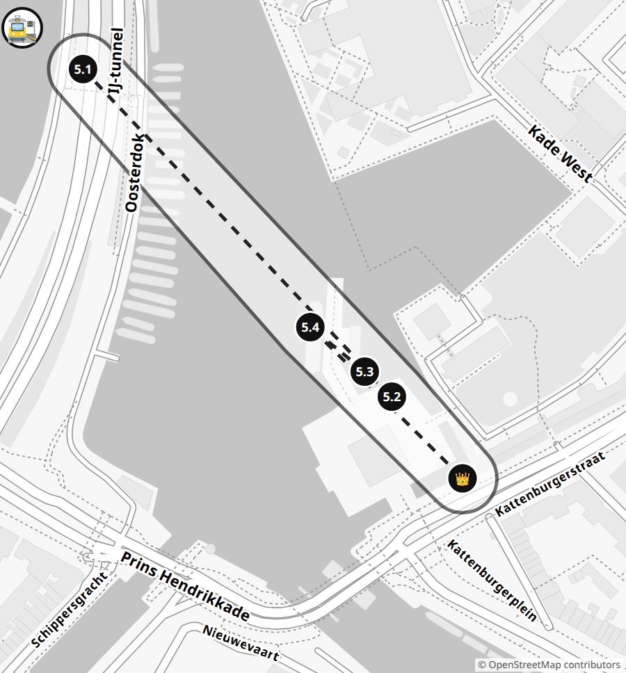

_The real ship Amsterdam was wrecked off the coast of England in 1749 and still lies in the sand. By the museum there is a copy of it, and you can go on board!_

- [ ] 5.1 🏃 **⏱ Roof Record** (🪙×2) — Run up the stairs to the NEMO roof while a parent times you. Rest, go back down and try to beat your record! 📍 [NEMO roof, Oosterdok 2](https://www.google.com/maps/search/?api=1&query=52.37385,4.91211)
- [ ] 5.2 🔍 **Wind Rose** ⚔️ (🪙×1+1) — In the museum courtyard, the glass roof is drawn like the wind rose on old sea charts. Who will be first to find north? 📍 [Het Scheepvaartmuseum, courtyard](https://www.google.com/maps/search/?api=1&query=52.37201,4.91495)
- [ ] 5.3 🏃 **Inside the Whale** (🪙×3) — A huge whale is hiding in the museum. Walk into its mouth! In the last room, name 5 different kinds of rubbish that end up in the sea. 📍 [Het Scheepvaartmuseum, "Tale of the Whale"](https://www.google.com/maps/search/?api=1&query=52.37215,4.9147)
- [ ] 5.4 🗣️ **Sinterklaas Is Here!** (🪙×4) — Only on 15 November: Sinterklaas's steamboat docks at the museum. Wave and shout "Welcome!" to him in Dutch! 📍 [Quay by Het Scheepvaartmuseum](https://www.google.com/maps/search/?api=1&query=52.3724,4.9142)
- [ ] 👑 **Zone boss: Ship's Captain** (🪙×6) — On the ship Amsterdam, lie in a hammock, take the wheel and lift the cargo. Count the gun ports on one side: how many on both sides? 📍 [The ship Amsterdam by Het Scheepvaartmuseum](https://www.google.com/maps/search/?api=1&query=52.37155,4.9156)

Coins needed: **9** 🏁

## 🦁 Zone 6: Plantage and Artis

🚋 Tram 14 from Centraal to Pontanusstraat (back from Artis).

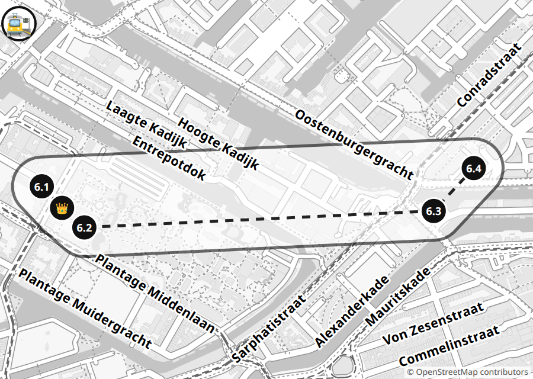

_Artis is the oldest zoo in the Netherlands: it is 188 years old! Next to it is Micropia, a museum of microbes: everything alive there is so small you can only see it under a microscope._

- [ ] 6.1 ⚔️ **Giant Windmill** (🪙×2+1) — From the tram we walk to the De Gooyer windmill. Who will see it first? Under the windmill is a brewery. What bird is painted on its sign? 📍 [De Gooyer, Funenkade 5](https://www.google.com/maps/search/?api=1&query=52.3668,4.92615)
- [ ] 6.2 🏃 **⏱ 20 Trees** (🪙×2) — Run into Funenpark next to the windmill. Touch 20 different trees in 3 minutes! A parent times you and counts. 📍 [Funenpark (Oosterspeeltuin)](https://www.google.com/maps/search/?api=1&query=52.36775,4.9276)
- [ ] 6.3 🔍 **Gate Words** (🪙×2) — Three Latin words are written on the zoo gates. Find them! Which one became the zoo's name? 📍 [ARTIS gates, Plantage Kerklaan 38](https://www.google.com/maps/search/?api=1&query=52.36696,4.91258)
- [ ] 6.4 🔍 **Kiss Microbes** (🪙×2) — Find the Kiss-o-meter and kiss Mum or Dad on the cheek: more than a million microbes or fewer? Then stand in front of the scanner mirror: where are the microbes on you? 📍 [Micropia, Kiss-o-meter](https://www.google.com/maps/search/?api=1&query=52.3668,4.91285)
- [ ] 👑 **Zone boss: Stamps and Water Bear** (🪙×6) — At the Micropia desk, ask for a stamp card. Collect the stamps. Find a live water bear under the microscope: how many legs does it have? 📍 [Micropia, Plantage Kerklaan 38–40](https://www.google.com/maps/search/?api=1&query=52.36689,4.91269)

Coins needed: **10** 🏁

## 🐍 Zone 7: Eastern Docklands

🚋 Tram 26 from Centraal to Rietlandpark.

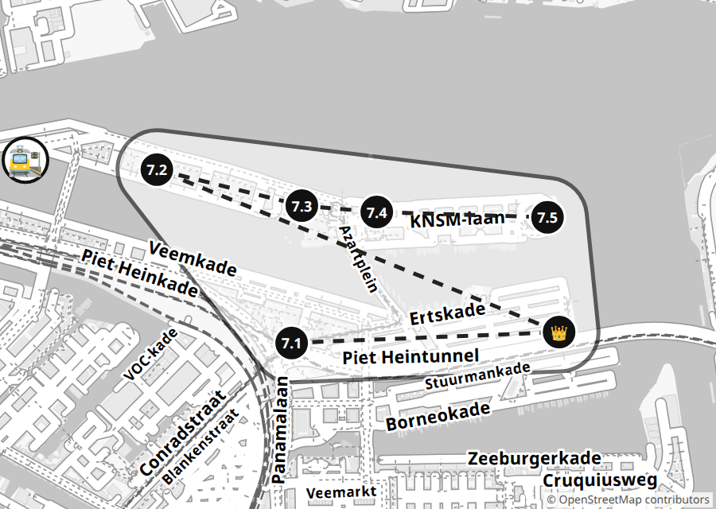

_There was a big port here. Now, instead of warehouses, there are islands with snake bridges and funny little bridges, and almost two thirds of the area is water!_

- [ ] 7.1 🚋 **Tram 26** (🪙×2) — Ride tram 26 from Centraal and count the stops to Rietlandpark. Take a photo of a tram coming the other way! 📍 [Rietlandpark stop](https://www.google.com/maps/search/?api=1&query=52.37309,4.93453)
- [ ] 7.2 ⚔️ **Java Bridges** (🪙×2+1) — Guess: how many little bridges cross the canals of Java Island? Who is closer, you or the parents? Now walk across the island and count! 📍 [Java-eiland, Lamonggracht](https://www.google.com/maps/search/?api=1&query=52.37872,4.92736)
- [ ] 7.3 🏃 **⏱ Five Things** (🪙×2) — At the Bogortuin playground, pick 5 different things to play on. In 2 minutes, visit each one: climb it, sit on it or swing! 📍 [Bogortuin playground, Java-eiland](https://www.google.com/maps/search/?api=1&query=52.37755,4.93507)
- [ ] 7.4 🔍 **Harbour Crane** (🪙×3) — Behind the old Loods 6 warehouse stands a harbour crane. Find its number! 📍 [Crane by Loods 6, KNSM-laan](https://www.google.com/maps/search/?api=1&query=52.37734,4.93906)
- [ ] 7.5 🔍 **House in the Water** ⚔️ (🪙×1+1) — Find a huge round house growing right out of the water! How many floors does it have? Who counts faster, you or the parents? 📍 [Emerald Empire, KNSM-eiland](https://www.google.com/maps/search/?api=1&query=52.37717,4.94814)
- [ ] 👑 **Zone boss: Python Bridge** (🪙×6) — Find the bright red bridge that wriggles like a snake! Cross it and count the steps. Come back walking backwards, holding the railing! 📍 [Pythonbrug (Hoge Brug), Sporenburg](https://www.google.com/maps/search/?api=1&query=52.37344,4.94876)

Coins needed: **11** 🏁

## ⛴️ Zone 8: North by Ferry

⛴️ Free ferry F4 from the piers behind Centraal station to NDSM.

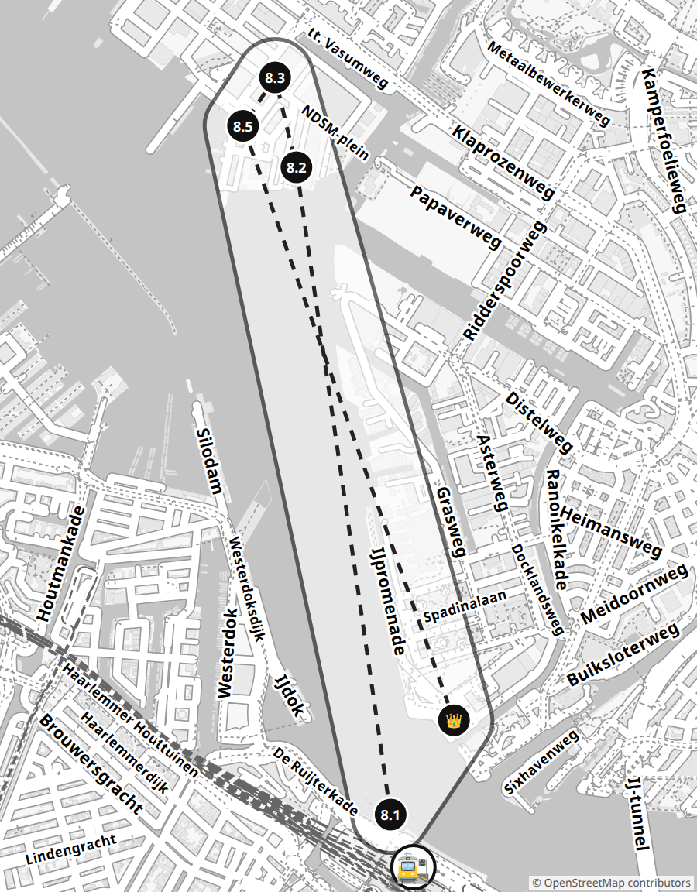

_At the NDSM shipyard, huge ships were built for almost 100 years. The last crane was not taken down, and now there's a hotel inside it!_

- [ ] 8.1 🚋 **Guess the Boats** ⚔️ (🪙×1+1) — We take ferry F4 behind Centraal station: almost 15 minutes to NDSM. Guess: how many boats and ships will we pass? Who is closer, you or the parents? We count together! 📍 [Ferries behind Centraal station](https://www.google.com/maps/search/?api=1&query=52.3811,4.8992)
- [ ] 8.2 📸 **Thumb Crane** (🪙×2) — Find the huge crane hotel. Stretch out your arm and walk away until the crane is exactly as tall as your thumb. A parent takes the photo over your shoulder! 📍 [Faralda Crane Hotel, NDSM-plein](https://www.google.com/maps/search/?api=1&query=52.39941,4.89484)
- [ ] 8.3 🎒 **STRAAT Hunt** (🪙×3) — On the outside wall of STRAAT, find a huge portrait of a girl: it's Anne Frank. Inside, ask at the desk for the kids' treasure hunt and do it! 📍 [STRAAT, NDSM-plein 1](https://www.google.com/maps/search/?api=1&query=52.40195,4.89385)
- [ ] 8.4 🍽️ **Dutch Pancakes** (🪙×2) — Order a Dutch pancake (pannenkoek): with apple, syrup or icing sugar! What did the waiter say? Translate it for us!
- [ ] 8.5 🏃 **Tightrope Walker** (🪙×2) — Find an old rail (or a kerb) at the shipyard. Walk 20 steps along it like a tightrope walker without falling off! 📍 [NDSM shipyard](https://www.google.com/maps/search/?api=1&query=52.40058,4.89236)
- [ ] 👑 **Zone boss: A'DAM Tower** (🪙×6) — Time how many seconds the A'DAM lift takes to carry us up 20 floors. How many times faster is it than you on the stairs? From the top, find the station. Brave enough? The swing over the edge is another +2 🪙! 📍 [A'DAM Lookout, Overhoeksplein 5](https://www.google.com/maps/search/?api=1&query=52.38377,4.90214)

Coins needed: **11** 🏁

## 🏭 Zone 9: Westerpark

🚉 Walk from Centraal ~20 minutes along Haarlemmerstraat.

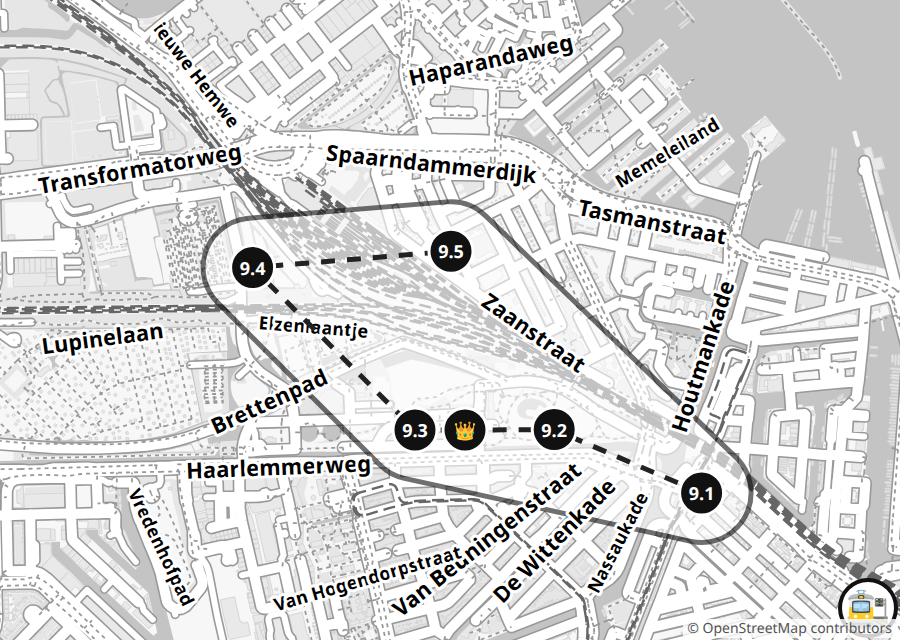

_There was a gasworks here: from 1885 it made gas for the street lamps. Now its buildings hold cafés and museums, and around them is a big wild park._

- [ ] 9.1 🍽️ **Oliebol!** (🪙×2) — In winter, oliebollen are sold by the Haarlemmerpoort gate: doughnuts with icing sugar. Try one! 📍 [Haarlemmerplein, Bollenbakkers stall](https://www.google.com/maps/search/?api=1&query=52.38461,4.88372)
- [ ] 9.2 🏃 **⏱ Stepping Stones** (🪙×2) — At the edge of the park, find a climbing frame and stepping stones. Jump across the stones and back 5 times in 1 minute! 📍 [Aldo van Eyck climbing frame, Westerpark (Haarlemmerweg)](https://www.google.com/maps/search/?api=1&query=52.38615,4.87784)
- [ ] 9.3 🔍 **Shell Bike** (🪙×2) — In Amsterdam in Motion, go upstairs. Find the bike that was pulled out of the bottom of a canal: it's covered in shells! Then make your own protest sign. 📍 [Amsterdam in Motion, Pazzanistraat 19](https://www.google.com/maps/search/?api=1&query=52.38614,4.87329)
- [ ] 9.4 🧱 **Den** (🪙×3) — On the wild play island Woeste Westen, build a den from sticks! It must stand on its own while a parent counts to 10. 📍 [Het Woeste Westen, Overbrakerpad 3](https://www.google.com/maps/search/?api=1&query=52.39009,4.86582)
- [ ] 9.5 📸 **Ship House** (🪙×2) — Find a house that looks like a ship! Where is its bow, and where is its funnel? Take a photo so the house is "sailing" towards you. 📍 [Het Schip, Oostzaanstraat 45](https://www.google.com/maps/search/?api=1&query=52.39049,4.87373)
- [ ] 👑 **Zone boss: Mini City** (🪙×6) — On the huge model of Amsterdam, find Central Station and NEMO. How many hand widths between them? And from the station to the place where you are standing? 📍 [Amsterdam in Motion, Pazzanistraat 19](https://www.google.com/maps/search/?api=1&query=52.38614,4.87329)

Coins needed: **11** 🏁

## 🖼️ Zone 10: Rijksmuseum and De Pijp

🚇 Metro 52 from Centraal (or Rokin) to De Pijp.

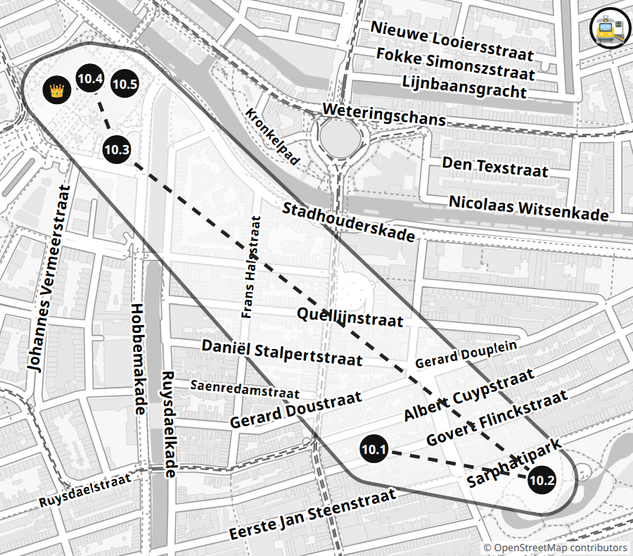

_The Rijksmuseum was built by the same architect as Centraal station: Pierre Cuypers. And a tunnel for bikes runs right through the middle of the museum!_

- [ ] 10.1 🚋 **Giant Escalator** ⚔️ (🪙×1+1) — De Pijp metro station is the deepest in the country! Guess how many seconds the escalator ride up takes. Who is closer? Let's time it! 📍 [De Pijp metro station](https://www.google.com/maps/search/?api=1&query=52.3549,4.8917)
- [ ] 10.2 🔍 **Park Temple** (🪙×2) — In Sarphatipark, find the temple in the middle of the water. What colour is the crown on its roof? Which animals guard the water below? 📍 [Sarphatimonument, Sarphatipark](https://www.google.com/maps/search/?api=1&query=52.35446,4.89557)
- [ ] 10.3 🏃 **⏱ Slide and Tunnel** (🪙×2) — On Museumplein by Café Cobra, go down the slide 10 times in 3 minutes! Then walk under the Rijksmuseum through the tunnel: the museum entrance is right inside it. 📍 [Playground on Museumplein → Rijksmuseum passage](https://www.google.com/maps/search/?api=1&query=52.35911,4.88577)
- [ ] 10.4 🔍 **Royal Ship** (🪙×2) — Find the huge model of the ship William Rex: it has 74 cannons! What animal is on the ship's bow, and what is on its head? 📍 [Rijksmuseum, room 2.15](https://www.google.com/maps/search/?api=1&query=52.36005,4.8854)
- [ ] 10.5 🔍 **Night Watch** (🪙×3) — Find Rembrandt's huge painting "The Night Watch". Where is the girl with a chicken on her belt? And where is the barking dog? 📍 [Rijksmuseum, room 2.30](https://www.google.com/maps/search/?api=1&query=52.36005,4.8854)
- [ ] 👑 **Zone boss: Doll's House** (🪙×6) — In Petronella's doll's house, find the tiny library and the kitchen. Of all the dolls in the house, only one is left. Find it: who is it? 📍 [Rijksmuseum, Petronella Oortman's doll's house](https://www.google.com/maps/search/?api=1&query=52.36,4.8847)

Coins needed: **12** 🏁

## 🌬️ Zone 11: Western Windmills

🚌 Start at the Haarlemmerpoort gate, then by bus (route in 9292).

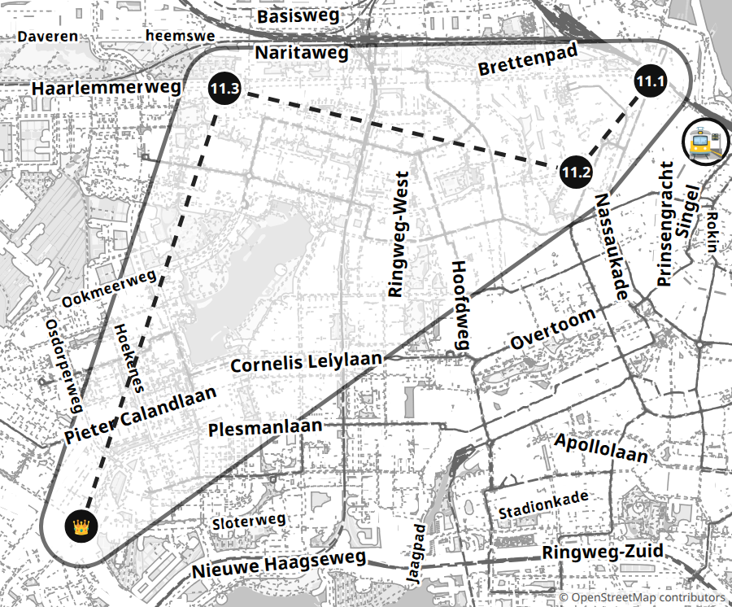

_The windmill "1200 Roe" is named after a distance: 1200 old units from the Haarlemmerpoort gate, where the city used to end._

- [ ] 11.1 🔍 **King's Gate** (🪙×2) — King Willem II rode in through this gate! Count the columns in the passage. How many on each side? 📍 [Haarlemmerpoort](https://www.google.com/maps/search/?api=1&query=52.38497,4.88308)
- [ ] 11.2 🔍 **Saw Mill** (🪙×2) — The De Otter windmill has been a sawmill for almost 400 years! It turns to face the wind all in one piece, little house and all. Find it on the canal. 📍 [De Otter, Gillis van Ledenberchstraat 78](https://www.google.com/maps/search/?api=1&query=52.37609,4.87119)
- [ ] 11.3 📏 **Giant's Measure** (🪙×3) — The De 1200 Roe windmill stands 1200 "roe" from the Haarlemmerpoort gate. One roe is almost 4 metres! Guess: how many times do you fit into one roe lying down? A parent marks it out with 5 big steps, and you lie down like a caterpillar: stand up where the top of your head was, and lie down again. 📍 [De 1200 Roe, Haarlemmerweg 701](https://www.google.com/maps/search/?api=1&query=52.38424,4.81512)
- [ ] 11.4 ⚔️ **I'm a Windmill!** (🪙×2+1) — Your arms are windmill sails! Make big circles with straight arms. Who can keep turning longer? Arm down or stopped? You're out.
- [ ] 👑 **Zone boss: Inside the Windmill** (🪙×6) — Climb inside the working Molen van Sloten windmill! In the attic, find people from Rembrandt's paintings: he was a miller's son. And where is the screw that lifts the water? 📍 [Molen van Sloten, Akersluis 10](https://www.google.com/maps/search/?api=1&query=52.3416,4.79227)

Coins needed: **10** 🏁

## 🌳 Zone 12: Amsterdamse Bos

🚌 Bus to the Bosbaan entrance. In spring: the historic tram.

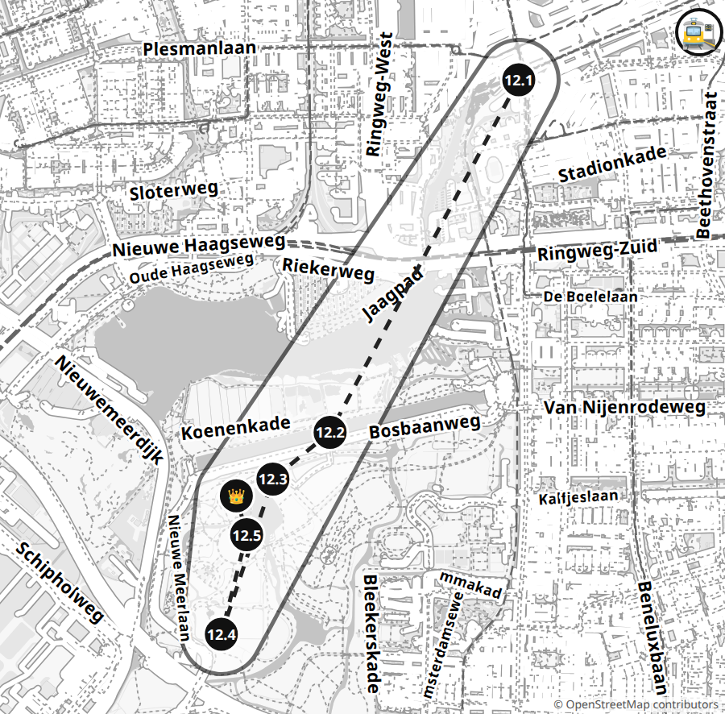

_People planted this huge forest! Work started in 1934. The forest has 116 bridges, and goats, cows and ponies live here._

- [ ] 12.1 🚋 **Old Tram** (🪙×4) — Only in spring and summer: ride to the forest on the historic tram from Haarlemmermeerstation! 📍 [Haarlemmermeerstation](https://www.google.com/maps/search/?api=1&query=52.34934,4.85672)
- [ ] 12.2 📏 **Rowing Canal** (🪙×3) — By the Bosbaan canal, time how many minutes it takes you to walk 100 metres. The canal is 2200 metres: that's 22 times 100. How many minutes for the whole thing? 📍 [Bosbaan](https://www.google.com/maps/search/?api=1&query=52.32616,4.8364)
- [ ] 12.3 ⚔️ **Weighted Bridges** (🪙×2+1) — The forest has little bridges with bright round balls. Who can find more? The balls are weights: they help the bridge lift up! 📍 [Bridges around the Grote Speelweide](https://www.google.com/maps/search/?api=1&query=52.323,4.83)
- [ ] 12.4 🔍 **Goat Farm** (🪙×3) — Find the Ridammerhoeve goat farm and pet a kid goat! Guess how many goats are in one pen, then count them. 📍 [Geitenboerderij Ridammerhoeve, Nieuwe Meerlaan 4](https://www.google.com/maps/search/?api=1&query=52.31287,4.82469)
- [ ] 12.5 🏃 **Wheelbarrow Monument** (🪙×2) — On the Big Meadow, find the wheelbarrow monument: this forest was built with wheelbarrows! Then run to the middle of the meadow and back while a parent times you. 📍 [Grote Speelweide](https://www.google.com/maps/search/?api=1&query=52.32017,4.82715)
- [ ] 👑 **Zone boss: Forest Boat with a Passenger** (🪙×6) — By the water at the Speeleilanden, build a boat from sticks, bark and leaves: only things that have fallen on the ground. Put a passenger on it: an acorn or a pebble. The boat must float for 10 seconds without the passenger falling into the water! 📍 [Speeleilanden, Grote Vijver](https://www.google.com/maps/search/?api=1&query=52.3213,4.8268)

Coins needed: **11** 🏁

---

## 👨‍👩‍👦 For parents

**Start:** Start — Amsterdam Centraal

### Plan

- **Outing 1 · Sun 15 November:** Zones 4 + 5 with Sinterklaas. 9:45 start at Centraal → Schreierstoren → Zeedijk → Waag → Kloveniersburgwal 26 (~1.5 h). By 11:00 head to the Scheepvaartmuseum: around 11:30 (the 2026 time is not published yet) Sinterklaas's steamboat arrives (challenge 5.4). Lunch, NEMO roof, the ship Amsterdam. Finish ~16:00.
- **Outing 2 · weekend day:** Zones 1 + 2 on foot from Centraal. Morning on the islands (farm opens at 9), Damrak quays, Brouwersgracht, apple pie at Winkel 43, Bloemgracht, Westerkerk, House with the Heads.
- **Outing 3 · weekend day:** Zones 3 + 10. Dam, Begijnhof, Spui, fries (Sun from 12), LEGO (Sun from 11:30). Metro 52 from Rokin to De Pijp → Sarphatipark → Rijksmuseum (~14:00).
- **Outing 4 · weekend day:** Zones 6 + 7. Tram 14 to Pontanusstraat → De Gooyer → Funenpark → Artis → Micropia (~11:00) → ~20 min walk to Rietlandpark → Python → Java → KNSM.
- **Outing 5 · weekend day:** Zones 9 + 8. Morning in Westerpark (Amsterdam in Motion, timed slot). Tram or walk (~30 min) to Centraal → ferry F4 behind the station (challenge 8.1) → NDSM → pancakes → A'DAM at sunset (~16:30 in winter) → ferry F3 to Centraal.
- **Outing 6 · weekend day:** Zones 11 + 12, a long day with buses. Molen van Sloten closes at 16:00 in winter, so start at the gate at 9:30. Or in spring (April 2027) on a Sunday: then you can take the historic tram (challenge 12.4).
- **Outing Bonus:** Amsterdam Light Festival 26.11.2026–17.01.2027, lights from 17:30: the Kids Walk in the app (quiz, small prize). Ice rink on Museumplein from ~14.11, good on the zone 10 day.

### 🎟️ Tickets and bookings

🎟️ **🚋 Kid's travel: Kids Vrij** _(arrange in advance)_

- When: Until 3.01.2027, daily 7:00–21:00 (GVB tram, bus, metro)
- Where: Online (personal OV-chipkaart) + GVB
- How: 1) Order a personal OV-chipkaart for the kid at ov-chipkaart.nl (with photo). 2) Load the free Kids Vrij product onto it following GVB's instructions (gvb.nl, search "Kids Vrij"). 3) On board, tap the card when getting on and off. Adults pay by bank card (OVpay). Ferries are free for everyone.
- Price: Kids Vrij is free for Amsterdam kids aged 4–11; check the price of the card itself. Without it: GVB child day ticket €5. From 2027 free travel for kids 4–11 nationwide is promised; check the rules.
- https://www.gvb.nl

### 🛍️ Bring / buy

- Stickers ~2 cm (for 12 zones + the map), a pen, glue or tape for the collection, a kid's camera (photo challenges), a die
- At home before the first outing: measure the kid's step with a tape (10 steps ÷ 10), height and palm; time one floor up the stairs with a stopwatch. Write them on the hunt card. Stopwatch on the phone
- The kid's OV-chipkaart with Kids Vrij, a parent's Museumkaart, a bank card (many tills take no cash)
- Wet wipes (pancakes, fries), spare trousers (Woeste Westen, the forest raft), warm clothes for the ferries

### 💡

- Does the kid speak Dutch? Let them order and ask where there are definitely people (ticket desks, stalls, cafés). There is often nobody at the farms.
- Measuring: the kid counts the steps; help multiply the big numbers. Answers are on the zone pages.
- ⏱ Timed challenges are for letting off steam at playgrounds. Didn't work? Second try.
- Make any challenge harder: eyes closed (holding hands), on one leg, a hand behind the back. Parents also use this to even out the duels.
- ⚔️ Duels: the card shows "🪙×2+1": the kid gets 2 coins even when losing; the last +1 only for winning (the duel column on the scoreboard).
- 🌀 A curse lasts until the next finished challenge. A failed attempt is not a skip: try again; a curse only comes for an honest skip.
- 🧭 Give the kid the zone map and follow; "warmer-colder" is allowed.
- Everything is open on Sundays too (LEGO from 11:30, fries from 12). Markets Noordermarkt (Sat) and Albert Cuyp (Mon–Sat) are a bonus. Farms: De Dierencapel is closed on Mon, the goat farm on Tue (and on Mon from November).
- Zone 4: stay on Zeedijk and Nieuwmarkt, don't turn into the alleys to the west: red-light district.
- The quays almost never have railings: hold hands by the water.
- The Begijnhof is a residential courtyard: quiet, no running.
- It gets dark ~16:30 in November–December: the finish at A'DAM (zone 8) is just in time for the city lights.
- Rank counts all coins earned (the "Coins" column with 🧭 + the hunt); spent coins don't lower the rank.

### 🔑 Answers and hints

#### 🏝️ 1. Western Islands

_The three man-made islands (Bickers-, Prinsen-, Realeneiland) were built up from 1610–1615 as an extension of the port: shipyards, tar works, herring smokehouses, warehouses. At first they were called the Front, Middle and Rear islands, later named after Jan Bicker, the Princes of Orange and the Reael family. In the late 19th century ships became too big and the islands emptied; after the war artists rediscovered them._

- Centraal → Zandhoek → Drieharingenbrug → Prinseneiland → Galgenstraat → Bickersgracht → Centraal. ~4 km, 1.5–2 h
- Everything outdoors; the farm Tue–Sun 9–17 (no staff needed for the charades)
- Free
- Cafés on Haarlemmerdijk
- **1.1 Golden Coin:** [Zandhoek](https://www.google.com/maps/search/?api=1&query=52.38769,4.88993) — ✔ Zandhoek 14, the stone "De Gouden Reael": a real coin with Emperor Charles V.
  The real was a Spanish-Portuguese silver coin used everywhere in the early 17th century; the version from the time of Charles V showed the emperor's bust. The coin hung as a sign on the house of Laurens Reael (later Governor-General of the East Indies), and the family took its surname from it. Around 1620 Reynier Reael bought up plots on the Rear Island, and around 1624 the island was named after him. In 1648 the family built a warehouse here (according to nl-Wikipedia, a herring-packing house) with the same coin on the stone. Around 1800 an inn called "De Gouden Reael" opened in the house, and the whole neighbourhood took its name from it. Today it is a restaurant. For the kid: "The coin gave its name to a family, the family to an island, and the house to a whole neighbourhood!"
- **1.2 Captains' Row:** [Zandhoek, row of houses](https://www.google.com/maps/search/?api=1&query=52.38745,4.8901) — ✔ 13 houses, nos. 2–14. Calculation: steps for one house × 13 (= 10 times + 3 times). Compare with what you walked.
  Reynier Reael built 13 identical "captains' houses" (nos. 2–14) around 1645–46; the monuments register dates nos. 2, 3 and 5 to 1657. Which captains rented them, the sources don't say: these are not merchant mansions like on the canal ring but a modest row of rental houses. Basements and upper floors were let separately, and some still have split doors so you could chat with the neighbour over the top half. Until 1832 the houses stood right on the open water of the IJ; then the Westerdoksdijk cut them off from the river. Sand for raising the streets was unloaded here, hence Zandhoek, "sand corner". In 1943 the houses were protected so that a tobacco factory couldn't demolish them. For the kid: "From these windows you used to see a sea of ships!"
- **1.3 Shipyard Birds:** [Prinseneiland](https://www.google.com/maps/search/?api=1&query=52.38615,4.88624) — ✔ Check the photo yourselves. A coot is black with a white beak and a white "bald" patch; herons often stand on boats and poles. Didn't work? Try by the farm (ducks, geese).
  Prinseneiland was sold in plots from 1623, mostly for timber and tar warehouses; it was probably named after the first Princes of Orange. There were "more than 60" or "more than 100" warehouses here (sources disagree) out of the city's ~900 stone warehouses. The warehouses of the Western Islands stored herring, grain, tobacco, wine, salt, pitch, tar, and yes, cat skins. Warehouses have "nose" gables, hoisting beams with hooks under the roof and shutter hatches; the shutters often name the goods or the city they traded with. Under a shelter by Galgenstraat there is still a winch used to lift barrels of tar from boats. Since the 1950s artists and ordinary residents have lived in the warehouses. Words are still visible on the warehouse shutters: the goods or a city they traded with (for example "Schelvis", haddock). For the kid: "The word on the shutters is what was stored here 300 years ago!"
- **1.4 ⏱ Playground Minute:** [Playground, Bickersgracht](https://www.google.com/maps/search/?api=1&query=52.38563,4.88869) — ✔ Self-check: a parent counts the touches out loud. Didn't work? Second try.
  A small playground on Bickerseiland (in OSM, without a name). For the kid: "Where you're running, 400 years ago they were tarring boats!"
- **1.5 Farm Charades:** [Kinderboerderij De Dierencapel, Bickersgracht 207](https://www.google.com/maps/search/?api=1&query=52.38597,4.88874) — ✔ No staff needed: look into the yard (sheep, goats, pigs, rabbits, guinea pigs, ducks, geese, chickens). Fewer than 3 guessed? A new set of five. The farm is open Tue–Sun 9–17, closed Mon.
  A children's farm by the water on Bickerseiland; it sells eggs and drinks. The island itself was bought in 1631 by the regent Jan Bicker: about 10 shipyards and a mansion with a tower, from which he watched his ships being built. For the kid: "Where the goats are now, they used to build ships!"
- **👑 Bridge 320:** [Drieharingenbrug](https://www.google.com/maps/search/?api=1&query=52.38687,4.88727) — ✔ Drieharingenbrug, the "Bridge of the Three Herrings". The bridge is narrow and bikes ride over it: start when there are no bikes; a parent walks behind and says "stop" if needed. It usually takes 2–3 tries. In 2024 there was a temporary bridge (replacement); check what is there now. If the number isn't visible, count it by the name.
  A double drawbridge over the Realengracht between Realeneiland and Prinseneiland. In 1625 there was a lift bridge with nine spans here; in 1737 it was nicknamed the "Flying" bridge, apparently because it opened fast; in 1859 it became a pontoon bridge, and the current narrow foot-and-bike bridge dates from 1983. The name comes from a stone with three crowned herrings on the corner house at Vierwindendwarsstraat 1; around 1676 a distillery called "De Drie Gecroonde Haringen" worked nearby. Amsterdam's bridge numbers are not in order: a bridge that disappears takes its number with it. For the kid: "Find the three herrings with crowns on the house by the bridge!"

#### 🌷 2. Jordaan and Canals

_Brouwersgracht (the "brewers' canal", from 1594) separates the Jordaan, a craftsmen's neighbourhood, from the rich 17th-century canal ring with the Keizersgracht and the Westerkerk. In 2007 readers of Het Parool voted Brouwersgracht the most beautiful street in the city._

- Centraal (Damrak piers) → Haarlemmersluis → Brouwersgracht → Noordermarkt → Bloemgracht → Westerkerk → Keizersgracht 123 → Centraal. ~3.5 km, 2 h
- Everything outdoors except Winkel 43 (daily, Sun from ~9–10). On Saturday the Noordermarkt market is also on the square (9–16): a bonus, not required
- Pie ~€5–7
- Winkel 43 (queue on Saturday because of the market; you can take it away)
- Winkel 43
- **2.1 Three Fleets:** [Piers at Damrak / Prins Hendrikkade](https://www.google.com/maps/search/?api=1&query=52.3773,4.8968) — ✔ Most of them by Damrak and Prins Hendrikkade: Stromma (Damrak piers), Lovers (orange, Prins Hendrikkade); also Flagship, Blue Boat, the small open boats of Those Dam Boat Guys (by the Westerkerk). Any name on the side counts; you can collect them along the whole route.
  The 17th-century canal ring (Herengracht, Keizersgracht, Prinsengracht and Singel) was added to the UNESCO World Heritage list in 2010. Today millions of tourists ride the canals every year; the main piers for canal cruises are opposite the station, on Damrak and Prins Hendrikkade. For the kid: "The canals used to carry goods to the warehouses, and now they carry people looking at those warehouses!"
- **2.2 Corner Warehouses:** [Brouwersgracht 200–207](https://www.google.com/maps/search/?api=1&query=52.38161,4.88702) — ✔ No. 200 Vijfhoek ("five corners"), no. 205 Vierhoek ("four corners"), no. 207 Driehoek ("three corners"); the island is no. 204 Spitsbergen.
  The canal is named after the 16th–17th-century breweries, although by 1664 only 3 of the city's 22 breweries stood on it. The warehouses have their own names because houses had no numbers back then: nos. 188–196 De Appel, Grouwe Valk, Groene Valk, De David, Koning David; no. 199 De Liefde; no. 206 "Little Green Deer", no. 210 "Big Green Deer". According to tourist sources they stored coffee, spices and leather (unconfirmed). Almost all the warehouses are now flats. For the kid: "Warehouses are like dogs: each one has its own name!"
- **2.3 Dutch Pie:** [Winkel 43, Noordermarkt 43](https://www.google.com/maps/search/?api=1&query=52.37908,4.88623) — ✔ "Een appeltaart met slagroom, alstublieft". A slice is ~€5–7 (price not found). Open every day: Mon–Sat from the morning, Sun from ~9–10 (sources differ). On Saturday there is a queue because of the market.
  According to the Michelin Guide, Winkel 43's five bakers peel apples every day and bake up to 140 pies. Queues are worst on market days: the Saturday farmers' market and the Monday flea market on the Noordermarkt. A Dutch apple pie recipe was written down in a cookbook as early as 1514 (unconfirmed). For the kid: "The Dutch have been baking this pie for more than 500 years!"
- **2.4 Three Brothers:** [De Drie Hendricken, Bloemgracht 87–91](https://www.google.com/maps/search/?api=1&query=52.37428,4.8797) — ✔ De Drie Hendricken, Bloemgracht 87–91 (1642). The sailor is De Seeman, no. 91.
  Three twin houses with stepped gables from 1642 in the Amsterdam Renaissance style. The stones show De Steeman (townsman, no. 87), De Landman (farmer, no. 89) and De Seeman (sailor, no. 91): symbols of three ways of life, not the jobs of the residents; the captions were added later. Lonely Planet links the "Three Hendricks" to the architect Hendrick Roelofs (unconfirmed). Since the 1920s the houses have belonged to the Vereniging Hendrick de Keyser, a society that rescues old houses. For the kid: "Town, country, sea: three brothers, three lives!"
- **2.5 House of Heads:** [Huis met de Hoofden, Keizersgracht 123](https://www.google.com/maps/search/?api=1&query=52.37634,4.88745) — ✔ 6 heads. The winged helmet is Mercury, the ears of wheat are Ceres. They are Roman gods, not thieves.
  A double house from 1622 built for the merchant Nicolaes Sohier; the facade is attributed to Hendrick de Keyser. The legend (from the 17th century): six burglars climbed into the house, and the deaf cook killed them one by one with an axe; as a reward the owner put the heads on the facade, and the seventh, "missing" head is supposedly the maid herself. In a 1911 version there were seven thieves. As early as 1861 the story was called made up. In reality these are busts of six Roman gods, about 1 m tall: Apollo (laurels), Ceres (ears of wheat), Mercury (winged helmet), Minerva (plumed helmet), Bacchus (grapes), Diana (crescent moon). Mercury (trade) and Minerva (wisdom) are by the entrance: the owner, the arms king Louis de Geer, wanted to present himself as a "wise merchant". From 1656 to 1670 the educator John Amos Comenius lived here; today it is the Embassy of the Free Mind museum. For the kid: "Find each head's symbol!"
- **👑 Tower Crown:** [Westerkerk](https://www.google.com/maps/search/?api=1&query=52.37455,4.88399) — ✔ The crown is blue (it was gold from 1906 to 2006). The tower has 51 bells; a short tune usually plays before the clock strikes (exact schedule unconfirmed; wait by the tower up to 15 min). Carillon concert on Tuesdays at noon (check).
  The Westerkerk was built in 1620–1631 to a design by Hendrick de Keyser; its 87 m tower is the tallest church tower in the city, and the carillon has 51 bells. Rembrandt was buried here in 1669 as a poor man; exactly where is unknown. Anne Frank writes in her diary about this tower's clock. Why a crown: in the 1480s Amsterdam lent money to Maximilian of Habsburg and in return got the right to a crown in its coat of arms (in 1497 the city even paid to have it confirmed). The crown on the tower (1638) is copied from the crown of Emperor Rudolf II. It was gilded for Rembrandt's 300th anniversary in 1906 and painted blue again in 2006. For the kid: "The city got its crown for lending the emperor money!"

#### 👑 3. Dam and Secret Courtyard

_Dam Square grew up by the dam on the Amstel that gave the city its name. The palace was built as the town hall, a symbol of Golden Age wealth. A couple of minutes from busy Kalverstraat hides the Begijnhof, a quiet courtyard where single religious women have lived since the Middle Ages._

- Dam → rear facade of the palace → Begijnhof (entrance from Spui) → Spui → Voetboogstraat → Kalverstraat 57 (LEGO). ~2 km, 1.5–2 h
- LEGO Sun from 11:30
- Fries ~€5; Pick & Build: price on the wall
- Vleminckx
- None in the LEGO Store; cafés on Spui

🎟️ **🧱 LEGO Store (zone 3)** _(no booking)_

- When: Mon 11–20, Tue/Wed/Fri/Sat 10–20, Thu 10–21, Sun 11:30–18:30
- Where: Kalverstraat 57
- How: If you have a LEGO passport, ask for a stamp at the till. Ask a staff member whether you can build at the demo table ("Mag ik hier bouwen?"); you can call ahead on +31 20 793 0620. If not, a small paper Pick & Build box from the wall.
- Price: Free entry. Pick & Build: paper boxes in several sizes, price on the wall (the cup used to be ~€9–16)
- https://www.lego.com/en-nl/stores/store/amsterdam

- **3.1 Giant with a World:** [Koninklijk Paleis, rear facade (Nieuwezijds Voorburgwal)](https://www.google.com/maps/search/?api=1&query=52.37322,4.8906) — ✔ Atlas is dark bronze, the globe is light green (after the 2024–26 restoration). The rear pediment shows "the four continents bringing gifts": an elephant and a lion (Africa), a camel and a crocodile with a boy riding it (Asia), an armadillo and a monkey (America). On the dome is a golden ship weathervane. If Atlas is still under scaffolding, find the lady with a snake (Prudence) and the sea horses in the front pediment.
  The palace was built in 1648–1665 as the town hall, then the largest building for a city government in Europe; it became a palace under Louis Bonaparte in 1808. The bronze statues on the roof, from sketches by Artus Quellinus, were cast by the Hemony brothers. Atlas (about 6 m, the globe almost 4 m and about 1,000 kg) stands at the back between Temperance and Vigilance. In July 2024 the globe was taken down for restoration; in spring 2026 Atlas returned, dark again, while the globe stayed light green. The weathervane shows a cog with two little men and a dog: according to legend, a ship without a rudder ran aground where Amsterdam was founded. For the kid: "The city was so rich it carried the whole world on its shoulders!"
- **3.2 Secret Courtyard:** [Begijnhof, Het Houten Huys](https://www.google.com/maps/search/?api=1&query=52.36911,4.88971) — ✔ Begijnhof, house no. 34, about 500 years old. People live in the courtyard, so speak quietly!
  The courtyard was first mentioned in 1389; it was home to Beguines, Catholic laywomen who lived alone, prayed and nursed the sick, but could leave and marry. The last Beguine died in 1971; today single women live here. No. 34 is one of two wooden houses in the centre (the other is In 't Aepjen, zone 4); only its front and back walls are wooden, and the upper floor sticks out in the medieval fashion. The date is disputed: around 1420 or around 1528. Wooden houses were later banned because of fires. Behind the ordinary facades of nos. 29–30 a Catholic "hidden church" (1671–80) is tucked away. The entrance from Spui was only made in the 19th century. For the kid: "This wood is 500 years old and the house is still standing!"
- **3.3 Bronze Rascal:** [Het Lieverdje, Spui](https://www.google.com/maps/search/?api=1&query=52.36878,4.88903) — ✔ "Het Lieverdje" (1960). Foot on the ground? Start the count again.
  "Lieverdje" ("little darling") is what the journalist Henri Knap called Amsterdam's street kids in 1947: mischievous but good-hearted. The statue was made by Carel Kneulman; readers' donations weren't enough for the bronze, so the cigarette company Crescent paid for it. That is why in the 1960s the "anti-smoking magician" Robert Jasper Grootveld held night-time happenings against smoking and consumerism at the statue; clashes with the police around them gave rise to the Provo movement. The statue has been painted, dressed up, once stolen, and hit by trucks in 2012 and 2024. It is part of the Amsterdam Canon. For the kid: "This rascal is the symbol of all the mischievous kids of Amsterdam. Like you!"
- **3.4 Fries with Mayo:** [Vleminckx, Voetboogstraat 33](https://www.google.com/maps/search/?api=1&query=52.3679,4.89102) — ✔ Sat 11–19, Sun 12–19 (according to unofficial sources). There is usually a queue.
  Vleminckx is a tiny window selling Flemish fries, since 1957 according to most sources. Its nickname "Sausmeester" ("sauce master") comes from its dozens of sauces. A popular choice is "oorlog" ("war"): mayonnaise, peanut sauce and onion. For the kid: "Fries with a sauce called 'war'!"
- **3.5 A Thousand Pieces:** [LEGO Store, Kalverstraat 57](https://www.google.com/maps/search/?api=1&query=52.3712,4.892) — ✔ Examples (2026): 11387 Holiday House 1354, 11383 Mayor Manor 1420, 10295 Porsche 911 1458, 11381 Jaguar E-Type 1673, 11379 Book Nook 1690, 11386 Bikini Bottom 1794. What is on the shelves is unconfirmed. The piece count is on the box.
  The LEGO flagship store opened on 29.11.2019: visitors were greeted by a 3.3 m windmill made of ~886,000 bricks, heavier than a car (over 1.8 t). Other models included the Munttoren, canal houses and an Escher-style staircase; the store has a Pick & Build wall, Build a Minifigure, a demo table and a minifigure factory. At the opening there was a "Build a Boat" corner with a LEGO canal; whether it still runs is unconfirmed.
- **👑 Record Tower:** [LEGO Store, Kalverstraat 57](https://www.google.com/maps/search/?api=1&query=52.3712,4.892) — ✔ Ask whether you can build at the demo table ("Mag ik hier bouwen?", tel. +31 20 793 0620). If not, buy the smallest Pick & Build box from the wall (now paper boxes, price on the wall) and build with it right in the store. No need to bring your own bag of LEGO. If you have a LEGO passport, ask for a stamp.

#### 🏯 4. Nieuwmarkt and the Waag

_Zeedijk is a former sea dyke, the oldest part of the city by the port: sailors set off to sea from here and came back here. The Waag and the Schreierstoren are pieces of the medieval city wall. Today Zeedijk is Chinatown._

- Centraal → Schreierstoren → along Zeedijk → Nieuwmarkt (Waag) → Kloveniersburgwal 26. ~1.5 km, 1–1.5 h. Stay on Zeedijk: the alleys to the west are the red-light district
- Everything outdoors
- Free
- Cafés on Nieuwmarkt
- **4.1 Traveller's Tower:** [Schreierstoren](https://www.google.com/maps/search/?api=1&query=52.37636,4.90224) — ✔ The stone is from 1569 (a weeping woman and a ship on the waves). On the left side of the tower is a 1927 plaque to Hudson; there is also a stone for the first voyage to the East Indies (1595).
  The defensive tower, from around 1487, stood where the wall made a sharp turn, hence the old name Schrayershoucktoren, "sharp corner tower". Wikipedia calls the pretty legend of sailors' wives "weeping" (schreien) here made up, but the 1569 stone with a weeping woman is there. It is Amsterdam's only surviving defensive tower; until 1960 it housed a harbour office, now a café. On 4 April 1609 Henry Hudson left from here on the "Halve Maen" to look for a route to Asia, and found the river where New Amsterdam, the future New York, later grew. For the kid: "A ship left from here and found the place for New York!"
- **4.2 Monkey House:** [In 't Aepjen, Zeedijk 1](https://www.google.com/maps/search/?api=1&query=52.37631,4.90015) — ✔ In 't Aepjen, Zeedijk 1 (1546–1550). It is a bar: look from the outside only.
  A house from 1546–1550: its wooden frame still holds up the upper floors, and inside is an oak spiral staircase. The legend: this was an inn where sailors paid with monkeys, and the monkeys' fleas bit the guests, supposedly the origin of the saying "in de aap gelogeerd zijn" ("to be in a fix"). There are no records of an inn: the name came from a 16th-century resident, Jan Claesz "int Aepgen", and it is already on a 1544 map. Today there is a bar downstairs. For the kid: "Imagine paying for the night with a monkey!"
- **4.3 Chinese Palace:** [He Hua Temple, Zeedijk 106–118](https://www.google.com/maps/search/?api=1&query=52.37361,4.90013) — ✔ He Hua Temple, opened in 2000 in the presence of Queen Beatrix.
  A Buddhist temple of the Fo Guang Shan order, built in the style of a Chinese palace and opened in September 2000 by Queen Beatrix. Wikipedia calls it the largest temple in this style in Europe; better to present that as "they say". You can go in quietly, without photographing people. For the kid: "This is how palaces are built in China: the roof corners point at the sky!"
- **4.4 Guild Doors:** [De Waag, Nieuwmarkt](https://www.google.com/maps/search/?api=1&query=52.37269,4.90039) — ✔ 4 guilds: smiths, painters, masons, surgeons. Theatrum Anatomicum is the surgeons' entrance.
  This was the city gate Sint-Antoniespoort; it is traditionally dated to 1488, but historians allow for ~1425. It is the oldest non-church building in Amsterdam. In 1617–18 the gate was turned into a weigh house, and four guilds moved in upstairs, each with its own entrance: smiths, painters, masons (their entrance was decorated by Hendrick de Keyser) and surgeons. In the surgeons' hall bodies were dissected in anatomy lessons; the guild commissioned Rembrandt's "The Anatomy Lesson of Dr Nicolaes Tulp" (1632), and the painting hung here until 1828. The domed anatomy theatre was added in the 1690s. Today there is a restaurant downstairs. For the kid: "Doctors learned here how a person works inside!"
- **4.5 One-Leg Turrets:** [De Waag, Nieuwmarkt](https://www.google.com/maps/search/?api=1&query=52.37269,4.90039) — ✔ Count together on the spot: you can't see them all from one side, so walk around the building and add them up.
  The Waag is the former Sint-Antoniespoort city gate of 1488, hence the round towers. When the city grew beyond its walls, the gate became a weigh house (from 1617), and the guilds moved in upstairs: each with its own entrance and a sign above the door. For the kid: "Goods were weighed here, and now you're weighing your balance!"
- **👑 Door-Wide House:** [Kleine Trippenhuis, Kloveniersburgwal 26](https://www.google.com/maps/search/?api=1&query=52.37163,4.8989) — ✔ Kleine Trippenhuis 2.44 m (≈ 5 kid's steps); the Trippenhuis (no. 29) opposite is over 22 m. 22 ÷ 2.44 ≈ 9 little houses. The big one has 7 windows in a row.
  The Trippenhuis was built in 1660–62 for the brothers Lodewijk and Hendrick Trip, dealers in weapons, copper and tar: it is two mirror-image houses behind one facade, and the chimneys on the roof are shaped like mortars. More than 22 m wide, it is the widest house in the city; from 1816 to 1885 it held the Rijksmuseum with "The Night Watch", and now the Academy of Sciences. Opposite is the Kleine Trippenhuis, 2.44 m wide (widening to ~6 m at the back). The legend of the coachman who sighed "if only I had a house as wide as your door" is made up: the little house was finished in 1696, when both brothers were already dead. For the kid: "How many of these little houses fit into the big one? Let's measure!"

#### ⚓ 5. Ships and NEMO

_Everything around here is a former naval harbour: in the 1650s the city built islands to the east, and on Kattenburg the Admiralty set up a shipyard and navy storehouses. NEMO stands right above the entrance to the road tunnel under the IJ._

- Centraal → NEMO roof → Scheepvaartmuseum. ~1.5 km on foot + museum 2 h
- Museum daily 10–17; NEMO roof daily
- Museum: adult €18.50, free under 12, 13–17 €8.50 (Museumkaart valid)
- Café in the museum
- Museum

🎟️ **⚓ Het Scheepvaartmuseum (zone 5)** _(tickets online or at the desk)_

- When: Daily 10–17 (closed 25.12 and 1.01). 15.11 is Sinterklaas day: it will be crowded
- Where: Kattenburgerplein 1
- How: hetscheepvaartmuseum.com → Tickets → adult + child. Show the Museumkaart at the entrance. Card payment only. Inside: a free Junior children's audio guide and a "Sea Monsters" sheet in the café.
- Price: Adult €18.50, child under 12 free, 13–17 €8.50 (the family page also says "free under 4": sources disagree)
- https://www.hetscheepvaartmuseum.com/visit/opening-hours-and-admission

🎟️ **🎅 Sinterklaas arrives (zone 5)** _(no booking)_

- When: Sun 15.11.2026: start ~10:30 from De Omval, at the Scheepvaartmuseum ~11:45; ~13:15 on horseback on Waterlooplein, ~15:00 Leidseplein
- Where: Quay by the Scheepvaartmuseum
- How: Arrive by ~11:15 and stand by the water. The city publishes exact times and road closures in November (sintinamsterdam.nl).
- Price: Free
- https://www.sintinamsterdam.nl/

🎟️ **🔬 NEMO inside (zone 5, optional)** _(book a time slot)_

- When: Tue–Sun 10–17:30
- Where: Oosterdok 2
- How: nemosciencemuseum.nl → Tickets → entry time (also with Museumkaart). The zone only needs the free roof.
- Price: ~€21.50 from age 4 (unconfirmed), Museumkaart valid
- https://www.nemosciencemuseum.nl/en/visit/tickets

- **5.1 ⏱ Roof Record:** [NEMO roof, Oosterdok 2](https://www.google.com/maps/search/?api=1&query=52.37385,4.91211) — ✔ Write the time on the card. The roof is free, stairs on the east side; reopened after renovation on 23.05.2025, daily 10–17:30 according to iamsterdam (winter and Monday hours unconfirmed). Closed in bad weather.
  The building was designed by Renzo Piano and opened in 1997 by Queen Beatrix. It stands over the entrance of the 1960s IJ tunnel, and its curve follows the curve of the tunnel: the building rises out of the water while the cars dive down beneath it. The facade is oxidised green copper; the square on the roof is 22 m up, with more than 75 kinds of plants. The likeness to a ship is something guidebooks point out, not the architect. For the kid: "There's a tunnel under you, and right now cars are driving through it under the water!"
- **5.2 Wind Rose:** [Het Scheepvaartmuseum, courtyard](https://www.google.com/maps/search/?api=1&query=52.37201,4.91495) — ✔ The courtyard roof copies the compass lines from old charts (1,200 panes of glass).
  The 's Lands Zeemagazijn was built in 1655–56 as the Admiralty arsenal: cannons, ropes and gunpowder for the navy after a lost war with England. It stands on 2,300 poles; in 1791 a fire gutted it, so the brick was plastered to look like sandstone, which is why the building is white. The navy used it until 1973, when the museum opened. The glass courtyard roof (1,200 panes, each cut separately because the building is crooked) was designed by Laurent Ney after the compass lines on old sea charts. For the kid: "Cannons were kept here, and now the roof has become a compass."
- **5.3 Inside the Whale:** [Het Scheepvaartmuseum, "Tale of the Whale"](https://www.google.com/maps/search/?api=1&query=52.37215,4.9147) — ✔ On the museum floor plan: "Het verhaal van de walvis" (The Tale of the Whale), west wing, 1st floor, 6+. You enter through the mouth of a bowhead whale; the last room (with WWF) is about the "plastic soup". Exactly which rubbish is shown is unconfirmed: count any 5 different kinds seen in the room (bottle, bag, battery…). Permanent exhibition.
  The children's exhibition starts with a life-size bowhead whale: you walk in through its mouth, and at the end its tail disappears under water. It tells how people have seen whales: as sea monsters, as prey for whalers (the Dutch hunted them too) and finally as endangered animals; the last room was made with WWF and is about plastic in the ocean. For the kid: "The whale will swallow you and let you out again!"
- **5.4 Sinterklaas Is Here!:** [Quay by Het Scheepvaartmuseum](https://www.google.com/maps/search/?api=1&query=52.3724,4.9142) — ✔ "Welkom, Sinterklaas!" Sun 15.11.2026; the time is not published yet (in 2025: left De Omval ~10:00, at the museum ~11:30). Arrive by ~11:00; very crowded.
  According to legend, Sinterklaas arrives by steamboat from Spain. Amsterdam has celebrated his arrival since 1934 (the chamber of commerce came up with it to start the shopping season), and it has been on TV since 1952. Back then there was a small boat and seven Piets; now there is a big steamboat and about 400 Piets. Route: from De Omval along the Amstel to the Scheepvaartmuseum, then a parade to Leidseplein. The national arrival in 2026 is on 14.11 in Grave.
- **👑 Ship's Captain:** [The ship Amsterdam by Het Scheepvaartmuseum](https://www.google.com/maps/search/?api=1&query=52.37155,4.9156) — ✔ Count the gun ports on the spot, × 2. The original had 42 cannons. On board you can "fire" a cannon and look into the captain's cabin. Entry with a museum ticket.
  On the decks of the replica you can see how 300+ people lived: hammocks hung side by side, and food was cooked in a single galley. The replica has about 16 cannons (unconfirmed). For the kid: "The real Amsterdam lies in the sand in England, and you're standing on its twin!"

#### 🦁 6. Plantage and Artis

_The Plantage became part of the city in 1663, but no buyers could be found for the plots, so instead of houses it was laid out as gardens for townspeople to relax in. Across the road from Artis is the Hortus botanical garden (1638, on this site since 1682): in 1706 a coffee plant was brought here from Java, and according to a popular story its descendants gave coffee to South America._

- Tram 14 to Pontanusstraat → De Gooyer → Funenpark → ~20 min walk (or tram 14, 2 stops) → Artis gates → Micropia. ~2.5 km + Micropia 1.5 h
- Micropia daily 10–17
- Micropia: kids under 12 free, adult from €17 online (Museumkaart valid)
- Cafés by Artis
- Micropia

🎟️ **🦠 Micropia (zone 6)** _(book online)_

- When: Daily 10–17
- Where: Plantage Kerklaan 38–40 (at the ARTIS entrance)
- How: dagtickets.artis.nl → ARTIS-Micropia → date, adult + child (0–12 free). The Museumkaart is valid at Micropia but NOT at the zoo. The kid asks for the stamp card at the desk.
- Price: Child 0–12 free, adult from €17 online. The zoo is separate: adult from €29.50, child 3–12 from €25.50
- https://www.artis.nl/en/artis-micropia

- **6.1 Giant Windmill:** [De Gooyer, Funenkade 5](https://www.google.com/maps/search/?api=1&query=52.3668,4.92615) — ✔ An ostrich with an egg (with the windmill next to it): the logo of Brouwerij 't IJ. You can't go inside the windmill. ~3 min walk from the Pontanusstraat stop (tram 14).
  The last of the windmills that stood on the bastions around the city from the 17th century. It ground grain. The name comes from two owners from Gooiland (around 1609). In 1725 it was put up where the Oranje-Nassau barracks are now, and in 1814 it was moved to the foundation of a demolished water mill on Funenkade; according to a tourist website, because the barracks blocked its wind (unconfirmed). The body is octagonal; it is the tallest wooden windmill in the country. In 1972 a storm tore its sails off into the canal. Next to it is the 't IJ brewery in a former 1911 bathhouse. For the kid: "The windmill was moved like LEGO because someone blocked its wind!"
- **6.2 ⏱ 20 Trees:** [Funenpark (Oosterspeeltuin)](https://www.google.com/maps/search/?api=1&query=52.36775,4.9276) — ✔ Self-check: a parent counts out loud. The Oosterspeeltuin playground is 200 m from the windmill (equipment unconfirmed).
  Funenpark is a car-free neighbourhood next to the De Gooyer windmill: the houses stand right among lawns and trees, with playgrounds in between. For the kid: "Count how many trees you manage, while the windmill turns its sails above you the whole time!"
- **6.3 Gate Words:** [ARTIS gates, Plantage Kerklaan 38](https://www.google.com/maps/search/?api=1&query=52.36696,4.91258) — ✔ NATURA ARTIS MAGISTRA, "Nature is the teacher of art". The name is ARTIS.
  The zoo was founded in 1838 by three zoology enthusiasts; at first it was a learned society for members only. The words Natura, Artis and Magistra stood above the three gates, and usually only the middle one was open, so people saw "Artis" and decided that was the zoo's name. It is the oldest zoo in the country; three ponds inside show where the Prinsengracht ran before it was filled in in 1866. For the kid: "The zoo got its name by mistake!"
- **6.4 Kiss Microbes:** [Micropia, Kiss-o-meter](https://www.google.com/maps/search/?api=1&query=52.3668,4.91285) — ✔ Kiss-o-meter: a 10-second kiss passes ~80 million bacteria (2014 study); a kiss on the cheek far fewer. The scanner mirror follows your hands and shows microbes on your feet, hands and nose (according to a Jan 2026 blog).
  Micropia opened in 2014 and calls itself the world's first museum of microbes; in 2016 it won the award for Europe's most innovative museum. The Kiss-o-meter shows how many microbes two people pass to each other. Almost all our microbes are useful. For the kid: "Millions fit into one kiss!"
- **👑 Stamps and Water Bear:** [Micropia, Plantage Kerklaan 38–40](https://www.google.com/maps/search/?api=1&query=52.36689,4.91269) — ✔ "Mag ik een stempelkaart?" 8 legs (tardigrade). 30 stamps in total; at the end the card goes into a scanner on the ground floor, and the collected microbes appear on the screen.
  Each stamp is a different microbe; you hunt for them all over the museum. The scanner at the end shows "your" collection on a big screen. Also inside: live microbes under microscopes, a "microbe of the month", Lab Talks at 11:30, 13:30, 15:30. Kids under 12 go free.

#### 🐍 7. Eastern Docklands

_In the 1870s–1900s a deep-water harbour was built here; after the war the port moved west, in the 1970s the area emptied, in the 1980s squatters and artists moved in, and in the 1990s–2000s it was turned into residential islands. About 2/3 of the area is water._

- Rietlandpark → Pythonbrug → Java-eiland (Bogortuin) → KNSM (Loods 6, Emerald Empire). ~4 km, 2–2.5 h. Back to Centraal by bus or on foot
- Everything outdoors
- Free (kid on the tram: Kids Vrij until 3.01.2027)
- Cafés in Loods 6 / on KNSM
- **7.1 Tram 26:** [Rietlandpark stop](https://www.google.com/maps/search/?api=1&query=52.37309,4.93453) — ✔ The 3rd stop: Muziekgebouw, Kattenburgerstraat, Rietlandpark. From 31.08.2026 the terminus is Strandeiland.
  The IJtram opened in 2005 to connect the station with the new IJburg district on man-made islands: 10 km, 25 minutes. Rietlandpark sits in an open cutting 6 m below ground level, and right after it the tram dives into the 1.5 km Piet Hein tunnel. For the kid: "Further on, this tram goes underground, like a metro!"
- **7.2 Java Bridges:** [Java-eiland, Lamonggracht](https://www.google.com/maps/search/?api=1&query=52.37872,4.92736) — ✔ The number of bridges isn't published: count on the spot (there are 4 canals across the island). Whoever's number is closer wins.
  The island was built up in the late 19th century as a breakwater; a steamship company with sailings to the Dutch East Indies, especially Java, was based here. The name "Java-eiland" and the housing only came in the 1990s, to a plan by Sjoerd Soeters. The Brantas, Lamong, Majang and Serang canals are named after rivers on Java; each block has its own inner garden. The little bridges were designed by the artists Guy Rombouts and Monika Droste. The long Jan Schaefer bridge nearby is no. 2000 (2001). For the kid: "The canals are named after rivers on the other side of the world."
- **7.3 ⏱ Five Things:** [Bogortuin playground, Java-eiland](https://www.google.com/maps/search/?api=1&query=52.37755,4.93507) — ✔ Self-check. What is at the playground is unconfirmed (only a point in OSM); if there's not much, a bench and a tree count too.
  Bogortuin is one of the inner gardens on the Java blocks (see 7.2). For the kid: "You're playing in a courtyard surrounded by houses and water on every side!"
- **7.4 Harbour Crane:** [Crane by Loods 6, KNSM-laan](https://www.google.com/maps/search/?api=1&query=52.37734,4.93906) — ✔ 2868.
  KNSM stands for Koninklijke Nederlandsche Stoomboot-Maatschappij, the "Royal Dutch Steamship Company": it came to the island in 1903 and left in 1977. The 1957–58 Figee crane loaded ships until 1979 and was the only one left when housing was built here; it was restored in 2016, and since 2018 it has an apartment inside for overnight stays. Loods 6 is a KNSM warehouse, now workshops. Nearby is the Amphitrite fountain, a gift from the staff for the company's 100th anniversary (1956). For the kid: "For 20 years the crane loaded ships, and now guests sleep in it!"
- **7.5 House in the Water:** [Emerald Empire, KNSM-eiland](https://www.google.com/maps/search/?api=1&query=52.37717,4.94814) — ✔ Emerald Empire on KNSM-eiland, a round house with a courtyard inside. The height changes around the circle: 7–9 floors (nl-Wikipedia); any honestly counted number from 7 to 9 counts.
  The round Emerald Empire house (1996) at the end of KNSM island was designed by Jo Coenen, who drew up the plan for the whole island. According to sales listings it has 224 flats around a round, green, car-free courtyard (unconfirmed). For the kid: "This doughnut has 224 flats and a shared secret garden!"
- **👑 Python Bridge:** [Pythonbrug (Hoge Brug), Sporenburg](https://www.google.com/maps/search/?api=1&query=52.37344,4.94876) — ✔ Hoge Brug (the Python), no. 1998, ~90 m in a straight line. Count the steps together. Backwards at walking pace, with a parent beside you on the downhill side; let go of the railing? Start again. It's a footbridge: bikes are walked across.
  Officially the Hoge Brug ("High Bridge"), number 1998, opened in 2001, designed by Adriaan Geuze (West 8); it was nicknamed the "Python" for its curves. It connects Sporenburg and Borneo, with 9.5 m clearance so yachts with masts can pass. Pedestrians only, with stairs. In 2002 it won an international award for best footbridge, and the whole Borneo-Sporenburg neighbourhood won a Harvard urban design award. For the kid: "The bridge arched up like a snake so the yachts could pass underneath."

#### ⛴️ 8. North by Ferry

_In the centre there is not a single bridge across the IJ: for centuries the north bank was the place of the gallows, then an industrial zone, and the shipping lobby feared obstacles for ships: a high bridge would have to open almost constantly for vessels taller than 11 m. That's why there are free ferries. A bike-and-foot bridge is promised no earlier than 2034._

- Centraal → ferry F4 → NDSM (crane, STRAAT) → ferry F4 to Centraal → ferry F3 to A'DAM → F3 back. 2.5–3 h
- A'DAM daily 10–22
- A'DAM: adult €16.50, child 4–12 €10.50 online
- The pancake boat or cafés at NDSM
- STRAAT, A'DAM

🎟️ **🗼 A'DAM Lookout (zone 8)** _(book online)_

- When: Daily 10–22, last entry 21:00
- Where: Overhoeksplein 5, ferry F3 from Centraal
- How: adamlookout.com/en/tickets → date and time → adult + child 4–12. The Over the Edge swing is an add-on, height from 1.20 m, 20-min slot, arrive 30 min early.
- Price: Online: adult €16.50, child €10.50 (at the desk €18.50 / €12.50). Swing +€7.50
- https://www.adamlookout.com/en/tickets

🎟️ **🎨 STRAAT (zone 8)** _(no booking)_

- When: Mon 12–17, Tue–Wed 10–17, Thu 10–21, Fri–Sun 10–17 (closed 5.11.2026 and 1.01.2027)
- Where: NDSM-plein 1, ferry F7 or F4
- How: straatmuseum.com → Tickets (or at the desk). The kid asks for the kids' hunt at the desk.
- Price: Adult €21.50, ages 13–18 €11.50, kids 0–12 free with an adult
- https://www.straatmuseum.com

🎟️ **⛴️ Ferries F7 / F4 / F3 (zone 8)** _(no booking)_

- When: F7 Pontsteiger–NDSM: every 20 min on weekdays, also runs at weekends (check). F4 Centraal–NDSM: ~every 10 min at weekends. F3 Centraal–Buiksloterweg: every 6 min
- Where: Pontsteiger (Tasmanstraat) · Centraal, IJ side
- How: Just walk onto the ferry, no ticket needed. Timetable: gvb.nl or 9292.nl.
- Price: Free
- https://9292.nl

🎟️ **🥞 Pancake boat (zone 8, optional)** _(book in advance)_

- When: Tue–Sun, sailings ~12:30–19:30, 75 min
- Where: Ms. van Riemsdijkweg, NDSM (ferry F4/F7)
- How: amsterdam.pannenkoekenboot.nl → date and sailing → adult + child. Tel. 020-636 88 17.
- Price: Adult from €27.50, child from €22.50 + €2.70 tourist tax
- https://amsterdam.pannenkoekenboot.nl

- **8.1 Guess the Boats:** [Ferries behind Centraal station](https://www.google.com/maps/search/?api=1&query=52.3811,4.8992) — ✔ Self-check; every vessel that passes or is moored along the way counts. F4 leaves from the piers behind the station (IJ side) and takes ~14 min along the port: more boats than on the short F7 from Pontsteiger (~7 min). Timetable: 9292.
  GVB ferries are free for pedestrians and bikes. F7 (Pontsteiger – NDSM) has run since 2007, every 20 minutes; F4 (Centraal – NDSM) every 10 minutes at weekends; F3 (Centraal – Buiksloterweg, to A'DAM) runs around the clock, every 6 minutes in the daytime. If the ferries stop because of ice or a strike, one tube of the IJ tunnel is opened to pedestrians. For the kid: "There's no bridge so the ships can pass, so the city takes everyone across for free!"
- **8.2 Thumb Crane:** [Faralda Crane Hotel, NDSM-plein](https://www.google.com/maps/search/?api=1&query=52.39941,4.89484) — ✔ Faralda Crane Hotel, the former crane no. 13 of the NDSM shipyard, 50 m (hotel website). The further you walk, the "smaller" the crane: usually you need to walk a hundred or two steps away.
  NDSM (Nederlandsche Dok en Scheepsbouw Maatschappij) was formed in 1946 from the merger of two companies; the ~90 ha yard was one of the largest in the world, built ships until 1979 and closed in 1984. Crane no. 13 helped build ships on the Y-Helling slipway; in 2013 it was restored and turned into a hotel with three suites. Its height is 50 m, the highest point of the yard; the suites are at 35–45 m; where the name "Faralda" comes from, we couldn't find. For the kid: "The crane used to lift pieces of ships, and now it lifts guests!"
- **8.3 STRAAT Hunt:** [STRAAT, NDSM-plein 1](https://www.google.com/maps/search/?api=1&query=52.40195,4.89385) — ✔ The Anne Frank portrait is by Eduardo Kobra (2016), on the facade. The hunt for ages 6–12 is free, at the desk ("Is er een speurtocht voor kinderen?"); its page on the website is currently a 404, so unconfirmed. Kids 0–12 free with an adult.
  STRAAT opened in 2020 in the shipyard's former welding hall: 8,000 m², more than 180 works by 170+ artists, many painted right on site, as big as a house wall. The Anne Frank mural outside was painted by the Brazilian Eduardo Kobra in 2016. For the kid: "Ships were welded here, and now they paint pictures as tall as a house."
- **8.4 Dutch Pancakes:** ✔ We found no pancake restaurant at NDSM itself. A party option: the Pannenkoekenboot pancake boat from Ms. van Riemsdijkweg by the NDSM ferry (75 min, all-you-can-eat pancakes, from €22.50 child / €27.50 adult, booking, +31 20 636 88 17). Or a pancake restaurant near Centraal.
- **8.5 Tightrope Walker:** [NDSM shipyard](https://www.google.com/maps/search/?api=1&query=52.40058,4.89236) — ✔ Whether rails are left on the NDSM square is unconfirmed; a kerb counts too. Fell off? Start again. Harder: hands on hips.
  NDSM is the former Dutch shipbuilding and repair yard: until 1984 tankers and cargo ships were built here, and harbour cranes ran on rails. After it closed, artists moved into the huge halls, and the yard became one of the biggest street art and festival places in Europe. For the kid: "They used to build huge tankers here, and now they paint on the walls!"
- **👑 A'DAM Tower:** [A'DAM Lookout, Overhoeksplein 5](https://www.google.com/maps/search/?api=1&query=52.38377,4.90214) — ✔ The lift from the 1st to the 20th floor (~100 m) takes ~20 s ≈ 1 floor per second. Compare with the "One floor of stairs" measure: e.g. 10 s per floor → the lift is 10 times faster. Centraal is right opposite across the river. The Over the Edge swing: height from 1.20 m (no official minimum age; ask info@adamlookout.com), +€7.50 per person, the seat is for two. The +2 bonus is on top of the boss coins. Back by F3 to Centraal.
  The tower was designed by Arthur Staal and built in 1966–71 for a Shell laboratory. It stands at an angle to the shore, so it was called "Toren Overhoeks", popularly the Shell-toren. Shell left in 2009, and in 2016 the tower reopened as A'DAM Toren: ~100 m with the mast, 22 floors. The Over the Edge swing swings you over the edge of the roof for about a minute. For the kid: "They used to invent petrol here, and now people swing over the abyss."

#### 🏭 9. Westerpark

_Westerpark was laid out in 1891 as a small park with a pond. In 2003 the site of the Westergasfabriek gasworks (1885; its 1902 gasholder was the largest in Europe) was added to it after being cleaned of pollution. The gasholder is under renovation until about the end of 2026._

- Centraal → Haarlemmerplein (oliebol) → climbing frame by Haarlemmerweg → Westergasfabriek (Amsterdam in Motion) → Woeste Westen → Het Schip → Centraal. ~5 km, 2.5–3 h
- Amsterdam in Motion Mon–Wed 11:30–16:30, Thu–Fri 10–17, Sat–Sun 10–18. Woeste Westen always open, supervisor Wed/Sat/Sun 11–18
- Amsterdam in Motion: adult €18, free under 18 (Museumkaart valid)
- Westergas cafés
- Amsterdam in Motion, Westergas cafés

🎟️ **🏙️ Amsterdam in Motion (zone 9)** _(book a time slot)_

- When: Mon–Wed 11:30–16:30, Thu–Fri 10–17, Sat–Sun 10–18 (Amsterdam Museum)
- Where: Westergas, Pazzanistraat 19–23
- How: amsterdaminmotion.nl/en → Tickets → date and time → adult (Museumkaart) + child (free). Everyone needs a time slot; arrive 15 min early. No café: food at Westergas.
- Price: Adult €18, free under 18
- https://www.amsterdaminmotion.nl/en/opening-hours-prices

- **9.1 Oliebol!:** [Haarlemmerplein, Bollenbakkers stall](https://www.google.com/maps/search/?api=1&query=52.38461,4.88372) — ✔ Stalls from late October to New Year (exact 2026 location unconfirmed). None by the gate? Any stall on the way; Bakker's Oliebollenkraam is mentioned in Westerpark.
  Oliebollen are eaten at New Year; the oldest printed recipe is from 1667 (back then flat "oliekoeken" with raisins and apple). Since the late Middle Ages they were handed out to the poor: the ingredients were cheap and the fatty dough kept you warm. A legend (not history): the ancient Germanic tribes ate fatty dough so that evil spirits' swords would slide off them. Settlers took "oliekoeken" to New Amsterdam, and historians consider them the ancestor of the American doughnut. For the kid: "The oliebol is the doughnut's grandpa!"
- **9.2 ⏱ Stepping Stones:** [Aldo van Eyck climbing frame, Westerpark (Haarlemmerweg)](https://www.google.com/maps/search/?api=1&query=52.38615,4.87784) — ✔ Aldo van Eyck climbing frame by the Haarlemmerweg: according to OSM, a climbing frame and 3 stepping stones. Didn't work? Second try.
  After the war the architect Aldo van Eyck built hundreds of playgrounds on empty lots in Amsterdam: simple climbing frames made of pipes, stepping stones and sandpits, so kids could play right in the middle of the city. Many have survived and become design monuments. For the kid: "This climbing frame may be older than Grandma!"
- **9.3 Shell Bike:** [Amsterdam in Motion, Pazzanistraat 19](https://www.google.com/maps/search/?api=1&query=52.38614,4.87329) — ✔ The bike with mussels is in the canals room on the top floor; the sign is made in the protests room.
  Every year thousands of bikes are pulled out of Amsterdam's canals: a special boat with a grab crane fishes them off the bottom. While a bike lies in the water, mussels settle on it. The protests room tells how Amsterdammers took to the streets, and you can make your own sign. For the kid: "In a year the mussels turned the bike into a submarine!"
- **9.4 Den:** [Het Woeste Westen, Overbrakerpad 3](https://www.google.com/maps/search/?api=1&query=52.39009,4.86582) — ✔ A nature playground for up to age 13, always open and free; a supervisor at weekends. It gets muddy: spare trousers!
  The "Wild West" is a playground without slides or swings: sand, water, a stream, sticks, frogs and beetles. For the kid: "Here grown-ups let you get dirty!"
- **9.5 Ship House:** [Het Schip, Oostzaanstraat 45](https://www.google.com/maps/search/?api=1&query=52.39049,4.87373) — ✔ Het Schip (1917–1920, architect Michel de Klerk): the bow is the sharp corner of the block, the "funnel" is the little tower above it.
  Michel de Klerk built the house for the workers' housing association Eigen Haard: 102 flats, a school and a post office, a "palace for workers". The triangular building with a tower looks like a liner with a funnel, hence "The Ship". It is the main example of the "Amsterdam School": wavy walls, bricks in different colours, little animal figures. The post office had a phone booth marked "Spreek" ("Speak"): the postmaster put the call through. Since 2001 the post office and school have been a museum. For the kid: "Find the ship's bow and the steamer's funnel!"
- **👑 Mini City:** [Amsterdam in Motion, Pazzanistraat 19](https://www.google.com/maps/search/?api=1&query=52.38614,4.87329) — ✔ Scale 1:1300, 30,500 houses, 15-min show. Centraal – NEMO in a straight line ~1 km ≈ 77 cm on the model ≈ 11 kid's palms; Centraal – Westergas ~2.3 km ≈ 1.8 m. Whether the buildings on the model can be recognised is unconfirmed.
  The model opened on the city's 750th birthday (27.10.2025) in the Zuiveringshal Oost, the hall where gas was purified: 200 m², 30,500 little houses glued on by hand, scale 1:1300; the 15-minute show goes from the village of 1275 to the future. The gasworks was built by a British company in 1885, and gas was made until 1967. For the kid: "Gas for the street lamps was made here, and now the whole city fits into one hall!"

#### 🖼️ 10. Rijksmuseum and De Pijp

_De Pijp ("the Pipe") grew up in the late 19th century on fields with windmills as a working-class neighbourhood, among others for the Heineken brewery; according to one story, the long narrow streets "blew" people out to work the way pipes blow smoke. Metro 52 was dug right under the old city._

- Metro 52 → De Pijp → Sarphatipark → ~15 min walk to Museumplein (slide) → tunnel → Rijksmuseum (ship, "The Night Watch", doll's house). 3 h
- Rijksmuseum daily 9–17, time slot for everyone; everything else outdoors
- Kids under 18 free, adult €25 (Museumkaart valid)
- Cafés on Museumplein; the Albert Cuyp market near the metro (Mon–Sat) is a bonus
- Rijksmuseum

🎟️ **🖼️ Rijksmuseum (zone 10)** _(book a time slot)_

- When: Daily 9–17
- Where: Museumstraat 1
- How: rijksmuseum.nl/en/visit → Tickets → date and time. Everyone needs a time slot, including kids and Museumkaart holders. A free Family Route booklet is at the info desk.
- Price: Adult €25, free under 18
- https://www.rijksmuseum.nl/en/visit

- **10.1 Giant Escalator:** [De Pijp metro station](https://www.google.com/maps/search/?api=1&query=52.3549,4.8917) — ✔ Depth ~27 m. Time it on the spot; if the climb has two flights, count the whole thing. From Centraal by metro 52: 4 stations.
  De Pijp station is the deepest in the Netherlands (~27 m): metro 52 runs under old houses and canals. During the construction of the neighbouring Vijzelgracht station, a leak in the pit lowered the groundwater, and old houses sank twice; work was stopped, residents were evacuated, and the joints in the walls were later frozen with machines. For the kid: "Above us are canals and old houses!"
- **10.2 Park Temple:** [Sarphatimonument, Sarphatipark](https://www.google.com/maps/search/?api=1&query=52.35446,4.89557) — ✔ The crown is gold: the crown of Amsterdam, like on the Westerkerk (zone 2). Below are 4 bronze lion heads above basins and frogs at the corners (the fountain may be off in winter).
  The monument to the doctor Samuel Sarphati (1813–1866) was put up in 1886: a temple ~12 m tall in the middle of a 16 m wide basin, with columns of red Swedish granite and a bronze bust by Stracké-van Bosse. The cornice reads "Sarphati, founder of the new Amsterdam", and the dome has shields reading "Diligence of the people – Education – Trade". Sarphati treated the poor and fought dirt: he pushed for rubbish collection, opened a bread factory with cheap bread, started the Palace of Industry and the Amstel Hotel, and came up with this park, but did not live to see it open. During the occupation the bust of the Jewish doctor was removed, and it was put back after the liberation. For the kid: "This doctor treated a whole city, and even made them collect the rubbish!"
- **10.3 ⏱ Slide and Tunnel:** [Playground on Museumplein → Rijksmuseum passage](https://www.google.com/maps/search/?api=1&query=52.35911,4.88577) — ✔ The playground was renewed in summer 2025: two slides, a net drum tower, a basket swing. The passage is free; stay on the pedestrian side (bikes!).
  From the start, Cuypers made the museum a gateway between the centre and the new south. The museum opened in 1885. During the renovation, the Spanish architects wanted to put the main entrance in the passage, but residents and the Cyclists' Union fought to keep the cycle route; the entrance was put underneath it. The renewed museum opened in 2013 after 10 years of work. For the kid: "The cyclists beat the museum!"
- **10.4 Royal Ship:** [Rijksmuseum, room 2.15](https://www.google.com/maps/search/?api=1&query=52.36005,4.8854) — ✔ A lion on its hind legs wearing an English crown, with little angels next to it. Model from 1698, 4.1 × 4.5 m, room 2.15 (check on the floor plan).
  The model was built in 1698 by craftsmen from Vlissingen for the council room of the Admiralty of Zeeland. It is a show model, not a copy of a specific ship. The name "William Rex" ("King William") was only given in the 19th century, after the four monograms on the stern. Scale ~1:12. For the kid: "This model is twice as tall as Dad!"
- **10.5 Night Watch:** [Rijksmuseum, room 2.30](https://www.google.com/maps/search/?api=1&query=52.36005,4.8854) — ✔ The girl in a golden dress is left of centre, with the chicken hanging from her belt; the dog is bottom right, barking at the drummer. The painting is being restored in a glass room (room 2.30): visible, but through glass.
  "The Night Watch" (1642) is a group portrait of the militia company of Captain Frans Banninck Cocq. It isn't set at night: the painting got that name later, when the varnish darkened. The girl's chicken is the sign of the arquebusiers' company: its claws were their emblem. Rembrandt took the dog from a drawing by Adriaen van de Venne. Since November 2024 restorers have been removing the old varnish right in the gallery, in a glass room, and the painting stays on the wall. For the kid: "Find who is making the most noise here: the drummer or the dog!"
- **👑 Doll's House:** [Rijksmuseum, Petronella Oortman's doll's house](https://www.google.com/maps/search/?api=1&query=52.36,4.8847) — ✔ A baby: the only surviving wax doll. Room 2.20, 9 rooms, the cabinet is decorated with tortoiseshell and pewter.
  This isn't a toy but a rich lady's collector's cabinet: Petronella Oortman put it together around 1686–1710. The oak cabinet is inlaid with tortoiseshell and pewter; inside there's silk, velvet, glass, marble and copper, all in exact proportions. According to her daughter it cost about 30,000 guilders, as much as a canal house. The original dolls are lost. For the kid: "They paid as much for this doll's house as for a real one!"

#### 🌬️ 11. Western Windmills

_The Haarlemmerpoort gate stood on the city's western border until 1870. The windmills further along the Haarlemmerweg stood outside the city, in the polders and along industrial canals; as the city grew, almost all of them disappeared. De Otter and De 1200 Roe survived, and the Molen van Sloten was reassembled._

- Haarlemmerpoort → bus/tram → De Otter → bus → De 1200 Roe → bus → Molen van Sloten. ~2.5–3 h with travel (9292.nl)
- Molen van Sloten 2.11–21.03: 10–16, last tour 15:00
- Windmill: adult €8, child 4–11 €4.50, Museumkaart €6.75; card only
- Molen van Sloten

🎟️ **🌬️ Molen van Sloten (zone 11)** _(tickets online)_

- When: 2.11–21.03: daily 10–16, last tour 15:00 (closed 25–26.12 and 1.01)
- Where: Akersluis 10
- How: tickets.molenvansloten.nl → date → adult + child 4–11. The tour is included. Card payment only. Tel. 020-669 0412.
- Price: Adult €8, child 4–11 €4.50, Museumkaart €6.75
- https://tickets.molenvansloten.nl/en/tickets

- **11.1 King's Gate:** [Haarlemmerpoort](https://www.google.com/maps/search/?api=1&query=52.38497,4.88308) — ✔ 8 columns (check the split per side on the spot). The gate opened on 27.11.1840.
  The official name is Willemspoort, but nobody calls it that. It is the fifth gate on the road to Haarlem; the previous one, by de Keyser (1615), was demolished in 1837. The new one opened on 27 November 1840: Willem II rode through it the day before his inauguration. The passage has 8 columns of Bentheim sandstone. Tax on incoming goods was collected here; later it held the police and the fire brigade. In 1889 the city decided to demolish the gate but changed its mind. Since 1986 it has held flats. For the kid: "A king rode in through this gate!"
- **11.2 Saw Mill:** [De Otter, Gillis van Ledenberchstraat 78](https://www.google.com/maps/search/?api=1&query=52.37609,4.87119) — ✔ 1631 (the register says 1638). It doesn't work: look from the outside; the sails may be missing.
  A wooden "paltrok" sawmill: it stands on a short post and a ring of rollers and turns to the wind as a whole. Inside, three vertical saws cut logs into planks. Of a whole group of sawmills along the Kostverlorenvaart, only this one is left. The sails were removed in 1925; in 1994–96 the mill was restored (19.5 m span), but between the houses it doesn't get enough wind. For the kid: "The wind sawed the logs!"
- **11.3 Giant's Measure:** [De 1200 Roe, Haarlemmerweg 701](https://www.google.com/maps/search/?api=1&query=52.38424,4.81512) — ✔ A roe ≈ 3.7 m (Amsterdam 3.68 m, Rhineland 3.77 m: sources differ). 5 adult steps of ~75 cm. A kid ~1.25 m tall fits ~3 times. 1200 roe ≈ 4.5 km: about how far you came from the gate by bus.
  An octagonal "grondzeiler" mill (sails reaching almost to the ground) from 1632 that drained the Osdorper Binnenpolder. The roe (roede, "rod") is an old unit of length that differed between cities: Amsterdam's was 13 feet, 3.68 m, the Rhineland one 3.77 m. In 1951 the polder was filled in for a housing estate, but the mill stayed; it works, but people live in it, so you can't go inside. For the kid: "The windmill's name is a distance!"
- **11.4 I'm a Windmill!:** ✔ The lawn by the Molen van Sloten. Big circles, straight arms: the parent checks the opponent is playing fair, the kid checks the parent.
- **👑 Inside the Windmill:** [Molen van Sloten, Akersluis 10](https://www.google.com/maps/search/?api=1&query=52.3416,4.79227) — ✔ A tour every hour, included in the ticket. In the attic are figures from Rembrandt's paintings (which ones is unconfirmed). An Archimedes screw (vijzel) lifts the water from the polder into the Ringvaart. Sails 26.4 m. In winter 10–16, last tour 15:00.
  A polder mill: together with a pumping station it pumps water out of the western districts. It was assembled in 1991 on a new base from the body of an 1847 mill from Watergraafsmeer; the cap and sails are new (the sails were replaced in 2024). The attic has an exhibition about Rembrandt, the miller's son; next to the mill are statues of Rembrandt and Saskia. For the kid: "This windmill keeps our feet dry!"

#### 🌳 12. Amsterdamse Bos

_In the Great Depression Amsterdam had more than 50,000 unemployed, and the city turned the "Boschplan" into a work project for them: from 30 April 1934 to 1940 ~20,000 people worked here, mostly with shovels and wheelbarrows. Today it covers ~1,000 ha with ~200,000 trees; the water inside lies ~5.5 m below sea level._

- Bosbaan entrance → along the canal → bridges → goat farm → Grote Speelweide → Speeleilanden. ~4–5 km, 2.5–3 h
- The forest is always open
- Free
- Café at the goat farm
- Goat farm

🎟️ **🚋 Historic tram, line 30 (zone 12, spring)** _(to be checked)_

- When: Sundays, April–October 2027
- Where: Haarlemmermeerstation, Amstelveenseweg
- How: museumtramlijn.org → 2027 season timetable; tickets are usually sold on the tram.
- Price: To be checked
- https://www.museumtramlijn.org/en

- **12.1 Old Tram:** [Haarlemmermeerstation](https://www.google.com/maps/search/?api=1&query=52.34934,4.85672) — ✔ The museum line runs on Sundays from April to October, 11–17 (check the 2027 season).
  The museum line opened in 1975 on the last stretch of an old 1915 railway: 7.2 km. It runs trams from 1904–1960 from Amsterdam, The Hague, Rotterdam, Vienna and Prague. For the kid: "This tram is older than Grandma, and it might have come from Vienna!"
- **12.2 Rowing Canal:** [Bosbaan](https://www.google.com/maps/search/?api=1&query=52.32616,4.8364) — ✔ 100 m: by phone GPS or ~200 kid's steps. Example: 1.5 min × 22 ≈ 33 min.
  The Bosbaan was dug first, from 1934, by unemployed men with their hands; the first races were in 1937. It is 2200 m long; it used to be 72 m wide, now 118 m with 8 racing lanes. World rowing championships have been held here. For the kid: "This huge canal was dug with shovels!"
- **12.3 Weighted Bridges:** [Bridges around the Grote Speelweide](https://www.google.com/maps/search/?api=1&query=52.323,4.83) — ✔ The balls are counterweights for the movable deck (design by Piet Kramer).
  The forest has 116 bridges; many were drawn by Piet Kramer, a master of the "Amsterdam School" who designed about 500 of the city's bridges. He mixed wood, brick, steel and concrete. The coloured balls are not decoration but part of the counterweight. For the kid: "The balls are weights that lift the bridge!"
- **12.4 Goat Farm:** [Geitenboerderij Ridammerhoeve, Nieuwe Meerlaan 4](https://www.google.com/maps/search/?api=1&query=52.31287,4.82469) — ✔ The farm has ~120 goats in total. Closed on Tue (and on Mon from November); open at weekends; call 020-645 5034.
  A biodynamic goat farm in the forest (the address is Amstelveen). It started in 1987; back then it was the biggest goat farm in the country, and now, with its ~120 goats, one of the smallest. The milk is made into cheese, yoghurt and even ice cream. Chickens, pigs, cows, a horse and ponies live there too. For the kid: "120 goats, and ice cream from their milk!"
- **12.5 Wheelbarrow Monument:** [Grote Speelweide](https://www.google.com/maps/search/?api=1&query=52.32017,4.82715) — ✔ "De Kruiwagen": a monument to the unemployed men who built the forest.
  The Grote Speelweide is the forest's central meadow. The "Wheelbarrow" monument remembers the 20,000 unemployed men who built the forest by hand. For the kid: "Find the wheelbarrow: this forest was built with wheelbarrows!"
- **👑 Forest Boat with a Passenger:** [Speeleilanden, Grote Vijver](https://www.google.com/maps/search/?api=1&query=52.3213,4.8268) — ✔ Sank or the passenger fell off? Fix it and try again. Launch it while holding a parent's hand. Don't break living branches, don't touch mushrooms, leave the boat in the forest.
  The Speeleilanden are play islands in the Grote Vijver (Big Pond): a little ferry you pull yourself, rope bridges, rafts and a place for dens; open all year and free. In the Amsterdamse Bos you may build with fallen branches, but you can't take anything away: people have even been fined here for picking mushrooms. For the kid: "People planted this whole forest, and you'll build the boat!"

### Sources

- https://nl.wikipedia.org/wiki/Westelijke_Eilanden_(Amsterdam)
- https://nl.wikipedia.org/wiki/Zandhoek_(Amsterdam)
- https://nl.wikipedia.org/wiki/Huis_met_de_Hoofden
- https://en.wikipedia.org/wiki/Westerkerk
- https://en.wikipedia.org/wiki/De_Drie_Hendricken
- https://nl.wikipedia.org/wiki/Brouwersgracht
- https://en.wikipedia.org/wiki/Royal_Palace_of_Amsterdam
- https://en.wikipedia.org/wiki/Begijnhof,_Amsterdam
- https://nl.wikipedia.org/wiki/Het_Lieverdje
- https://lego.com/da-dk/aboutus/news/2019/november/lego-flagship-store-amsterdam
- https://en.wikipedia.org/wiki/De_Waag
- https://en.wikipedia.org/wiki/Schreierstoren
- https://atlasobscura.com/places/in-t-aepjen
- https://en.wikipedia.org/wiki/He_Hua_Temple
- https://dutchreview.com/culture/narrowest-house-amsterdam/
- https://en.wikipedia.org/wiki/Het_Scheepvaartmuseum
- https://www.hetscheepvaartmuseum.com/whats-on/families-and-children
- https://en.wikipedia.org/wiki/Artis_(zoo)
- https://www.artis.nl/en/artis-micropia
- https://nl.wikipedia.org/wiki/De_Gooyer_(Amsterdam)
- https://en.wikipedia.org/wiki/Python_Bridge
- https://nl.wikipedia.org/wiki/Java-eiland
- https://nl.wikipedia.org/wiki/KNSM-eiland
- https://en.wikipedia.org/wiki/NDSM
- https://www.amsterdamtips.com/straat-museum-amsterdam
- https://en.wikipedia.org/wiki/Westergasfabriek
- https://en.wikipedia.org/wiki/Het_Schip
- https://www.rijksmuseum.nl/en/stories/10-things/story/10-things-about-petronella-s-doll-house
- https://www.rijksmuseum.nl/en/collection/NG-MC-651
- https://en.wikipedia.org/wiki/Albert_Cuyp_Market
- https://nl.wikipedia.org/wiki/Haarlemmerpoort_(Amsterdam)
- https://nl.wikipedia.org/wiki/De_Otter_(Amsterdam)
- https://nl.wikipedia.org/wiki/De_1200_Roe
- https://www.molenvansloten.nl/
- https://en.wikipedia.org/wiki/Amsterdamse_Bos
- https://en.wikipedia.org/wiki/Amsterdammertje
- https://www.rodi.nl/amsterdam-noord/uit/509292/hij-komt-hij-komt-sinterklaas-vaart-zondag-15-november-door-amsterdam-en-trekt-daarna-te-paard-door-de-binnenstad
- https://amsterdamlightfestival.com/en/walk
- https://www.iamexpat.nl/expat-info/dutch-expat-news/free-public-transport-children-amsterdam-extended-until-2027
- https://mforamsterdam.com/realeneiland/
- https://en.wikipedia.org/wiki/Gouden_Reael
- https://nl.wikipedia.org/wiki/Prinseneiland
- https://rzvdeamstel-site.e-captain.nl/bestanden/midweek-wandel-westelijke-eilanden.pdf
- https://nl.wikipedia.org/wiki/Drieharingenbrug
- https://mforamsterdam.com/huis-met-de-hoofden/
- https://mforamsterdam.com/the-crowned-city/
- https://nl.wikipedia.org/wiki/Schreierstoren
- https://nl.wikipedia.org/wiki/In_%27t_Aepjen
- https://nl.wikipedia.org/wiki/Waag_(Amsterdam)
- https://mforamsterdam.com/the-trippenhuis/
- https://en.wikipedia.org/wiki/Amsterdam_(1748_ship)
- https://en.wikipedia.org/wiki/%27s_Lands_Zeemagazijn
- https://www.artis.nl/en/artis-micropia/daily-schedule/collect-all-microbe-stamps
- https://en.wikipedia.org/wiki/IJtram
- https://en.wikipedia.org/wiki/KNSM_Island
- https://nl.wikipedia.org/wiki/Pythonbrug
- https://en.wikipedia.org/wiki/Amsterdam_IJ_Ferries
- https://en.wikipedia.org/wiki/STRAAT_Museum
- https://nl.wikipedia.org/wiki/A%27DAM_Toren
- https://cultureelpersbureau.nl/en/2025/09/amsterdam-in-motions-werelds-grootste-multimediale-maquette-van-een-stad-opent-op-750ste-verjaardagvan-amsterdam/
- https://www.treinreiziger.nl/amsterdamse-noord-zuidlijn-krijgt-langste-roltrappen/
- https://www.rijksmuseum.nl/en/collection/BK-NM-1010
- https://en.wikipedia.org/wiki/De_Otter,_Amsterdam
- https://nl.wikipedia.org/wiki/Molen_van_Sloten
- https://nl.wikipedia.org/wiki/Amsterdamse_Bos
- https://en.wikipedia.org/wiki/Coat_of_arms_of_Amsterdam
- https://www.lego.com/en-gb/stores/store/amsterdam
- https://www.nhnieuws.nl/nieuws/359450/atlas-terug-op-paleis-amsterdam
- https://www.rijksmuseum.nl/en/collection/BK-AM-51-3/catalogue-entry
- https://www.paleisamsterdam.nl/documents/399/Achtergrond_informatie_Hoog_Kijk_omhoog.pdf
- https://www.lego.com/en-nl/themes/lego-icons
- https://brickfact.com/nl-nl/blog/handleiding/lego-pick-a-brick
- https://www.rijksmuseum.nl/en/press/press-releases/restoration-begins-of-rembrandt-s-the-night-watch
- https://en.wikipedia.org/wiki/The_Night_Watch
- https://www.rijksmuseum.nl/en/collection/NG-MC-651/catalogue-entry
- https://en.wikipedia.org/wiki/Petronella_Oortman
- https://molenvansloten.nl/en/technical-data/
- https://www.adamlookout.com/
- https://straatmuseum.com/en/plan-your-visit
- https://www.amsterdammuseum.nl/en/tickets-and-visit/locations/amsterdam-in-motion/228553
- https://www.hetscheepvaartmuseum.com/whats-on/exhibitions/the-tale-of-the-whale
- https://www.nemosciencemuseum.nl/en/press/rooftop-square-nemo-open-to-the-public
- https://www.iamsterdam.com/nl/zien-en-doen/eten-en-drinken/alle-restaurants/winkel-43
- https://www.stad-en-groen.nl/upload/artikelen/sg2510_adv-boerplay---museumplein-in-amsterdam.pdf
- https://www.kidsproof.nl/amsterdam/uitje/amsterdamse-bos-gemeente-amsterdam-speeleilanden-in-het-bos-zomer-buitenspelen/
- https://dutchnews.nl/2024/02/e13-for-a-stroopwafel-is-this-the-most-expensive-tourist-snack
