# ❌❌❌ Conquer Amsterdam

**Ships, windmills, ferries, secret courtyards and Sinterklaas**

_Campaign from November 2026 · 12 zones · 1–2 zones per outing_

Amsterdam stands on thousands of wooden poles, and its coat of arms has three crosses: XXX. This is our city, but do you know its secrets? Where does a giant carry the whole world on his shoulders? Where is the bridge of three herrings? Where is the house as wide as a door? Conquer the zones in any order, collect coins and become the Admiral of Amsterdam!

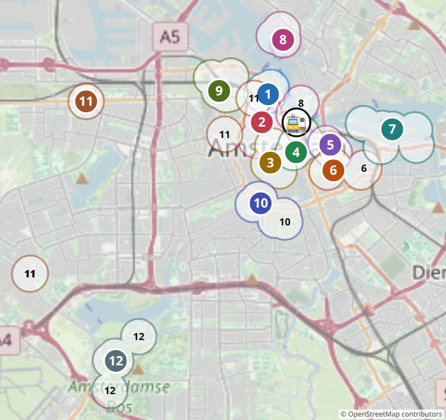

## 📜 How to play

1. We are one team against Amsterdam. 12 zones in any order, 1–2 per outing.
2. Challenge done? Tick the box ☐ and colour in the coins 🪙. You lead everyone to all the stops with the map and no hints? Another 🧭 +2.
3. Reached 🏁? The zone is CONQUERED! A sticker on the card and on its number on the big map.
4. 👑 Boss: a big challenge. It may not work the first time, so try again! ⚔️ Duel: me against the parents. I get the coins for playing either way; the last one (+1) is only for winning. ⏱ Against the clock. 📏 Measures are on the hunt card.
5. Coins add up over all the outings. Spend them whenever you like: your rank counts everything you have earned!

### 🛒 What coins buy

- 🪙×5 — A hint for a riddle
- 🪙×12 — I choose the snack
- 🪙×20 — A parent does a curse of my choice
- 🪙×35 — Ice cream or a sweet
- 🪙×60 — A small souvenir
- 🪙×120 — A big surprise from the parents

### 🌀 City curses

A curse falls when we enter a new zone and the die shows 1, or when we skip a challenge. Roll the die again: the number is the curse. It hits the whole team until we finish the next challenge.

1. We talk like pirates: "Arr!" at the end of every sentence
2. We walk like seagulls, arms as wings, until the next bridge
3. See a boat? Shout "Full steam ahead!"
4. One hand behind your back
5. The next challenge on one leg (where you can)
6. We ring like a tram: "Ding-ding!" at every corner

### 🎖️ Rank

Your rank counts ALL the coins you have earned. Spending coins does not take it away:

- **Deckhand** — under 30 coins
- **Sailor** — 🪙 30+
- **Bosun** — 🪙 65+
- **Navigator** — 🪙 105+
- **Captain** — 🪙 150+
- **Admiral** — 🪙 195+ and all 12 zones conquered

## 🎯 City-wide hunt

Look on every outing, in any zone. Fill a row and get the coins!

- ☐ ☐ ☐ ☐ ☐ XXX: three crosses on the brown posts by the road. Stand next to one: does it reach your knee or your waist? (🪙×2)
- ☐ ☐ ☐ The city's coat of arms: a shield with XXX, two lions and a crown (🪙×2)
- ☐ ☐ ☐ ☐ ☐ A bridge number (written on the bridge) (🪙×2)
- ☐ ☐ ☐ ☐ ☐ ☐ ☐ ☐ A picture stone on a house wall (they were used instead of house numbers!) (🪙×3)
- ☐ ☐ ☐ ☐ ☐ Windmills (any 5): De Gooyer · De Bloem · De Otter · De 1200 Roe · Molen van Sloten · Riekermolen (🪙×4)
- ☐ ☐ ☐ ☐ ☐ Transport: tram · metro · ferry · bus · train (🪙×3)

📏 My measures (measure at home): Step, cm ____ · Height, cm ____ · Palm, cm ____ · One floor of stairs, sec ____

## 🏝️ Zone 1: Western Islands

🚉 Walk from Centraal, ~15 minutes west along the water.

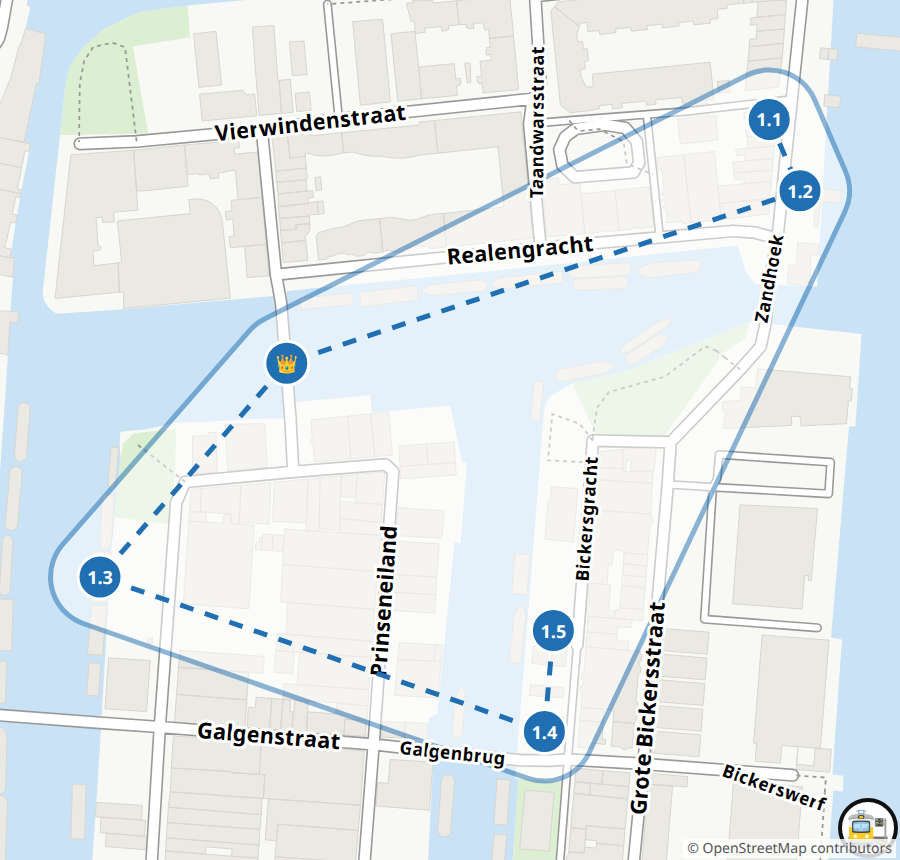

_400 years ago people built three islands here for warehouses and shipyards. Ships brought herring, salt, tar, and even cat skins!_

- [ ] 1.1 🔍 **Golden Coin** ⚔️ (🪙×1+1) — Who will be first to find, on the Zandhoek quay, the stone with a golden coin and an emperor? The coin gave its name to the Reael family, and the family gave its name to this island! 📍 [Zandhoek](https://www.google.com/maps/search/?api=1&query=52.38769,4.88993)
- [ ] 1.2 📏 **Captains' Row** (🪙×3) — Pace out the width of one captain's house. There are 13 of these houses in the row. How many steps will the whole row take? Walk it and check! 📍 [Zandhoek, row of houses](https://www.google.com/maps/search/?api=1&query=52.38745,4.8901)
- [ ] 1.3 📸 **Shipyard Birds** (🪙×2) — By the water on Prinseneiland, take a photo of two different birds in one picture: a duck, a coot, a gull, a heron, a goose… 📍 [Prinseneiland](https://www.google.com/maps/search/?api=1&query=52.38615,4.88624)
- [ ] 1.4 🏃 **⏱ Playground Minute** (🪙×2) — At the playground on Bickersgracht, touch 15 different things in 1 minute: swing, slide, bench, tree… A parent times you and counts! 📍 [Playground, Bickersgracht](https://www.google.com/maps/search/?api=1&query=52.38563,4.88869)
- [ ] 1.5 🏃 **Farm Charades** (🪙×3) — At the De Dierencapel farm, act out 5 animals you can see in the yard, without sounds. The parents must guess at least 3! 📍 [Kinderboerderij De Dierencapel, Bickersgracht 207](https://www.google.com/maps/search/?api=1&query=52.38597,4.88874)
- [ ] 👑 **Zone boss: Bridge 320** (🪙×6) — Find the bridge with number 320 and read its name. Cross it with your eyes closed without touching the railings! Touched them or opened your eyes? Start again. 📍 [Drieharingenbrug](https://www.google.com/maps/search/?api=1&query=52.38687,4.88727)

Coins needed: **12** 🏁

## 🌷 Zone 2: Jordaan and Canals

🚉 Walk from Centraal, ~10 minutes.

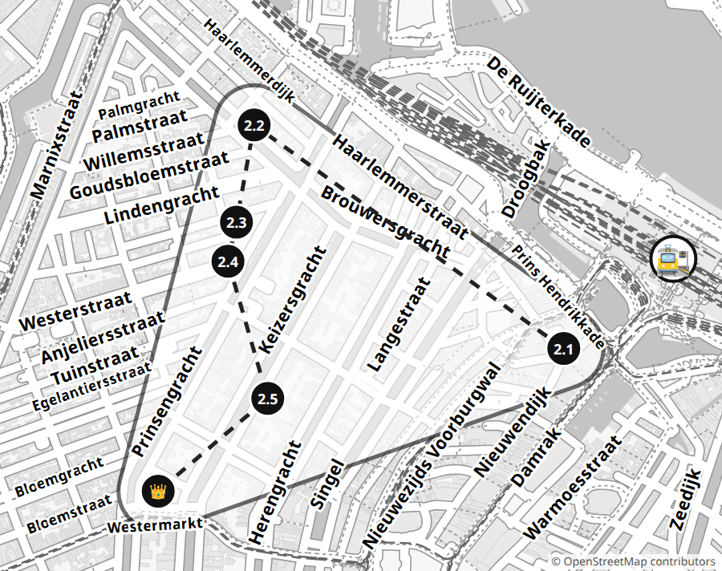

_Houses used to have no numbers, only names and stone pictures on the walls. There are lots of them here. Go find them!_

- [ ] 2.1 📸 **Photo Hunt: Three Fleets** (🪙×5) — As you walk the zone, photograph boats from three different companies: the name is on the side. Plus 5 places marked with a camera on the zone map: the church with two towers, the West India House, the bronze boy and girl from a book, the pink stone triangle by the water and Anne Frank's house. Any order, just finish before the boss! 📍 [Damrak / Prins Hendrikkade piers](https://www.google.com/maps/search/?api=1&query=52.3773,4.8968)
- [ ] 2.2 🔍 **Corner Warehouses** (🪙×2) — On the warehouses of the Brouwersgracht canal, find the words Vijfhoek, Vierhoek and Driehoek and translate them! And which warehouse is named after a faraway island? 📍 [Brouwersgracht 200–207](https://www.google.com/maps/search/?api=1&query=52.38161,4.88702)
- [ ] 2.3 🏃 **⏱ Cross Church** (🪙×2) — The Noorderkerk is shaped like a cross, and little houses snuggle into the corners between its arms. Run around the church in 2 minutes and count the little houses! 📍 [Noorderkerk, Noordermarkt](https://www.google.com/maps/search/?api=1&query=52.37964,4.88643)
- [ ] 2.4 🗣️ **Dutch Pie** (🪙×3) — At Winkel 43, order apple pie with whipped cream in Dutch and ask how many pies they bake a day. What did they say? Translate it for us! Then rate the pie from 1 to 10. 📍 [Winkel 43, Noordermarkt 43](https://www.google.com/maps/search/?api=1&query=52.37908,4.88623)
- [ ] 2.5 ⚔️ **House of Heads** (🪙×2+1) — The legend: a maid caught six thieves, and now their heads are on the wall. Find by the heads: laurels, ears of wheat, grapes, a crescent moon and two different helmets. Can you find all six before a parent finds three? 📍 [Huis met de Hoofden, Keizersgracht 123](https://www.google.com/maps/search/?api=1&query=52.37634,4.88745)
- [ ] 👑 **Zone boss: Tower Crown** (🪙×6) — Stand so that the crown on the city's tallest tower sits on your head: photo! Slipped off? Move and shoot again. Then, on the hour, count the bell strikes and jump that many times. Lost count? Wait for the next hour or try together with a parent. 📍 [Westerkerk](https://www.google.com/maps/search/?api=1&query=52.37455,4.88399)

Coins needed: **13** 🏁

## 👑 Zone 3: Dam and Secret Courtyard

🚋 Tram (or metro 52) to Rokin / Muntplein, by the Munttoren tower.

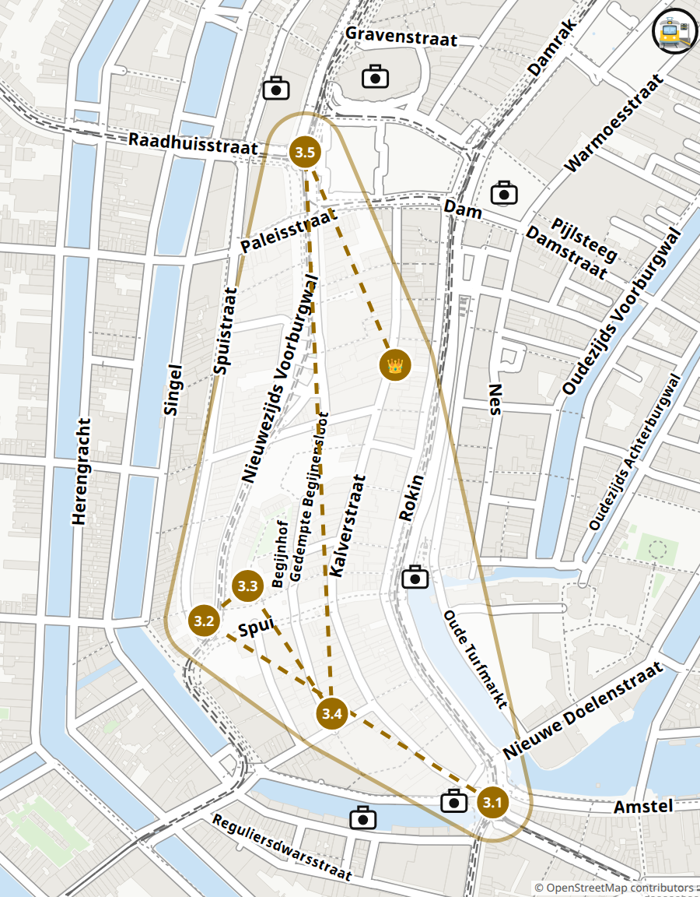

_The Royal Palace stands on 13,659 wooden poles, like a giant brush! It used to be the town hall and became a palace in 1808._

- [ ] 3.1 📸 **Zone Photo Hunt** (🪙×4) — As you walk the zone, photograph 6 places marked with a camera on the zone map: the Munttoren tower, a flower stall on the water, the queen on a horse, the white stone pillar on Dam Square, the post-office palace with turrets and the New Church by the palace. Any order, just finish before the boss! 📍 [Munttoren, Muntplein](https://www.google.com/maps/search/?api=1&query=52.36706,4.89322)
- [ ] 3.2 📸 **Bronze Rascal** (🪙×2) — On Spui square stands a bronze rascal of a boy. Stand next to him so you look like twins in the photo: same pose, same look! 📍 [Het Lieverdje, Spui](https://www.google.com/maps/search/?api=1&query=52.36878,4.88903)
- [ ] 3.3 🧭 **Secret Courtyard** (🪙×3) — Go through the gate from Gedempte Begijnensloot street into a secret courtyard. Inside is the oldest wooden house in the city. Find its number! 📍 [map](https://www.google.com/maps/search/?api=1&query=52.36911,4.88971)
- [ ] 3.4 ⚔️ **Blindfold Sauce** (🪙×2+1) — Get fries with two different sauces of your choice. Close your eyes: a parent gives you a fry 3 times, with one sauce or the other, and you say which. Then swap. Who guessed right more often? 📍 [Vleminckx, Voetboogstraat 33](https://www.google.com/maps/search/?api=1&query=52.3679,4.89102)
- [ ] 3.5 🔍 **Animals from Faraway Lands** (🪙×3) — Walk around the back of the palace. In the triangle under the giant Atlas, people from all over the world bring gifts to the city, and lead animals. Count all the animals! A parent counts separately. Same number? Done! If not, count together, pointing with your finger. 📍 [Koninklijk Paleis, rear facade (Nieuwezijds Voorburgwal)](https://www.google.com/maps/search/?api=1&query=52.37322,4.8906)
- [ ] 👑 **Zone boss: Record Tower** (🪙×6) — In the LEGO Store, build a tower from 4 different kinds of pieces, taller than your elbow when your arm rests on the table. It must stand on its own while a parent blows on it and counts to 5! Fell over? Build it stronger and try again. 📍 [LEGO Store, Kalverstraat 57](https://www.google.com/maps/search/?api=1&query=52.3712,4.892)

Coins needed: **13** 🏁

## 🏯 Zone 4: Nieuwmarkt and the Waag

🚇 Metro 51/53/54 to Nieuwmarkt (or walk from Centraal, ~10 minutes) to the Chinese temple on Zeedijk. After zone 5: walk along Prins Hendrikkade, ~15 minutes.

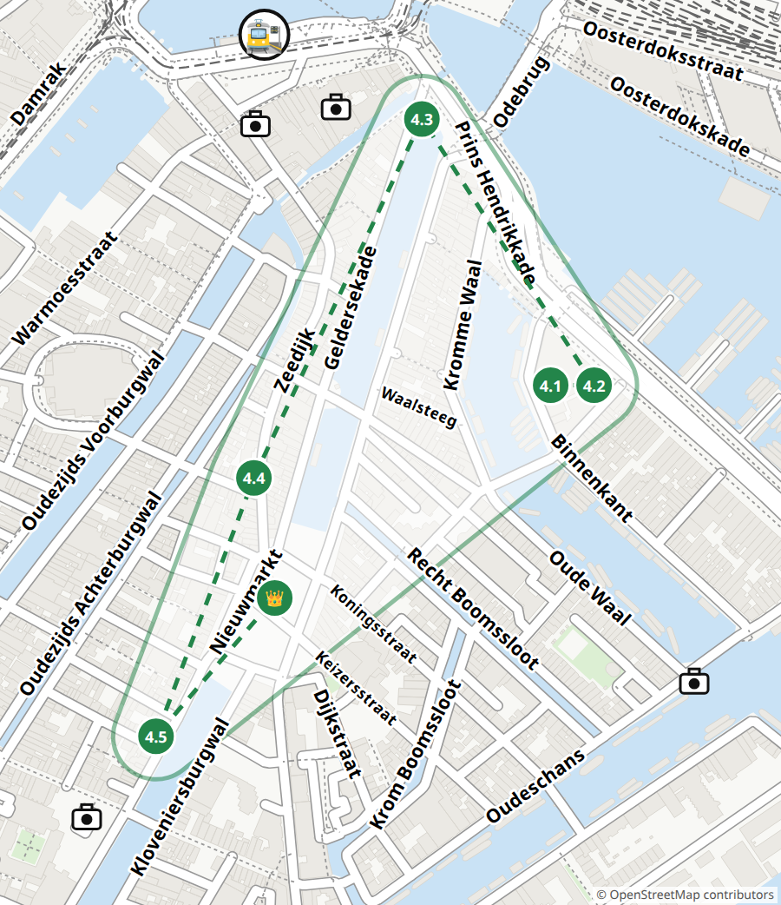

_The Waag (weigh house) was a city gate more than 500 years ago. Later goods were weighed here, and upstairs every guild of craftsmen had its own door!_

- [ ] 4.1 📸 **Zone photo hunt** (🪙×4) — As you walk through the zone, photograph 6 places marked with a camera on the zone map: Sinterklaas's church with two towers, the wooden house "At the Little Monkeys", the Chinese palace temple, the Montelbaanstoren tower, the gate with the letters VOC and the Zuiderkerk tower. Any order, but before the boss! 📍 [He Hua Temple, Zeedijk 106–118](https://www.google.com/maps/search/?api=1&query=52.37361,4.90013)
- [ ] 4.2 🍽️ **Blind chocolate tasting** (🪙×3) — In the Tony's Chocolonely shop, pick 5 chocolate bars with different flavours, any you like! Then close your eyes: a parent gives you a piece of each in any order, and you name the flavour. Guess at least 4 out of 5! 📍 [Tony's Chocolonely Super Store, Oudebrugsteeg 15](https://www.google.com/maps/search/?api=1&query=52.37565,4.8966)
- [ ] 4.3 🔍 **Traveller's Tower** (🪙×3) — In 1609 Captain Hudson sailed from here, towards the future New York! Find the stone on the tower: a woman points at a ship but has turned away. What year is on it? 📍 [Schreierstoren](https://www.google.com/maps/search/?api=1&query=52.37636,4.90224)
- [ ] 4.4 📸 **Sea monsters** (🪙×2) — Stone sea monsters, gods and ships live on the Scheepvaarthuis, the shipping house. Find the scariest monster and take a photo! 📍 [Scheepvaarthuis, Prins Hendrikkade 108](https://www.google.com/maps/search/?api=1&query=52.37432,4.90413)
- [ ] 4.5 ⚔️ **Door-Wide House** (🪙×2+1) — The legend: the rich Trip family's coachman asked for a house as wide as their door, and got one! Stand by the little house and spread your arms: how many of you wide is it? You and your parents guess: how many little houses fit into the big house opposite? Who's closest? Bonus: the Trip brothers sold weapons. Find chimneys like cannons on their roof! 📍 [Kleine Trippenhuis, Kloveniersburgwal 26](https://www.google.com/maps/search/?api=1&query=52.37163,4.8989)
- [ ] 👑 **Zone boss: ⏱ Guild masters** (🪙×6) — A parent secretly takes close-up photos of three carved details on the Waag. In 3 minutes, find where each one is and say which guild worked behind that door. Too slow? Three new photos! 📍 [De Waag, Nieuwmarkt](https://www.google.com/maps/search/?api=1&query=52.37269,4.90039)

Coins needed: **13** 🏁

## ⚓ Zone 5: Ships and NEMO

🚉 Walk from Centraal, ~15 minutes.

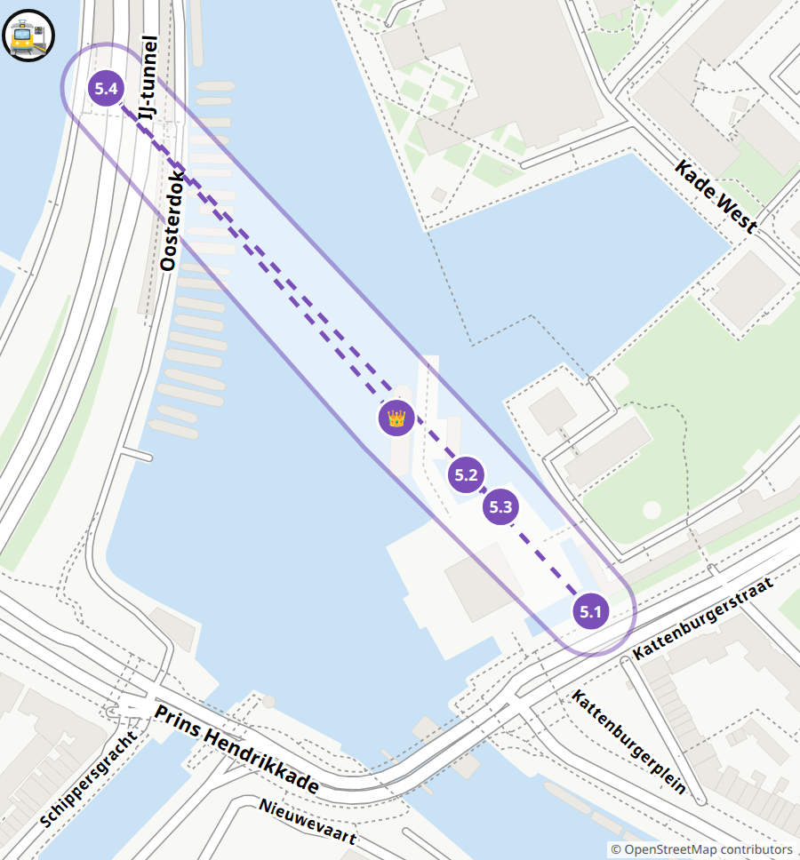

_The real ship Amsterdam was wrecked off the coast of England in 1749 and still lies in the sand. By the museum there is a copy of it, and you can go on board!_

- [ ] 5.1 🏃 **Captain's orders** (🪙×3) — On the ship Amsterdam, a parent names 5 places on deck just once: the wheel, the bell, a hammock, a cannon, the captain's cabin. Visit them in the same order in 3 minutes. Made a mistake? New order! 📍 [The ship Amsterdam at Het Scheepvaartmuseum](https://www.google.com/maps/search/?api=1&query=52.37155,4.9156)
- [ ] 5.2 🔍 **Inside the Whale** (🪙×3) — A huge whale is hiding in the museum. Walk into its mouth! In the last room, name 5 different kinds of rubbish that end up in the sea. 📍 [Het Scheepvaartmuseum, «Tale of the Whale»](https://www.google.com/maps/search/?api=1&query=52.37215,4.9147)
- [ ] 5.3 🔍 **Wind Rose** ⚔️ (🪙×1+1) — In the museum courtyard, the glass roof is drawn like the wind rose on old sea charts. Stand where you think north is. A parent does too! Who's closest? Check with the phone compass. 📍 [Het Scheepvaartmuseum, courtyard](https://www.google.com/maps/search/?api=1&query=52.37201,4.91495)
- [ ] 5.4 🏃 **⏱ Floors on the Clock** (🪙×2) — Walk up to the NEMO roof while a parent times you. How many floors is it? Divide your time by your "one floor of stairs" time. Go down and run: reach the top a whole floor faster! 📍 [NEMO roof, Oosterdok 2](https://www.google.com/maps/search/?api=1&query=52.37385,4.91211)
- [ ] 👑 **Zone boss: Sinterklaas Is Here!** (🪙×6) — On 15 November Sinterklaas's steamboat docks at the museum. Before it ties up, find: the steamboat's name, a Piet on the mast and the white horse. Too slow? Keep looking while Sint comes ashore. Then shout "Welcome!" in Dutch! On another day the boss is "Captain's orders" with 7 places. 📍 [Quay by Het Scheepvaartmuseum](https://www.google.com/maps/search/?api=1&query=52.3724,4.9142)

Coins needed: **10** 🏁

## 🦁 Zone 6: Plantage and Artis

🚋 Tram 14 from Centraal to Pontanusstraat (back from Artis).

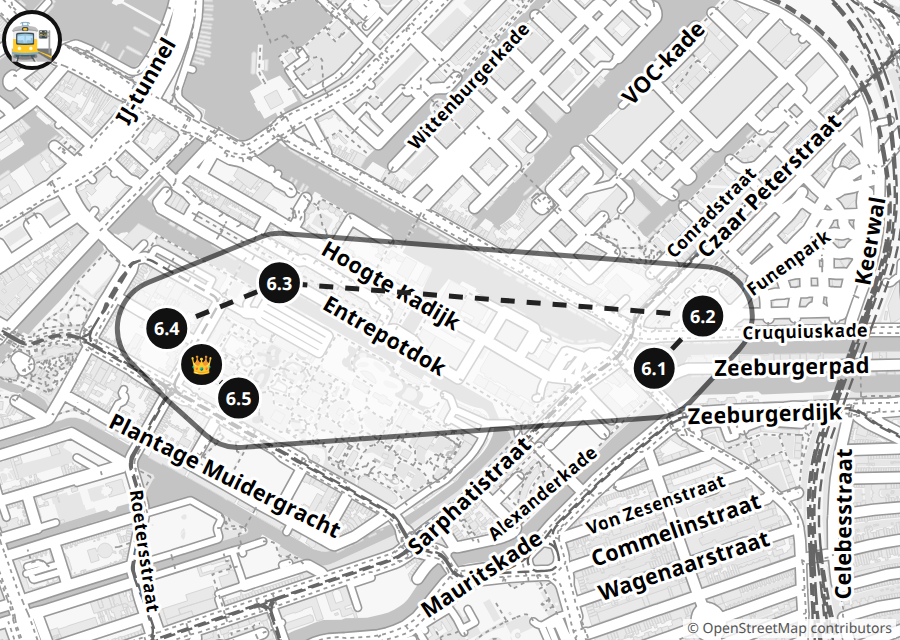

_Artis is the oldest zoo in the Netherlands: it is 188 years old! Next to it is Micropia, a museum of microbes: everything alive there is so small you can only see it under a microscope._

- [ ] 6.1 🔍 **The windmill ostrich** (🪙×2) — Under the De Gooyer windmill is a brewery. A bird is painted on its sign. Which bird? And what is it holding? 📍 [De Gooyer, Funenkade 5](https://www.google.com/maps/search/?api=1&query=52.3668,4.92615)
- [ ] 6.2 🏃 **⏱ Ostrich run** (🪙×2) — Run along the Funenpark paths with ostrich steps, knees high! Reach the tree a parent picks in under 2 minutes. Walked normally? Start again! 📍 [Funenpark](https://www.google.com/maps/search/?api=1&query=52.36775,4.9276)
- [ ] 6.3 📸 **Giraffe across the canal** (🪙×2) — Walk along the Entrepotdok canal. On the other bank is the zoo's savannah. Take a photo of a giraffe or a zebra without going into the zoo! 📍 [Entrepotdok quay opposite the Artis savannah](https://www.google.com/maps/search/?api=1&query=52.36835,4.915)
- [ ] 6.4 🔍 **Gate Words** (🪙×2) — Three Latin words are written on the zoo gates. Read them! Two look like English words. Which ones, and what do they mean? 📍 [ARTIS gate, Plantage Kerklaan 38](https://www.google.com/maps/search/?api=1&query=52.36696,4.91258)
- [ ] 6.5 🔍 **Kiss Microbes** (🪙×2) — Find the Kiss-o-meter and kiss Mum or Dad on the cheek: more than a million microbes or fewer? Then stand in front of the scanner mirror: where are the microbes on you? 📍 [Micropia, Kiss-o-meter](https://www.google.com/maps/search/?api=1&query=52.3668,4.91285)
- [ ] 👑 **Zone boss: Stamps and Water Bear** (🪙×6) — At the Micropia desk, ask for a stamp card. Collect 12 stamps in 40 minutes, then find a live water bear under the microscope and show on your fingers how many legs it has. Too slow? 20 more minutes for the missing ones! 📍 [Micropia, Plantage Kerklaan 38–40](https://www.google.com/maps/search/?api=1&query=52.36689,4.91269)

Coins needed: **11** 🏁

## 🐍 Zone 7: Eastern Docklands

🚋 Tram 26 from Centraal to Rietlandpark.

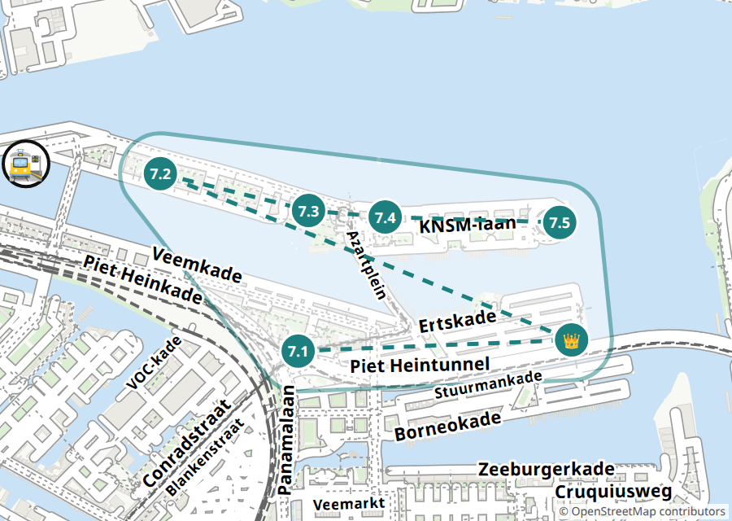

_There was a big port here. Now, instead of warehouses, there are islands with snake bridges and funny little bridges, and almost two thirds of the area is water!_

- [ ] 7.1 🚋 **Tram 26** (🪙×2) — Ride tram 26 from Centraal and count the stops to Rietlandpark. Take a photo of a tram coming the other way! 📍 [Rietlandpark stop](https://www.google.com/maps/search/?api=1&query=52.37309,4.93453)
- [ ] 7.2 ⚔️ **Java Bridges** (🪙×2+1) — Guess: how many little bridges cross the canals of Java Island? Who is closer, you or the parents? Now walk across the island and count! 📍 [Java-eiland, Lamonggracht](https://www.google.com/maps/search/?api=1&query=52.37872,4.92736)
- [ ] 7.3 🏃 **⏱ Five Things** (🪙×2) — At the Bogortuin playground, pick 5 different things to play on. In 2 minutes, visit each one: climb it, sit on it or swing! 📍 [Bogortuin playground, Java-eiland](https://www.google.com/maps/search/?api=1&query=52.37755,4.93507)
- [ ] 7.4 🔍 **Harbour Crane** (🪙×3) — Behind the old Loods 6 warehouse stands a harbour crane. Find its number! 📍 [Crane by Loods 6, KNSM-laan](https://www.google.com/maps/search/?api=1&query=52.37734,4.93906)
- [ ] 7.5 🔍 **House in the Water** ⚔️ (🪙×1+1) — Find a huge round house growing right out of the water! How many floors does it have? Who counts faster, you or the parents? 📍 [Emerald Empire, KNSM-eiland](https://www.google.com/maps/search/?api=1&query=52.37717,4.94814)
- [ ] 👑 **Zone boss: Python Bridge** (🪙×6) — Find the bright red bridge that wiggles like a snake! Cross it and count the steps. Come back walking backwards, holding the railing! 📍 [Pythonbrug (Hoge Brug), Sporenburg](https://www.google.com/maps/search/?api=1&query=52.37344,4.94876)

Coins needed: **11** 🏁

## ⛴️ Zone 8: North by Ferry

⛴️ Free ferry F4 from the piers behind Centraal station to NDSM.

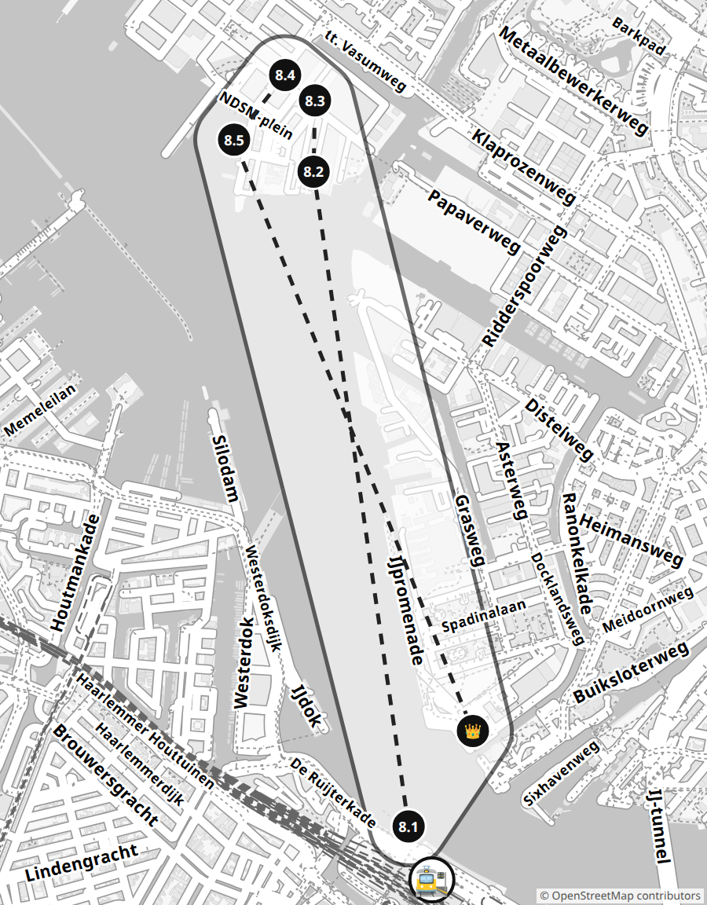

_At the NDSM shipyard, huge ships were built for almost 100 years. The last crane was not taken down, and now there's a hotel inside it!_

- [ ] 8.1 📸 **Ferry Bingo** (🪙×2) — From ferry F4, photograph 4 of these 6: the EYE film museum (a white "flying saucer"), the A'DAM tower, the Silodam house on stilts, the crane hotel, a tugboat, a cargo barge. Where are they? See the 📷 icons and dots on the zone map. 📍 [Ferries behind Centraal station](https://www.google.com/maps/search/?api=1&query=52.3811,4.8992)
- [ ] 8.2 📸 **Thumb Crane** (🪙×2) — Find the huge crane hotel. Walk away until it fits on your palm, and a parent takes the photo over your shoulder! 📍 [Faralda Crane Hotel, NDSM-plein](https://www.google.com/maps/search/?api=1&query=52.39941,4.89484)
- [ ] 8.3 🏃 **⏱ Container Arch** (🪙×2) — Count how many containers make up the arch at the shipyard. Then run under it and back 5 times in 1 minute! 📍 [De Containerboog, NDSM](https://www.google.com/maps/search/?api=1&query=52.40156,4.8946)
- [ ] 8.4 🔍 **STRAAT Hunt** (🪙×3) — On the outside wall of STRAAT, find a huge portrait of a girl: it's Anne Frank. Inside, ask at the desk in Dutch for the kids' treasure hunt and do it! 📍 [STRAAT, NDSM-plein 1](https://www.google.com/maps/search/?api=1&query=52.40195,4.89385)
- [ ] 8.5 🍽️ **Pancake Boat** (🪙×3) — On the pancake boat you take as many pancakes as you like: count how many you can manage! Decorate one with the Amsterdam flag, three crosses ××× like on the little posts by the road, and take a photo! Then spot the A'DAM tower from the window: we go there tonight. 📍 [Pannenkoekenboot, Ms. van Riemsdijkweg 33 (by the NDSM ferry)](https://www.google.com/maps/search/?api=1&query=52.4003,4.8912)
- [ ] 👑 **Zone boss: A'DAM Tower** (🪙×6) — Time how many seconds the A'DAM lift takes to carry us up 20 floors. At the top, in 3 minutes, find and point to: the station, NEMO, the Westertoren crown and the crane hotel. Not in time? A parent names 3 new places, and you find them with one eye, the other covered by your hand! Brave? The swing over the edge is another +2 🪙! 📍 [A'DAM Lookout, Overhoeksplein 5](https://www.google.com/maps/search/?api=1&query=52.38377,4.90214)

Coins needed: **12** 🏁

## 🏭 Zone 9: Westerpark

🚶 Walk from home ~20 minutes to Het Schip (or bus 22 from Centraal to Zaandammerplein: check in 9292).

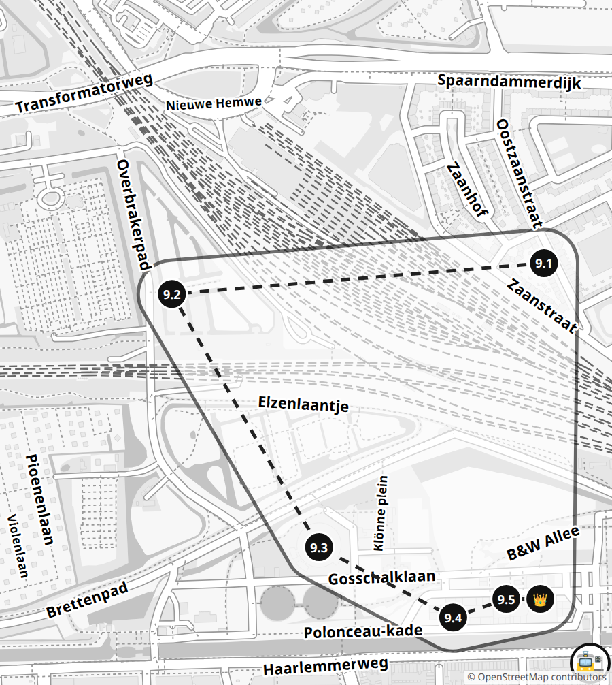

_There was a gasworks here: from 1885 it made gas for the street lamps. Now its buildings hold cafés and museums, and around them is a big wild park._

- [ ] 9.1 📸 **Ship House** (🪙×2) — Find a house that looks like a ship! Where is its bow, and where is its funnel? Take a photo so the house is "sailing" towards you. 📍 [Het Schip, Oostzaanstraat 45](https://www.google.com/maps/search/?api=1&query=52.39049,4.87373)
- [ ] 9.2 🧱 **Den** (🪙×3) — ⏱ On the wild island Woeste Westen, collect 10 fallen sticks in 2 minutes. Then build a round den from them, like a gas holder. It must stand on its own while a parent counts to 10! 📍 [Het Woeste Westen, Overbrakerpad 3](https://www.google.com/maps/search/?api=1&query=52.39009,4.86582)
- [ ] 9.3 🏃 **⏱ Gas Holder** (🪙×2) — Find the round building with no corners: it stored gas for the lamps of the whole city. Run all the way round it while a parent times you! Rest, then beat your record. 📍 [Gashouder, Westergasfabriek](https://www.google.com/maps/search/?api=1&query=52.38681,4.86895)
- [ ] 9.4 🍽️ **Oliebol!** (🪙×2) — Winter only (late October to New Year): the park sells oliebollen and their cousins. A parent secretly buys two different ones. Taste both, then find them in the stall window: what are they called? Out of season? A parent secretly orders two different snacks at a café: guess what they are by taste. 📍 [Westergasfabriek](https://www.google.com/maps/search/?api=1&query=52.3859,4.8718)
- [ ] 9.5 🔍 **Shell Bike** ⚔️ (🪙×1+1) — In Amsterdam in Motion, go upstairs. Who will be first to find the bike pulled out of the bottom of a canal? It's covered in shells! 📍 [Amsterdam in Motion, Pazzanistraat 19](https://www.google.com/maps/search/?api=1&query=52.38614,4.87329)
- [ ] 👑 **Zone boss: City in Miniature** (🪙×6) — ⏱ On the huge model of Amsterdam, find 4 places we have already conquered in 2 minutes: Centraal station, Dam Square with the palace, the Westerkerk tower and green NEMO. Not in time? A parent names 4 new places! 📍 [Amsterdam in Motion, Pazzanistraat 19](https://www.google.com/maps/search/?api=1&query=52.38614,4.87329)

Coins needed: **11** 🏁

## 🖼️ Zone 10: Rijksmuseum and De Pijp

🚇 Metro 52 from Centraal (or Rokin) to De Pijp.

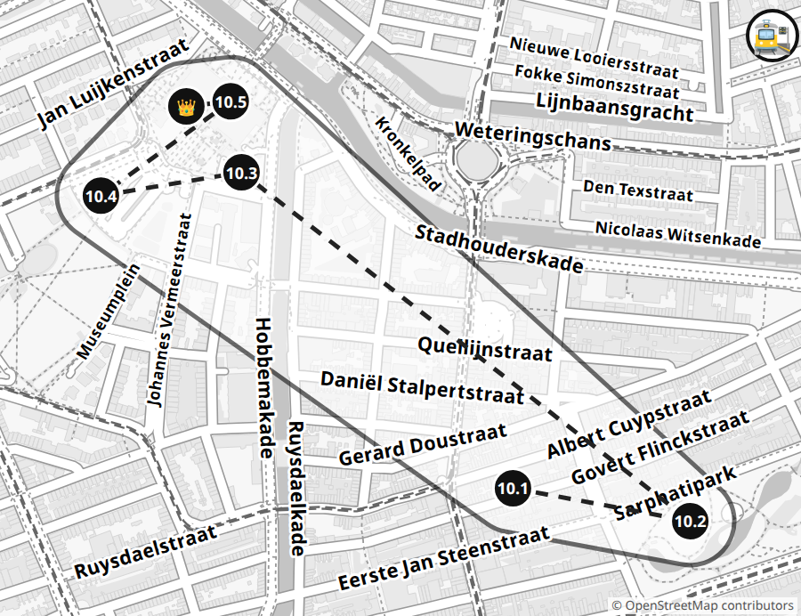

_The Rijksmuseum was built by the same architect as Centraal station: Pierre Cuypers. And a tunnel for bikes runs right through the middle of the museum!_

- [ ] 10.1 🚋 **Giant Escalator** ⚔️ (🪙×1+1) — De Pijp station is the deepest in the country! You and your parents guess: how many canal houses stacked on top of each other would reach the street? Who is closest? 📍 [De Pijp metro station](https://www.google.com/maps/search/?api=1&query=52.3549,4.8917)
- [ ] 10.2 📸 **Zone Photo Hunt** (🪙×4) — As you walk through the zone, take photos of the 5 places with a camera icon on the map: the Albert Cuyp market, the red-brick brewery, the little castle-house with a tower, the white "bathtub" and the Van Gogh Museum with its round wing. Finish before the boss! 📍 [Albert Cuypmarkt](https://www.google.com/maps/search/?api=1&query=52.35605,4.89497)
- [ ] 10.3 🔍 **Park Temple** (🪙×2) — In Sarphatipark, find the temple in the middle of the water. The shields under the dome have three Dutch words: read and translate them! Which animals guard the water below? 📍 [Sarphatimonument, Sarphatipark](https://www.google.com/maps/search/?api=1&query=52.35446,4.89557)
- [ ] 10.4 🏃 **⏱ Slide and Tunnel** (🪙×2) — On Museumplein by Café Cobra, go down the slide 10 times in 3 minutes! Then walk under the Rijksmuseum through the tunnel: the museum entrance is right inside it. 📍 [Museumplein playground → Rijksmuseum passage](https://www.google.com/maps/search/?api=1&query=52.35911,4.88577)
- [ ] 10.5 📸 **Lyre on a Finger** (🪙×2) — A golden lyre shines on the roof of the Concertgebouw concert hall. Walk back across Museumplein until the lyre sits on the tip of your finger. Photo! 📍 [Museumplein, by the Rijksmuseum (view of the Concertgebouw)](https://www.google.com/maps/search/?api=1&query=52.3588,4.8827)
- [ ] 10.6 🔍 **Night Watch** (🪙×3) — Find Rembrandt's huge painting "The Night Watch". Where is the girl with a chicken on her belt? And the barking dog? It isn't a night scene at all: why that name? Ask your parents! 📍 [Rijksmuseum, Night Watch room](https://www.google.com/maps/search/?api=1&query=52.36005,4.8854)
- [ ] 👑 **Zone boss: Doll's House** (🪙×6) — Look at Petronella's doll's house for one minute, then turn away. A parent asks 5 questions: what hangs in the kitchen? how many floors? what colour are the curtains?… 4 right and you win. If not, look for another minute: new questions! 📍 [Rijksmuseum, Petronella Oortman's doll's house](https://www.google.com/maps/search/?api=1&query=52.36,4.8847)

Coins needed: **13** 🏁

## 🌬️ Zone 11: Western Windmills

🚶 Start at the Haarlemmerpoort gate, walk through Westerpark to the De Bloem and De Otter windmills, then take the bus.

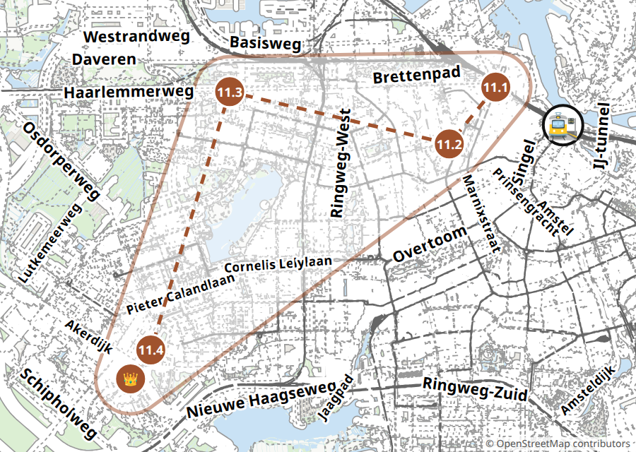

_The windmill "1200 Roe" is named after a distance: 1200 old units from the Haarlemmerpoort gate, where the city used to end._

- [ ] 11.1 🔍 **King's Gate** (🪙×2) — King Willem II rode in through this gate! Count the columns in the passage. How many on each side? 📍 [Haarlemmerpoort](https://www.google.com/maps/search/?api=1&query=52.38497,4.88308)
- [ ] 11.2 🔍 **Saw Mill** (🪙×2) — The De Otter windmill has been a sawmill for almost 400 years! It turns to face the wind all in one piece, little house and all. Find what the miller turned it with. Stand where the mill looks straight at you. Photo! 📍 [De Otter, Gillis van Ledenberchstraat 78](https://www.google.com/maps/search/?api=1&query=52.37609,4.87119)
- [ ] 11.3 📏 **Giant's Measure** (🪙×3) — The De 1200 Roe windmill stands 1200 "roe" from the Haarlemmerpoort gate. One roe is almost 4 metres! A parent marks one out with 5 big steps on the grass, and you lie down like a caterpillar: stand up where the top of your head was, and lie down again. How many times did you fit? 📍 [De 1200 Roe, Haarlemmerweg 701](https://www.google.com/maps/search/?api=1&query=52.38424,4.81512)
- [ ] 11.4 ⚔️ **I'm a Windmill!** (🪙×2+1) — Your arms are windmill sails! Turn your straight arms in time with the real sails: one circle per sail. Who lasts longer? Lose the beat or drop an arm and you're out. No wind? Turn to a parent's count. 📍 [Lawn by Molen van Sloten](https://www.google.com/maps/search/?api=1&query=52.3418,4.7925)
- [ ] 👑 **Zone boss: Inside the Windmill** (🪙×6) — Climb inside the Molen van Sloten windmill. Ask the miller in Dutch: how do the sails stand when there is a party? What did he say? Show it with your arms and hold while a parent counts to 20. Arms dropped? Start again! Then find the screw that lifts the water. 📍 [Molen van Sloten, Akersluis 10](https://www.google.com/maps/search/?api=1&query=52.3416,4.79227)

Coins needed: **10** 🏁

## 🌳 Zone 12: Amsterdamse Bos

🚌 Bus 170 or 172 from Centraal to the Amsterdamse Bos stop (Van Nijenrodeweg / Amstelveenseweg), then walk to the Bosbaan, ~5 min. In spring: the historic tram.

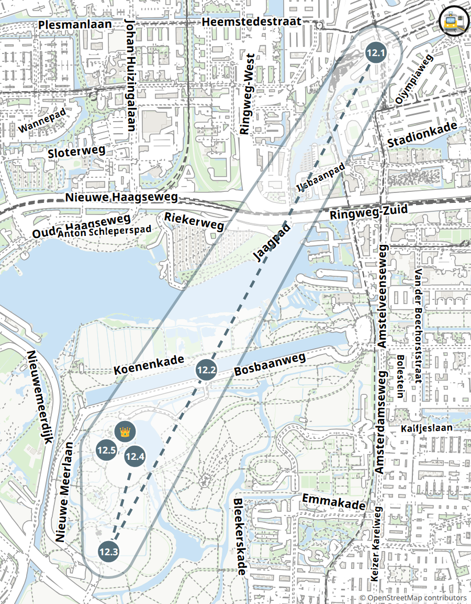

_People planted this huge forest! Work started in 1934. The forest has 116 bridges, and goats, cows and ponies live here._

- [ ] 12.1 🚋 **Old Tram** (🪙×4) — Only in spring and summer: ride to the forest on the historic tram! Find the plate in the carriage: which city was our tram made in? 📍 [Haarlemmermeerstation](https://www.google.com/maps/search/?api=1&query=52.34934,4.85672)
- [ ] 12.2 🏃 **⏱ Race the Boat** (🪙×3) — Run 100 metres along the Bosbaan rowing canal while a parent times you. A rowing eight does 100 metres in under 20 seconds. Who is faster? If a boat comes by, race it! 📍 [Bosbaan](https://www.google.com/maps/search/?api=1&query=52.32616,4.8364)
- [ ] 12.3 🍽️ **Goat Farm** (🪙×3) — At the Ridammerhoeve goat farm, pet a goat (kids in spring!). Then try something made with goat's milk in the farm café and find the word geit on a sign. Score it from 1 to 10! 📍 [Geitenboerderij Ridammerhoeve, Nieuwe Meerlaan 4](https://www.google.com/maps/search/?api=1&query=52.31287,4.82469)
- [ ] 12.4 🏃 **⏱ Human Wheelbarrow** (🪙×2) — This forest was built with wheelbarrows! Find the wheelbarrow monument on the Big Meadow. Then become a wheelbarrow: a parent holds your legs and you walk 10 steps on your hands in 1 minute. Fall? Start again! 📍 [Grote Speelweide](https://www.google.com/maps/search/?api=1&query=52.32017,4.82715)
- [ ] 12.5 🔍 **Weighted Bridges** (🪙×2) — Find a little bridge in the forest with bright round balls. The balls are weights: they help the bridge lift up! How many balls are on the bridge? Where are the hinges it lifts on? 📍 [Bridges around the Grote Speelweide](https://www.google.com/maps/search/?api=1&query=52.32031,4.82497)
- [ ] 👑 **Zone boss: Forest Boat with a Passenger** (🪙×6) — By the water at the Speeleilanden, build a boat from sticks, bark and leaves: only things that have fallen on the ground. Put a passenger on it: an acorn or a pebble. The boat must float for 10 seconds without the passenger falling into the water! 📍 [Speeleilanden, Grote Vijver](https://www.google.com/maps/search/?api=1&query=52.3213,4.8268)

Coins needed: **11** 🏁

---

## 👨‍👩‍👦 For parents

**Start:** Start — Amsterdam Centraal

### Plan

- **Outing 1 · Sun 15 November:** Zones 5 + 4 with Sinterklaas. 9:45 Centraal → 10:00 Scheepvaartmuseum at opening (ship, whale, courtyard) → ~11:05 NEMO roof → by ~11:15 to the quay → ~11:30 Sinterklaas's steamboat (boss 5; the 2026 time is not published yet). Lunch → zone 4: along Prins Hendrikkade and Geldersekade to the temple on Zeedijk (~15 min), then the loop (~13:15 the parade near Waterlooplein: crowded). Finish ~15:30.
- **Outing 2 · weekend day:** Zones 1 + 2 on foot from Centraal. Morning on the islands (farm opens at 9), Damrak quays, Brouwersgracht, apple pie at Winkel 43, Westerkerk, House with the Heads.
- **Outing 3 · weekend day:** Zones 3 + 10. ~11:00 Munttoren → Rokin → Spui → Begijnhof → fries (Sun from 12) → Dam → LEGO (Sun from 11:30). Metro 52 from Rokin to De Pijp → Sarphatipark → Museumplein → Rijksmuseum (~14:30).
- **Outing 4 · weekend day:** Zones 6 + 7. Tram 14 to Pontanusstraat → De Gooyer → Funenpark → Artis → Micropia (~11:00) → ~20 min walk to Rietlandpark → Python → Java → KNSM.
- **Outing 5 · weekend day:** Zones 9 + 8. From home to Het Schip → Woeste Westen → gasholder → Amsterdam in Motion (slot ~11:00). Tram to Centraal → ferry F4 → NDSM, STRAAT → pancake boat (~14:30) → A'DAM at sunset → ferry F3.
- **Outing 6 · weekend day:** Zones 11 + 12, a long day. Haarlemmerpoort at 9:30 → walk to De Otter → buses → Molen van Sloten by 15:00. Or on a Sunday in spring, with the historic tram (12.1).
- **Outing Bonus:** Amsterdam Light Festival 26.11.2026–17.01.2027, lights from 17:30: the Kids Walk in the app (quiz, small prize). Ice rink on Museumplein from ~14.11, good on the zone 10 day.

### 🎟️ Tickets and bookings

🎟️ **🚋 Kid's travel: Kids Vrij** _(arrange in advance)_

- When: Until 3.01.2027, daily 7:00–21:00 (GVB tram, bus, metro)
- Where: Online (personal OV-chipkaart) + GVB
- How: 1) Order a personal OV-chipkaart for the kid at ov-chipkaart.nl (with photo). 2) Load the free Kids Vrij product onto it following GVB's instructions (gvb.nl, search "Kids Vrij"). 3) On board, tap the card when getting on and off. Adults pay by bank card (OVpay). Ferries are free for everyone.
- Price: Kids Vrij is free for Amsterdam kids aged 4–11; check the price of the card itself. Without it: GVB child day ticket €5. From 2027 free travel for kids 4–11 nationwide is promised; check the rules.
- https://www.gvb.nl

### 🛍️ Bring / buy

- Stickers ~2 cm (for 12 zones + the map), a pen, glue or tape for the collection, a kid's camera (photo challenges), a die
- At home before the first outing: measure the kid's step with a tape (10 steps ÷ 10), height and palm; time one floor up the stairs with a stopwatch. Write them on the hunt card. Stopwatch on the phone
- The kid's OV-chipkaart with Kids Vrij, a parent's Museumkaart, a bank card (many tills take no cash)
- Wet wipes (pancakes, fries), spare trousers (Woeste Westen, the forest raft), warm clothes for the ferries

### 💡

- Does the kid speak Dutch? Let him order and ask where there are definitely people (ticket desks, stalls, cafés). There is often nobody at the farms.
- Measuring: the kid counts the steps; help multiply the big numbers. Answers are on the zone pages.
- ⏱ Timed challenges are for letting off steam at playgrounds. Didn't work? Second try.
- Make any challenge harder: eyes closed (holding hands), on one leg, a hand behind the back. Parents also use this to even out the duels.
- ⚔️ Duels: the card shows "🪙×2+1": the kid gets 2 coins even when losing; the last +1 only for winning (the duel column on the scoreboard).
- 🌀 A curse lasts until the next finished challenge. A failed attempt is not a skip: try again; a curse only comes for an honest skip.
- 🧭 Give the kid the zone map and follow; "warmer-colder" is allowed.
- Everything is open on Sundays too (fries from 12, LEGO from 11:30, Begijnhof from 9:30). Markets Noordermarkt (Sat) and Albert Cuyp (Mon–Sat) are a bonus. Farms: De Dierencapel is closed on Mon, the goat farm on Tue (and on Mon from November).
- Zone 4: stay on Zeedijk and Nieuwmarkt, don't turn into the alleys to the west: red-light district.
- The quays almost never have railings: hold hands by the water.
- The Begijnhof is a residential courtyard: quiet, no running.
- It gets dark ~16:30 in November–December: the finish at A'DAM (zone 8) is just in time for the city lights.
- Rank counts all coins earned (the "Coins" column with 🧭 + the hunt); spent coins don't lower the rank.

### 🔑 Answers and hints

#### 🏝️ 1. Western Islands

_The three man-made islands (Bickers-, Prinsen-, Realeneiland) were built up in 1610–1615 as an extension of the port: shipyards, tar works, herring smokehouses, warehouses. At first they were called the Front, Middle and Rear islands, later named after Jan Bicker, the Princes of Orange and the Reael family. In the late 19th century ships grew too big, the islands emptied, and after the war artists rediscovered them._

- Centraal → Zandhoek → Drieharingenbrug → Prinseneiland → Galgenstraat → Bickersgracht → Centraal. ~4 km, 1.5–2 h
- All outdoors; farm Tue–Sun 9–17 (no staff needed for charades)
- Free
- Cafés on Haarlemmerdijk
- **1.1 Golden Coin:** [Zandhoek](https://www.google.com/maps/search/?api=1&query=52.38769,4.88993) — ✔ Zandhoek 14, the "De Gouden Reael" stone: a real coin with Emperor Charles V.
  The real was a Spanish-Portuguese silver coin used everywhere in the early 17th century; the Charles V version showed the emperor's bust. The coin hung as a house sign on the home of Laurens Reael (later Governor-General of the East Indies), and the family took its surname from it. Around 1620 Reynier Reael bought up plots on the Rear Island, and around 1624 the island was named after him. In 1648 the family built a warehouse here (a herring packing house, per Dutch Wikipedia) with the same coin on its stone. Around 1800 an inn called "De Gouden Reael" opened in the building, and the whole neighbourhood took its name. Today it is a restaurant. For the kid: "The coin named a family, the family named an island, and the house named a whole neighbourhood!"
- **1.2 Captains' Row:** [Zandhoek, row of houses](https://www.google.com/maps/search/?api=1&query=52.38745,4.8901) — ✔ 13 houses, nos. 2–14. Sum: steps for one house × 13 (= 10 times + 3 times). Compare with the walk.
  Reynier Reael built 13 identical "captains' houses" (nos. 2–14) around 1645–46; the monuments register dates nos. 2, 3 and 5 to 1657. Sources don't say which captains rented them: these aren't merchants' mansions like on the canal ring but a modest row of rental houses. Basements and upper floors were let separately, and some still have split doors so you can chat with the neighbour over the top half. Until 1832 the houses stood right on the open water of the IJ; then the Westerdoksdijk cut them off from the river. Sand for raising the streets was unloaded here, hence Zandhoek, "sand corner". In 1943 the houses were protected so a tobacco factory couldn't demolish them. For the kid: "From these windows you used to see a sea of ships!"
- **1.3 Shipyard Birds:** [Prinseneiland](https://www.google.com/maps/search/?api=1&query=52.38615,4.88624) — ✔ Check the photo yourselves. A coot is black with a white beak and a white "bald" patch; herons often stand on boats and posts. No luck? Try at the farm (ducks, geese).
  Prinseneiland was sold in plots from 1623, mostly for timber and tar warehouses; probably named after the first Princes of Orange. There were "over 60" or "over 100" warehouses here (sources disagree) out of the city's ~900 brick warehouses. The Western Islands warehouses stored herring, grain, tobacco, wine, salt, tar, pitch and, yes, cat skins. They have spout gables, hoisting beams with hooks under the roof and hatch shutters; the shutters often show the goods or a city they traded with. Under a shelter by Galgenstraat there is still a winch that lifted tar barrels from boats. Since the 1950s artists and ordinary residents live in the warehouses. Words are still visible on the shutters, the goods or a trading city (e.g. "Schelvis", haddock). For the kid: "The word on the shutters is what was stored here 300 years ago!"
- **1.4 ⏱ Playground Minute:** [Playground, Bickersgracht](https://www.google.com/maps/search/?api=1&query=52.38563,4.88869) — ✔ Self-check: a parent counts the touches out loud. Didn't make it? Second try.
  A small playground on Bickerseiland (unnamed on OSM). For the kid: "Where you're running, people tarred boats 400 years ago!"
- **1.5 Farm Charades:** [Kinderboerderij De Dierencapel, Bickersgracht 207](https://www.google.com/maps/search/?api=1&query=52.38597,4.88874) — ✔ No staff needed: look into the yard (sheep, goats, pigs, rabbits, guinea pigs, ducks, geese, chickens). Fewer than 3 guessed? A new set of five. Farm open Tue–Sun 9–17, closed Mon.
  A children's farm by the water on Bickerseiland; it sells eggs and drinks. The island itself was bought in 1631 by the regent Jan Bicker: about 10 shipyards and a mansion with a tower from which he watched his ships being built. For the kid: "Where the goats are now, they used to build ships!"
- **👑 Bridge 320:** [Drieharingenbrug](https://www.google.com/maps/search/?api=1&query=52.38687,4.88727) — ✔ Drieharingenbrug, the "Three Herrings Bridge". The bridge is narrow and bikes use it: start when no bikes are coming; a parent walks behind and says "stop" if needed. Usually takes 2–3 tries. In 2024 a temporary bridge stood here (replacement), so check which one is there now; if the number isn't visible, count it by the name.
  A double drawbridge over the Realengracht between Realeneiland and Prinseneiland. In 1625 there was a lift bridge with nine spans here; in 1737 it was nicknamed the "Flying" bridge, probably because it opened quickly; in 1859 it became a pontoon bridge, and today's narrow foot-and-bike bridge dates from 1983. The name comes from a stone with three crowned herrings on the corner house Vierwindendwarsstraat 1; around 1676 the distillery "De Drie Gecroonde Haringen" worked next door. Amsterdam's bridge numbers aren't in order: a bridge that disappears takes its number with it. For the kid: "Find the three crowned herrings on the house by the bridge!"

#### 🌷 2. Jordaan and Canals

_The Brouwersgracht ("brewers' canal", since 1594) separates the Jordaan, the craftsmen's district, from the wealthy 17th-century canal ring with the Keizersgracht and Westerkerk. In 2007 readers of Het Parool voted Brouwersgracht the most beautiful street in the city. The three brother houses at Bloemgracht 87–91 (townsman, farmer and sailor on their stones) are 3 minutes from Westerkerk if you have the energy. On the way to Brouwersgracht is the West-Indisch Huis on Herenmarkt: here the West India Company decided to found New Amsterdam, the future New York; in the courtyard is a statue of Peter Stuyvesant with his wooden leg (the gate is often closed at weekends)._

- Centraal (Damrak piers) → Herenmarkt (West-Indisch Huis) → Brouwersgracht → Noordermarkt (Noorderkerk, Winkel 43) → Keizersgracht 123 → along Prinsengracht past the Anne Frank House → Westerkerk. ~2.5 km, 2 h
- All outdoors except Winkel 43 (daily, Sun from ~9–10). On Saturdays the Noordermarkt market (9–16) is also on the square: a bonus, not required
- Pie ~5–7 €
- Winkel 43 (queue on Saturdays because of the market, takeaway possible)
- Winkel 43
- **2.1 Photo Hunt: Three Fleets:** [Damrak / Prins Hendrikkade piers](https://www.google.com/maps/search/?api=1&query=52.3773,4.8968) — ✔ Boats: most at Damrak and Prins Hendrikkade: Stromma (Damrak piers), Lovers (orange, Prins Hendrikkade); also Flagship, Blue Boat, small open Those Dam Boat Guys boats (by Westerkerk). Any name on the side counts. Places in route order: 1) Posthoornkerk, Haarlemmerstraat 124. 2) West-Indisch Huis, Herenmarkt / Haarlemmerstraat 75. 3) Woutertje Pieterse and Femke, by Noordermarkt / Westerstraat (near 2.3). 4) Homomonument, by Westerkerk. 5) Anne Frank Huis, Prinsengracht 263, next to Westerkerk, before the boss. No timer: done if all photos are in before the boss.
  The 17th-century canal ring (Herengracht, Keizersgracht, Prinsengracht and Singel) was added to the UNESCO list in 2010; the main tour-boat piers are by the station. For the kid: "The canals used to carry goods to the warehouses, and now they carry people who look at those warehouses!" 1) Posthoornkerk (1860–63) is a Catholic church by Pierre Cuypers, who also built the station and the Rijksmuseum; its two towers rise high above Haarlemmerstraat. The name comes from an old "hidden church" in a house called the Post Horn (Posthoorn). 2) West-Indisch Huis (1617) was first a meat market, then the headquarters of the West India Company (WIC), which traded with the Americas: here in 1625 it was decided to build New Amsterdam, the future New York. In the courtyard stands Peter Stuyvesant, its governor with the wooden leg. 3) Woutertje Pieterse is the daydreaming boy from Multatuli's book, Femke is his friend; nearby is a statue of Theo Thijssen, teacher and writer from this neighbourhood. For the kid: "The boy from the book was always daydreaming. What do you dream about?" 4) Homomonument (1987): three pink granite triangles, one stepping down into the water, in memory of people persecuted for who they love; the first monument of its kind in the world. 5) Anne Frank Huis: here the girl Anne Frank and her family hid from the Nazis for two years in the back house behind a bookcase, and she kept a diary; from the window she heard the Westerkerk bells. For the kid, simply: "A girl hid here with her family and wrote a diary that people all over the world read now."
- **2.2 Corner Warehouses:** [Brouwersgracht 200–207](https://www.google.com/maps/search/?api=1&query=52.38161,4.88702) — ✔ No. 200 Vijfhoek ("five corners"), no. 205 Vierhoek ("four corners"), no. 207 Driehoek ("three corners"); the island is no. 204 Spitsbergen.
  The canal is named after its 16th–17th-century breweries, though by 1664 only 3 of the city's 22 breweries stood on it. The warehouses have their own names because houses had no numbers then: nos. 188–196 De Appel, Grouwe Valk, Groene Valk, De David, Koning David; no. 199 De Liefde; no. 206 "Little Green Deer", no. 210 "Big Green Deer". According to tourist sources they stored coffee, spices and leather (unconfirmed). Almost all are flats now. For the kid: "Warehouses are like dogs: each one has its own name!"
- **2.3 ⏱ Cross Church:** [Noorderkerk, Noordermarkt](https://www.google.com/maps/search/?api=1&query=52.37964,4.88643) — ✔ There are little houses in all four corners of the cross (check on the spot). Run on the Noordermarkt square and pavement, don't cross the road; on Saturdays and Mondays there's a market here, so walk then.
  Noorderkerk (1620–1623, Hendrick de Keyser) is Amsterdam's first church in the shape of a Greek cross: the pulpit is in the middle, so every worshipper, the poor people of the Jordaan, could hear well. The little houses in the corners were rented out and the money went to the church. For the kid: "The church is a plus sign, and people live in its corners!"
- **2.4 Dutch Pie:** [Winkel 43, Noordermarkt 43](https://www.google.com/maps/search/?api=1&query=52.37908,4.88623) — ✔ Order: "Een appeltaart met slagroom, alstublieft". Question: "Hoeveel appeltaarten bakken jullie per dag?" Per the Michelin Guide, up to 140. A slice ~5–7 €. Open daily, Sun from ~9–10. Queue on Saturdays because of the market.
  Per the Michelin Guide, Winkel 43's five bakers peel apples every day and bake up to 140 pies. Queues are worst on market days: the Saturday farmers' market and the Monday flea market on Noordermarkt. A Dutch apple pie recipe already appears in a cookbook from 1514 (unconfirmed). For the kid: "The Dutch have been baking this pie for over 500 years!"
- **2.5 House of Heads:** [Huis met de Hoofden, Keizersgracht 123](https://www.google.com/maps/search/?api=1&query=52.37634,4.88745) — ✔ 6 heads of Roman gods: laurels, Apollo; wheat, Ceres; grapes, Bacchus; crescent, Diana; helmets, Minerva and Mars (other sources: Mercury in a winged helmet). They are gods, not thieves.
  This 1622 double house was built for the merchant Nicolaes Sohier; the facade is attributed to Hendrick de Keyser. The legend (from the 17th century): six burglars climbed into the house and a deaf cook chopped them down one by one with an axe; as a reward the owner put their heads on the facade, and the seventh, "missing" head is supposedly the maid herself. In a 1911 version there were seven thieves. As early as 1861 the story was called made up. In fact they are busts of six Roman gods, about 1 m tall: Apollo (laurels), Ceres (wheat), Mercury (winged helmet), Minerva (plumed helmet), Bacchus (grapes), Diana (crescent). Mercury (trade) and Minerva (wisdom) flank the entrance: the owner, arms king Louis de Geer, wanted to show himself as a "wise merchant". From 1656 to 1670 the educator Jan Amos Comenius lived here; today it is the Embassy of the Free Mind museum. For the kid: "Find each head's sign!"
- **👑 Tower Crown:** [Westerkerk](https://www.google.com/maps/search/?api=1&query=52.37455,4.88399) — ✔ The crown is blue (gold from 1906 to 2006). Best photo from Westermarkt, south of the tower. Strikes on the hour (1–12). The Homomonument is next to it: it's quiet there, and we don't stand in the Anne Frank House queue.
  Westerkerk was built in 1620–1631 to a design by Hendrick de Keyser; its 87 m tower is the tallest church tower in the city, and the carillon has 51 bells. Rembrandt was buried here in 1669 as a poor man, nobody knows exactly where; Anne Frank mentions this tower's clock in her diary. Why a crown: in the 1480s Amsterdam lent money to Maximilian of Habsburg and in return got the right to a crown in its coat of arms (in 1497 the city even paid to have it confirmed). The crown on the tower (1638) copies the crown of Emperor Rudolf II. It was gilded for Rembrandt's 300th birthday in 1906 and turned blue again in 2006. For the kid: "The city got its crown for lending the emperor money!" Anne Frank, in the hiding place at Prinsengracht 263, two minutes from here, heard these bells and wrote about them in her diary.

#### 👑 3. Dam and Secret Courtyard

_Dam Square grew up by the dam on the Amstel that gave the city its name. The palace was built as the town hall, a symbol of Golden Age wealth. A couple of minutes from busy Kalverstraat hides the Begijnhof, a quiet courtyard where single religious women have lived since the Middle Ages._

- Munttoren and flower market → Rokin → Spui → Begijnhof (enter from Gedempte Begijnensloot) → Vleminckx → back of the palace → Dam Square → LEGO Store, Kalverstraat 57. ~2 km, 2 h
- Begijnhof daily 9:30–17:00; Vleminckx Sun from 12; LEGO Store Sun 11:30–18:30, so start at Munttoren ~11:00
- Fries ~5 € (two sauces a bit more); Pick & Build: price on the wall
- Vleminckx
- Cafés on Spui

🎟️ **🧱 LEGO Store (zone 3)** _(no booking)_

- When: Mon 11–20, Tue/Wed/Fri/Sat 10–20, Thu 10–21, Sun 11:30–18:30
- Where: Kalverstraat 57
- How: Got a LEGO passport? Ask for a stamp at the till. Ask staff whether you may build at the demo table ("Mag ik hier bouwen?"); you can call ahead on +31 20 793 0620. If not, a small paper Pick & Build box from the wall.
- Price: Free entry. Pick & Build: paper boxes in several sizes, price on the wall (the old cup was ~9–16 €)
- https://www.lego.com/en-nl/stores/store/amsterdam

- **3.1 Zone Photo Hunt:** [Munttoren, Muntplein](https://www.google.com/maps/search/?api=1&query=52.36706,4.89322) — ✔ 1) Munttoren, Muntplein: the start. 2) Bloemenmarkt, Singel: stalls on barges, visible from the bridge at Muntplein. 3) Equestrian statue of Queen Wilhelmina, Rokin (between Muntplein and Spui). 4) Nationaal Monument, Dam Square: the 22 m white pillar. 5) Magna Plaza, Nieuwezijds Voorburgwal 182, opposite the back of the palace (3.5). 6) Nieuwe Kerk, by the palace on Dam. No timer: done if all photos are in before the boss.
  1) Munttoren is what's left of the medieval Regulierspoort gate (1480s); after a fire in 1618 Hendrick de Keyser added the tower on top. In 1672–73, when war cut off the way to the mint, coins were struck here, hence the "Mint Tower". For the kid: "They made real coins here, like yours!" 2) Bloemenmarkt, since 1862: flowers came by boat, and the stalls still stand on barges. It is the only floating flower market in the world. 3) Wilhelmina reigned for 50 years (1898–1948), longer than anyone in the country; during the war she spoke to the Dutch by radio from London. The statue is from 1972. 4) Nationaal Monument (1956) honours those who died in the Second World War; the wall holds urns with soil from every province. On 4 May at 20:00 the whole country keeps two minutes' silence here. 5) Magna Plaza (1899) was built as the main post office, which is why it looks like a palace with turrets; now it's a shopping centre, and you can look at the dome inside. 6) Nieuwe Kerk ("New" since the 1400s!): kings are crowned and royals married here; today it is an exhibition hall.
- **3.2 Bronze Rascal:** [Het Lieverdje, Spui](https://www.google.com/maps/search/?api=1&query=52.36878,4.88903) — ✔ "Het Lieverdje" (1960). A parent watches the frame and adjusts until it matches. A lorry knocked the statue over in March 2024; it was repaired and returned to Spui in May 2024.
  "Lieverdje" ("little darling") was what journalist Henri Knap called Amsterdam's street kids in 1947: naughty but good-hearted. The statue is by Carel Kneulman; readers' donations didn't cover the bronze, so the cigarette firm Crescent paid. That's why in the 1960s the "anti-smoking magician" Robert Jasper Grootveld held night-time happenings at the statue against smoking and consumerism; clashes with police around them gave rise to the Provo movement. The statue has been painted, dressed up, once kidnapped, and knocked over by lorries in 2012 and 2024. It is part of the Amsterdam Canon. For the kid: "This rascal stands for all the naughty kids of Amsterdam. Like you!"
- **3.3 Secret Courtyard:** [Begijnhof, Het Houten Huys](https://www.google.com/maps/search/?api=1&query=52.36911,4.88971) — ✔ Begijnhof, house no. 34, about 500 years old. People live in the courtyard, so speak quietly! Enter through the gate on Gedempte Begijnensloot (the Spui door is closed to visitors). Daily 9:30–17:00 (summer until 18), free, no bikes or large groups.
  The courtyard is first mentioned in 1389; it was home to Beguines, Catholic laywomen who lived alone, prayed and nursed the sick but were free to leave and marry. The last Beguine died in 1971; single women live here now. No. 34 is one of two wooden houses in the centre (the other is In 't Aepjen, zone 4); only its front and back walls are wooden, and the upper floor juts out in medieval fashion. The date is disputed: around 1420 or around 1528. Wooden houses were later banned because of fires. Behind the ordinary facades of nos. 29–30 hides a Catholic "hidden church" (1671–80). The Spui door was only added in the 19th century; visitors now enter from Gedempte Begijnensloot. For the kid: "This wood is 500 years old, and the house is still standing!"
- **3.4 Blindfold Sauce:** [Vleminckx, Voetboogstraat 33](https://www.google.com/maps/search/?api=1&query=52.3679,4.89102) — ✔ Any two sauces. Oorlog ("war"): mayonnaise, peanut satay sauce and raw onion. Vleminckx: Sat 11–19, Sun 12–19 (unofficial), usually a queue.
  Vleminckx is a tiny window selling Flemish fries, since 1957 according to most sources. Nicknamed the "Sausmeester" ("sauce master") for its dozens of sauces. A popular choice is "oorlog" ("war"): mayonnaise, peanut sauce and onion. For the kid: "Fries with a sauce called 'war'!"
- **3.5 Animals from Faraway Lands:** [Koninklijk Paleis, rear facade (Nieuwezijds Voorburgwal)](https://www.google.com/maps/search/?api=1&query=52.37322,4.8906) — ✔ The rear pediment "The Four Continents Bring Gifts to Amsterdam": the animals include an elephant and a lion (Africa), a camel and a crocodile with a boy riding it (Asia), plus small ones like a parrot. We found no exact number: it counts when the kid's and the parent's totals match. Watch from the pavement: trams run on Nieuwezijds Voorburgwal.
  The palace was built in 1648–1665 as the town hall, then the largest city government building in Europe; it became a palace under Louis Bonaparte in 1808. The bronze statues on the roof, designed by Artus Quellinus, were cast by the Hemony brothers. Atlas (about 6 m; the globe almost 4 m and about 1000 kg) stands at the back between Temperance and Vigilance. In July 2024 the globe was taken down for restoration; in spring 2026 Atlas returned, dark again, while the globe stayed light green. The weather vane is a cog ship with two little men and a dog: legend says a rudderless boat ran aground where Amsterdam was founded. For the kid: "The city was so rich it carried the whole world on its shoulders!"
- **👑 Record Tower:** [LEGO Store, Kalverstraat 57](https://www.google.com/maps/search/?api=1&query=52.3712,4.892) — ✔ Ask whether you may build at the demo table ("Mag ik hier bouwen?", tel. +31 20 793 0620). If not, buy the smallest Pick & Build box from the wall (now paper boxes, price on the wall) and build with it right in the shop. No need to bring your own LEGO. Got a LEGO passport? Ask for a stamp.

#### 🏯 4. Nieuwmarkt and the Waag

_Zeedijk is a former sea dyke, the oldest part of the city by the port: sailors left for sea from here and came back here. The Waag and the Schreierstoren are pieces of the medieval city wall. Today Zeedijk is the Chinatown._

- A loop: He Hua Temple (Zeedijk) → along Zeedijk, Nieuwebrugsteeg and the edge of Warmoesstraat to Tony's Chocolonely (Oudebrugsteeg) → along Damrak and Prins Hendrikkade to the Schreierstoren → Scheepvaarthuis → along Oudeschans past Montelbaanstoren, Zuiderkerk and the VOC gate → Kloveniersburgwal 26 → Waag. ~3.2 km, 2.5 h. Don't turn south of Oudebrugsteeg on Warmoesstraat or west of Zeedijk: that is the red-light district
- Tony's Chocolonely Super Store: daily from 10:00, closing 17:00–21:00 depending on the day (check tonyschocolonely.com). Everything else is outdoors
- 5 Tony's bars ≈ €20–25; everything else free
- Chocolate from Tony's; Chinese bakeries and cafés on Zeedijk (optional)
- Cafés on Nieuwmarkt
- **4.1 Zone photo hunt:** [He Hua Temple, Zeedijk 106–118](https://www.google.com/maps/search/?api=1&query=52.37361,4.90013) — ✔ In route order: 1) He Hua Temple, Zeedijk 106–118, the start of the zone; bonus shot: a roof corner "touching" the Waag. 2) In 't Aepjen, Zeedijk 1, at the end of Zeedijk, on the way to Tony's. 3) Basiliek van de Heilige Nicolaas, Prins Hendrikkade 73, on the way from Tony's to the Schreierstoren. 4) Montelbaanstoren, Oudeschans 2, from the Scheepvaarthuis (4.4) along Oudeschans. 5) Zuiderkerk, Zuiderkerkhof, on the way. 6) Oost-Indisch Huis: the VOC gate at Oude Hoogstraat 24, by the bridge to Kloveniersburgwal. No time limit: it counts if all photos are taken before the boss.
  1) He Hua Temple: a Buddhist temple in the style of a Chinese palace, opened in 2000 by Queen Beatrix; said to be the largest of its kind in Europe. You may go in quietly, no photos of people. For the kid: "This is how palaces are built in China: the roof corners point at the sky!" 2) In 't Aepjen (1546–1550): one of the last two wooden houses in the centre (the other is in the Begijnhof, zone 3); legend says sailors paid for their bed here with monkeys, hence "At the Little Monkeys". 3) Basilica of St Nicholas (1887): the main Catholic church of the centre. Nicholas is the patron saint of Amsterdam and of sailors, and he is Sinterklaas too. For the kid: "This is Sinterklaas's church!" 4) Montelbaanstoren (1516) guarded the shipyards; in 1606 Hendrick de Keyser added its openwork top, and in 1611 the tower began to lean and was pulled straight with ropes. 5) Zuiderkerk (1611): the city's first Protestant church, its tower also by Hendrick de Keyser; Claude Monet painted it from the Groenburgwal canal, and Rembrandt lived nearby. 6) Oost-Indisch Huis (1606): headquarters of the Dutch East India Company (VOC), the world's first company with shares; its ships sailed to Indonesia for spices. Today it is part of the university.
- **4.2 Blind chocolate tasting:** [Tony's Chocolonely Super Store, Oudebrugsteeg 15](https://www.google.com/maps/search/?api=1&query=52.37565,4.8966) — ✔ The kid picks 5 different flavours himself (a 180 g bar ≈ €4–5). The parent remembers the order (or notes it on the phone). Taste on a bench by the water at the Schreierstoren, the next stop (5 minutes along Prins Hendrikkade). 4 out of 5 counts; fewer, and you can try again later with other pieces.
  Tony's Chocolonely was founded in 2005 by Dutch journalist Teun van de Keuken: he learned that cocoa beans are often picked by child slaves in West Africa and decided to make slave-free chocolate. The bar is divided into unequal pieces on purpose, just as the money from cocoa is shared unequally. For the kid: "Look, all the pieces are different. Can you guess why?"
- **4.3 Traveller's Tower:** [Schreierstoren](https://www.google.com/maps/search/?api=1&query=52.37636,4.90224) — ✔ The stone of 1569 (a weeping woman and a ship on the waves). On the left of the tower is a 1927 plaque to Hudson; there is also a stone for the first voyage to the East Indies (1595).
  This defence tower of about 1487 stood where the wall made a sharp turn, hence its old name Schrayershoucktoren, "sharp corner tower". Wikipedia calls the lovely legend of sailors' wives "weeping" (schreien) here a myth, but the 1569 stone with a weeping woman is there. It is Amsterdam's only surviving defence tower; until 1960 it held a harbour office, now a café. On 4 April 1609 Henry Hudson left from here on the "Halve Maen" to look for a route to Asia, and found the river where New Amsterdam, the future New York, later grew. For the kid: "A ship left from here and found the place for New York!"
- **4.4 Sea monsters:** [Scheepvaarthuis, Prins Hendrikkade 108](https://www.google.com/maps/search/?api=1&query=52.37432,4.90413) — ✔ The facade is covered in stone and iron carvings: sea monsters, dolphins, Neptune, seahorses, ships and maps. The kid picks the scariest. Look from the pavement of Prins Hendrikkade (a busy street).
  The Scheepvaarthuis (1913–1916) was built by six shipping companies: the first building of the "Amsterdam School" (architects Van der Mey, De Klerk and Kramer). It stands on the site of the shipyards and warehouses from which the first ships left for the East Indies in 1595. Today it is a hotel. For the kid: "The whole house tells about the sea, like a book made of stone."
- **4.5 Door-Wide House:** [Kleine Trippenhuis, Kloveniersburgwal 26](https://www.google.com/maps/search/?api=1&query=52.37163,4.8989) — ✔ Kleine Trippenhuis 2.44 m (≈ 2 of the kid's arm spans); the Trippenhuis (no. 29) opposite is over 22 m with 7 windows in a row → ≈ 9 little houses. The roof chimneys are shaped like mortars. The coachman legend was made up later.
  The Trippenhuis was built in 1660–62 for the brothers Louys and Hendrick Trip, traders in weapons, copper and tar: two mirror-image houses behind one facade, with chimneys shaped like mortars. Over 22 m wide, it is the widest house in the city; from 1816 to 1885 it held the Rijksmuseum with the "Night Watch", today the Academy of Sciences. Opposite is the Kleine Trippenhuis, 2.44 m wide (widening to ~6 m at the back). The legend of the coachman sighing "I wish I had a house as wide as your door" is made up: the little house was finished in 1696, when both brothers were already dead. For the kid: "How many little houses fit into the big one? Let's measure!"
- **👑 ⏱ Guild masters:** [De Waag, Nieuwmarkt](https://www.google.com/maps/search/?api=1&query=52.37269,4.90039) — ✔ Above the doors are 4 guilds: smiths, painters, masons, surgeons; Theatrum Anatomicum is the surgeons' entrance (skull and instruments). Pick details visible from the square, one each on different doors.
  This was the city gate Sint-Antoniespoort; it is traditionally dated 1488, but historians allow ~1425. It is the oldest non-church building in Amsterdam. In 1617–18 the gate became a weigh house, and upstairs four guilds moved in, each with its own entrance: smiths, painters, masons (their entrance decorated by Hendrick de Keyser) and surgeons. In the surgeons' hall bodies were dissected in anatomy lessons; the guild commissioned Rembrandt's "The Anatomy Lesson of Dr Nicolaes Tulp" (1632), which hung here until 1828. The domed anatomy theatre was added in the 1690s. Today there is a restaurant downstairs. For the kid: "Doctors learned here how a person works inside!"

#### ⚓ 5. Ships and NEMO

_Everything around here was once a naval harbour: in the 1650s the city built islands in the east, and on Kattenburg the Admiralty set up its shipyard and naval warehouses. NEMO stands right above the entrance to the road tunnel under the IJ._

- Centraal → Scheepvaartmuseum at opening (ship, whale, courtyard) → NEMO roof → museum quay (Sinterklaas). ~1.5 km + museum 1 h
- Museum daily 10–17; NEMO roof Tue–Sun 10–17:30, free (closed in bad weather)
- Museum: adult €18.50, under 12 free, 13–17 €8.50 (Museumkaart valid)
- Museum café
- Museum

🎟️ **⚓ Het Scheepvaartmuseum (zone 5)** _(tickets online or at the desk)_

- When: Daily 10–17 (closed 25.12 and 1.01). 15.11 is Sinterklaas day, it will be crowded
- Where: Kattenburgerplein 1
- How: hetscheepvaartmuseum.com → Tickets → adult + child, entry at 10:00 (15.11 will be crowded). Show the Museumkaart at the entrance. Card payment only. Single-entry ticket: do everything in the museum in one go, then go out to Sinterklaas. Inside: free Junior audio guide for kids.
- Price: Adult €18.50, child under 12 free, 13–17 €8.50 (the families page also says "under 4 free"; sources disagree)
- https://www.hetscheepvaartmuseum.com/visit/opening-hours-and-admission

🎟️ **🎅 Sinterklaas arrives (zone 5)** _(no booking)_

- When: Sun 15.11.2026: starts ~10:30 from De Omval, at the Scheepvaartmuseum ~11:45; ~13:15 on horseback at Waterlooplein, ~15:00 Leidseplein
- Where: Quay by the Scheepvaartmuseum
- How: Be at the museum by ~11:15, hold hands, meeting point is the museum entrance. The city publishes exact times and road closures in November (sintinamsterdam.nl). In 2019 the steamboat could be visited at the museum quay after arrival with a museum ticket; check hetscheepvaartmuseum.com.
- Price: Free
- https://www.sintinamsterdam.nl/

🎟️ **🔬 NEMO inside (zone 5, optional)** _(book a time slot)_

- When: Tue–Sun 10–17:30
- Where: Oosterdok 2
- How: nemosciencemuseum.nl → Tickets → entry time (also with a Museumkaart). The zone only needs the free roof.
- Price: ~€21.50 from age 4 (not confirmed), Museumkaart valid
- https://www.nemosciencemuseum.nl/en/visit/tickets

- **5.1 Captain's orders:** [The ship Amsterdam at Het Scheepvaartmuseum](https://www.google.com/maps/search/?api=1&query=52.37155,4.9156) — ✔ You can swap places (galley, anchor, cargo hoist: "lift the cargo"). The original had 42 cannons. Entry with a museum ticket; do the ship first, while it is quiet.
  The copy's decks show how 300+ people lived: hammocks hung side by side, food was cooked in one galley. The copy has about 16 cannons (not confirmed). For the kid: "The real Amsterdam lies in the sand in England: you are standing on its twin!"
- **5.2 Inside the Whale:** [Het Scheepvaartmuseum, «Tale of the Whale»](https://www.google.com/maps/search/?api=1&query=52.37215,4.9147) — ✔ On the museum map: "Het verhaal van de walvis" (The Tale of the Whale), west wing, 1st floor, 6+. You enter through the mouth of a bowhead whale; the last room (made with WWF) is about the "plastic soup". Exactly which rubbish is shown is not confirmed: count any 5 different kinds seen in the room (bottle, bag, battery…). The exhibition is permanent.
  The children's exhibition starts with a life-size bowhead whale: you walk into its mouth, and at the end its tail dives under water. It tells how people have seen whales: as sea monsters, as prey for whalers (the Dutch hunted them too) and finally as endangered animals; the last room, made with WWF, is about plastic in the ocean. For the kid: "The whale will swallow you and spit you back out!"
- **5.3 Wind Rose:** [Het Scheepvaartmuseum, courtyard](https://www.google.com/maps/search/?api=1&query=52.37201,4.91495) — ✔ The courtyard is inside the museum (with a ticket). Use the phone compass; whoever's arm points more accurately is closest. The roof follows the compass lines of old charts (1,200 panes).
  The 's Lands Zeemagazijn was built in 1655–56 as the Admiralty arsenal: cannons, ropes and gunpowder for the navy after a lost war with England. It stands on 2,300 piles; in 1791 a fire gutted it, so the brick was plastered to look like sandstone, which is why the building is white. The navy used it until 1973, when the museum opened. The glass courtyard roof (1,200 panes, each cut separately because the building is crooked) was designed by Laurent Ney after the compass lines of old sea charts. For the kid: "Cannons were kept here, and now the roof has become a compass."
- **5.4 ⏱ Floors on the Clock:** [NEMO roof, Oosterdok 2](https://www.google.com/maps/search/?api=1&query=52.37385,4.91211) — ✔ Floors = walking time ÷ the "one floor of stairs" measure (check: the roof is 22 m up ≈ 7 floors of 3 m). Second go target = walking time minus one floor's time; made it — 🪙×2. The roof is free, stairs on the east side; reopened after renovation on 23.05.2025, per iamsterdam daily 10–17:30 (winter and Monday hours not confirmed). Closed in bad weather. Per the NEMO website: Tue–Sun 10–17:30, free, stairs on the east side; may close in bad weather.
  The building was designed by Renzo Piano and opened in 1997 by Queen Beatrix. It sits above the entrance to the 1960s IJ tunnel, and its curve follows the tunnel's curve: the building rises out of the water while the cars dive down beneath it. The facade is oxidised green copper; the roof square is 22 m high and has over 75 kinds of plants. The ship likeness comes from guidebooks, not the architect. For the kid: "There is a tunnel under you, and cars are driving through it under the water right now!"
- **👑 Sinterklaas Is Here!:** [Quay by Het Scheepvaartmuseum](https://www.google.com/maps/search/?api=1&query=52.3724,4.9142) — ✔ "Welkom, Sinterklaas!" Sun 15.11.2026; time not yet published (in 2025: at the museum ~11:30). It will be very crowded: hold hands, agree to meet at the museum entrance, and put a card with your phone number in the kid's pocket. You can watch from above on the NEMO roof (if open). Sint's horse is Ozosnel (formerly Amerigo).
  The legend says Sinterklaas arrives by steamboat from Spain. Amsterdam has celebrated his arrival since 1934 (the chamber of commerce invented it to start the shopping season), and it has been on TV since 1952. Back then there was a small boat and seven Piets; now a big steamboat and about 400 Piets. Route: from De Omval along the Amstel to the Scheepvaartmuseum, then a parade to Leidseplein. The national arrival in 2026 is on 14.11 in Grave. St Nicholas is the patron saint of Amsterdam (and of sailors): his basilica stands opposite Centraal.

#### 🦁 6. Plantage and Artis

_The Plantage became part of the city in 1663, but nobody bought the plots, so instead of houses it was laid out as pleasure gardens for the townspeople. Across the road from Artis is the Hortus botanical garden (1638, here since 1682): in 1706 a coffee plant was brought here from Java, and, as the popular story goes, its descendants gave coffee to South America._

- Tram 14 to Pontanusstraat → De Gooyer → Funenpark → along Entrepotdok (~20 min) → Artis gate → Micropia. ~2.5 km + Micropia 1.5 h. The zone can't be won without Micropia: book it
- Micropia daily 10–17
- Micropia: children under 12 free, adult from €17 online (Museumkaart valid)
- Café-Restaurant De Plantage (Plantage Kerklaan 36, next to Micropia; check Sunday hours)
- Micropia

🎟️ **🦠 Micropia (zone 6)** _(book online)_

- When: Daily 10–17
- Where: Plantage Kerklaan 38–40 (at the ARTIS entrance)
- How: dagtickets.artis.nl → ARTIS-Micropia → date, adult + child (0–12 free). The Museumkaart is valid at Micropia but NOT at the zoo. The kid asks for the stamp card at the desk.
- Price: Child 0–12 free, adult from €17 online. Zoo separately: adult from €29.50, child 3–12 from €25.50
- https://www.artis.nl/en/artis-micropia

- **6.1 The windmill ostrich:** [De Gooyer, Funenkade 5](https://www.google.com/maps/search/?api=1&query=52.3668,4.92615) — ✔ An ostrich with an egg (with the windmill next to it): the sign of Brouwerij 't IJ. You can't go inside the windmill. ~3 min walk from the Pontanusstraat stop (tram 14).
  The last of the windmills that stood on the bastions around the city from the 17th century. It ground grain. The name comes from two owners from Gooiland (around 1609). In 1725 it was put where the Oranje-Nassau barracks are now, and in 1814 it was moved onto the foundation of a demolished water mill on Funenkade; a tourist site says because the barracks blocked its wind (not confirmed). The body is octagonal; it is the tallest wooden windmill in the country. In 1972 a storm blew its sails into the canal. Next to it is the 't IJ brewery in a former 1911 bathhouse. For the kid: "They moved the windmill like LEGO because something blocked its wind!"
- **6.2 ⏱ Ostrich run:** [Funenpark](https://www.google.com/maps/search/?api=1&query=52.36775,4.9276) — ✔ A tree ~150–200 m along the park paths (no cars). The parent times it and watches the knees.
  Funenpark was built in the 2000s on the site of an old railway depot: the houses stand right in the park, with no streets or cars. For the kid: "The ostrich on the sign runs faster than a horse. Try it like him!"
- **6.3 Giraffe across the canal:** [Entrepotdok quay opposite the Artis savannah](https://www.google.com/maps/search/?api=1&query=52.36835,4.915) — ✔ The Artis savannah reaches the Entrepotdok canal; the animals can be seen from the quay (not always: in winter they may be kept indoors). Nobody there? Any zoo animal or bird counts.
  Entrepotdok (1708–1829): warehouses of the East India Company and the city, 84 identical warehouses in a row, once the longest warehouse complex in Europe. The facades still carry the warehouse names, which are names of cities and rivers. Now they are flats. The crane on the quay is an old one for unloading. For the kid: "Coffee and tea from all over the world were stored here, and now giraffes walk across the water."
- **6.4 Gate Words:** [ARTIS gate, Plantage Kerklaan 38](https://www.google.com/maps/search/?api=1&query=52.36696,4.91258) — ✔ NATURA ARTIS MAGISTRA: "Nature is the teacher of art". NATURA ≈ "nature", MAGISTRA ≈ "master" (teacher). That is where the name ARTIS comes from.
  The zoo was founded in 1838 by three zoology fans; at first it was a learned society for members only. The words Natura, Artis and Magistra stood above three gates, and usually only the middle one was open, so people saw "Artis" and thought that was the zoo's name. It is the oldest zoo in the country; three ponds inside show where the Prinsengracht ran before it was filled in in 1866. For the kid: "The zoo got its name by mistake!"
- **6.5 Kiss Microbes:** [Micropia, Kiss-o-meter](https://www.google.com/maps/search/?api=1&query=52.3668,4.91285) — ✔ Kiss-o-meter: a 10-second kiss passes ~80 million bacteria (a 2014 study), a kiss on the cheek far fewer. The scanner mirror follows your hands and shows microbes on legs, hands and nose (per a Jan 2026 blog).
  Micropia opened in 2014 and calls itself the world's first microbe museum; in 2016 it won the award for Europe's most innovative museum. The Kiss-o-meter shows how many microbes two people pass to each other. Almost all our microbes are useful. For the kid: "Millions fit into one kiss!"
- **👑 Stamps and Water Bear:** [Micropia, Plantage Kerklaan 38–40](https://www.google.com/maps/search/?api=1&query=52.36689,4.91269) — ✔ "Mag ik een stempelkaart?" 30 stamps in all, 12 is the boss goal. 8 legs (tardigrade). At the end the card goes into the scanner on the ground floor, and the collected microbes appear on the screen.
  Each stamp is a different microbe, to be found all over the museum. The scanner at the end shows "your" collection on a big screen. Also inside: live microbes under microscopes, a "microbe of the month", Lab Talks at 11:30, 13:30, 15:30. Children under 12 free.

#### 🐍 7. Eastern Docklands

_In the 1870s–1900s a deep-water harbour was built here; after the war the port moved west, in the 1970s the area emptied, in the 1980s squatters and artists took it over, and in the 1990s–2000s it was turned into residential islands. The area is about 2/3 water._

- Rietlandpark → Pythonbrug → Java-eiland (Bogortuin) → KNSM (Loods 6, Emerald Empire). ~4 km, 2–2.5 h. Back by bus or on foot to Centraal
- All outdoors
- Free (kid on the tram: Kids Vrij until 3.01.2027)
- Café in Loods 6 / on KNSM
- **7.1 Tram 26:** [Rietlandpark stop](https://www.google.com/maps/search/?api=1&query=52.37309,4.93453) — ✔ The 3rd stop: Muziekgebouw, Kattenburgerstraat, Rietlandpark. From 31.08.2026 the terminus is Strandeiland.
  The IJtram opened in 2005 to connect the station with the new IJburg district on man-made islands: 10 km, 25 minutes. Rietlandpark sits in an open cutting 6 m below ground level, and right after it the tram dives into the 1.5 km Piet Hein tunnel. For the kid: "Further on, this tram goes underground, like a metro!"
- **7.2 Java Bridges:** [Java-eiland, Lamonggracht](https://www.google.com/maps/search/?api=1&query=52.37872,4.92736) — ✔ The number of bridges isn't published: count on the spot (there are 4 canals across the island). Whoever's number is closer wins.
  The island was built up in the late 19th century as a breakwater; a steamship company with sailings to the Dutch East Indies, especially Java, was based here. The name "Java-eiland" and the housing only came in the 1990s, to a plan by Sjoerd Soeters. The Brantas, Lamong, Majang and Serang canals are named after rivers on Java; each block has its own inner garden. The little bridges were designed by the artists Guy Rombouts and Monika Droste. The long Jan Schaefer bridge nearby is no. 2000 (2001). For the kid: "The canals are named after rivers on the other side of the world."
- **7.3 ⏱ Five Things:** [Bogortuin playground, Java-eiland](https://www.google.com/maps/search/?api=1&query=52.37755,4.93507) — ✔ Self-check. What is at the playground is unconfirmed (only a point in OSM); if there's not much, a bench and a tree count too.
  Bogortuin is one of the inner gardens on the Java blocks (see 7.2). For the kid: "You're playing in a courtyard surrounded by houses and water on every side!"
- **7.4 Harbour Crane:** [Crane by Loods 6, KNSM-laan](https://www.google.com/maps/search/?api=1&query=52.37734,4.93906) — ✔ 2868.
  KNSM stands for Koninklijke Nederlandsche Stoomboot-Maatschappij, the "Royal Dutch Steamship Company": it came to the island in 1903 and left in 1977. The 1957–58 Figee crane loaded ships until 1979 and was the only one left when housing was built here; it was restored in 2016, and since 2018 it holds an overnight apartment. Loods 6 is a KNSM warehouse, now workshops. Nearby is the Amphitrite fountain, a gift from the staff for the company's 100th anniversary (1956). For the kid: "The crane loaded ships for 20 years, and now guests sleep in it!"
- **7.5 House in the Water:** [Emerald Empire, KNSM-eiland](https://www.google.com/maps/search/?api=1&query=52.37717,4.94814) — ✔ Emerald Empire on KNSM-eiland, a round house with a courtyard inside. The height changes around the ring: 7–9 floors (nl-Wikipedia), so any honestly counted number from 7 to 9 counts.
  The round Emerald Empire house (1996) at the tip of KNSM island was designed by Jo Coenen, who also drew up the plan for the whole island. According to sale listings, it has 224 flats around a round, car-free green courtyard (unconfirmed). For the kid: "This doughnut has 224 flats and a shared secret garden!"
- **👑 Python Bridge:** [Pythonbrug (Hoge Brug), Sporenburg](https://www.google.com/maps/search/?api=1&query=52.37344,4.94876) — ✔ Hoge Brug (the Python), no. 1998, ~90 m in a straight line. Count the steps together. Backwards at walking pace, with a parent beside him on the downhill side; let go of the railing and you start again. It's a footbridge: bikes are walked across.
  Officially Hoge Brug ("High Bridge"), no. 1998, opened in 2001, designed by Adriaan Geuze (West 8); its curves earned it the nickname "Python". It links Sporenburg and Borneo, with 9.5 m of clearance so yachts with masts can pass. Pedestrians only, with stairs. In 2002 it won an international award for best footbridge, and the whole Borneo-Sporenburg area won a Harvard prize for urban design. For the kid: "The bridge arches like a snake so yachts can pass underneath."

#### ⛴️ 8. North by Ferry

_In the centre there isn't a single bridge across the IJ: for centuries the north bank was the place of the gallows, then an industrial zone, and the shipping lobby feared obstruction: a high bridge would have to open almost constantly for vessels over 11 m. So free ferries run instead. A cycling and walking bridge is promised for 2034 at the earliest._

- Centraal → ferry F4 → NDSM (crane, arch, STRAAT) → pancake boat (75 min, from the pier by the ferry) → ferry F4 to Centraal → ferry F3 to A'DAM → F3 back. 3.5–4 h
- A'DAM daily 10–22
- A'DAM: adult €16.50, child 4–12 €10.50 online; pancake boat: adult from €27.50, child from €22.50
- Pancake boat (booked; pick a sailing after STRAAT)
- STRAAT, A'DAM

🎟️ **🗼 A'DAM Lookout (zone 8)** _(book online)_

- When: Daily 10–22, last entry 21:00
- Where: Overhoeksplein 5, ferry F3 from Centraal
- How: adamlookout.com/en/tickets → date and time → adult + child 4–12. The Over the Edge swing is an add-on, height from 1.20 m, 20-min slot, arrive 30 min early.
- Price: Online: adult €16.50, child €10.50 (at the desk €18.50 / €12.50). Swing +€7.50
- https://www.adamlookout.com/en/tickets

🎟️ **🎨 STRAAT (zone 8)** _(no booking)_

- When: Mon 12–17, Tue–Wed 10–17, Thu 10–21, Fri–Sun 10–17 (closed 5.11.2026 and 1.01.2027)
- Where: NDSM-plein 1, ferry F7 or F4
- How: straatmuseum.com → Tickets (or at the desk). The kid asks for the kids' hunt at the desk.
- Price: Adult €21.50, ages 13–18 €11.50, kids 0–12 free with an adult
- https://www.straatmuseum.com

🎟️ **⛴️ Ferries F7 / F4 / F3 (zone 8)** _(no booking)_

- When: F7 Pontsteiger–NDSM: every 20 min on weekdays, also runs at weekends (check). F4 Centraal–NDSM: ~every 10 min at weekends. F3 Centraal–Buiksloterweg: every 6 min
- Where: Pontsteiger (Tasmanstraat) · Centraal, IJ side
- How: Just walk onto the ferry, no ticket needed. Timetable: gvb.nl or 9292.nl.
- Price: Free
- https://9292.nl

🎟️ **🥞 Pancake boat (zone 8)** _(book ahead)_

- When: Tue–Sun, sailings ~12:30–19:30, 75 min
- Where: Ms. van Riemsdijkweg, NDSM (ferry F4/F7)
- How: amsterdam.pannenkoekenboot.nl → date and sailing → adult + child. Sailing after STRAAT (~1 h for the hunt), on board 15 min early. Tel. 020-636 88 17.
- Price: Adult from €27.50, child from €22.50 + €2.70 tourist tax
- https://amsterdam.pannenkoekenboot.nl

- **8.1 Ferry Bingo:** [Ferries behind Centraal station](https://www.google.com/maps/search/?api=1&query=52.3811,4.8992) — ✔ Saucer: EYE film museum; tower: A'DAM; house on stilts: Silodam; crane: Faralda Crane Hotel at NDSM. Tugs and barges go by all the time. The crossing takes ~14 min.
  GVB ferries are free; at weekends F4 runs every 10 minutes. For the kid: "There's no bridge so the ships can pass, so the city takes everyone across for free!" What you see: EYE (2012) is a film museum, a white building like a flying saucer; inside you can watch old films in viewing pods for free. A'DAM Toren (1971) is a former Shell oil company office, now a hotel, club and viewing deck with a swing over the edge (the zone boss). Silodam (2002) is a housing block on stilts in the water, multicoloured as if stacked from shipping containers; next to it are old grain silos, also turned into flats. Faralda Crane Hotel is a 1950s harbour crane at the NDSM yard; its cabin and beams now hold three hotel rooms and a hot tub on top. Tugboats push and pull big ships into the port; barges on the IJ carry sand, containers and fuel: the Port of Amsterdam is one of the largest in Europe.
- **8.2 Thumb Crane:** [Faralda Crane Hotel, NDSM-plein](https://www.google.com/maps/search/?api=1&query=52.39941,4.89484) — ✔ Faralda Crane Hotel, the former crane no. 13 of the NDSM shipyard, 50 m.
  NDSM (Nederlandsche Dok en Scheepsbouw Maatschappij) was formed in 1946 from the merger of two companies; the ~90 ha yard was one of the largest in the world, built ships until 1979 and closed in 1984. Crane no. 13 helped build ships on the Y-Helling slipway; in 2013 it was restored and turned into a hotel with three suites. Its height is 50 m, the highest point of the yard; the suites are at 35–45 m; where the name "Faralda" comes from, we couldn't find. For the kid: "The crane used to lift pieces of ships, and now it lifts guests!"
- **8.3 ⏱ Container Arch:** [De Containerboog, NDSM](https://www.google.com/maps/search/?api=1&query=52.40156,4.8946) — ✔ De Containerboog, an arch of shipping containers (count them on the spot).
  The NDSM yard built and repaired ships until 1984; the huge halls stood empty until artists moved in in the 1990s. Now there are workshops, festivals and art made from what the port left behind, the container arch too. For the kid: "Ships carry toys, bananas and cars all over the world in containers like these."
- **8.4 STRAAT Hunt:** [STRAAT, NDSM-plein 1](https://www.google.com/maps/search/?api=1&query=52.40195,4.89385) — ✔ "Let me be myself" by Eduardo Kobra (2016, 240 m²), right above the museum entrance. The hunt for ages 6–12 is free, a sheet from the desk ("Is er een speurtocht voor kinderen?"); the colouring part can be skipped. Kids under 13 free with an adult. Tue–Sun 10–17, Mon 12–17.
  STRAAT opened in 2020 in the shipyard's former welding hall: 8,000 m², more than 180 works by 170+ artists, many painted right there at the size of a house wall. The Anne Frank mural outside was painted by the Brazilian Eduardo Kobra in 2016. For the kid: "They used to weld ships here, and now they paint pictures as tall as a house."
- **8.5 Pancake Boat:** [Pannenkoekenboot, Ms. van Riemsdijkweg 33 (by the NDSM ferry)](https://www.google.com/maps/search/?api=1&query=52.4003,4.8912) — ✔ Crosses in strips of syrup, chocolate or slices. The boat is moored by the NDSM ferry, Ms. van Riemsdijkweg 33; the trip is 75 min, be on board 15 min early: the captain doesn't wait. Self-service: plain, apple, bacon, 30+ toppings. The route goes along the IJ past EYE and A'DAM.
  The three crosses ××× are the St Andrew's crosses from Amsterdam's coat of arms (the legend says fire, water and plague, but that's made up). You see them on the flag and on the red-brown "amsterdammertjes" posts that keep cars off the pavement. A Dutch pancake (pannenkoek) is bigger and thinner than a Russian blin, and is eaten both sweet and with bacon and cheese. For the kid: "Eat the city's coat of arms!"
- **👑 A'DAM Tower:** [A'DAM Lookout, Overhoeksplein 5](https://www.google.com/maps/search/?api=1&query=52.38377,4.90214) — ✔ The lift takes ~20 s for 100 m. Centraal is straight across the river; NEMO is the green "ship's bow" further left, to the east; Westertoren is the tall tower with a blue crown to the right, to the south-west; the crane hotel is far to the west, at NDSM. New places: EYE (the white "saucer" below), a ferry on the river, the St Nicholas church with two towers by the station. Over the Edge swing: height from 1.20 m, +€7.50.
  The tower was designed by Arthur Staal and built in 1966–71 for a Shell laboratory. It stands at an angle to the shore, hence the name "Toren Overhoeks"; locals called it the Shell-toren. Shell left in 2009, and in 2016 the tower reopened as A'DAM Toren: ~100 m including the mast, 22 floors. The Over the Edge swing swings you over the edge of the roof for about a minute. For the kid: "They used to invent petrol here, and now people swing over the drop."

#### 🏭 9. Westerpark

_Westerpark was laid out in 1891 as a small park with a pond. In 2003 it was joined by the site of the Westergasfabriek gasworks (1885; the 1902 gas holder was the largest in Europe), cleaned of pollution. The gas holder is under renovation until about the end of 2026._

- Het Schip → Woeste Westen → through the park → gas holder → Westergas café → Amsterdam in Motion. ~3 km, 2.5–3 h. Then tram or walk to Centraal (zone 8)
- Amsterdam in Motion Mon–Wed 11:30–16:30, Thu–Fri 10–17, Sat–Sun 10–18. Woeste Westen always open, supervisor Wed/Sat/Sun 11–18
- Amsterdam in Motion: adult €18, under 18 free (Museumkaart valid)
- Westergas café; in winter an oliebollen stall in the park
- Amsterdam in Motion, Westergas café

🎟️ **🏙️ Amsterdam in Motion (zone 9)** _(book a time slot)_

- When: Mon–Wed 11:30–16:30, Thu–Fri 10–17, Sat–Sun 10–18 (Amsterdam Museum)
- Where: Westergas, Pazzanistraat 19–23
- How: amsterdaminmotion.nl/en → Tickets → date and time → adult (Museumkaart) + child (free). Everyone needs a time slot; arrive 15 min early. No café: food at Westergas.
- Price: Adult €18, under 18 free
- https://www.amsterdaminmotion.nl/en/opening-hours-prices

- **9.1 Ship House:** [Het Schip, Oostzaanstraat 45](https://www.google.com/maps/search/?api=1&query=52.39049,4.87373) — ✔ Het Schip (1917–1920, architect Michel de Klerk): the bow is the sharp corner of the block, the "funnel" is the little tower above it. Shoot from the Zaandammerplein side, not standing in the roadway of Oostzaanstraat.
  Michel de Klerk built the house for the workers' housing association Eigen Haard: 102 flats, a school and a post office, a "palace for workers". The triangular building with a tower looks like a liner with a funnel, hence "the Ship". It is the prime example of the "Amsterdam School": wavy walls, bricks of different colours, little animal figures. The post office had a phone booth marked "Spreek" ("Speak"): the postmaster put the call through. Since 2001 the post office and school have been a museum. For the kid: "Find the ship's bow and the steamer's funnel!"
- **9.2 Den:** [Het Woeste Westen, Overbrakerpad 3](https://www.google.com/maps/search/?api=1&query=52.39009,4.86582) — ✔ Nature playground for up to age 13, always open and free; a supervisor at weekends. It's muddy: spare trousers!
  The "Wild West" is a playground with no slides or swings: sand, water, a stream, sticks, frogs and beetles. For the kid: "Here the grown-ups let you get dirty!"
- **9.3 ⏱ Gas Holder:** [Gashouder, Westergasfabriek](https://www.google.com/maps/search/?api=1&query=52.38681,4.86895) — ✔ Gashouder (1902), ~60 m across, so a lap is ~200 m. The gas holder was renovated in 2025–2026 and is open again by autumn 2026; if there's a fence around it, run round the building next door or in a circle by the pond.
  The gas holder was the largest in Europe: a huge bell rose and sank in water as the gas inside grew or shrank. Gas was made from coal for lamps and stoves until 1967; afterwards the ground stayed poisonous for a long time, was cleaned up, and since 2003 it has been a park and cultural centre. Now concerts are held in the holder. For the kid: "They kept gas here so all the city's lamps could burn at night."
- **9.4 Oliebol!:** [Westergasfabriek](https://www.google.com/maps/search/?api=1&query=52.3859,4.8718) — ✔ Usually in the window: oliebol (plain, and with raisins: krentenbol), appelbeignet (an apple ring in batter), berliner (with cream), appelflap (a puff pastry with apple). Stalls from late October to New Year (Bakker's Oliebollenkraam is mentioned in Westerpark; check the 2026 spot on site). Year-round: bitterballen and fries at the Westergas café.
  Oliebollen are eaten at New Year; the oldest printed recipe is from 1667 (back then flat "oliekoeken" with raisins and apple). Since the late Middle Ages they were handed out to the poor: the ingredients were cheap and the fatty dough kept you warm. A legend (not history): the ancient Germanic tribes ate fatty dough so that evil spirits' swords would slide off them. Settlers took "oliekoeken" to New Amsterdam, and historians consider them the ancestor of the American doughnut. For the kid: "The oliebol is the doughnut's grandpa!"
- **9.5 Shell Bike:** [Amsterdam in Motion, Pazzanistraat 19](https://www.google.com/maps/search/?api=1&query=52.38614,4.87329) — ✔ The bike with mussels is in the canals room on the top floor.
  Every year thousands of bikes are pulled out of Amsterdam's canals: a special boat with a grab crane fishes them off the bottom. While a bike lies in the water, mussels settle on it. The protests room tells how Amsterdammers took to the streets, and you can make your own sign. For the kid: "In a year the mussels turned the bike into a submarine!"
- **👑 City in Miniature:** [Amsterdam in Motion, Pazzanistraat 19](https://www.google.com/maps/search/?api=1&query=52.38614,4.87329) — ✔ Model 1:1300, 200 m², 30,500 houses, 15-min show. Which buildings are easy to recognise is unconfirmed: if it doesn't work, count the IJ river, Westerpark and the gasworks you're standing in. New places: Rijksmuseum, Artis, De Gooyer windmill, A'DAM.
  The model opened on the city's 750th birthday (27.10.2025) in the Zuiveringshal Oost, the hall where gas was purified: 200 m², 30,500 little houses glued on by hand, scale 1:1300; a 15-minute show runs from the village of 1275 to the future. The gasworks was built by a British company in 1885 and made gas until 1967. For the kid: "They made gas for the lamps here, and now the whole city fits in one hall!"

#### 🖼️ 10. Rijksmuseum and De Pijp

_De Pijp ("the Pipe") grew up in the late 19th century on fields with windmills as a working-class district, partly for the Heineken brewery; one story says its long narrow streets "blew" people out to work like a pipe blows smoke. Metro 52 was dug right under the old city._

- Metro 52 → De Pijp → Sarphatipark → walk ~15 min to Museumplein (slide, lyre) → tunnel → Rijksmuseum (Night Watch, doll's house). 3 h. The zone can't be won without the museum: book a slot
- Rijksmuseum daily 9–17, time slot for everyone; the rest is outdoors
- Under 18 free, adult €25 (Museumkaart valid)
- Cafés on Museumplein; Albert Cuyp market by the metro (Mon–Sat) as a bonus
- Rijksmuseum

🎟️ **🖼️ Rijksmuseum (zone 10)** _(book a time slot)_

- When: Daily 9–17
- Where: Museumstraat 1
- How: rijksmuseum.nl/en/visit → Tickets → date and time. Everyone needs a time slot, including children and Museumkaart holders. Free Family Route booklet at the info desk.
- Price: Adult €25, under 18 free
- https://www.rijksmuseum.nl/en/visit

- **10.1 Giant Escalator:** [De Pijp metro station](https://www.google.com/maps/search/?api=1&query=52.3549,4.8917) — ✔ Depth ~27 m, a canal house ~12–14 m → ≈ 2 houses. For fun, also time the escalator ride up.
  De Pijp is the deepest station in the Netherlands (~27 m): metro 52 runs under old houses and canals. While the nearby Vijzelgracht station was being built, a leak in the construction pit lowered the groundwater and old houses sank twice; work was halted, residents were evacuated, and the wall joints were later frozen with machines. For the kid: "There are canals and old houses above us!"
- **10.2 Zone Photo Hunt:** [Albert Cuypmarkt](https://www.google.com/maps/search/?api=1&query=52.35605,4.89497) — ✔ In route order: 1) Albert Cuypmarkt: 150 m north of De Pijp metro (market Mon–Sat 9–17; no stalls on Sunday, then photograph the street sign). 2) Heineken Experience, Stadhouderskade 78: a ~250 m detour from Ruysdaelkade. 3) Moco Museum, Villa Alsberg, Honthorststraat 20, by Museumplein. 4) Stedelijk Museum, Museumplein 10: the white "bathtub" (de Badkuip). 5) Van Gogh Museum, Museumplein 6: the new wing is oval. No time limit: it counts if all the photos are taken before the boss.
  1) Albert Cuypmarkt is the largest street market in the Netherlands (since 1905), 260 stalls: cheese, herring, stroopwafels fresh off the griddle. It is named after a 17th-century painter, like all the streets in De Pijp. For the kid: "All the streets here are named after painters!" 2) Heineken Experience: the old Heineken brewery (1867–1988), now a museum; inside stand huge copper vats where the beer was brewed, and it was delivered around town on horse-drawn carts. 3) Moco Museum: in a 1904 villa with a tower that looks like a little castle; inside are Banksy and Dalí. 4) Stedelijk: the museum of modern art; Amsterdammers immediately nicknamed its new white wing (2012) "the bathtub". 5) Van Gogh Museum: the most Van Gogh paintings in the world (about 200); the oval wing (1999) was built by the Japanese architect Kisho Kurokawa. For the kid: "They say Van Gogh sold only one painting in his whole life!"
- **10.3 Park Temple:** [Sarphatimonument, Sarphatipark](https://www.google.com/maps/search/?api=1&query=52.35446,4.89557) — ✔ Shields: "Volksvlyt – Onderwijs – Handel" (people's industry, education, trade; "y" is an old spelling of "ij"). On the cornice: "Sarphati – Stichter – Van 't Nieuw Amsterdam". Below: lion heads and frogs (the fountain may be off in winter).
  The monument to the doctor Samuel Sarphati (1813–1866) was put up in 1886: a temple ~12 m tall in the middle of a pool 16 m wide, columns of red Swedish granite, a bronze bust by Stracké-van Bosse. The cornice reads "Sarphati, founder of the new Amsterdam"; the shields on the dome say "Industry of the people, Education, Trade". Sarphati treated the poor and fought filth: he pushed for rubbish collection, opened a bread factory selling cheap bread, started the Palace of Industry and the Amstel Hotel, and came up with this park, but did not live to see it open. During the occupation the bust of the Jewish doctor was removed; it was put back after the liberation. For the kid: "This doctor looked after a whole city, he even got them to collect the rubbish!"
- **10.4 ⏱ Slide and Tunnel:** [Museumplein playground → Rijksmuseum passage](https://www.google.com/maps/search/?api=1&query=52.35911,4.88577) — ✔ The playground was renewed in summer 2025: two slides, a net drum tower, a basket swing. The passage is free; stay on the pedestrian side (bikes!). From ~14.11 there is an ice rink on Museumplein: check the playground is open.
  From the start, Cuypers made the museum a gateway between the centre and the new south. The museum opened in 1885. During the renovation the Spanish architects wanted the main entrance in the passage, but residents and the Cyclists' Union saved the bike route; the entrance was put underneath it. The renewed museum reopened in 2013 after 10 years of work. For the kid: "The cyclists beat the museum!"
- **10.5 Lyre on a Finger:** [Museumplein, by the Rijksmuseum (view of the Concertgebouw)](https://www.google.com/maps/search/?api=1&query=52.3588,4.8827) — ✔ A gilded lyre has topped the gable since 1888 (today's is a 1993 copy, ~3 m). Walk back towards the Rijksmuseum; the square has no cars, but bikes cross it on a path.
  The Concertgebouw (1888) was built on a marsh outside the city on 2186 piles; its Main Hall is considered one of the best-sounding in the world. Museumplein was waste ground for the 1883 World Exhibition. For the kid: "Music plays in this building, and the Rijksmuseum at the other end of the square is the house of paintings."
- **10.6 Night Watch:** [Rijksmuseum, Night Watch room](https://www.google.com/maps/search/?api=1&query=52.36005,4.8854) — ✔ The girl in the golden dress is left of centre, the chicken on her belt; the dog at the bottom right barks at the drummer. The name came later, when the varnish darkened. The painting is being restored in a glass room (Operatie Nachtwacht, probably until 2027), visible through the glass. The Night Watch room is at the end of the Gallery of Honour (number on the map).
  "The Night Watch" (1642) is a group portrait of the militia company of Captain Frans Banninck Cocq. It is not a night scene: it got that name later, when the varnish darkened. The girl's chicken is the sign of the arquebusiers' company: its claws were their emblem. Rembrandt took the dog from a drawing by Adriaen van de Venne. Since November 2024 restorers have been removing the old varnish right in the room, in a glass chamber, and the painting stays on the wall. For the kid: "Find who is the noisiest here: the drummer or the dog!"
- **👑 Doll's House:** [Rijksmuseum, Petronella Oortman's doll's house](https://www.google.com/maps/search/?api=1&query=52.36,4.8847) — ✔ Petronella Oortman's doll's house, room 2.20: 9 rooms, a cabinet with tortoiseshell and pewter inlay. Make up your own questions by looking at the house while he looks (kitchen, library, nurse with baby, baskets, paintings).
  It is not a toy but a rich lady's collector's cabinet: Petronella Oortman put it together around 1686–1710. The oak cabinet is inlaid with tortoiseshell and pewter; inside are silk, velvet, glass, marble, copper, all in exact proportion. According to her daughter it cost about 30,000 guilders, as much as a canal house. The original dolls are lost. For the kid: "They paid as much for this doll's house as for a real one!"

#### 🌬️ 11. Western Windmills

_The Haarlemmerpoort stood on the city's western edge until 1870. The mills further along Haarlemmerweg stood outside the city, in the polders and by industrial canals; as the city grew almost all of them disappeared. De Otter and De 1200 Roe survived, and Molen van Sloten was rebuilt. De Bloem (1768) grinds grain; it was moved here in 1878, when its old spot by the city walls was built over._

- Haarlemmerpoort → Westerpark → De Bloem (Haarlemmerweg 465) → along the Kostverlorenvaart → De Otter (~2 km on foot) → bus to De 1200 Roe (check the number in 9292 the day before) → bus to Station Lelylaan → bus 195 to the Langsom stop (or tram 2 to Oudenaardeplantsoen / 1 to Baden Powellweg and walk) → Molen van Sloten. Leave De 1200 Roe by ~13:45 at the latest: the last mill tour is at 15:00
- Molen van Sloten 2.11–21.03: 10–16, last tour 15:00
- Mill: adult €8, child 4–11 €4.50, Museumkaart €6.75; card only
- Bring snacks; Westergas café at the start or by Molen van Sloten (check)
- Westergas, Molen van Sloten

🎟️ **🌬️ Molen van Sloten (zone 11)** _(tickets online)_

- When: 2.11–21.03: daily 10–16, last tour 15:00 (closed 25–26.12 and 1.01)
- Where: Akersluis 10
- How: tickets.molenvansloten.nl → date → adult + child 4–11. Tour included. Card payment only. Tel. 020-669 0412.
- Price: Adult €8, child 4–11 €4.50, Museumkaart €6.75
- https://tickets.molenvansloten.nl/en/tickets

- **11.1 King's Gate:** [Haarlemmerpoort](https://www.google.com/maps/search/?api=1&query=52.38497,4.88308) — ✔ 8 columns (check the split per side on site). The gate opened on 27.11.1840. Count from the pavement: bikes ride through the arch, don't stand in the passage.
  Its official name is Willemspoort, but nobody calls it that. It is the fifth gate on the road to Haarlem; the previous one, by de Keyser (1615), was demolished in 1837. The new one opened on 27 November 1840: Willem II rode through it the day before he took the throne. The passage has 8 columns of Bentheim sandstone. Tax on incoming goods was collected here, later it housed police and firemen; in 1889 the city decided to demolish it but changed its mind. Since 1986 it has held flats. For the kid: "A king rode in through this gate!"
- **11.2 Saw Mill:** [De Otter, Gillis van Ledenberchstraat 78](https://www.google.com/maps/search/?api=1&query=52.37609,4.87119) — ✔ A paltrok: the whole body sits on a ring of rollers and is turned with a winch at the back (check on site). If it isn't working, look from outside; the sails may be missing.
  A wooden "paltrok" sawmill: it stands on a short post and a ring of rollers and turns to the wind all in one piece. Inside, three vertical saws cut logs into planks. Of a whole group of sawmills along the Kostverlorenvaart, only this one is left. The sails were removed in 1925; the mill was restored in 1994–96 (span 19.5 m), but between the houses it doesn't get enough wind. For the kid: "The wind sawed the logs!"
- **11.3 Giant's Measure:** [De 1200 Roe, Haarlemmerweg 701](https://www.google.com/maps/search/?api=1&query=52.38424,4.81512) — ✔ A roe ≈ 3.7 m (Amsterdam 3.68 m, Rhineland 3.77 m; sources differ). 5 adult steps of ~75 cm. A child ~1.25 m tall fits ~3 times. 1200 roe ≈ 4.5 km, about how far you came from the gate by bus. Do the caterpillar on the grass on the mill side, away from Haarlemmerweg (busy road).
  This octagonal "grondzeiler" mill (sails reaching almost to the ground) from 1632 drained the Osdorper Binnenpolder. The roe (roede, "rod") is an old measure of length that differed from city to city: Amsterdam's was 13 feet, 3.68 m, Rhineland's 3.77 m. In 1951 the polder was filled in for a housing estate, but the mill stayed; it works, but people live in it, so you can't go inside. For the kid: "The mill's name is a distance!"
- **11.4 I'm a Windmill!:** [Lawn by Molen van Sloten](https://www.google.com/maps/search/?api=1&query=52.3418,4.7925) — ✔ The lawn by Molen van Sloten. Big circles, straight arms: the parent checks the kid plays fair, and the kid checks the parent.
- **👑 Inside the Windmill:** [Molen van Sloten, Akersluis 10](https://www.google.com/maps/search/?api=1&query=52.3416,4.79227) — ✔ A tour every hour, included in the ticket. In the attic, figures from Rembrandt's paintings (he was a miller's son), according to reviews. "Hoe staan de wieken als er feest is?" Joy (vreugdestand): the top sail stops just short of the very top; mourning (rouwstand): just past the top (check with the miller). An Archimedes screw (vijzel) lifts the water from the polder into the Ringvaart. In winter 10–16, last tour 15:00.
  A polder mill: together with a pumping station it drains water from the western districts. It was assembled in 1991 on a new base from the body of an 1847 mill from Watergraafsmeer; the cap and sails are new (the sails were replaced in 2024). The attic has an exhibition on Rembrandt, the miller's son; next to the mill stand statues of Rembrandt and Saskia. For the kid: "This mill keeps our feet dry!"

#### 🌳 12. Amsterdamse Bos

_In the Great Depression Amsterdam had over 50,000 unemployed, and the city turned the "Boschplan" into a work project for them: from 30 April 1934 to 1940 ~20,000 people worked here, mostly with shovels and wheelbarrows. Today it is ~1000 ha and ~200,000 trees; the water inside lies ~5.5 m below sea level._

- Entrance by the Bosbaan → along the canal → goat farm → Big Meadow (wheelbarrow) → ball bridge no. 520 → Speeleilanden. ~3.5 km, 2.5–3 h
- The forest is always open
- Free
- Café at the goat farm
- Goat farm

🎟️ **🚋 Historic tram, line 30 (zone 12, spring)** _(to check)_

- When: Sundays, April–October 2027
- Where: Haarlemmermeerstation, Amstelveenseweg
- How: museumtramlijn.org → 2027 season timetable; tickets are usually sold on the tram.
- Price: To check
- https://www.museumtramlijn.org/en

- **12.1 Old Tram:** [Haarlemmermeerstation](https://www.google.com/maps/search/?api=1&query=52.34934,4.85672) — ✔ The museum line runs on Sundays from April to October, 11–17 (check the 2027 season). The museum's trams come from Amsterdam, Vienna, Prague and other cities: the maker's plate is usually by the door or above a window.
  The museum line opened in 1975 on the last stretch of an old 1915 railway: 7.2 km. It runs trams from 1904–1960 from Amsterdam, The Hague, Rotterdam, Vienna and Prague. For the kid: "This tram is older than Grandma, and it might have come from Vienna!"
- **12.2 ⏱ Race the Boat:** [Bosbaan](https://www.google.com/maps/search/?api=1&query=52.32616,4.8364) — ✔ Measure 100 m with phone GPS. An eight: 2000 m in ~5.5–6 min → 100 m in ~17–18 s. Rowers often train on Sundays.
  The Bosbaan was dug first, from 1934, by hand by unemployed men; the first races were in 1937. It is 2200 m long; it was 72 m wide, now 118 m with 8 racing lanes. World rowing championships have been held here. For the kid: "This huge canal was dug with shovels!" The Bosbaan (1936–1937) was the world's first artificial rowing course of this length, 2200 m; the boathouse and the grandstand at the start are listed monuments.
- **12.3 Goat Farm:** [Geitenboerderij Ridammerhoeve, Nieuwe Meerlaan 4](https://www.google.com/maps/search/?api=1&query=52.31287,4.82469) — ✔ From 1.11 the farm is closed Mon and Tue, other days 10–17 (open Sunday). The café has goat's milk ice cream and coffee, the shop goat's cheese. There probably won't be kids in November.
  A biodynamic goat farm in the forest (the address is in Amstelveen). It started in 1987; back then it was the largest goat farm in the country, now with its ~120 goats it is one of the smallest. The milk becomes cheese, yoghurt and even ice cream. Chickens, pigs, cows, a horse and ponies live here too. For the kid: "120 goats, and ice cream from their milk!"
- **12.4 ⏱ Human Wheelbarrow:** [Grote Speelweide](https://www.google.com/maps/search/?api=1&query=52.32017,4.82715) — ✔ "De Kruiwagen" is a monument to the unemployed who built the forest by hand in the 1930s. Wet grass: bring wipes; the parent holds at the knees, not the feet.
  The Grote Speelweide is the forest's central meadow. The Wheelbarrow monument remembers the 20,000 unemployed men who built the forest by hand. For the kid: "Find the wheelbarrow: this forest was built with wheelbarrows!"
- **12.5 Weighted Bridges:** [Bridges around the Grote Speelweide](https://www.google.com/maps/search/?api=1&query=52.32031,4.82497) — ✔ The ball bridges are designed by Piet Kramer: no. 520 (1938) by the Big Meadow, one of a series of five by the Bosbaan; no. 549, the "red" one with 3 balls, at the east end of the Bosbaan; also no. 548 (6 balls) and no. 592. The balls are counterweights for the moving deck; the hinges are at one edge.
  The forest has 116 bridges; many were drawn by Piet Kramer, a master of the Amsterdam School who designed about 500 of the city's bridges. He mixed wood, brick, steel and concrete. The coloured balls are not decoration but part of the counterweight. For the kid: "The balls are weights that lift the bridge!"
- **👑 Forest Boat with a Passenger:** [Speeleilanden, Grote Vijver](https://www.google.com/maps/search/?api=1&query=52.3213,4.8268) — ✔ Sank, or the passenger fell off? Fix it and try again. Launch it holding a parent's hand. Don't break living branches, don't touch mushrooms, leave the boat in the forest.
  The Speeleilanden are play islands in the Big Pond (Grote Vijver): a ferry you pull yourself, rope bridges, rafts and a place for building huts, open all year and free. In the Amsterdamse Bos you may build with fallen branches, but you can't take anything away; people have even been fined here for picking mushrooms. For the kid: "People planted this whole forest, and you'll build the boat!"

### Sources

- https://nl.wikipedia.org/wiki/Westelijke_Eilanden_(Amsterdam)
- https://nl.wikipedia.org/wiki/Zandhoek_(Amsterdam)
- https://nl.wikipedia.org/wiki/Huis_met_de_Hoofden
- https://en.wikipedia.org/wiki/Westerkerk
- https://en.wikipedia.org/wiki/De_Drie_Hendricken
- https://nl.wikipedia.org/wiki/Brouwersgracht
- https://en.wikipedia.org/wiki/Royal_Palace_of_Amsterdam
- https://en.wikipedia.org/wiki/Begijnhof,_Amsterdam
- https://nl.wikipedia.org/wiki/Het_Lieverdje
- https://lego.com/da-dk/aboutus/news/2019/november/lego-flagship-store-amsterdam
- https://en.wikipedia.org/wiki/De_Waag
- https://en.wikipedia.org/wiki/Schreierstoren
- https://atlasobscura.com/places/in-t-aepjen
- https://en.wikipedia.org/wiki/He_Hua_Temple
- https://dutchreview.com/culture/narrowest-house-amsterdam/
- https://en.wikipedia.org/wiki/Het_Scheepvaartmuseum
- https://www.hetscheepvaartmuseum.com/whats-on/families-and-children
- https://en.wikipedia.org/wiki/Artis_(zoo)
- https://www.artis.nl/en/artis-micropia
- https://nl.wikipedia.org/wiki/De_Gooyer_(Amsterdam)
- https://en.wikipedia.org/wiki/Python_Bridge
- https://nl.wikipedia.org/wiki/Java-eiland
- https://nl.wikipedia.org/wiki/KNSM-eiland
- https://en.wikipedia.org/wiki/NDSM
- https://www.amsterdamtips.com/straat-museum-amsterdam
- https://en.wikipedia.org/wiki/Westergasfabriek
- https://en.wikipedia.org/wiki/Het_Schip
- https://www.rijksmuseum.nl/en/stories/10-things/story/10-things-about-petronella-s-doll-house
- https://www.rijksmuseum.nl/en/collection/NG-MC-651
- https://en.wikipedia.org/wiki/Albert_Cuyp_Market
- https://nl.wikipedia.org/wiki/Haarlemmerpoort_(Amsterdam)
- https://nl.wikipedia.org/wiki/De_Otter_(Amsterdam)
- https://nl.wikipedia.org/wiki/De_1200_Roe
- https://www.molenvansloten.nl/
- https://en.wikipedia.org/wiki/Amsterdamse_Bos
- https://en.wikipedia.org/wiki/Amsterdammertje
- https://www.rodi.nl/amsterdam-noord/uit/509292/hij-komt-hij-komt-sinterklaas-vaart-zondag-15-november-door-amsterdam-en-trekt-daarna-te-paard-door-de-binnenstad
- https://amsterdamlightfestival.com/en/walk
- https://www.iamexpat.nl/expat-info/dutch-expat-news/free-public-transport-children-amsterdam-extended-until-2027
- https://mforamsterdam.com/realeneiland/
- https://en.wikipedia.org/wiki/Gouden_Reael
- https://nl.wikipedia.org/wiki/Prinseneiland
- https://rzvdeamstel-site.e-captain.nl/bestanden/midweek-wandel-westelijke-eilanden.pdf
- https://nl.wikipedia.org/wiki/Drieharingenbrug
- https://mforamsterdam.com/huis-met-de-hoofden/
- https://mforamsterdam.com/the-crowned-city/
- https://nl.wikipedia.org/wiki/Schreierstoren
- https://nl.wikipedia.org/wiki/In_%27t_Aepjen
- https://nl.wikipedia.org/wiki/Waag_(Amsterdam)
- https://mforamsterdam.com/the-trippenhuis/
- https://en.wikipedia.org/wiki/Amsterdam_(1748_ship)
- https://en.wikipedia.org/wiki/%27s_Lands_Zeemagazijn
- https://www.artis.nl/en/artis-micropia/daily-schedule/collect-all-microbe-stamps
- https://en.wikipedia.org/wiki/IJtram
- https://en.wikipedia.org/wiki/KNSM_Island
- https://nl.wikipedia.org/wiki/Pythonbrug
- https://en.wikipedia.org/wiki/Amsterdam_IJ_Ferries
- https://en.wikipedia.org/wiki/STRAAT_Museum
- https://nl.wikipedia.org/wiki/A%27DAM_Toren
- https://cultureelpersbureau.nl/en/2025/09/amsterdam-in-motions-werelds-grootste-multimediale-maquette-van-een-stad-opent-op-750ste-verjaardagvan-amsterdam/
- https://www.treinreiziger.nl/amsterdamse-noord-zuidlijn-krijgt-langste-roltrappen/
- https://www.rijksmuseum.nl/en/collection/BK-NM-1010
- https://en.wikipedia.org/wiki/De_Otter,_Amsterdam
- https://nl.wikipedia.org/wiki/Molen_van_Sloten
- https://nl.wikipedia.org/wiki/Amsterdamse_Bos
- https://en.wikipedia.org/wiki/Coat_of_arms_of_Amsterdam
- https://www.lego.com/en-gb/stores/store/amsterdam
- https://www.nhnieuws.nl/nieuws/359450/atlas-terug-op-paleis-amsterdam
- https://www.rijksmuseum.nl/en/collection/BK-AM-51-3/catalogue-entry
- https://www.paleisamsterdam.nl/documents/399/Achtergrond_informatie_Hoog_Kijk_omhoog.pdf
- https://www.lego.com/en-nl/themes/lego-icons
- https://brickfact.com/nl-nl/blog/handleiding/lego-pick-a-brick
- https://www.rijksmuseum.nl/en/press/press-releases/restoration-begins-of-rembrandt-s-the-night-watch
- https://en.wikipedia.org/wiki/The_Night_Watch
- https://www.rijksmuseum.nl/en/collection/NG-MC-651/catalogue-entry
- https://en.wikipedia.org/wiki/Petronella_Oortman
- https://molenvansloten.nl/en/technical-data/
- https://www.adamlookout.com/
- https://straatmuseum.com/en/plan-your-visit
- https://www.amsterdammuseum.nl/en/tickets-and-visit/locations/amsterdam-in-motion/228553
- https://www.hetscheepvaartmuseum.com/whats-on/exhibitions/the-tale-of-the-whale
- https://www.nemosciencemuseum.nl/en/press/rooftop-square-nemo-open-to-the-public
- https://www.iamsterdam.com/nl/zien-en-doen/eten-en-drinken/alle-restaurants/winkel-43
- https://www.stad-en-groen.nl/upload/artikelen/sg2510_adv-boerplay---museumplein-in-amsterdam.pdf
- https://www.kidsproof.nl/amsterdam/uitje/amsterdamse-bos-gemeente-amsterdam-speeleilanden-in-het-bos-zomer-buitenspelen/
- https://dutchnews.nl/2024/02/e13-for-a-stroopwafel-is-this-the-most-expensive-tourist-snack
- https://amsterdam.pannenkoekenboot.nl/vertreklocatie-parkeren/
- https://www.rijksmuseum.nl/en/collection/BK-AM-51-3
- Tony's Chocolonely Super Store, address and hours: https://tonyschocolonely.com/nl/en/visit-us
