# ❌❌❌ Захват Амстердама

**Корабли, мельницы, паромы, тайные дворы и Синтерклаас**

_Кампания с ноября 2026 · 12 зон · по 1–2 зоны за вылазку_

Амстердам стоит на тысячах деревянных свай, а на его гербе — три креста XXX. Это наш город, но знаешь ли ты его секреты? Где великан держит на плечах весь мир? Где мост трёх селёдок? Где дом шириной с дверь? Захватывай зоны в любом порядке, копи монеты и стань Адмиралом Амстердама!

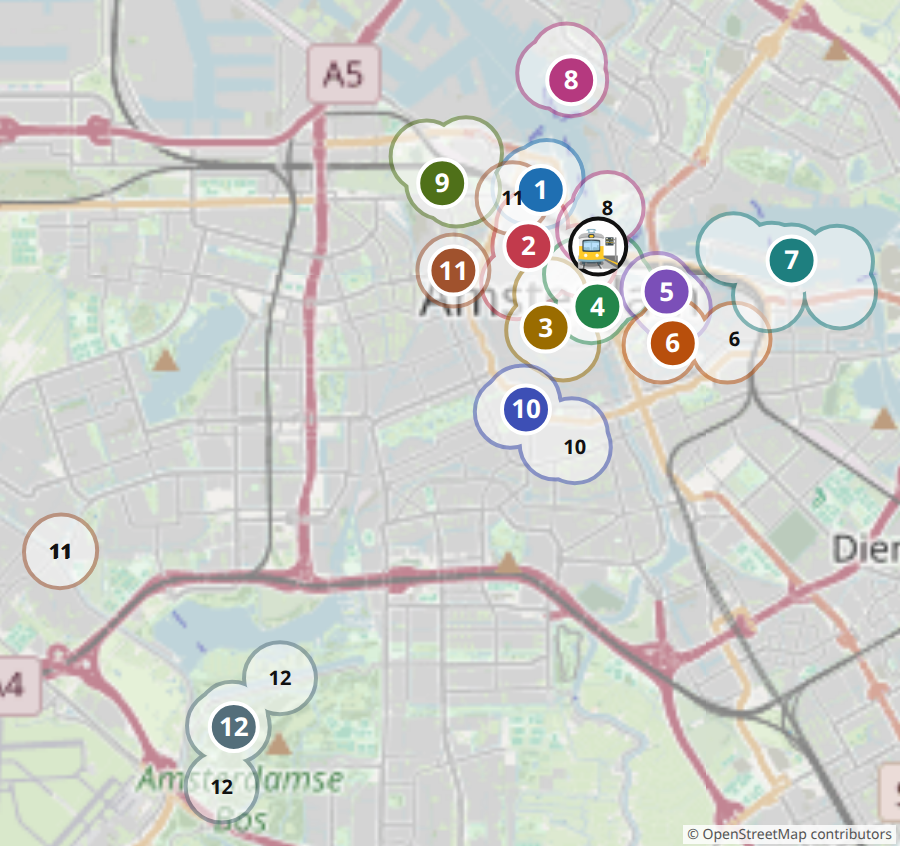

## 📜 Как играть

1. Мы одна команда против Амстердама. 12 зон в любом порядке, 1–2 за вылазку.
2. Задание выполнено — галочка ☐ и закрась кружки 🪙. Ведёшь всех по карте ко всем точкам без подсказок — ещё 🧭 +2.
3. Добрались до 🏁 — зона ЗАХВАЧЕНА! Наклейка на карточку и на номер на большой карте.
4. 👑 Босс — большое задание, с первого раза может не выйти — пробуй ещё! ⚔️ Дуэль — я против родителей: за игру монеты мои в любом случае, последняя (+1) — только за победу. ⏱ На время. 📏 Мерки — на карточке охоты.
5. Монеты копятся за все вылазки. Тратить можно когда хочешь — звание считается по всем заработанным!

### 🛒 Что купить за монеты

- 🪙×5 — Подсказка к загадке
- 🪙×12 — Я выбираю перекус
- 🪙×20 — Родитель выполняет проклятие по моему выбору
- 🪙×35 — Мороженое или сладость
- 🪙×60 — Маленький сувенир
- 🪙×120 — Большой сюрприз от родителей

### 🌀 Проклятия города

Проклятие падает, когда: входим в новую зону и на кубике выпало 1 — или пропускаем задание. Бросаем кубик ещё раз: номер = проклятие. Действует на всю команду, пока не выполним следующее задание.

1. Говорим только как пираты: «Арр!» в конце каждой фразы
2. Идём, как чайки, — руки-крылья, до следующего моста
3. Видишь лодку — кричи «Полный вперёд!»
4. Одна рука за спиной
5. Следующее задание — на одной ноге (где можно)
6. Звеним, как трамвай: «Дзынь-дзынь!» на каждом повороте

### 🎖️ Звание

Звание считается по ВСЕМ заработанным монетам — покупки его не отнимают:

- **Юнга** — меньше 30 монет
- **Матрос** — 🪙 30+
- **Боцман** — 🪙 65+
- **Штурман** — 🪙 105+
- **Капитан** — 🪙 150+
- **Адмирал** — 🪙 195+ и все 12 зон захвачены

## 🎯 Охота по всему городу

Ищи в каждой вылазке, в любой зоне. Строчка заполнена — получи монеты!

- ☐ ☐ ☐ ☐ ☐ XXX — три креста на бурых столбиках у дороги. Встань рядом: столбик тебе до колена или до пояса? (🪙×2)
- ☐ ☐ ☐ Герб города: щит с XXX, два льва и корона (🪙×2)
- ☐ ☐ ☐ ☐ ☐ Номер моста (написан на мосту) (🪙×2)
- ☐ ☐ ☐ ☐ ☐ ☐ ☐ ☐ Камень-картинка на стене дома (раньше вместо номеров!) (🪙×3)
- ☐ ☐ ☐ ☐ ☐ Мельницы (любые 5): De Gooyer · De Bloem · De Otter · De 1200 Roe · Молен ван Слотен · Riekermolen (🪙×4)
- ☐ ☐ ☐ ☐ ☐ Транспорт: трамвай · метро · паром · автобус · поезд (🪙×3)

📏 Мои мерки (измерь дома): Шаг, см ____ · Рост, см ____ · Ладонь, см ____ · Этаж по лестнице, сек ____

## 🏝️ Зона 1: Западные острова

🚉 Пешком от Centraal ~15 минут вдоль воды на запад.

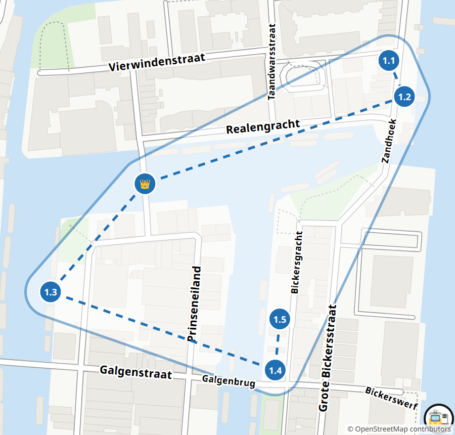

_400 лет назад здесь насыпали три острова для складов и верфей. Сюда везли селёдку, соль, смолу — и даже кошачьи шкуры!_

- [ ] 1.1 🔍 **Золотая монета** ⚔️ (🪙×1+1) — Кто первым найдёт на набережной Zandhoek камень с золотой монетой и императором? Монета дала имя семье Реал, а семья — этому острову! 📍 [Zandhoek](https://www.google.com/maps/search/?api=1&query=52.38769,4.88993)
- [ ] 1.2 📏 **Ряд капитанов** (🪙×3) — Измерь шагами ширину одного дома капитанов. Таких домов в ряду 13. Сколько шагов займёт весь ряд? Пройди и проверь! 📍 [Zandhoek, ряд домов](https://www.google.com/maps/search/?api=1&query=52.38745,4.8901)
- [ ] 1.3 📸 **Птицы у верфей** (🪙×2) — У воды на Prinseneiland сфотографируй двух разных птиц в одном кадре: утку, лысуху, чайку, цаплю, гуся… 📍 [Prinseneiland](https://www.google.com/maps/search/?api=1&query=52.38615,4.88624)
- [ ] 1.4 🏃 **⏱ Минута на площадке** (🪙×2) — На площадке у Bickersgracht коснись за 1 минуту 15 разных вещей: качели, горка, скамейка, дерево… Родитель засекает и считает! 📍 [Детская площадка, Bickersgracht](https://www.google.com/maps/search/?api=1&query=52.38563,4.88869)
- [ ] 1.5 🏃 **Шарады на ферме** (🪙×3) — У фермы De Dierencapel покажи без звуков 5 животных, которых видишь во дворе. Родители должны угадать хотя бы 3! 📍 [Kinderboerderij De Dierencapel, Bickersgracht 207](https://www.google.com/maps/search/?api=1&query=52.38597,4.88874)
- [ ] 👑 **Босс зоны: Мост номер 320** (🪙×6) — Найди мост с номером 320 и прочитай его имя. Перейди его с закрытыми глазами и не касайся перил! Коснулся или открыл глаза — начинай сначала. 📍 [Drieharingenbrug](https://www.google.com/maps/search/?api=1&query=52.38687,4.88727)

Нужно монет: **12** 🏁

## 🌷 Зона 2: Иордан и каналы

🚉 Пешком от Centraal ~10 минут.

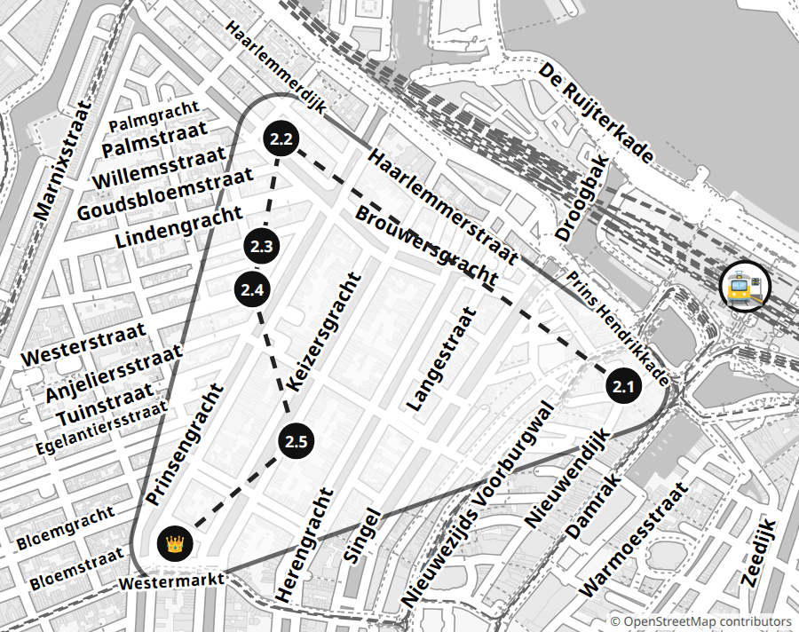

_Раньше у домов не было номеров — только имена и картинки из камня на стенах. Здесь их полно — ищи!_

- [ ] 2.1 📸 **Фотоохота: три флота** (🪙×5) — Пока идёшь по зоне, сфотографируй кораблики трёх разных компаний — имя написано на борту. И ещё 5 мест под значком фотоаппарата на карте зоны: церковь с двумя башнями, Вест-Индский дом, бронзовых мальчика и девочку из книжки, розовый каменный треугольник у воды и дом Анны Франк. Порядок любой — успей до босса! 📍 [Причалы Damrak / Prins Hendrikkade](https://www.google.com/maps/search/?api=1&query=52.3773,4.8968)
- [ ] 2.2 🔍 **Склады с углами** (🪙×2) — На складах канала Brouwersgracht найди надписи Vijfhoek, Vierhoek и Driehoek и переведи их! А какой склад назван в честь далёкого острова? 📍 [Brouwersgracht 200–207](https://www.google.com/maps/search/?api=1&query=52.38161,4.88702)
- [ ] 2.3 🏃 **⏱ Церковь-крест** (🪙×2) — Церковь Noorderkerk построена крестом, а в углах между его концами прижались маленькие домики. Обеги церковь за 2 минуты и сосчитай домики! 📍 [Noorderkerk, Noordermarkt](https://www.google.com/maps/search/?api=1&query=52.37964,4.88643)
- [ ] 2.4 🗣️ **Пирог по-голландски** (🪙×3) — В Winkel 43 закажи по-голландски яблочный пирог со сливками и спроси, сколько пирогов они пекут за день. Что ответили? Переведи нам! Потом оцени пирог от 1 до 10. 📍 [Winkel 43, Noordermarkt 43](https://www.google.com/maps/search/?api=1&query=52.37908,4.88623)
- [ ] 2.5 ⚔️ **Дом с головами** (🪙×2+1) — Легенда: служанка поймала шестерых воров, и их головы теперь на стене. Найди у голов: лавры, колосья, виноград, полумесяц и два разных шлема. Ты найдёшь все шесть раньше, чем родитель — три? 📍 [Huis met de Hoofden, Keizersgracht 123](https://www.google.com/maps/search/?api=1&query=52.37634,4.88745)
- [ ] 👑 **Босс зоны: Корона на башне** (🪙×6) — Встань так, чтобы корона с самой высокой башни города оказалась у тебя на голове, — фото! Съехала — двигайся и снимай снова. Потом в полный час сосчитай удары колокола и прыгни столько же раз. Сбился — жди следующего часа или пробуй с родителем вдвоём. 📍 [Westerkerk](https://www.google.com/maps/search/?api=1&query=52.37455,4.88399)

Нужно монет: **13** 🏁

## 👑 Зона 3: Дам и тайный двор

🚋 Трамваем (или метро 52) до Rokin / Muntplein, к башне Munttoren.

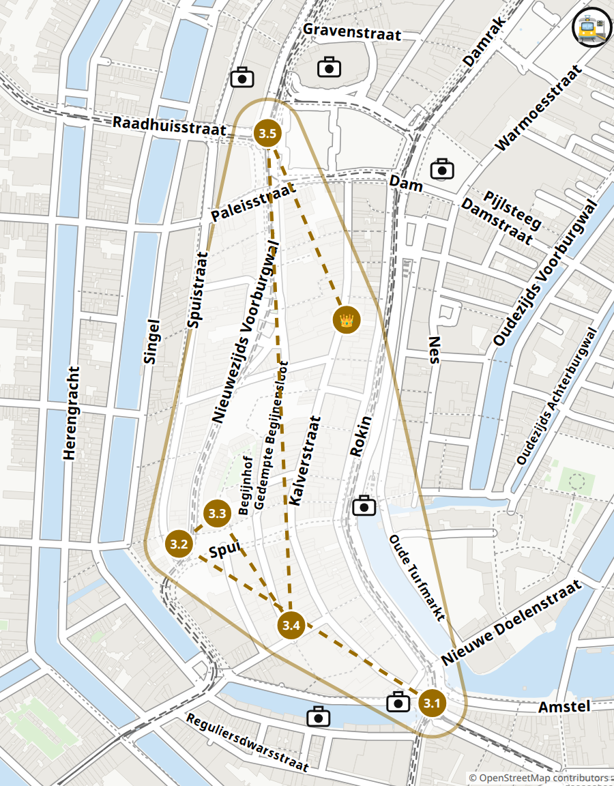

_Королевский дворец стоит на 13 659 деревянных сваях — как на огромной щётке! Когда-то он был ратушей, а дворцом стал в 1808 году._

- [ ] 3.1 📸 **Фотоохота по зоне** (🪙×4) — Пока идёшь по зоне, сфотографируй 6 мест — они на карте зоны под значком фотоаппарата: башню Munttoren, цветочный ларёк на воде, королеву на коне, белый каменный столб на площади Дам, дворец-почту с башенками и Новую церковь у дворца. Порядок любой — успей до босса! 📍 [Munttoren, Muntplein](https://www.google.com/maps/search/?api=1&query=52.36706,4.89322)
- [ ] 3.2 📸 **Бронзовый хулиган** (🪙×2) — На площади Spui стоит бронзовый мальчишка-озорник. Встань рядом так, чтобы на фото вы были как близнецы: та же поза, тот же взгляд! 📍 [Het Lieverdje, Spui](https://www.google.com/maps/search/?api=1&query=52.36878,4.88903)
- [ ] 3.3 🧭 **Тайный двор** (🪙×3) — Через ворота с улицы Gedempte Begijnensloot войди в тайный двор. Внутри — самый старый деревянный дом города. Найди его номер! 📍 [карта](https://www.google.com/maps/search/?api=1&query=52.36911,4.88971)
- [ ] 3.4 ⚔️ **Соус с закрытыми глазами** (🪙×2+1) — Возьми фри с двумя разными соусами на твой выбор. Закрой глаза: родитель 3 раза даёт тебе картошку то с одним, то с другим соусом, а ты говоришь, с каким. Потом поменяйтесь. Кто угадал больше раз? 📍 [Vleminckx, Voetboogstraat 33](https://www.google.com/maps/search/?api=1&query=52.3679,4.89102)
- [ ] 3.5 🔍 **Звери дальних стран** (🪙×3) — Обойди дворец сзади. В треугольнике под великаном Атласом люди со всего света несут дары городу — и ведут зверей. Сосчитай всех зверей! Родитель считает отдельно. Сошлось — задание выполнено; нет — считайте вместе, показывая пальцем. 📍 [Koninklijk Paleis, задний фасад (Nieuwezijds Voorburgwal)](https://www.google.com/maps/search/?api=1&query=52.37322,4.8906)
- [ ] 👑 **Босс зоны: Башня-рекорд** (🪙×6) — Построй в LEGO Store башню из 4 разных видов деталей — выше твоего локтя, если поставить руку на стол. Она должна простоять сама, пока родитель дует на неё и считает до 5! Упала — строй крепче и снова. 📍 [LEGO Store, Kalverstraat 57](https://www.google.com/maps/search/?api=1&query=52.3712,4.892)

Нужно монет: **13** 🏁

## 🏯 Зона 4: Ньюмаркт и Весовая

🚇 Метро 51/53/54 до Nieuwmarkt (или пешком от Centraal ~10 минут), к китайскому храму на Zeedijk. После зоны 5 — пешком по Prins Hendrikkade ~15 минут.

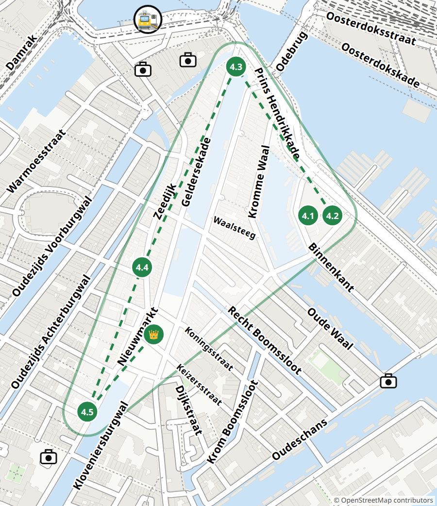

_Весовая (Waag) была городскими воротами больше 500 лет назад. Потом здесь взвешивали товары, а наверху у каждой гильдии мастеров была своя дверь!_

- [ ] 4.1 📸 **Фотоохота по зоне** (🪙×4) — Пока идёшь по зоне, сфотографируй 6 мест — они на карте зоны под значком фотоаппарата: церковь Синтерклааса с двумя башнями, деревянный дом «У обезьянок», китайский храм-дворец, башню Montelbaanstoren, ворота с буквами VOC и башню Zuiderkerk. Порядок любой — успей до босса! 📍 [He Hua Temple, Zeedijk 106–118](https://www.google.com/maps/search/?api=1&query=52.37361,4.90013)
- [ ] 4.2 🍽️ **Шоколад вслепую** (🪙×3) — В магазине Tony's Chocolonely выбери 5 шоколадок с разными вкусами — какие хочешь! Потом закрой глаза: родитель даёт по кусочку в любом порядке, а ты называешь вкус. Угадай хотя бы 4 из 5! 📍 [Tony's Chocolonely Super Store, Oudebrugsteeg 15](https://www.google.com/maps/search/?api=1&query=52.37565,4.8966)
- [ ] 4.3 🔍 **Башня путешественника** (🪙×3) — Отсюда в 1609 году уплыл капитан Гудзон — к будущему Нью-Йорку! Найди на башне камень: женщина показывает на корабль, а сама отвернулась. Какой там год? 📍 [Schreierstoren](https://www.google.com/maps/search/?api=1&query=52.37636,4.90224)
- [ ] 4.4 📸 **Морские чудища** (🪙×2) — На доме мореходов Scheepvaarthuis живут морские чудища, боги и корабли из камня. Найди самое страшное чудище и сфотографируй! 📍 [Scheepvaarthuis, Prins Hendrikkade 108](https://www.google.com/maps/search/?api=1&query=52.37432,4.90413)
- [ ] 4.5 ⚔️ **Дом шириной с дверь** (🪙×2+1) — Легенда: кучер богачей Трип попросил дом шириной с их дверь — и получил! Встань у домика и раскинь руки: сколько тебя в ширину? Угадайте, ты и родители: сколько таких домиков влезет в большой дом напротив? Кто ближе? Бонус: братья Трип продавали оружие — найди на крыше их дома трубы, похожие на пушки! 📍 [Kleine Trippenhuis, Kloveniersburgwal 26](https://www.google.com/maps/search/?api=1&query=52.37163,4.8989)
- [ ] 👑 **Босс зоны: ⏱ Мастера гильдий** (🪙×6) — Родитель тайком фотографирует крупно три резные детали Весовой. Найди за 3 минуты, где каждая, и скажи, какая гильдия работала за этой дверью. Не успел — три новые фото! 📍 [De Waag, Nieuwmarkt](https://www.google.com/maps/search/?api=1&query=52.37269,4.90039)

Нужно монет: **13** 🏁

## ⚓ Зона 5: Корабли и NEMO

🚉 Пешком от Centraal ~15 минут.

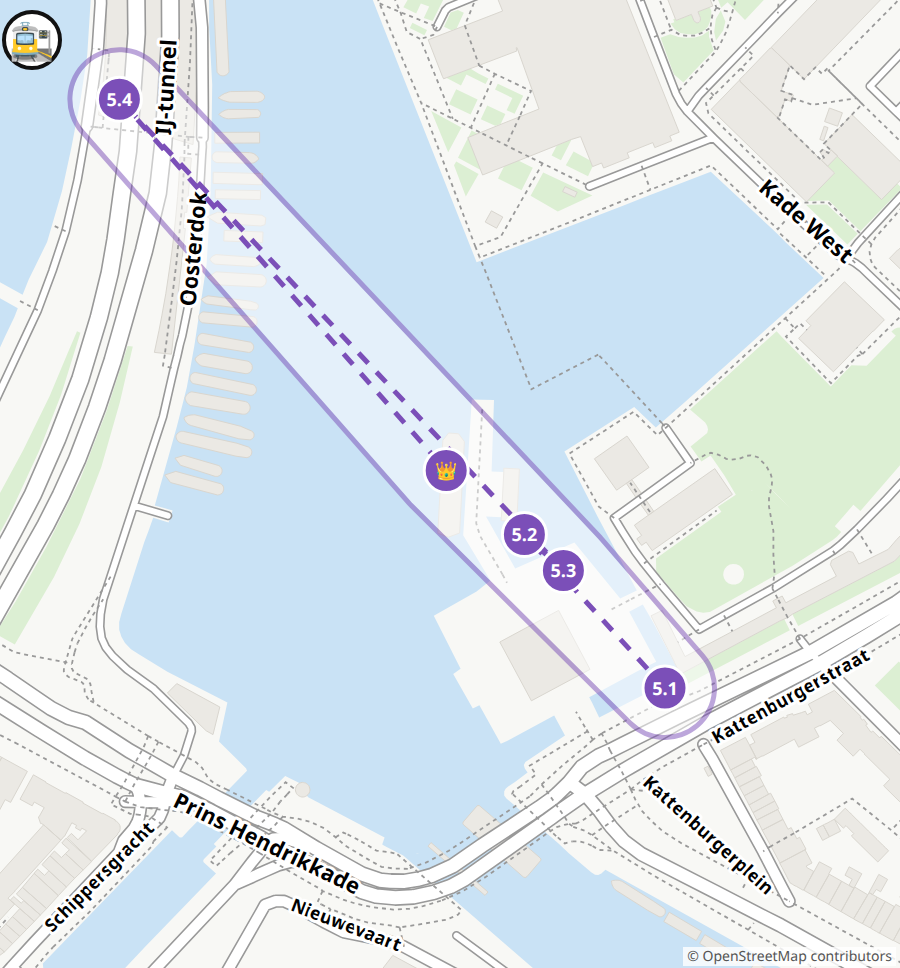

_Настоящий корабль «Амстердам» в 1749 году разбился у берегов Англии и до сих пор лежит в песке. А у музея стоит его копия — на неё можно подняться!_

- [ ] 5.1 🏃 **Приказ капитана** (🪙×3) — На корабле «Амстердам» родитель один раз называет 5 мест на палубе: штурвал, колокол, гамак, пушка, каюта капитана. Обойди их в том же порядке за 3 минуты. Ошибся — новый порядок! 📍 [Корабль «Амстердам» у Het Scheepvaartmuseum](https://www.google.com/maps/search/?api=1&query=52.37155,4.9156)
- [ ] 5.2 🔍 **Внутри кита** (🪙×3) — В музее спрятался огромный кит. Войди к нему в пасть! В последнем зале назови 5 разных видов мусора, который попадает в море. 📍 [Het Scheepvaartmuseum, «Tale of the Whale»](https://www.google.com/maps/search/?api=1&query=52.37215,4.9147)
- [ ] 5.3 🔍 **Роза ветров** ⚔️ (🪙×1+1) — Во дворе музея стеклянная крыша нарисована как роза ветров со старых морских карт. Встань там, где, по-твоему, север. Родитель тоже! Кто ближе — проверяем компасом в телефоне. 📍 [Het Scheepvaartmuseum, внутренний двор](https://www.google.com/maps/search/?api=1&query=52.37201,4.91495)
- [ ] 5.4 🏃 **⏱ Рекорд на крыше** (🪙×2) — Взбеги по лестнице на крышу NEMO, родитель засекает время. Отдохни, спустись и попробуй побить свой рекорд! 📍 [Крыша NEMO, Oosterdok 2](https://www.google.com/maps/search/?api=1&query=52.37385,4.91211)
- [ ] 👑 **Босс зоны: Синтерклаас приплыл!** (🪙×6) — 15 ноября пароход Синтерклааса причаливает у музея. Пока он не встал у причала, найди: имя парохода, Пита на мачте и белого коня. Не успел — ищи, пока Синт сходит на берег. Потом крикни по-голландски «Добро пожаловать!» В другой день босс — «Приказ капитана» с 7 местами. 📍 [Причал у Het Scheepvaartmuseum](https://www.google.com/maps/search/?api=1&query=52.3724,4.9142)

Нужно монет: **10** 🏁

## 🦁 Зона 6: Плантаж и Артис

🚋 Трамвай 14 от Centraal до Pontanusstraat (обратно — от Artis).

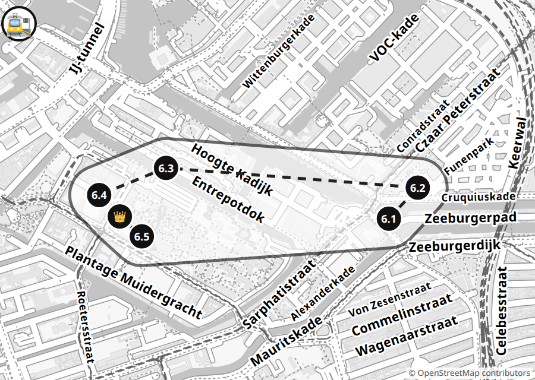

_Артис — самый старый зоопарк Нидерландов, ему 188 лет! А рядом — музей микробов Микропия: всё живое там такое маленькое, что видно только в микроскоп._

- [ ] 6.1 🔍 **Страус с мельницы** (🪙×2) — Под мельницей De Gooyer — пивоварня. На её вывеске нарисована птица. Какая? И что она держит? 📍 [De Gooyer, Funenkade 5](https://www.google.com/maps/search/?api=1&query=52.3668,4.92615)
- [ ] 6.2 🏃 **⏱ Страусиный бег** (🪙×2) — Беги по дорожкам Funenpark страусиными шагами — колени высоко! — до дерева, которое выберет родитель, меньше чем за 2 минуты. Пошёл обычным шагом — начинай сначала! 📍 [Funenpark](https://www.google.com/maps/search/?api=1&query=52.36775,4.9276)
- [ ] 6.3 📸 **Жираф через канал** (🪙×2) — Иди вдоль канала Entrepotdok. На другом берегу — саванна зоопарка. Сфотографируй жирафа или зебру, не заходя в зоопарк! 📍 [Набережная Entrepotdok напротив саванны Артиса](https://www.google.com/maps/search/?api=1&query=52.36835,4.915)
- [ ] 6.4 🔍 **Слова на воротах** (🪙×2) — На воротах зоопарка написаны три латинских слова. Прочитай их! Два похожи на русские слова — какие и что они значат? 📍 [Ворота ARTIS, Plantage Kerklaan 38](https://www.google.com/maps/search/?api=1&query=52.36696,4.91258)
- [ ] 6.5 🔍 **Микробы в поцелуе** (🪙×2) — Найди Kiss-o-meter и поцелуй маму или папу в щёку: больше миллиона микробов или меньше? Потом встань перед зеркалом-сканером: где на тебе микробы? 📍 [Micropia, Kiss-o-meter](https://www.google.com/maps/search/?api=1&query=52.3668,4.91285)
- [ ] 👑 **Босс зоны: Штампы и водяной медведь** (🪙×6) — В кассе Микропии попроси карточку для штампов. Собери 12 штампов за 40 минут, потом найди под микроскопом живого водяного медведя и покажи на пальцах, сколько у него ног. Не успел — ещё 20 минут на недостающие! 📍 [Micropia, Plantage Kerklaan 38–40](https://www.google.com/maps/search/?api=1&query=52.36689,4.91269)

Нужно монет: **11** 🏁

## 🐍 Зона 7: Восточные доки

🚋 Трамвай 26 от Centraal до Rietlandpark.

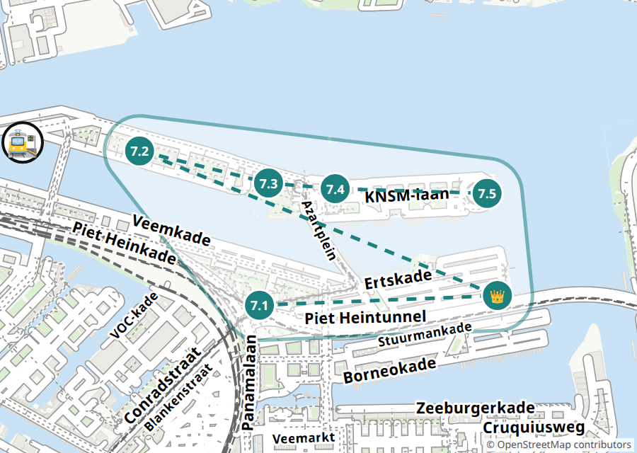

_Здесь был большой порт. Теперь вместо складов — острова с мостами-змеями и смешными мостиками, и почти две трети района — вода!_

- [ ] 7.1 🚋 **Трамвай 26** (🪙×2) — Прокатись на трамвае 26 от Centraal и сосчитай остановки до Rietlandpark. Сфотографируй трамвай, который едет навстречу! 📍 [Остановка Rietlandpark](https://www.google.com/maps/search/?api=1&query=52.37309,4.93453)
- [ ] 7.2 ⚔️ **Мостики острова Ява** (🪙×2+1) — Угадай: сколько мостиков через каналы острова Ява? Кто ближе — ты или родители? Теперь пройди по острову и посчитай! 📍 [Java-eiland, Lamonggracht](https://www.google.com/maps/search/?api=1&query=52.37872,4.92736)
- [ ] 7.3 🏃 **⏱ Пять снарядов** (🪙×2) — На площадке Bogortuin выбери 5 разных снарядов. За 2 минуты побывай на каждом: залезь, сядь или качнись! 📍 [Площадка Bogortuin, Java-eiland](https://www.google.com/maps/search/?api=1&query=52.37755,4.93507)
- [ ] 7.4 🔍 **Портовый кран** (🪙×3) — За старым складом Loods 6 стоит портовый кран. Найди его номер! 📍 [Кран у Loods 6, KNSM-laan](https://www.google.com/maps/search/?api=1&query=52.37734,4.93906)
- [ ] 7.5 🔍 **Дом из воды** ⚔️ (🪙×1+1) — Найди огромный круглый дом, который растёт прямо из воды! Сколько в нём этажей? Кто быстрее сосчитает — ты или родители? 📍 [Emerald Empire, KNSM-eiland](https://www.google.com/maps/search/?api=1&query=52.37717,4.94814)
- [ ] 👑 **Босс зоны: Мост-Питон** (🪙×6) — Найди ярко-красный мост, который извивается, как змея! Перейди его и считай ступеньки. Обратно — спиной вперёд, держась за перила! 📍 [Pythonbrug (Hoge Brug), Sporenburg](https://www.google.com/maps/search/?api=1&query=52.37344,4.94876)

Нужно монет: **11** 🏁

## ⛴️ Зона 8: Север на пароме

⛴️ Бесплатный паром F4 от причалов за вокзалом Centraal до NDSM.

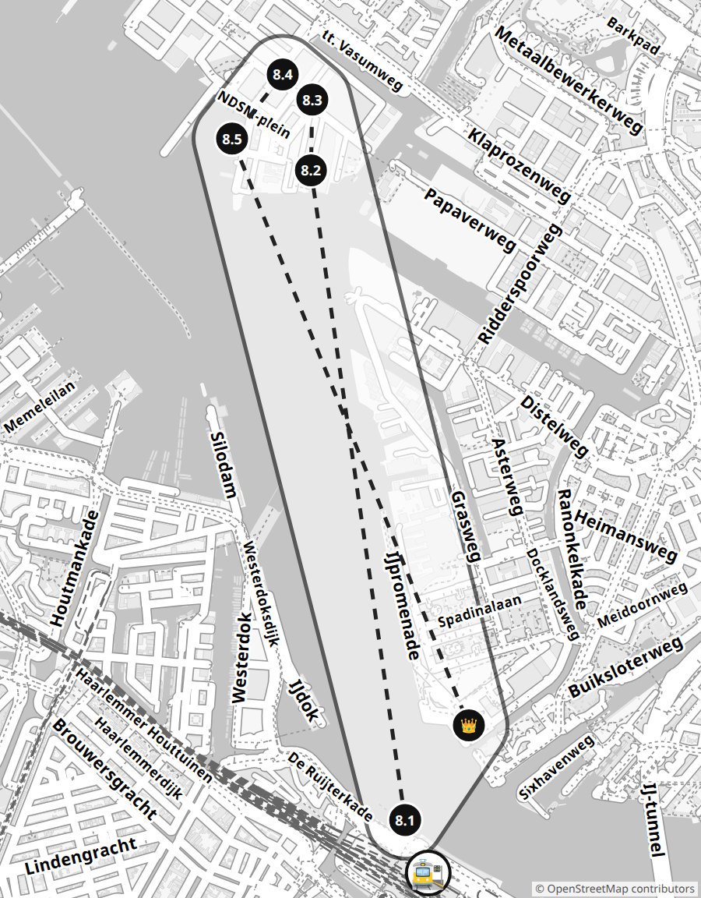

_На верфи NDSM почти 100 лет строили огромные корабли. Последний кран не стали разбирать — внутри него теперь отель!_

- [ ] 8.1 📸 **Бинго с парома** (🪙×2) — С парома F4 сфотографируй 4 из 6: киномузей EYE — белую «летающую тарелку», башню A'DAM, дом на сваях Silodam, кран-отель, буксир, баржу с грузом. Где они — смотри значки 📷 и точки на карте зоны. 📍 [Паромы за вокзалом Centraal](https://www.google.com/maps/search/?api=1&query=52.3811,4.8992)
- [ ] 8.2 📸 **Кран с палец** (🪙×2) — Найди огромный кран-отель. Отходи, пока он не встанет у тебя на ладони, — родитель фотографирует из-за плеча! 📍 [Faralda Crane Hotel, NDSM-plein](https://www.google.com/maps/search/?api=1&query=52.39941,4.89484)
- [ ] 8.3 🏃 **⏱ Контейнерная арка** (🪙×2) — Сосчитай, из скольких контейнеров сложена арка на верфи. Потом пробеги под ней туда и обратно 5 раз за 1 минуту! 📍 [De Containerboog, NDSM](https://www.google.com/maps/search/?api=1&query=52.40156,4.8946)
- [ ] 8.4 🔍 **Охота в STRAAT** (🪙×3) — На стене STRAAT снаружи найди огромный портрет девочки — это Анна Франк. Внутри спроси на кассе по-голландски детскую охоту за сокровищами и пройди её! 📍 [STRAAT, NDSM-plein 1](https://www.google.com/maps/search/?api=1&query=52.40195,4.89385)
- [ ] 8.5 🍽️ **Блинный корабль** (🪙×3) — На блинном корабле блинчики сам берёшь сколько хочешь — считай, сколько осилишь! Укрась один блинчик флагом Амстердама — три креста ×××, как на столбиках у дороги, — фото! А из окна найди башню A'DAM, где мы будем вечером. 📍 [Pannenkoekenboot, Ms. van Riemsdijkweg 33 (у парома NDSM)](https://www.google.com/maps/search/?api=1&query=52.4003,4.8912)
- [ ] 👑 **Босс зоны: Башня A'DAM** (🪙×6) — Засеки, за сколько секунд лифт A'DAM поднимет нас на 20 этажей. Наверху за 3 минуты найди и покажи: вокзал, NEMO, корону Westertoren и кран-отель. Не успел — родитель называет 3 новых места, и ищешь их одним глазом, второй закрыт ладонью! Смелый? Качели над краем — ещё +2 🪙! 📍 [A'DAM Lookout, Overhoeksplein 5](https://www.google.com/maps/search/?api=1&query=52.38377,4.90214)

Нужно монет: **12** 🏁

## 🏭 Зона 9: Вестерпарк

🚶 Из дома пешком ~20 минут до Het Schip (или автобус 22 от Centraal до Zaandammerplein — проверить в 9292).

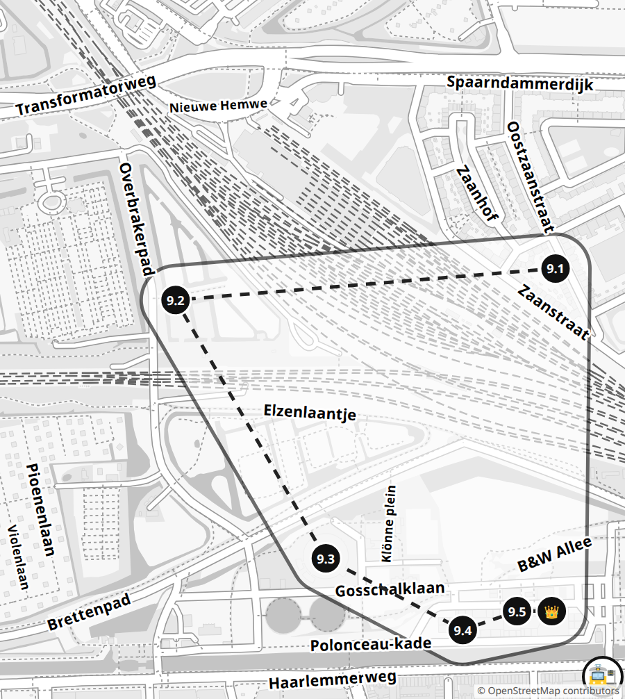

_Здесь был газовый завод: с 1885 года он делал газ для уличных фонарей. Теперь в его зданиях кафе и музеи, а вокруг — большой дикий парк._

- [ ] 9.1 📸 **Дом-корабль** (🪙×2) — Найди дом, похожий на корабль! Где у него нос, а где труба? Сфотографируй дом так, чтобы он «плыл» на тебя. 📍 [Het Schip, Oostzaanstraat 45](https://www.google.com/maps/search/?api=1&query=52.39049,4.87373)
- [ ] 9.2 🧱 **Шалаш** (🪙×3) — ⏱ На диком острове Woeste Westen за 2 минуты собери 10 упавших веток. Потом построй из них круглый шалаш, как газовая бочка. Он должен простоять сам, пока родитель считает до 10! 📍 [Het Woeste Westen, Overbrakerpad 3](https://www.google.com/maps/search/?api=1&query=52.39009,4.86582)
- [ ] 9.3 🏃 **⏱ Газовая бочка** (🪙×2) — Найди круглое здание без углов — в нём хранили газ для фонарей всего города. Обеги его кругом, родитель засекает время! Отдохни и побей свой рекорд. 📍 [Gashouder, Westergasfabriek](https://www.google.com/maps/search/?api=1&query=52.38681,4.86895)
- [ ] 9.4 🍽️ **Олиебол!** (🪙×2) — Только зимой (с конца октября до Нового года): в парке продают олиеболы и их родственников. Родитель тайком покупает два разных. Попробуй оба — и найди их на витрине ларька: как называются? Не сезон — родитель тайком заказывает в кафе две разные закуски, угадай по вкусу, что это. 📍 [Westergasfabriek](https://www.google.com/maps/search/?api=1&query=52.3859,4.8718)
- [ ] 9.5 🔍 **Велик с ракушками** ⚔️ (🪙×1+1) — В Amsterdam in Motion поднимись наверх. Кто первым найдёт велосипед, который достали со дна канала, — он весь в ракушках! 📍 [Amsterdam in Motion, Pazzanistraat 19](https://www.google.com/maps/search/?api=1&query=52.38614,4.87329)
- [ ] 👑 **Босс зоны: Город в миниатюре** (🪙×6) — ⏱ На огромной модели Амстердама за 2 минуты найди 4 места, которые мы уже завоевали: вокзал Centraal, площадь Дам с дворцом, башню Westerkerk и зелёный NEMO. Не успел — родитель называет 4 новых места! 📍 [Amsterdam in Motion, Pazzanistraat 19](https://www.google.com/maps/search/?api=1&query=52.38614,4.87329)

Нужно монет: **11** 🏁

## 🖼️ Зона 10: Рейксмузеум и Де Пейп

🚇 Метро 52 от Centraal (или Rokin) до De Pijp.

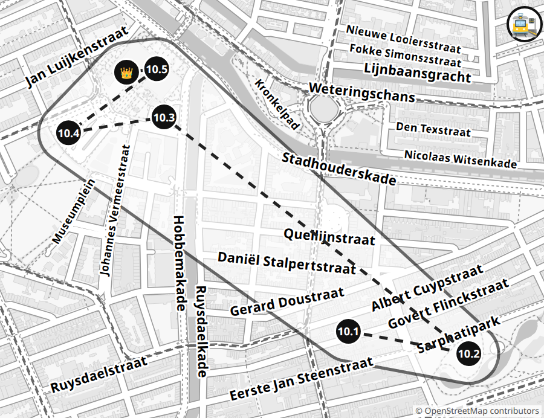

_Рейксмузеум построил тот же архитектор, что и вокзал Centraal, — Пьер Кёйперс. А прямо через середину музея проходит туннель для велосипедов!_

- [ ] 10.1 🚋 **Эскалатор-великан** ⚔️ (🪙×1+1) — Станция De Pijp — самая глубокая в стране! Угадайте с родителями: сколько домов на канале поставить друг на друга, чтобы достать до улицы? Кто ближе? 📍 [Станция метро De Pijp](https://www.google.com/maps/search/?api=1&query=52.3549,4.8917)
- [ ] 10.2 📸 **Фотоохота по зоне** (🪙×4) — Пока идёшь по зоне, сфотографируй 5 мест под значком фотоаппарата на карте: рынок Albert Cuyp, пивоварню из красного кирпича, домик-замок с башенкой, белую «ванну» и музей Ван Гога с круглым крылом. Успей до босса! 📍 [Albert Cuypmarkt](https://www.google.com/maps/search/?api=1&query=52.35605,4.89497)
- [ ] 10.3 🔍 **Храм в парке** (🪙×2) — В парке Sarphatipark найди храм посреди воды. На щитах под куполом три голландских слова — прочитай и переведи! Какие звери сторожат воду внизу? 📍 [Sarphatimonument, Sarphatipark](https://www.google.com/maps/search/?api=1&query=52.35446,4.89557)
- [ ] 10.4 🏃 **⏱ Горка и туннель** (🪙×2) — На Museumplein у кафе Cobra скатись с горки 10 раз за 3 минуты! Потом пройди туннелем под Рейксмузеумом — в нём вход в музей. 📍 [Площадка на Museumplein → проход Rijksmuseum](https://www.google.com/maps/search/?api=1&query=52.35911,4.88577)
- [ ] 10.5 📸 **Лира на пальце** (🪙×2) — На крыше концертного дома Concertgebouw блестит золотая лира. Отойди по площади Museumplein так, чтобы лира уселась на кончик твоего пальца, — фото! 📍 [Museumplein, у Рейксмузеума (вид на Concertgebouw)](https://www.google.com/maps/search/?api=1&query=52.3588,4.8827)
- [ ] 10.6 🔍 **Ночной дозор** (🪙×3) — Найди огромную картину Рембрандта «Ночной дозор». Где девочка с курицей на поясе? А лающая собака? Сцена вовсе не ночная — почему так назвали? Спроси родителей! 📍 [Rijksmuseum, зал «Ночного дозора»](https://www.google.com/maps/search/?api=1&query=52.36005,4.8854)
- [ ] 👑 **Босс зоны: Кукольный дом** (🪙×6) — Минуту смотри на кукольный дом Петронеллы, потом отвернись. Родитель задаёт 5 вопросов: что висит на кухне? сколько этажей?… 4 верных — победа. Нет — ещё минута и новые вопросы! 📍 [Rijksmuseum, кукольный дом Петронеллы Оортман](https://www.google.com/maps/search/?api=1&query=52.36,4.8847)

Нужно монет: **13** 🏁

## 🌬️ Зона 11: Мельницы Запада

🚶 Старт у ворот Haarlemmerpoort, пешком через Вестерпарк к мельницам De Bloem и De Otter, дальше автобусом.

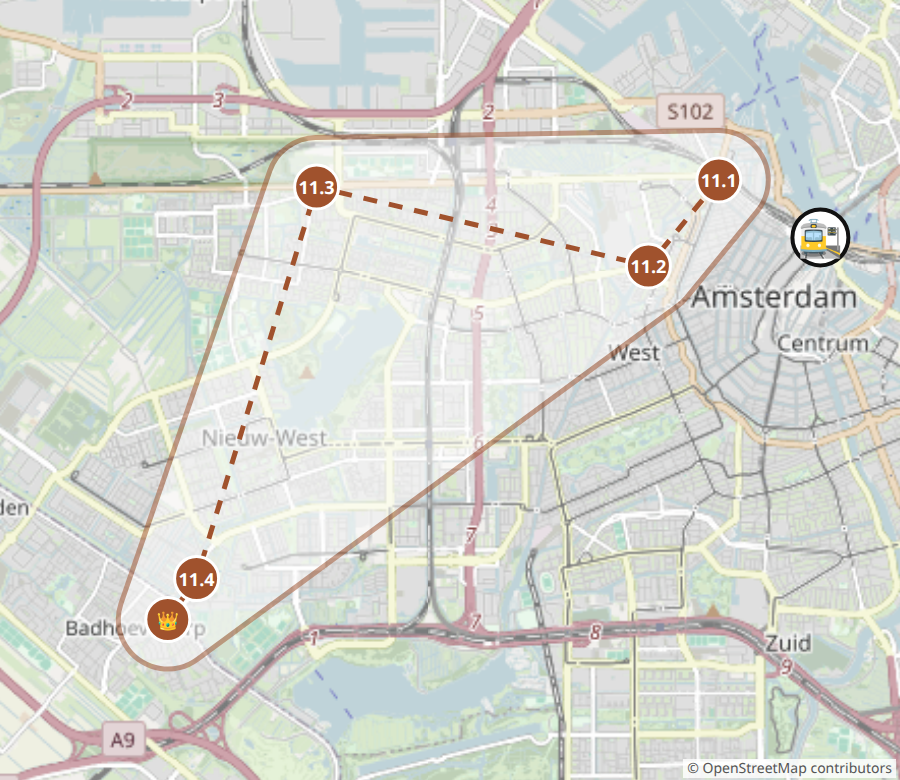

_Мельница «1200 Roe» названа по расстоянию: 1200 старых мер от ворот Haarlemmerpoort, где раньше кончался город._

- [ ] 11.1 🔍 **Ворота короля** (🪙×2) — Через эти ворота въехал король Виллем II! Сосчитай колонны в проходе. Сколько с каждой стороны? 📍 [Haarlemmerpoort](https://www.google.com/maps/search/?api=1&query=52.38497,4.88308)
- [ ] 11.2 🔍 **Мельница-пила** (🪙×2) — Мельница De Otter — лесопилка почти 400 лет! Она поворачивается к ветру целиком, вместе с домиком. Найди, чем мельник её поворачивал. Встань так, чтобы мельница смотрела прямо на тебя, — фото! 📍 [De Otter, Gillis van Ledenberchstraat 78](https://www.google.com/maps/search/?api=1&query=52.37609,4.87119)
- [ ] 11.3 📏 **Великанья мера** (🪙×3) — Мельница De 1200 Roe стоит в 1200 «roe» от ворот Haarlemmerpoort. Одна roe — почти 4 метра! Родитель отмерит её 5 большими шагами на траве, а ты ложись «гусеницей»: встал там, где была макушка, — и ложись снова. Сколько раз ты поместился? 📍 [De 1200 Roe, Haarlemmerweg 701](https://www.google.com/maps/search/?api=1&query=52.38424,4.81512)
- [ ] 11.4 ⚔️ **Я — мельница!** (🪙×2+1) — Руки — крылья мельницы! Крутите прямыми руками в такт настоящим крыльям: один круг — одно крыло. Кто дольше? Сбился или опустил руку — выбыл. Нет ветра — крутим под счёт родителя. 📍 [Лужайка у Molen van Sloten](https://www.google.com/maps/search/?api=1&query=52.3418,4.7925)
- [ ] 👑 **Босс зоны: Внутри мельницы** (🪙×6) — Поднимись внутрь мельницы Молен ван Слотен. Спроси мельника по-голландски: как стоят крылья, когда праздник? Что он сказал? Покажи руками и держи, пока родитель считает до 20. Руки упали — сначала! Потом найди винт, который поднимает воду. 📍 [Molen van Sloten, Akersluis 10](https://www.google.com/maps/search/?api=1&query=52.3416,4.79227)

Нужно монет: **10** 🏁

## 🌳 Зона 12: Амстердамский лес

🚌 Автобус 170 или 172 от Centraal до остановки Amsterdamse Bos (Van Nijenrodeweg / Amstelveenseweg), оттуда пешком к Bosbaan, ~5 мин. Весной — исторический трамвай.

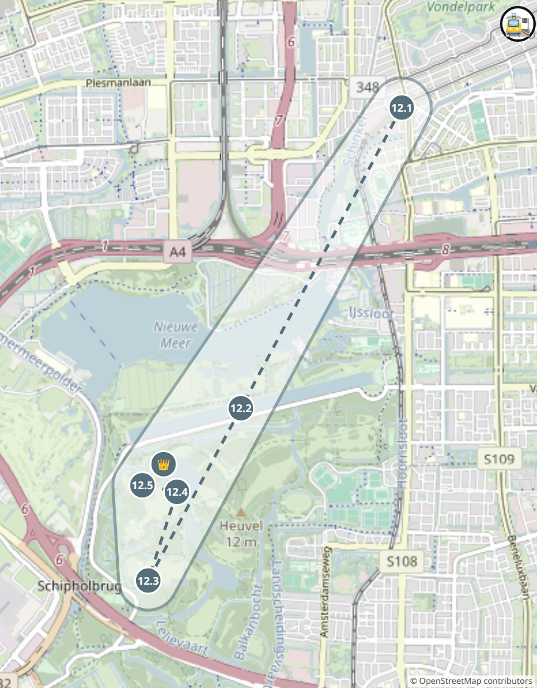

_Этот огромный лес посадили люди! Стройка началась в 1934 году. В лесу 116 мостов, а живут тут козы, коровы и пони._

- [ ] 12.1 🚋 **Старый трамвай** (🪙×4) — Только весной и летом: прокатись до леса на историческом трамвае! Найди в вагоне табличку: в каком городе сделан наш трамвай? 📍 [Haarlemmermeerstation](https://www.google.com/maps/search/?api=1&query=52.34934,4.85672)
- [ ] 12.2 🏃 **⏱ Наперегонки с лодкой** (🪙×3) — Пробеги 100 метров вдоль гребного канала Bosbaan, родитель засекает. Лодка-восьмёрка проходит 100 метров меньше чем за 20 секунд. Кто быстрее? Плывёт лодка — бежим рядом наперегонки! 📍 [Bosbaan](https://www.google.com/maps/search/?api=1&query=52.32616,4.8364)
- [ ] 12.3 🍽️ **Козья ферма** (🪙×3) — На козьей ферме Ридаммерхуве погладь козу (весной — козлят!). Потом попробуй в кафе фермы что-нибудь из козьего молока и найди на табличке слово geit. Оценка от 1 до 10! 📍 [Geitenboerderij Ridammerhoeve, Nieuwe Meerlaan 4](https://www.google.com/maps/search/?api=1&query=52.31287,4.82469)
- [ ] 12.4 🏃 **⏱ Живая тачка** (🪙×2) — Этот лес насыпали тачками! Найди на Большом лугу памятник-тачку. Потом стань тачкой: родитель держит тебя за ноги, а ты пройди на руках 10 шагов за 1 минуту. Упал — сначала! 📍 [Grote Speelweide](https://www.google.com/maps/search/?api=1&query=52.32017,4.82715)
- [ ] 12.5 🔍 **Мостики с гирями** (🪙×2) — Найди в лесу мостик с яркими круглыми шарами. Шары — это гири: они помогают мостику подниматься! Сколько шаров на мостике? Где у него петли, на которых он поднимается? 📍 [Мостики вокруг Grote Speelweide](https://www.google.com/maps/search/?api=1&query=52.32031,4.82497)
- [ ] 👑 **Босс зоны: Лесной кораблик с пассажиром** (🪙×6) — У воды у Speeleilanden построй кораблик из палочек, коры и листьев — только из того, что упало на землю. Посади на него пассажира — жёлудь или камешек. Кораблик должен проплыть 10 секунд, и пассажир не должен упасть в воду! 📍 [Speeleilanden, Grote Vijver](https://www.google.com/maps/search/?api=1&query=52.3213,4.8268)

Нужно монет: **11** 🏁

---

## 👨‍👩‍👦 Для родителей

**Старт:** Старт — Amsterdam Centraal

### План

- **Вылазка 1 · вс 15 ноября:** Зоны 5 + 4 с Синтерклаасом. 9:45 Centraal → 10:00 Scheepvaartmuseum к открытию (корабль, кит, двор) → ~11:05 крыша NEMO → к ~11:15 к причалу → ~11:30 пароход Синтерклааса (босс 5; время 2026 ещё не опубликовано). Обед → зона 4: по Prins Hendrikkade и Geldersekade к храму на Zeedijk (~15 мин), дальше по кругу (~13:15 шествие у Waterlooplein — людно). Конец ~15:30.
- **Вылазка 2 · выходной:** Зоны 1 + 2 пешком от Centraal. Утро — острова (ферма с 9), причалы Damrak, Brouwersgracht, пирог в Winkel 43, Westerkerk, дом с головами.
- **Вылазка 3 · выходной:** Зоны 3 + 10. ~11:00 Munttoren → Rokin → Spui → Бегейнхоф → фри (вс с 12) → Дам → LEGO (вс с 11:30). Метро 52 с Rokin до De Pijp → Sarphatipark → Museumplein → Rijksmuseum (~14:30).
- **Вылазка 4 · выходной:** Зоны 6 + 7. Трамвай 14 до Pontanusstraat → De Gooyer → Funenpark → Артис → Микропия (~11:00) → пешком ~20 мин к Rietlandpark → Питон → Ява → KNSM.
- **Вылазка 5 · выходной:** Зоны 9 + 8. Из дома к Het Schip → Woeste Westen → газгольдер → Amsterdam in Motion (слот ~11:00). Трамваем к Centraal → паром F4 → NDSM, STRAAT → блинный корабль (~14:30) → A'DAM на закате → паром F3.
- **Вылазка 6 · выходной:** Зоны 11 + 12, долгий день. Haarlemmerpoort в 9:30 → пешком к De Otter → автобусы → Молен ван Слотен до 15:00. Или весной в воскресенье, с историческим трамваем (12.1).
- **Вылазка Бонус:** Amsterdam Light Festival 26.11.2026–17.01.2027, огни с 17:30: детская прогулка Kids Walk в приложении (квиз, маленький приз). Каток на Museumplein с ~14.11 — хорошо в день зоны 10.

### 🎟️ Билеты и бронирование

🎟️ **🚋 Проезд ребёнка — Kids Vrij** _(оформить заранее)_

- Когда: До 3.01.2027, ежедневно 7:00–21:00 (трамвай, автобус, метро GVB)
- Где: Онлайн (персональная OV-chipkaart) + GVB
- Как: 1) Заказать ребёнку персональную OV-chipkaart на ov-chipkaart.nl (с фото). 2) Загрузить на неё бесплатный продукт Kids Vrij по инструкции GVB (gvb.nl, поиск «Kids Vrij»). 3) В транспорте — приложить карту при входе и выходе. Взрослый — банковской картой (OVpay). Паромы бесплатны для всех.
- Цена: Kids Vrij бесплатно для детей Амстердама 4–11; цену самой карты уточнить. Без неё — детский дневной билет GVB 5 €. С 2027 обещают бесплатный проезд детей 4–11 по стране — правила уточнить.
- https://www.gvb.nl

### 🛍️ Взять с собой / купить

- Наклейки ~2 см (на 12 зон + карту), ручка, клей или скотч для коллекции, детский фотоаппарат (фото-задания), кубик
- Дома до первой вылазки: рулеткой измерить шаг (10 шагов : 10), рост и ладонь; секундомером — подъём на один этаж по лестнице. Записать на карточку охоты. В телефоне — секундомер
- OV-chipkaart ребёнка с Kids Vrij, Museumkaart родителя, банковская карта (многие кассы без наличных)
- Влажные салфетки (блинчики, фри), запасные штаны (Woeste Westen, лесной кораблик), тёплая одежда для паромов

### 💡

- Ребёнок говорит по-голландски? Пусть сам заказывает и спрашивает там, где точно есть люди (кассы, ларьки, кафе). На фермах часто никого нет.
- Измерения: шаги ребёнок считает сам, большие числа помогите умножить. Ответы — на страницах зон.
- ⏱ Задания на время — выпустить пар на площадках. Не получилось — вторая попытка.
- Усложнить любое задание: глаза закрыты (за руку), на одной ноге, рука за спиной. Так и родители уравнивают шансы в дуэлях.
- ⚔️ Дуэли: на карточке «🪙×2+1»: 2 монеты ребёнок получает и при проигрыше, последнюю +1 — только за победу (столбик дуэлей на табло).
- 🌀 Проклятие — до следующего выполненного задания. Неудачная попытка — не пропуск: пробуйте ещё; проклятие только за честный пропуск.
- 🧭 Дайте ребёнку карту зоны и идите следом; «теплее-холоднее» можно.
- Всё работает и в воскресенье (фри с 12, LEGO с 11:30, Бегейнхоф с 9:30). Рынки Noordermarkt (сб) и Albert Cuyp (пн–сб) — бонус. Фермы: De Dierencapel закрыта в пн, козья — во вт (с ноября и в пн).
- Зона 4: держитесь Zeedijk и Nieuwmarkt, не сворачивайте в переулки к западу — квартал красных фонарей.
- Набережные почти везде без перил — у воды за руку.
- Бегейнхоф — жилой двор: тихо, без беготни.
- Темнеет в ноябре–декабре ~16:30 — финиш на A'DAM (зона 8) как раз к огням города.
- Звание — по всем заработанным монетам (столбик «Монеты» с 🧭 + охота); потраченные монеты звание не уменьшают.

### 🔑 Ответы и подсказки

#### 🏝️ 1. Западные острова

_Три рукотворных острова (Bickers-, Prinsen-, Realeneiland) намыли в 1610–1615 гг. как продолжение порта: верфи, смолокурни, коптильни сельди, склады. Сначала их звали Передним, Средним и Задним, потом — в честь Яна Биккера, принцев Оранских и семьи Реал. В конце XIX века корабли стали слишком большими, острова опустели, после войны их заново открыли художники._

- Centraal → Zandhoek → Drieharingenbrug → Prinseneiland → Galgenstraat → Bickersgracht → Centraal. ~4 км, 1,5–2 ч
- Всё снаружи; ферма вт–вс 9–17 (для шарад работники не нужны)
- Бесплатно
- Кафе на Haarlemmerdijk
- **1.1 Золотая монета:** [Zandhoek](https://www.google.com/maps/search/?api=1&query=52.38769,4.88993) — ✔ Zandhoek 14, камень «De Gouden Reael»: монета-реал с императором Карлом V.
  Реал — испано-португальская серебряная монета, ходившая повсюду в начале XVII века; на варианте времён Карла V был бюст императора. Монета висела знаком на доме Лауренса Реала (будущего генерал-губернатора Ост-Индии), и семья взяла от неё фамилию. Рейнир Реал около 1620 г. скупил участки на Заднем острове, и около 1624 г. остров назвали в его честь. В 1648 г. семья построила здесь склад (по nl-Википедии — упаковочную сельди) с той же монетой на камне. Около 1800 г. в доме открыли гостиницу «De Gouden Reael» — от неё пошло имя всего района. Сейчас здесь ресторан. Ребёнку: «Монета дала имя семье, семья — острову, а дом — целому району!»
- **1.2 Ряд капитанов:** [Zandhoek, ряд домов](https://www.google.com/maps/search/?api=1&query=52.38745,4.8901) — ✔ 13 домов, № 2–14. Расчёт: шаги одного дома × 13 (= 10 раз + 3 раза). Сравните с пройденным.
  Рейнир Реал построил 13 одинаковых «капитанских домов» (№ 2–14) около 1645–46 гг.; реестр памятников датирует № 2, 3, 5 1657 годом. Каким именно капитанам их сдавали, источники не говорят: это не купеческие особняки, как на кольце каналов, а скромный ряд доходных домов — подвалы и верхние этажи сдавали отдельно, у некоторых до сих пор двери-половинки, чтобы болтать с соседом через верх. До 1832 г. дома стояли прямо у открытой воды IJ, потом дамба Westerdoksdijk отрезала их от реки. Здесь выгружали песок для подсыпки улиц — отсюда Zandhoek, «песчаный угол». В 1943 г. дома взяли под охрану, чтобы табачная фабрика не снесла их. Ребёнку: «Раньше отсюда из окна было видно море кораблей!»
- **1.3 Птицы у верфей:** [Prinseneiland](https://www.google.com/maps/search/?api=1&query=52.38615,4.88624) — ✔ Самопроверка по фото. Лысуха — чёрная с белым клювом и «лысиной»; цапля часто стоит на лодках и сваях. Не вышло — попробуйте у фермы (утки, гуси).
  Prinseneiland продавали участками с 1623 г., в основном под склады леса и смолы; назван, вероятно, в честь первых принцев Оранских. Складов здесь было «больше 60» или «больше 100» (источники спорят) из ~900 каменных складов города. В складах западных островов хранили сельдь, зерно, табак, вино, соль, смолу, дёготь — и правда кошачьи шкуры. У складов «носовые» фронтоны, балки с крюками под крышей и ставни-люки; на ставнях часто написан товар или город, с которым торговали. Под навесом у Galgenstraat сохранился ворот, которым поднимали бочки смолы с лодок. С 1950-х в складах живут художники и обычные жильцы. На ставнях складов до сих пор видны слова — товар или город, с которым торговали (например, «Schelvis» — пикша). Ребёнку: «Слово на ставнях — это то, что тут лежало 300 лет назад!»
- **1.4 ⏱ Минута на площадке:** [Детская площадка, Bickersgracht](https://www.google.com/maps/search/?api=1&query=52.38563,4.88869) — ✔ Самопроверка: родитель считает касания вслух. Не получилось — вторая попытка.
  Маленькая площадка на острове Биккера (по OSM, без названия). Ребёнку: «Где ты бегаешь, 400 лет назад смолили лодки!»
- **1.5 Шарады на ферме:** [Kinderboerderij De Dierencapel, Bickersgracht 207](https://www.google.com/maps/search/?api=1&query=52.38597,4.88874) — ✔ Работники не нужны: смотрим во двор (овцы, козы, свиньи, кролики, морские свинки, утки, гуси, куры). Угадали меньше 3 — новая пятёрка. Ферма вт–вс 9–17, пн закрыто.
  Детская ферма у воды на острове Биккера; продают яйца и напитки. Сам остров в 1631 г. купил регент Ян Биккер: около 10 верфей и особняк с башней, откуда он смотрел, как строятся его корабли. Ребёнку: «Где сейчас козы, раньше строили корабли!»
- **👑 Мост номер 320:** [Drieharingenbrug](https://www.google.com/maps/search/?api=1&query=52.38687,4.88727) — ✔ Drieharingenbrug — «мост Трёх селёдок». Мост узкий, по нему ездят велосипеды: начинайте, когда велосипедов нет; родитель идёт сзади и говорит «стоп», если надо. Обычно выходит с 2–3 попыток. В 2024 стоял временный мост (замена) — какой сейчас, проверить; если номера не видно, засчитайте по названию.
  Двойной разводной мост через Realengracht между Реален- и Принсен-эйландом. В 1625 г. здесь был подъёмный мост с девятью пролётами, в 1737 г. его прозвали «Летучим» — видимо, он быстро открывался; в 1859 г. он стал понтонным, а нынешний узкий пешеходно-велосипедный мост — 1983 года. Имя — от камня с тремя коронованными селёдками на угловом доме Vierwindendwarsstraat 1; около 1676 г. рядом работала винокурня «De Drie Gecroonde Haringen». Номера мостов в Амстердаме не идут по порядку: исчезнувший мост свой номер уносит. Ребёнку: «Найди на доме у моста трёх селёдок в коронах!»

#### 🌷 2. Иордан и каналы

_Brouwersgracht («канал пивоваров», с 1594 г.) отделяет Иордан — район ремесленников — от богатого кольца каналов XVII века с Keizersgracht и Westerkerk. В 2007 г. читатели Het Parool выбрали Brouwersgracht самой красивой улицей города. Три дома-брата на Bloemgracht 87–91 (горожанин, крестьянин и моряк на камнях) — в 3 минутах от Westerkerk, если хватит сил. По дороге к Brouwersgracht — West-Indisch Huis на Herenmarkt: здесь Вест-Индская компания решила основать Новый Амстердам, будущий Нью-Йорк; во дворе статуя Питера Стёйвесанта с деревянной ногой (в выходные ворота часто закрыты)._

- Centraal (причалы Damrak) → Herenmarkt (West-Indisch Huis) → Brouwersgracht → Noordermarkt (Noorderkerk, Winkel 43) → Keizersgracht 123 → по Prinsengracht мимо Дома Анны Франк → Westerkerk. ~2,5 км, 2 ч
- Всё снаружи, кроме Winkel 43 (ежедневно, вс с ~9–10). В субботу на площади ещё рынок Noordermarkt (9–16) — бонус, не обязательно
- Пирог ~5–7 €
- Winkel 43 (в субботу из-за рынка очередь — можно взять с собой)
- Winkel 43
- **2.1 Фотоохота: три флота:** [Причалы Damrak / Prins Hendrikkade](https://www.google.com/maps/search/?api=1&query=52.3773,4.8968) — ✔ Кораблики: больше всего у Damrak и Prins Hendrikkade — Stromma (причалы Damrak), Lovers (оранжевые, Prins Hendrikkade); ещё Flagship, Blue Boat, маленькие открытые лодки Those Dam Boat Guys (у Westerkerk). Считается любое имя на борту. Места — по порядку маршрута: 1) Posthoornkerk, Haarlemmerstraat 124. 2) West-Indisch Huis, Herenmarkt / Haarlemmerstraat 75. 3) Woutertje Pieterse и Femke, у Noordermarkt / Westerstraat (рядом с 2.3). 4) Homomonument, у Westerkerk. 5) Anne Frank Huis, Prinsengracht 263 — рядом с Westerkerk, перед боссом. Без времени: засчитано, если все фото есть до босса.
  Кольцо каналов XVII века (Herengracht, Keizersgracht, Prinsengracht и Singel) в 2010 г. внесли в список ЮНЕСКО; главные причалы катеров — у вокзала. Ребёнку: «Раньше по каналам возили товары к складам, а теперь — людей, которые смотрят на эти склады!» 1) Posthoornkerk (1860–63) — католическая церковь Пьера Кёйперса, того же, кто строил вокзал и Рейксмузеум; две башни видны издалека над Haarlemmerstraat. Имя — от старой «тайной церкви» в доме «Почтовый рожок» (Posthoorn). 2) West-Indisch Huis (1617) — сначала мясной рынок, потом штаб Вест-Индской компании (WIC), торговавшей с Америкой: здесь в 1625 г. решили строить Новый Амстердам — будущий Нью-Йорк. Во дворе стоит Питер Стёйвесант, его губернатор с деревянной ногой. 3) Woutertje Pieterse — мальчик-мечтатель из книги Мультатули, Femke — его подруга; рядом памятник Тео Тейссену, учителю и писателю этого квартала. Ребёнку: «Мальчик из книжки всё время мечтал — о чём мечтаешь ты?» 4) Homomonument (1987) — три розовых гранитных треугольника, один спускается к воде: память о людях, которых преследовали за то, кого они любят; первый такой памятник в мире. 5) Anne Frank Huis — здесь девочка Анна Франк с семьёй два года пряталась от нацистов в заднем доме за книжным шкафом и вела дневник; из окна она слушала колокола Westerkerk. Ребёнку можно просто: «Здесь девочка прятала свою семью и писала дневник, который теперь читают во всём мире».
- **2.2 Склады с углами:** [Brouwersgracht 200–207](https://www.google.com/maps/search/?api=1&query=52.38161,4.88702) — ✔ № 200 Vijfhoek («пять углов»), № 205 Vierhoek («четыре угла»), № 207 Driehoek («три угла»); остров — № 204 Spitsbergen.
  Канал назван по пивоварням XVI–XVII вв., хотя к 1664 г. на нём стояли только 3 из 22 пивоварен города. У складов собственные имена, потому что номеров на домах тогда не было: № 188–196 De Appel, Grouwe Valk, Groene Valk, De David, Koning David; № 199 De Liefde; № 206 «Маленький зелёный олень», № 210 «Большой зелёный олень». Хранили, по туристическим источникам, кофе, пряности и кожу (не подтверждено). Почти все склады теперь квартиры. Ребёнку: «Склады — как собаки: у каждого своё имя!»
- **2.3 ⏱ Церковь-крест:** [Noorderkerk, Noordermarkt](https://www.google.com/maps/search/?api=1&query=52.37964,4.88643) — ✔ Домики стоят во всех четырёх углах креста (проверьте на месте). Бежим по площади Noordermarkt и тротуару, дорогу не перебегаем; по субботам и понедельникам здесь рынок — тогда идём шагом.
  Noorderkerk (1620–1623, Хендрик де Кейзер) — первая в Амстердаме церковь в форме греческого креста: кафедра в центре, и всем прихожанам — бедным жителям Йордана — было хорошо слышно. Домики в углах креста сдавали внаём, деньги шли церкви. Ребёнку: «Церковь как плюс, а в его углах живут люди!»
- **2.4 Пирог по-голландски:** [Winkel 43, Noordermarkt 43](https://www.google.com/maps/search/?api=1&query=52.37908,4.88623) — ✔ Заказ: «Een appeltaart met slagroom, alstublieft». Вопрос: «Hoeveel appeltaarten bakken jullie per dag?» — по Michelin Guide до 140. Кусок ~5–7 €. Открыто каждый день, вс с ~9–10. В субботу из-за рынка очередь.
  По Michelin Guide, пятеро пекарей Winkel 43 каждый день чистят яблоки и пекут до 140 пирогов. Очереди особенно в рыночные дни: субботний фермерский рынок и понедельничный блошиный на Noordermarkt. Голландский рецепт яблочного пирога записан ещё в поваренной книге 1514 г. (не подтверждено). Ребёнку: «Голландцы пекут такой пирог больше 500 лет!»
- **2.5 Дом с головами:** [Huis met de Hoofden, Keizersgracht 123](https://www.google.com/maps/search/?api=1&query=52.37634,4.88745) — ✔ 6 голов римских богов: лавры — Аполлон, колосья — Церера, виноград — Вакх, полумесяц — Диана, шлемы — Минерва и Марс (по другим источникам — Меркурий в крылатом шлеме). Это боги, а не воры.
  Двойной дом 1622 г. построен для торговца Николаса Сохира, фасад приписывают Хендрику де Кейзеру. Легенда (с XVII века): шестеро грабителей лезли в дом, и глухая кухарка по одному зарубила их топором; хозяин в награду выставил головы на фасад, а седьмая, «недостающая», голова — будто бы сама служанка. В версии 1911 г. воров было семеро. Уже в 1861 г. историю назвали выдумкой. На самом деле это бюсты шести римских богов около 1 м высотой: Аполлон (лавры), Церера (колосья), Меркурий (крылатый шлем), Минерва (шлем с перьями), Вакх (виноград), Диана (полумесяц). Меркурий (торговля) и Минерва (мудрость) у входа — хозяин, оружейный король Луи де Геер, хотел показать себя «мудрым купцом». В 1656–1670 здесь жил педагог Ян Амос Коменский; сейчас — музей Embassy of the Free Mind. Ребёнку: «Найди у каждой головы её знак!»
- **👑 Корона на башне:** [Westerkerk](https://www.google.com/maps/search/?api=1&query=52.37455,4.88399) — ✔ Корона синяя (1906–2006 была золотой). Фото лучше с Westermarkt с южной стороны башни. Удары — в полный час (по 1–12). Рядом Homomonument (памятник) — там тихо, и не встаём в очередь Дома Анны Франк.
  Westerkerk построена в 1620–1631 гг. по проекту Хендрика де Кейзера; башня 87 м — самая высокая церковная башня города, в карильоне 51 колокол. Рембрандта похоронили здесь в 1669 г. как бедняка — где именно, неизвестно; Анна Франк пишет в дневнике о часах этой башни. Почему корона: в 1480-х Амстердам одалживал деньги Максимилиану Габсбургу и в награду получил право на корону в гербе (в 1497 г. город ещё и заплатил за подтверждение). Сама корона на башне (1638) скопирована с короны императора Рудольфа II. Её позолотили к 300-летию Рембрандта в 1906 г. и вернули синий цвет в 2006-м. Ребёнку: «Корону городу дали за то, что Амстердам одолжил императору денег!» Анна Франк в убежище на Prinsengracht 263, в двух минутах отсюда, слышала эти колокола и писала о них в дневнике.

#### 👑 3. Дам и тайный двор

_Площадь Дам выросла у плотины (dam) на Амстеле, давшей городу имя. Дворец строили как ратушу — символ богатства Золотого века. В паре минут от шумной Kalverstraat прячется Бегейнхоф, тихий двор, где со Средних веков жили одинокие верующие женщины._

- Munttoren и цветочный рынок → Rokin → Spui → Begijnhof (вход с Gedempte Begijnensloot) → Vleminckx → задний фасад дворца → площадь Дам → LEGO Store, Kalverstraat 57. ~2 км, 2 ч
- Begijnhof ежедневно 9:30–17:00; Vleminckx вс с 12; LEGO Store вс 11:30–18:30 — начинайте у Munttoren ~11:00
- Фри ~5 € (два соуса — немного дороже); Pick & Build — цена на стене
- Vleminckx
- Кафе на Spui

🎟️ **🧱 LEGO Store (зона 3)** _(без брони)_

- Когда: Пн 11–20, вт/ср/пт/сб 10–20, чт 10–21, вс 11:30–18:30
- Где: Kalverstraat 57
- Как: Есть LEGO-паспорт — попросите штамп на кассе. Спросить у сотрудника, можно ли строить у демо-стола («Mag ik hier bouwen?»); заранее можно позвонить +31 20 793 0620. Нельзя — маленькая бумажная коробка Pick & Build со стены.
- Цена: Вход бесплатно. Pick & Build: бумажные коробки нескольких размеров, цена на стене (раньше стаканчик ~9–16 €)
- https://www.lego.com/en-nl/stores/store/amsterdam

- **3.1 Фотоохота по зоне:** [Munttoren, Muntplein](https://www.google.com/maps/search/?api=1&query=52.36706,4.89322) — ✔ 1) Munttoren, Muntplein — старт. 2) Bloemenmarkt, Singel — ларьки на баржах, видно с моста у Muntplein. 3) Конная статуя королевы Вильгельмины, Rokin (между Muntplein и Spui). 4) Nationaal Monument, площадь Дам — белый столб 22 м. 5) Magna Plaza, Nieuwezijds Voorburgwal 182 — напротив заднего фасада дворца (3.5). 6) Nieuwe Kerk, у дворца на Дам. Без времени: засчитано, если все фото есть до босса.
  1) Munttoren — остаток средневековых ворот Regulierspoort (1480-е); после пожара 1618 г. Хендрик де Кейзер надстроил башню. В 1672–73 гг., когда война отрезала путь на монетный двор, здесь чеканили монеты — отсюда «Монетная башня». Ребёнку: «Здесь делали настоящие монеты, как твои!» 2) Bloemenmarkt — с 1862 г.: цветы привозили на лодках, и ларьки до сих пор стоят на баржах. Это единственный плавучий цветочный рынок в мире. 3) Вильгельмина правила 50 лет (1898–1948) — дольше всех в стране; во время войны она говорила с голландцами по радио из Лондона. Статуя 1972 г. 4) Nationaal Monument (1956) — в память о погибших во Второй мировой; в стене урны с землёй из всех провинций. 4 мая в 20:00 здесь две минуты молчит вся страна. 5) Magna Plaza (1899) построили как главный почтамт, поэтому он похож на дворец с башенками; теперь это торговый центр — внутри можно посмотреть на купол. 6) Nieuwe Kerk («Новая» — с 1400-х!) — здесь коронуют королей и венчают королевскую семью; сейчас выставочный зал.
- **3.2 Бронзовый хулиган:** [Het Lieverdje, Spui](https://www.google.com/maps/search/?api=1&query=52.36878,4.88903) — ✔ «Het Lieverdje» (1960). Родитель смотрит в кадр и поправляет, пока не похоже. Статую сбил грузовик в марте 2024 г.; её починили и вернули на Spui в мае 2024 г.
  «Лиевердье» («милашка») — так журналист Хенри Кнап в 1947 г. называл амстердамских уличных мальчишек: озорных, но с добрым сердцем. Статую сделал Карел Кнёлман; на бронзу не хватило денег читателей, и её оплатила сигаретная фирма Crescent. Поэтому в 1960-х «антитабачный маг» Роберт Яспер Гротвелд устраивал у статуи ночные хэппенинги против курения и потребления — стычки с полицией вокруг них дали начало движению Provo. Статую красили, наряжали, однажды похитили, грузовики сбивали её в 2012 г. и в 2024 г. Она входит в Канон Амстердама. Ребёнку: «Этот хулиган — символ всех озорных детей Амстердама. Как ты!»
- **3.3 Тайный двор:** [Begijnhof, Het Houten Huys](https://www.google.com/maps/search/?api=1&query=52.36911,4.88971) — ✔ Бегейнхоф, дом № 34, ему около 500 лет. Во дворе живут люди — говорим тихо! Вход — через ворота с Gedempte Begijnensloot (дверь со Spui для гостей закрыта). Ежедневно 9:30–17:00 (летом до 18), бесплатно, без велосипедов и больших групп.
  Двор впервые упомянут в 1389 г.; здесь жили бегинки — католические женщины-мирянки, которые жили одни, молились и ухаживали за больными, но могли уйти и выйти замуж. Последняя бегинка умерла в 1971 г.; сейчас здесь живут одинокие женщины. Дом № 34 — один из двух деревянных домов центра (второй — In 't Aepjen, зона 4); деревянные у него только фасад и задняя стена, верхний этаж выступает вперёд по средневековой моде. Дата спорная: около 1420 г. или около 1528 г. Деревянные дома потом запретили из-за пожаров. За обычными фасадами № 29–30 спрятана католическая «тайная церковь» (1671–80). Дверь со Spui сделали только в XIX веке; теперь гости входят с Gedempte Begijnensloot. Ребёнку: «Этому дереву 500 лет, а дом стоит!»
- **3.4 Соус с закрытыми глазами:** [Vleminckx, Voetboogstraat 33](https://www.google.com/maps/search/?api=1&query=52.3679,4.89102) — ✔ Соусы — любые два. Oorlog («война»): майонез, арахисовый соус сате и сырой лук. Vleminckx: сб 11–19, вс 12–19 (неофициально), обычно очередь.
  Vleminckx — крошечное окошко с фламандской картошкой фри, по большинству источников с 1957 г. Прозвище «Sausmeester» («мастер соусов») — за десятки соусов. Популярный вариант «oorlog» («война»): майонез, арахисовый соус и лук. Ребёнку: «Фри с соусом под названием „война“!»
- **3.5 Звери дальних стран:** [Koninklijk Paleis, задний фасад (Nieuwezijds Voorburgwal)](https://www.google.com/maps/search/?api=1&query=52.37322,4.8906) — ✔ Задний фронтон «Четыре части света несут дары Амстердаму»: среди зверей слон и лев (Африка), верблюд и крокодил с мальчиком верхом (Азия), а ещё мелкие — попугай и другие. Точное число не нашли: засчитываем, когда счёт ребёнка и родителя сошёлся. Смотрим с тротуара: по Nieuwezijds Voorburgwal ходят трамваи.
  Дворец строили в 1648–1665 гг. как ратушу — тогда самое большое здание Европы для городской власти; дворцом он стал при Луи Бонапарте в 1808 г. Бронзовые статуи на крыше по эскизам Артуса Квеллинуса отлили братья Хемони. Атлас (около 6 м, шар почти 4 м и около 1000 кг) стоит сзади между Умеренностью и Бдительностью. В июле 2024 г. шар сняли на реставрацию, весной 2026 г. Атлас вернулся — снова тёмный, а шар остался светло-зелёным. На флюгере — когг с двумя человечками и собачкой: по легенде, корабль без руля сел на мель там, где основали Амстердам. Ребёнку: «Город был таким богатым, что держал весь мир на плечах!»
- **👑 Башня-рекорд:** [LEGO Store, Kalverstraat 57](https://www.google.com/maps/search/?api=1&query=52.3712,4.892) — ✔ Спросите, можно ли строить у демо-стола («Mag ik hier bouwen?», тел. +31 20 793 0620). Нельзя — купите самую маленькую коробочку Pick & Build со стены (теперь бумажные коробки, цена на стене) и стройте из неё прямо в магазине. Своя сумка с LEGO не нужна. Есть LEGO-паспорт — попросите штамп.

#### 🏯 4. Ньюмаркт и Весовая

_Zeedijk — бывшая морская дамба, старейшая часть города у порта: отсюда моряки уходили в море и сюда возвращались. Весовая и Schreierstoren — куски средневековой городской стены. Сейчас на Zeedijk китайский квартал._

- Круг: He Hua Temple (Zeedijk) → по Zeedijk, Nieuwebrugsteeg и краю Warmoesstraat к Tony's Chocolonely (Oudebrugsteeg) → по Damrak и Prins Hendrikkade к Schreierstoren → Scheepvaarthuis → по Oudeschans мимо Montelbaanstoren, Zuiderkerk и ворот VOC → Kloveniersburgwal 26 → Waag. ~3,2 км, 2,5 ч. Южнее Oudebrugsteeg на Warmoesstraat и западнее Zeedijk не сворачивайте: там квартал красных фонарей
- Tony's Chocolonely Super Store — каждый день с 10:00, закрытие 17:00–21:00 по дням (проверить на tonyschocolonely.com). Остальное снаружи
- 5 плиток Tony's ≈ €20–25; остальное бесплатно
- Шоколад из Tony's; китайские пекарни и кафе на Zeedijk (по желанию)
- Кафе на Nieuwmarkt
- **4.1 Фотоохота по зоне:** [He Hua Temple, Zeedijk 106–118](https://www.google.com/maps/search/?api=1&query=52.37361,4.90013) — ✔ По порядку маршрута: 1) He Hua Temple, Zeedijk 106–118 — старт зоны; бонус-кадр: угол крыши «касается» Весовой. 2) In 't Aepjen, Zeedijk 1 — в конце Zeedijk, по пути к Tony's. 3) Basiliek van de Heilige Nicolaas, Prins Hendrikkade 73 — по пути от Tony's к Schreierstoren. 4) Montelbaanstoren, Oudeschans 2 — от Scheepvaarthuis (4.4) по Oudeschans. 5) Zuiderkerk, Zuiderkerkhof — по пути. 6) Oost-Indisch Huis — ворота с VOC на Oude Hoogstraat 24, у моста к Kloveniersburgwal. Без времени: засчитано, если все фото есть до босса.
  1) He Hua Temple — буддийский храм в стиле китайского дворца, открыт в 2000 г. королевой Беатрикс; говорят, крупнейший такой в Европе. Внутрь можно зайти тихо, без фото людей. Ребёнку: «Так строят дворцы в Китае — углы крыши смотрят в небо!» 2) In 't Aepjen (1546–1550) — один из двух последних деревянных домов центра (второй — в Бегейнхофе, зона 3); легенда: моряки платили здесь за ночлег обезьянками, отсюда «У обезьянок». 3) Базилика Святого Николая (1887) — главная католическая церковь центра: Николай — покровитель Амстердама и моряков, он же Синтерклаас. Ребёнку: «Это церковь Синтерклааса!» 4) Montelbaanstoren (1516) охранял верфи; в 1606 г. Хендрик де Кейзер надстроил ему ажурный верх, а в 1611 г. башня начала падать — её выпрямили канатами. 5) Zuiderkerk (1611) — первая протестантская церковь города, башню построил тот же Хендрик де Кейзер; Клод Моне рисовал её с канала Groenburgwal, а Рембрандт жил рядом. 6) Oost-Indisch Huis (1606) — штаб Ост-Индской компании VOC, первой в мире компании с акциями; её корабли ходили в Индонезию за пряностями. Сейчас там университет.
- **4.2 Шоколад вслепую:** [Tony's Chocolonely Super Store, Oudebrugsteeg 15](https://www.google.com/maps/search/?api=1&query=52.37565,4.8966) — ✔ Ребёнок сам выбирает 5 разных вкусов (плитка 180 г ≈ €4–5). Родитель запоминает порядок (или пишет в телефон). Пробовать — на скамейке у воды у Schreierstoren, следующей точки (5 минут по Prins Hendrikkade). 4 из 5 — засчитано; меньше — можно позже повторить с другими кусочками.
  Tony's Chocolonely основал в 2005 г. голландский журналист Тён ван де Кёкен: он узнал, что какао-бобы часто собирают дети-рабы в Западной Африке, и решил делать шоколад без рабства. Плитка нарочно поделена на неравные кусочки — как неравно делятся деньги за какао. Ребёнку: «Посмотри, кусочки все разные — угадай почему?»
- **4.3 Башня путешественника:** [Schreierstoren](https://www.google.com/maps/search/?api=1&query=52.37636,4.90224) — ✔ Камень 1569 г. (плачущая женщина и корабль на волнах). Слева на башне — доска Гудзону 1927 г.; ещё есть камень в честь первого плавания в Ост-Индию (1595).
  Оборонительная башня около 1487 г. стояла там, где стена делала острый поворот, — отсюда старое имя Schrayershoucktoren, «башня острого угла». Красивую легенду о «плачущих» (schreien) жёнах моряков Википедия считает выдумкой, но камень 1569 г. с плачущей женщиной висит. Это единственная уцелевшая оборонительная башня Амстердама; до 1960 г. здесь была портовая контора, сейчас кафе. 4 апреля 1609 г. отсюда ушёл Генри Гудзон на «Halve Maen» искать путь в Азию — и открыл реку, на которой потом вырос Нью-Амстердам, будущий Нью-Йорк. Ребёнку: «Отсюда уплыл корабль, который нашёл место для Нью-Йорка!»
- **4.4 Морские чудища:** [Scheepvaarthuis, Prins Hendrikkade 108](https://www.google.com/maps/search/?api=1&query=52.37432,4.90413) — ✔ Фасад весь в каменной и железной резьбе: морские чудища, дельфины, Нептун, морские коньки, корабли и карты. Самое страшное выбирает ребёнок. Смотрим с тротуара Prins Hendrikkade (оживлённая улица).
  Scheepvaarthuis (1913–1916) построили шесть пароходных компаний — первый дом «Амстердамской школы» (архитекторы Ван дер Мей, Де Клерк и Крамер). Дом стоит на месте верфей и складов, откуда в 1595 г. ушли первые корабли в Ост-Индию. Теперь здесь отель. Ребёнку: «Весь дом рассказывает о море — как книжка из камня».
- **4.5 Дом шириной с дверь:** [Kleine Trippenhuis, Kloveniersburgwal 26](https://www.google.com/maps/search/?api=1&query=52.37163,4.8989) — ✔ Kleine Trippenhuis 2,44 м (≈ 2 размаха рук ребёнка); Trippenhuis (№ 29) напротив — больше 22 м, у него 7 окон в ряд → ≈ 9 домиков. Трубы на крыше — в форме мортир. Легенда о кучере придумана позже.
  Trippenhuis построили в 1660–62 гг. для братьев Луйса и Хендрика Трип — торговцев оружием, медью и смолой: это два зеркальных дома за одним фасадом, а трубы на крыше сделаны в форме мортир. Шире 22 м — самый широкий жилой дом города; в 1816–1885 здесь был Рейксмузеум с «Ночным дозором», сейчас Академия наук. Напротив — Kleine Trippenhuis шириной 2,44 м (сзади расширяется до ~6 м). Легенда о кучере, который вздохнул «мне бы дом шириной с вашу дверь», — выдумка: домик закончили в 1696 г., когда обоих братьев уже не было в живых. Ребёнку: «Сколько таких домиков влезет в большой? Давай измерим!»
- **👑 ⏱ Мастера гильдий:** [De Waag, Nieuwmarkt](https://www.google.com/maps/search/?api=1&query=52.37269,4.90039) — ✔ Над дверями 4 гильдии: кузнецы, художники, каменщики, хирурги; Theatrum Anatomicum — вход хирургов (череп и инструменты). Детали выбирайте видные с площади, по одной на разные двери.
  Это были городские ворота Sint-Antoniespoort; их традиционно датируют 1488 г., но историки допускают ~1425 г. Это старейшее нецерковное здание Амстердама. В 1617–18 гг. ворота превратили в весовую, а наверху сели четыре гильдии со своими входами: кузнецы, художники, каменщики (вход украшал Хендрик де Кейзер) и хирурги. В зале хирургов вскрывали тела на уроках анатомии; гильдия заказала Рембрандту «Урок анатомии доктора Тульпа» (1632), и картина висела здесь до 1828 г. Купольный анатомический театр достроили в 1690-х. Сейчас внизу ресторан. Ребёнку: «Здесь врачи учились, как устроен человек внутри!»

#### ⚓ 5. Корабли и NEMO

_Всё вокруг — бывшая военно-морская гавань: в 1650-х город насыпал на востоке острова, и на Каттенбурге устроили верфь и склады флота Адмиралтейства. NEMO стоит прямо над въездом в автомобильный туннель под IJ._

- Centraal → Scheepvaartmuseum к открытию (корабль, кит, двор) → крыша NEMO → причал у музея (Синтерклаас). ~1,5 км + музей 1 ч
- Музей ежедневно 10–17; крыша NEMO — вт–вс 10–17:30, бесплатно (в непогоду закрывают)
- Музей: взрослый 18,50 €, до 12 лет бесплатно, 13–17 8,50 € (Museumkaart действует)
- Кафе в музее
- Музей

🎟️ **⚓ Het Scheepvaartmuseum (зона 5)** _(билеты онлайн или на кассе)_

- Когда: Ежедневно 10–17 (закрыт 25.12 и 1.01). 15.11 — день Синтерклааса, будет людно
- Где: Kattenburgerplein 1
- Как: hetscheepvaartmuseum.com → Tickets → взрослый + ребёнок, вход на 10:00 (15.11 будет людно). Museumkaart показать на входе. Оплата только картой. Билет одноразовый: всё в музее делаем подряд, потом выходим к Синтерклаасу. Внутри: бесплатный детский аудиогид Junior.
- Цена: Взрослый 18,50 €, ребёнок до 12 бесплатно, 13–17 8,50 € (на странице для семей ещё написано «до 4 бесплатно» — источники спорят)
- https://www.hetscheepvaartmuseum.com/visit/opening-hours-and-admission

🎟️ **🎅 Синтерклаас приплывает (зона 5)** _(без брони)_

- Когда: Вс 15.11.2026: старт ~10:30 от De Omval, у Scheepvaartmuseum ~11:45; ~13:15 на коне на Waterlooplein, ~15:00 Leidseplein
- Где: Причал у Scheepvaartmuseum
- Как: Встать к ~11:15 у музея, держаться за руку, место встречи — вход в музей. Точные времена и перекрытия город публикует в ноябре (sintinamsterdam.nl). В 2019 г. пароход после прибытия можно было посмотреть у музейного причала по билету музея — проверьте на hetscheepvaartmuseum.com.
- Цена: Бесплатно
- https://www.sintinamsterdam.nl/

🎟️ **🔬 NEMO внутри (зона 5, по желанию)** _(бронировать время)_

- Когда: Вт–вс 10–17:30
- Где: Oosterdok 2
- Как: nemosciencemuseum.nl → Tickets → время входа (и для Museumkaart). Для зоны нужна только бесплатная крыша.
- Цена: ~21,50 € с 4 лет (не подтверждено), Museumkaart действует
- https://www.nemosciencemuseum.nl/en/visit/tickets

- **5.1 Приказ капитана:** [Корабль «Амстердам» у Het Scheepvaartmuseum](https://www.google.com/maps/search/?api=1&query=52.37155,4.9156) — ✔ Места можно менять (камбуз, якорь, грузовой подъёмник — «подними груз»). У оригинала было 42 пушки. Вход по билету музея; корабль — первым, пока мало людей.
  На палубах копии видно, как жили 300+ человек: гамаки висели вплотную, еду готовили на одном камбузе. На копии около 16 пушек (не подтверждено). Ребёнку: «Настоящий „Амстердам“ лежит в песке в Англии — ты стоишь на его близнеце!»
- **5.2 Внутри кита:** [Het Scheepvaartmuseum, «Tale of the Whale»](https://www.google.com/maps/search/?api=1&query=52.37215,4.9147) — ✔ На плане музея: «Het verhaal van de walvis» (The Tale of the Whale), западное крыло (west), 1-й этаж, 6+. Вход через пасть гренландского кита; последний зал (с WWF) — о «пластиковом супе». Какой именно мусор показан, не подтверждено — засчитайте 5 разных видов, увиденных в зале (бутылка, пакет, батарейка…). Выставка постоянная.
  Детская выставка начинается с гренландского кита в натуральную величину: заходишь в пасть, а в конце хвост уходит под воду. Рассказ о том, как люди видели китов: морскими чудовищами, добычей китобоев (голландцы тоже охотились) и, наконец, исчезающими животными; последний зал сделан с WWF про пластик в океане. Ребёнку: «Кит тебя проглотит и выпустит обратно!»
- **5.3 Роза ветров:** [Het Scheepvaartmuseum, внутренний двор](https://www.google.com/maps/search/?api=1&query=52.37201,4.91495) — ✔ Двор внутри музея (по билету). Компас в телефоне; ближе тот, чья рука показывает точнее. Крыша повторяет линии компаса со старых карт (1200 стёкол).
  Здание 's Lands Zeemagazijn построено в 1655–56 гг. как арсенал Адмиралтейства: пушки, канаты и порох для военного флота после проигранной войны с Англией. Стоит на 2300 сваях; в 1791 г. пожар выжег его изнутри, поэтому кирпич оштукатурили «под песчаник» — здание белое. Флот пользовался им до 1973 г., тогда же открылся музей. Стеклянную крышу двора (1200 стёкол, каждое вырезано отдельно — здание кривое) спроектировал Лоран Ней по линиям компаса со старых морских карт. Ребёнку: «Здесь хранили пушки, а теперь крыша стала компасом».
- **5.4 ⏱ Рекорд на крыше:** [Крыша NEMO, Oosterdok 2](https://www.google.com/maps/search/?api=1&query=52.37385,4.91211) — ✔ Время записать на карточке. Крыша бесплатная, вход по лестнице с восточной стороны; открыта после реконструкции с 23.05.2025, по iamsterdam ежедневно 10–17:30 (часы зимой и по понедельникам не подтверждены). В непогоду закрывают. По сайту NEMO: вт–вс 10–17:30, бесплатно, лестница с восточной стороны; в непогоду могут закрыть.
  Здание спроектировал Ренцо Пьяно, открыто в 1997 г. королевой Беатрикс. Оно стоит над въездом в туннель IJ 1960-х, и изгиб здания повторяет изгиб туннеля: дом поднимается из воды, а машины под ним ныряют вниз. Фасад из окисленной зелёной меди; площадь на крыше на высоте 22 м, на ней растёт больше 75 видов растений. Похожесть на корабль отмечают путеводители, а не архитектор. Ребёнку: «Под тобой туннель, и по нему прямо сейчас едут машины под водой!»
- **👑 Синтерклаас приплыл!:** [Причал у Het Scheepvaartmuseum](https://www.google.com/maps/search/?api=1&query=52.3724,4.9142) — ✔ «Welkom, Sinterklaas!» Вс 15.11.2026; время ещё не опубликовано (в 2025: у музея ~11:30). Будет очень людно: держим за руку, договоритесь о встрече у входа в музей, у ребёнка в кармане карточка с телефоном. Можно смотреть сверху с крыши NEMO (если открыта). Конь Синта — Ozosnel (бывший Amerigo).
  По легенде Синтерклаас приплывает на пароходе из Испании. В Амстердаме въезд празднуют с 1934 г. (его придумала торговая палата, чтобы начать сезон покупок), по телевизору показывают с 1952-го. Тогда была маленькая лодка и семь Питов, теперь большой пароход и около 400 Питов. Маршрут: от De Omval по Амстелу к Scheepvaartmuseum, дальше шествие к Leidseplein. Общенациональный въезд в 2026 г. — 14.11 в Граве. Святой Николай — покровитель Амстердама (и моряков): его базилика стоит напротив Centraal.

#### 🦁 6. Плантаж и Артис

_Плантаж вошёл в город в 1663 г., но покупателей на участки не нашлось, и вместо домов сделали сады для отдыха горожан. Через дорогу от Артиса — ботанический сад Hortus (1638, здесь с 1682 г.): в 1706 г. сюда привезли кофейное дерево с Явы, и, по популярной версии, его потомки дали кофе Южной Америке._

- Трамвай 14 до Pontanusstraat → De Gooyer → Funenpark → вдоль Entrepotdok (~20 мин) → ворота Artis → Micropia. ~2,5 км + Микропия 1,5 ч. Без Микропии зону не взять — бронируйте
- Micropia ежедневно 10–17
- Micropia: дети до 12 бесплатно, взрослый от 17 € онлайн (Museumkaart действует)
- Café-Restaurant De Plantage (Plantage Kerklaan 36, рядом с Микропией; часы в воскресенье — проверить)
- Micropia

🎟️ **🦠 Micropia (зона 6)** _(бронировать онлайн)_

- Когда: Ежедневно 10–17
- Где: Plantage Kerklaan 38–40 (у входа ARTIS)
- Как: dagtickets.artis.nl → ARTIS-Micropia → дата, взрослый + ребёнок (0–12 бесплатно). Museumkaart действует в Micropia, но НЕ в зоопарке. Карточку для штампов ребёнок просит в кассе.
- Цена: Ребёнок 0–12 бесплатно, взрослый от 17 € онлайн. Зоопарк отдельно: взрослый от 29,50 €, ребёнок 3–12 от 25,50 €
- https://www.artis.nl/en/artis-micropia

- **6.1 Страус с мельницы:** [De Gooyer, Funenkade 5](https://www.google.com/maps/search/?api=1&query=52.3668,4.92615) — ✔ Страус с яйцом (рядом мельница) — знак пивоварни Brouwerij 't IJ. Внутрь мельницы нельзя. ~3 мин пешком от остановки Pontanusstraat (трамвай 14).
  Последняя из мельниц, что с XVII века стояли на бастионах вокруг города. Молола зерно. Имя — от двух владельцев из Гойланда (около 1609 г.). В 1725 г. её поставили там, где сейчас казармы Oranje-Nassau, а в 1814 г. перенесли на фундамент снесённой водяной мельницы на Funenkade — по туристическому сайту, потому что казармы закрыли ей ветер (не подтверждено). Корпус восьмигранный; это самая высокая деревянная мельница страны. В 1972 г. буря сорвала крылья в канал. Рядом пивоварня 't IJ в бывшей бане 1911 г. Ребёнку: «Мельницу переносили, как LEGO, потому что ей загородили ветер!»
- **6.2 ⏱ Страусиный бег:** [Funenpark](https://www.google.com/maps/search/?api=1&query=52.36775,4.9276) — ✔ Дерево ~150–200 м по дорожкам парка (без машин). Родитель засекает и следит за коленями.
  Funenpark построили в 2000-х на месте старого железнодорожного депо: дома стоят прямо в парке, без улиц и машин. Ребёнку: «Страус с вывески бегает быстрее лошади — попробуй как он!»
- **6.3 Жираф через канал:** [Набережная Entrepotdok напротив саванны Артиса](https://www.google.com/maps/search/?api=1&query=52.36835,4.915) — ✔ Саванна Артиса выходит к каналу Entrepotdok; звери видны с набережной (не всегда — зимой их могут держать в доме). Никого нет — засчитываем любого зверя или птицу зоопарка.
  Entrepotdok (1708–1829) — склады Ост-Индской компании и города: 84 одинаковых склада в ряд, когда-то самый длинный складской комплекс Европы. На фасадах до сих пор имена складов — названия городов и рек. Теперь там квартиры. Кран у набережной — старый, для разгрузки. Ребёнку: «Здесь хранили кофе и чай со всего света, а напротив теперь гуляют жирафы».
- **6.4 Слова на воротах:** [Ворота ARTIS, Plantage Kerklaan 38](https://www.google.com/maps/search/?api=1&query=52.36696,4.91258) — ✔ NATURA ARTIS MAGISTRA — «Природа — учительница искусства». NATURA ≈ «натура» (природа), MAGISTRA ≈ «магистр» (учительница). Отсюда имя ARTIS.
  Зоопарк основали в 1838 г. трое любителей зоологии; сначала это было учёное общество только для своих членов. Над тремя воротами стояли слова Natura, Artis и Magistra, а открывали обычно только средние — люди видели «Artis» и решили, что зоопарк так называется. Это старейший зоопарк страны; три пруда внутри показывают, где шёл засыпанный в 1866 г. Принсенграхт. Ребёнку: «Зоопарк получил имя по ошибке!»
- **6.5 Микробы в поцелуе:** [Micropia, Kiss-o-meter](https://www.google.com/maps/search/?api=1&query=52.3668,4.91285) — ✔ Kiss-o-meter: за 10-секундный поцелуй ~80 млн бактерий (исследование 2014 г.), в щёку — гораздо меньше. Зеркало-сканер следит за руками и показывает микробов на ногах, руках, носу (по блогу янв. 2026).
  Микропия открылась в 2014 г. и называет себя первым в мире музеем микробов; в 2016 г. получила премию самого инновационного музея Европы. Kiss-o-meter показывает, сколько микробов двое передают друг другу. Почти все наши микробы полезные. Ребёнку: «Миллионы помещаются в один поцелуй!»
- **👑 Штампы и водяной медведь:** [Micropia, Plantage Kerklaan 38–40](https://www.google.com/maps/search/?api=1&query=52.36689,4.91269) — ✔ «Mag ik een stempelkaart?» Всего 30 штампов, 12 — цель босса. 8 ног (тихоходка). В конце карточку кладут в сканер на первом этаже — собранные микробы появляются на экране.
  Каждый штамп — свой микроб; искать их по всему музею. Сканер в конце показывает «твою» коллекцию на большом экране. Ещё внутри: живые микробы под микроскопами, «микроб месяца», Lab Talks в 11:30, 13:30, 15:30. Дети до 12 лет — бесплатно.

#### 🐍 7. Восточные доки

_В 1870–1900-х здесь построили глубоководную гавань; после войны порт ушёл на запад, в 1970-х район опустел, в 1980-х его заняли сквоттеры и художники, а в 1990–2000-х превратили в жилые острова. Район примерно на 2/3 состоит из воды._

- Rietlandpark → Pythonbrug → Java-eiland (Bogortuin) → KNSM (Loods 6, Emerald Empire). ~4 км, 2–2,5 ч. Обратно автобусом или пешком к Centraal
- Всё снаружи
- Бесплатно (ребёнок в трамвае — Kids Vrij до 3.01.2027)
- Кафе в Loods 6 / на KNSM
- **7.1 Трамвай 26:** [Остановка Rietlandpark](https://www.google.com/maps/search/?api=1&query=52.37309,4.93453) — ✔ 3-я остановка: Muziekgebouw, Kattenburgerstraat, Rietlandpark. С 31.08.2026 конечная — Strandeiland.
  IJtram открыли в 2005 г., чтобы связать вокзал с новым районом IJburg на насыпных островах: 10 км, 25 минут. Rietlandpark стоит в открытой выемке на 6 м ниже земли, а сразу за ней трамвай ныряет в туннель Piet Hein длиной 1,5 км. Ребёнку: «Этот трамвай дальше уходит под землю, как метро!»
- **7.2 Мостики острова Ява:** [Java-eiland, Lamonggracht](https://www.google.com/maps/search/?api=1&query=52.37872,4.92736) — ✔ Число мостиков не публикуют — считайте на месте (каналов поперёк острова 4). Побеждает тот, чьё число ближе.
  Остров намыли в конце XIX века как волнолом; здесь стояла пароходная компания с рейсами в Нидерландскую Ост-Индию, особенно на Яву. Имя «Java-eiland» и жильё появились только в 1990-х по плану Шурда Сутерса. Каналы Brantas, Lamong, Majang и Serang названы по рекам Явы; у каждого островка свой внутренний сад. Мостики придумали художники Гай Ромбаутс и Моника Дросте. Длинный мост Яна Схафера рядом — № 2000 (2001 г.). Ребёнку: «Каналы назвали по рекам на другом конце света».
- **7.3 ⏱ Пять снарядов:** [Площадка Bogortuin, Java-eiland](https://www.google.com/maps/search/?api=1&query=52.37755,4.93507) — ✔ Самопроверка. Что стоит на площадке — не подтверждено (есть только точка в OSM); мало снарядов — скамейка и дерево тоже считаются.
  Bogortuin — один из внутренних садов на островках Явы (см. 7.2). Ребёнку: «Ты играешь во дворе, со всех сторон окружённом домами и водой!»
- **7.4 Портовый кран:** [Кран у Loods 6, KNSM-laan](https://www.google.com/maps/search/?api=1&query=52.37734,4.93906) — ✔ 2868.
  KNSM — Koninklijke Nederlandsche Stoomboot-Maatschappij, «Королевская нидерландская пароходная компания»: пришла на остров в 1903 г., ушла в 1977-м. Кран Figee 1957–58 гг. грузил корабли до 1979 г. и остался единственным, когда здесь стали строить жильё; в 2016 г. его отреставрировали, и с 2018 г. внутри апартаменты для ночёвки. Loods 6 — склад KNSM, теперь мастерские. Рядом фонтан Амфитриты — подарок сотрудников к 100-летию компании (1956). Ребёнку: «Кран 20 лет грузил корабли, а теперь в нём спят гости!»
- **7.5 Дом из воды:** [Emerald Empire, KNSM-eiland](https://www.google.com/maps/search/?api=1&query=52.37717,4.94814) — ✔ Emerald Empire на KNSM-eiland, круглый дом с двором внутри. Высота меняется по кругу: 7–9 этажей (nl-Википедия) — засчитывается любое честно посчитанное число от 7 до 9.
  Круглый дом Emerald Empire (1996) на конце острова KNSM спроектировал Йо Конен — автор плана всего острова. По объявлениям о продаже, в нём 224 квартиры вокруг круглого зелёного двора без машин (не подтверждено). Ребёнку: «В этом бублике 224 квартиры и общий секретный сад!»
- **👑 Мост-Питон:** [Pythonbrug (Hoge Brug), Sporenburg](https://www.google.com/maps/search/?api=1&query=52.37344,4.94876) — ✔ Hoge Brug (Питон), № 1998, по прямой ~90 м. Ступеньки считайте вместе. Спиной вперёд — шагом, родитель идёт рядом со стороны спуска; отпустил перила — начинаем сначала. Мост пешеходный — велосипеды по нему ведут.
  Официально Hoge Brug («Высокий мост»), номер 1998, сдан в 2001 г., автор — Адриан Гёзе (West 8); «Питоном» его прозвали за извивы. Соединяет Sporenburg и Borneo; под ним 9,5 м, чтобы проходили яхты с мачтами. Только пешеходный, с лестницами. В 2002 г. получил международную премию за лучший пешеходный мост, а весь квартал Borneo-Sporenburg — премию Гарварда за городской дизайн. Ребёнку: «Мост выгнулся, как змея, чтобы под ним прошли яхты».

#### ⛴️ 8. Север на пароме

_В центре через IJ нет ни одного моста: северный берег веками был местом виселиц, потом промзоной, а морское лобби боялось помех судам — высокий мост пришлось бы разводить почти постоянно для судов выше 11 м. Поэтому ходят бесплатные паромы. Велопешеходный мост обещают не раньше 2034 г._

- Centraal → паром F4 → NDSM (кран, арка, STRAAT) → блинный корабль (75 мин, от причала у парома) → паром F4 к Centraal → паром F3 к A'DAM → F3 обратно. 3,5–4 ч
- A'DAM ежедневно 10–22
- A'DAM: взрослый 16,50 €, ребёнок 4–12 10,50 € онлайн; блинный корабль: взрослый от 27,50 €, ребёнок от 22,50 €
- Блинный корабль (по брони, рейс подобрать после STRAAT)
- STRAAT, A'DAM

🎟️ **🗼 A'DAM Lookout (зона 8)** _(бронировать онлайн)_

- Когда: Ежедневно 10–22, последний вход 21:00
- Где: Overhoeksplein 5, паром F3 от Centraal
- Как: adamlookout.com/en/tickets → дата и время → взрослый + ребёнок 4–12. Качели Over the Edge — опция, рост от 1,20 м, слот 20 мин, прийти за 30 мин.
- Цена: Онлайн: взрослый 16,50 €, ребёнок 10,50 € (на кассе 18,50 / 12,50 €). Качели +7,50 €
- https://www.adamlookout.com/en/tickets

🎟️ **🎨 STRAAT (зона 8)** _(без брони)_

- Когда: Пн 12–17, вт–ср 10–17, чт 10–21, пт–вс 10–17 (закрыто 5.11.2026 и 1.01.2027)
- Где: NDSM-plein 1, паром F7 или F4
- Как: straatmuseum.com → Tickets (или на кассе). Детскую охоту ребёнок спрашивает на кассе.
- Цена: Взрослый 21,50 €, 13–18 лет 11,50 €, дети 0–12 бесплатно со взрослым
- https://www.straatmuseum.com

🎟️ **⛴️ Паромы F7 / F4 / F3 (зона 8)** _(без брони)_

- Когда: F7 Pontsteiger–NDSM: в будни каждые 20 мин, по выходным тоже ходит (уточнить). F4 Centraal–NDSM: по выходным ~каждые 10 мин. F3 Centraal–Buiksloterweg: каждые 6 мин
- Где: Pontsteiger (Tasmanstraat) · Centraal, сторона IJ
- Как: Просто зайти на паром, билет не нужен. Расписание — gvb.nl или 9292.nl.
- Цена: Бесплатно
- https://9292.nl

🎟️ **🥞 Блинный корабль (зона 8)** _(бронировать заранее)_

- Когда: Вт–вс, рейсы ~12:30–19:30, 75 мин
- Где: Ms. van Riemsdijkweg, NDSM (паром F4/F7)
- Как: amsterdam.pannenkoekenboot.nl → дата и рейс → взрослый + ребёнок. Рейс — после STRAAT (~1 ч на охоту), на борт за 15 мин. Тел. 020-636 88 17.
- Цена: Взрослый от 27,50 €, ребёнок от 22,50 € + 2,70 € туристический налог
- https://amsterdam.pannenkoekenboot.nl

- **8.1 Бинго с парома:** [Паромы за вокзалом Centraal](https://www.google.com/maps/search/?api=1&query=52.3811,4.8992) — ✔ Тарелка — киномузей EYE; башня — A'DAM; дом на сваях — Silodam; кран — Faralda Crane Hotel у NDSM. Буксиры и баржи ходят всё время. Плыть ~14 мин.
  Паромы GVB бесплатны; F4 по выходным — каждые 10 минут. Ребёнку: «Моста нет, чтобы проходили корабли, — поэтому город возит всех бесплатно!» Что видно: EYE (2012) — киномузей, белое здание как летающая тарелка; внутри бесплатно можно посмотреть старые фильмы в капсулах. A'DAM Toren (1971) — бывший офис нефтяной компании Shell, теперь отель, клуб и смотровая площадка с качелями над краем (босс зоны). Silodam (2002) — жилой дом на сваях в воде, разноцветный, будто сложен из морских контейнеров; рядом старые зерновые силосы, тоже ставшие квартирами. Faralda Crane Hotel — портовый кран 1950-х на верфи NDSM, в кабине и на балках теперь три номера отеля и джакузи наверху. Буксиры толкают и тянут большие корабли в порт; баржи по IJ возят песок, контейнеры и топливо — Амстердамский порт один из крупнейших в Европе.
- **8.2 Кран с палец:** [Faralda Crane Hotel, NDSM-plein](https://www.google.com/maps/search/?api=1&query=52.39941,4.89484) — ✔ Faralda Crane Hotel — бывший кран № 13 верфи NDSM, 50 м.
  NDSM (Nederlandsche Dok en Scheepsbouw Maatschappij) появилась в 1946 г. после слияния двух компаний; верфь на ~90 га была одной из крупнейших в мире, корабли строили до 1979 г., закрыли в 1984 г. Кран № 13 помогал строить корабли на стапеле Y-Helling; в 2013 г. его отреставрировали и превратили в отель с тремя люксами. Высота — 50 м, самая высокая точка верфи; люксы на 35–45 м; откуда имя «Faralda», не нашли. Ребёнку: «Кран поднимал куски кораблей, а теперь поднимает гостей!»
- **8.3 ⏱ Контейнерная арка:** [De Containerboog, NDSM](https://www.google.com/maps/search/?api=1&query=52.40156,4.8946) — ✔ De Containerboog — арка из морских контейнеров (сосчитайте на месте).
  Верфь NDSM строила и чинила корабли до 1984 г.; огромные цеха пустовали, пока художники не заняли их в 1990-х. Теперь здесь мастерские, фестивали и искусство из того, что осталось от порта, — арка из контейнеров тоже. Ребёнку: «В таких контейнерах корабли возят по всему миру игрушки, бананы и машины».
- **8.4 Охота в STRAAT:** [STRAAT, NDSM-plein 1](https://www.google.com/maps/search/?api=1&query=52.40195,4.89385) — ✔ «Let me be myself» Эдуардо Кобры (2016, 240 м²) — прямо над входом в музей. Охота 6–12 лет бесплатна, листок на кассе («Is er een speurtocht voor kinderen?»); раскраску к ней можно пропустить. Дети до 13 бесплатно со взрослым. Вт–вс 10–17, пн 12–17.
  STRAAT открылся в 2020 г. в бывшем сварочном цехе верфи: 8000 м², больше 180 работ 170+ художников, многие нарисованы прямо на месте размером со стену дома. Мурал с Анной Франк снаружи написал бразилец Эдуардо Кобра в 2016 г. Ребёнку: «Здесь сваривали корабли, а теперь рисуют картины высотой с дом».
- **8.5 Блинный корабль:** [Pannenkoekenboot, Ms. van Riemsdijkweg 33 (у парома NDSM)](https://www.google.com/maps/search/?api=1&query=52.4003,4.8912) — ✔ Кресты — полосками сиропа, шоколада или из ломтиков. Корабль стоит у парома NDSM, Ms. van Riemsdijkweg 33; рейс 75 мин, быть на борту за 15 мин — капитан не ждёт. Самообслуживание: простые, с яблоком, с беконом, 30+ начинок. Маршрут по IJ мимо EYE и A'DAM.
  Три креста ××× — Андреевские кресты из герба Амстердама (по легенде — огонь, вода и чума, но это выдумка). Их видно на флаге и на красно-коричневых столбиках «amsterdammertjes», которые не пускают машины на тротуар. Голландский блинчик (pannenkoek) больше и тоньше русского блина, его едят и сладким, и с беконом и сыром. Ребёнку: «Ешь герб города!»
- **👑 Башня A'DAM:** [A'DAM Lookout, Overhoeksplein 5](https://www.google.com/maps/search/?api=1&query=52.38377,4.90214) — ✔ Лифт ~20 с на 100 м. Centraal — прямо напротив за рекой; NEMO — зелёный «нос корабля» левее, на востоке; Westertoren — высокая башня с синей короной справа, на юго-западе; кран-отель — далеко на западе, у NDSM. Новые места: EYE (белая «тарелка» внизу), паром на реке, церковь Синтерклааса с двумя башнями у вокзала. Качели Over the Edge — рост от 1,20 м, +7,50 €.
  Башню спроектировал Артур Стал; построена в 1966–71 гг. для лаборатории Shell. Стоит наискосок к берегу, поэтому звалась «Toren Overhoeks», в народе — Shell-toren. Shell уехала в 2009 г., в 2016 г. башня открылась как A'DAM Toren: ~100 м с мачтой, 22 этажа. Качели Over the Edge качают над краем крыши около минуты. Ребёнку: «Раньше тут изобретали бензин, а теперь качаются над пропастью».

#### 🏭 9. Вестерпарк

_Вестерпарк заложили в 1891 г. как маленький парк с прудом. В 2003 г. к нему присоединили территорию газового завода Westergasfabriek (1885; газгольдер 1902 г. был крупнейшим в Европе), очищенную от загрязнения. Газгольдер на ремонте примерно до конца 2026 г._

- Het Schip → Woeste Westen → через парк → газгольдер → кафе Westergas → Amsterdam in Motion. ~3 км, 2,5–3 ч. Дальше трамваем или пешком к Centraal (зона 8)
- Amsterdam in Motion пн–ср 11:30–16:30, чт–пт 10–17, сб–вс 10–18. Woeste Westen всегда открыт, смотритель ср/сб/вс 11–18
- Amsterdam in Motion: взрослый 18 €, до 18 лет бесплатно (Museumkaart действует)
- Кафе Westergas; зимой олиебольный ларёк в парке
- Amsterdam in Motion, кафе Westergas

🎟️ **🏙️ Amsterdam in Motion (зона 9)** _(бронировать тайм-слот)_

- Когда: Пн–ср 11:30–16:30, чт–пт 10–17, сб–вс 10–18 (Amsterdam Museum)
- Где: Westergas, Pazzanistraat 19–23
- Как: amsterdaminmotion.nl/en → Tickets → дата и время → взрослый (Museumkaart) + ребёнок (бесплатно). Тайм-слот нужен всем, прийти за 15 мин. Кафе нет — еда в Westergas.
- Цена: Взрослый 18 €, до 18 лет бесплатно
- https://www.amsterdaminmotion.nl/en/opening-hours-prices

- **9.1 Дом-корабль:** [Het Schip, Oostzaanstraat 45](https://www.google.com/maps/search/?api=1&query=52.39049,4.87373) — ✔ Het Schip (1917–1920, архитектор Мишель де Клерк): нос — острый угол квартала, «труба» — башенка над ним. Снимаем со стороны Zaandammerplein, не стоя на проезжей части Oostzaanstraat.
  Мишель де Клерк построил дом для рабочего жилищного общества Eigen Haard: 102 квартиры, школа и почта — «дворец для рабочих». Треугольный дом с башней похож на лайнер с трубой — отсюда «Корабль». Это главный образец «Амстердамской школы»: волнистые стены, кирпич разных цветов, фигурки зверей. На почте стояла телефонная кабина с надписью «Spreek» («Говори»): почтмейстер соединял звонок. С 2001 г. в почте и школе — музей. Ребёнку: «Найди нос корабля и трубу парохода!»
- **9.2 Шалаш:** [Het Woeste Westen, Overbrakerpad 3](https://www.google.com/maps/search/?api=1&query=52.39009,4.86582) — ✔ Природная площадка до 13 лет, всегда открыта и бесплатна; по выходным смотритель. Грязно — запасные штаны!
  «Дикий Запад» — площадка без горок и качелей: песок, вода, ручей, ветки, лягушки и жуки. Ребёнку: «Здесь взрослые разрешают пачкаться!»
- **9.3 ⏱ Газовая бочка:** [Gashouder, Westergasfabriek](https://www.google.com/maps/search/?api=1&query=52.38681,4.86895) — ✔ Gashouder (1902), диаметр ~60 м — круг ~200 м. Ремонт газгольдера шёл в 2025–2026 гг., к осени 2026 он снова открыт; если вокруг забор — бегите вокруг соседнего здания или по кругу у пруда.
  Газгольдер был крупнейшим в Европе: огромный колокол поднимался и опускался в воде, когда в нём прибавлялось или убывало газа. Газ делали из угля для фонарей и плит до 1967 г.; потом земля долго была ядовитой, её очистили, и с 2003 г. здесь парк и культурный центр. Теперь в бочке концерты. Ребёнку: «Здесь хранили газ, чтобы ночью горели все фонари города».
- **9.4 Олиебол!:** [Westergasfabriek](https://www.google.com/maps/search/?api=1&query=52.3859,4.8718) — ✔ На витрине обычно: oliebol (простой и с изюмом — krentenbol), appelbeignet (кольцо яблока в тесте), berliner (с кремом), appelflap (слоёный с яблоком). Ларьки — с конца октября до Нового года (в Вестерпарке упоминают Bakker's Oliebollenkraam; место 2026 — смотрите на месте). Круглый год — биттербаллен и фри в кафе Westergas.
  Олиеболы едят под Новый год; самый старый напечатанный рецепт — 1667 г. (тогда плоские «oliekoeken» с изюмом и яблоком). С позднего Средневековья их раздавали бедным: продукты дешёвые, а жирное тесто греет. Легенда (не история): древние германцы ели жирное тесто, чтобы мечи злых духов соскальзывали. Поселенцы увезли «oliekoeken» в Новый Амстердам — историки считают их предком американского донатса. Ребёнку: «Олиебол — дедушка донатса!»
- **9.5 Велик с ракушками:** [Amsterdam in Motion, Pazzanistraat 19](https://www.google.com/maps/search/?api=1&query=52.38614,4.87329) — ✔ Велосипед с мидиями — в зале о каналах на верхнем этаже.
  Каждый год из амстердамских каналов достают тысячи велосипедов — специальное судно с краном-грейфером вылавливает их со дна. Пока велосипед лежит в воде, на нём селятся мидии. В зале о протестах рассказывают, как амстердамцы выходили на улицы, и можно сделать свой плакат. Ребёнку: «Мидии за год превратили велик в подводный корабль!»
- **👑 Город в миниатюре:** [Amsterdam in Motion, Pazzanistraat 19](https://www.google.com/maps/search/?api=1&query=52.38614,4.87329) — ✔ Модель 1:1300, 200 м², 30 500 домов, шоу 15 мин. Какие здания легко узнать — не подтверждено: если не получается, засчитывайте реку IJ, Вестерпарк и газовый завод, где вы стоите. Новые места: Рейксмузеум, Артис, мельница De Gooyer, A'DAM.
  Модель открыли в 750-й день рождения города (27.10.2025) в Zuiveringshal Oost — зале, где очищали газ: 200 м², 30 500 домиков, приклеенных вручную, масштаб 1:1300; шоу 15 минут — от деревни 1275 года до будущего. Газовый завод построила британская компания в 1885 г., газ делали до 1967 г. Ребёнку: «Здесь делали газ для фонарей, а теперь весь город поместился в один зал!»

#### 🖼️ 10. Рейксмузеум и Де Пейп

_Де Пейп («Трубка») выросла в конце XIX века на месте полей с мельницами как рабочий район, в том числе для пивоварни Heineken; по одной версии, узкие длинные улицы «выдували» людей на работу, как трубки дым. Метро 52 проложили прямо под старым городом._

- Метро 52 → De Pijp → Sarphatipark → пешком ~15 мин к Museumplein (горка, лира) → туннель → Rijksmuseum («Ночной дозор», кукольный дом). 3 ч. Без музея зону не взять — бронируйте слот
- Rijksmuseum ежедневно 9–17, тайм-слот для всех; остальное снаружи
- Дети до 18 бесплатно, взрослый 25 € (Museumkaart действует)
- Кафе на Museumplein; рынок Albert Cuyp рядом с метро (пн–сб) — бонус
- Rijksmuseum

🎟️ **🖼️ Rijksmuseum (зона 10)** _(бронировать тайм-слот)_

- Когда: Ежедневно 9–17
- Где: Museumstraat 1
- Как: rijksmuseum.nl/en/visit → Tickets → дата и время. Тайм-слот нужен всем, включая детей и Museumkaart. Бесплатная брошюра Family Route — на инфостойке.
- Цена: Взрослый 25 €, до 18 лет бесплатно
- https://www.rijksmuseum.nl/en/visit

- **10.1 Эскалатор-великан:** [Станция метро De Pijp](https://www.google.com/maps/search/?api=1&query=52.3549,4.8917) — ✔ Глубина ~27 м, дом на канале ~12–14 м → ≈ 2 дома. Засеките ещё подъём на эскалаторе для интереса.
  Станция De Pijp — самая глубокая в Нидерландах (~27 м): метро 52 идёт под старыми домами и каналами. На стройке соседней станции Vijzelgracht протечка в котловане опустила грунтовые воды, и старые дома дважды просели; работы останавливали, жильцов эвакуировали, швы стен потом замораживали машинами. Ребёнку: «Над нами каналы и старые дома!»
- **10.2 Фотоохота по зоне:** [Albert Cuypmarkt](https://www.google.com/maps/search/?api=1&query=52.35605,4.89497) — ✔ По порядку маршрута: 1) Albert Cuypmarkt — от метро De Pijp 150 м на север (рынок пн–сб 9–17, в воскресенье лотков нет — тогда фото таблички улицы). 2) Heineken Experience, Stadhouderskade 78 — крюк ~250 м от Ruysdaelkade. 3) Moco Museum, Villa Alsberg, Honthorststraat 20 — у Museumplein. 4) Stedelijk Museum, Museumplein 10 — белая «ванна» (de Badkuip). 5) Van Gogh Museum, Museumplein 6 — новое крыло овальное. Без времени: засчитано, если все фото есть до босса.
  1) Albert Cuypmarkt — самый большой уличный рынок Нидерландов (с 1905 г.), 260 лотков: сыр, селёдка, stroopwafels прямо с огня. Назван по художнику XVII века — как и все улицы Де Пейпа. Ребёнку: «Здесь все улицы названы именами художников!» 2) Heineken Experience — старая пивоварня Heineken (1867–1988), теперь музей; внутри стоят огромные медные чаны, в которых варили пиво, а по городу его развозили на телегах с лошадьми. 3) Moco Museum — в вилле 1904 г. с башенкой, похожей на маленький замок; внутри Бэнкси и Дали. 4) Stedelijk — музей современного искусства; новое белое крыло (2012) амстердамцы сразу прозвали «ванной». 5) Van Gogh Museum — больше всего картин Ван Гога в мире (около 200); овальное крыло (1999) построил японский архитектор Кисё Курокава. Ребёнку: «Ван Гог при жизни продал, говорят, всего одну картину!»
- **10.3 Храм в парке:** [Sarphatimonument, Sarphatipark](https://www.google.com/maps/search/?api=1&query=52.35446,4.89557) — ✔ Щиты: «Volksvlyt – Onderwijs – Handel» (народный труд, образование, торговля; «y» — старое написание «ij»). На карнизе: «Sarphati – Stichter – Van 't Nieuw Amsterdam». Внизу львиные морды и лягушки (зимой фонтан может не работать).
  Памятник врачу Самюэлу Сарфати (1813–1866) поставили в 1886 г.: храм ~12 м высотой посреди бассейна шириной 16 м, колонны из красного шведского гранита, бронзовый бюст работы Стракке-ван Боссе. На карнизе надпись «Sarphati — основатель нового Амстердама», на куполе щиты «Трудолюбие народа — Образование — Торговля». Сарфати лечил бедных и боролся с грязью: добивался вывоза мусора, открыл хлебную фабрику с дешёвым хлебом, затеял Дворец промышленности и отель Amstel и придумал этот парк, но не дожил до его открытия. В оккупацию бюст еврейского врача сняли, после освобождения вернули. Ребёнку: «Этот доктор лечил целый город — даже заставил вывозить мусор!»
- **10.4 ⏱ Горка и туннель:** [Площадка на Museumplein → проход Rijksmuseum](https://www.google.com/maps/search/?api=1&query=52.35911,4.88577) — ✔ Площадка обновлена летом 2025: две горки, сетчатая башня-барабан, качели-корзина. Проход бесплатный, держитесь пешеходной части (велосипеды!). С ~14.11 на Museumplein каток — проверьте, что площадка открыта.
  Кёйперс с самого начала сделал музей воротами между центром и новым югом. Музей открылся в 1885 г. При реконструкции испанские архитекторы хотели устроить в проходе главный вход, но жители и Союз велосипедистов отстояли проезд; вход сделали под ним. Обновлённый музей открыли в 2013 г. после 10 лет ремонта. Ребёнку: «Велосипедисты победили музей!»
- **10.5 Лира на пальце:** [Museumplein, у Рейксмузеума (вид на Concertgebouw)](https://www.google.com/maps/search/?api=1&query=52.3588,4.8827) — ✔ Позолоченная лира на фронтоне с 1888 г. (нынешняя — копия 1993 г., ~3 м). Отходим к Рейксмузеуму; площадь без машин, но через неё едут велосипеды по дорожке.
  Concertgebouw (1888) построили на болоте за городом на 2186 сваях; его Большой зал считают одним из лучших по звучанию в мире. Museumplein был пустырём для Всемирной выставки 1883 г. Ребёнку: «В этом доме звучит музыка, а Рейксмузеум на другом конце площади — дом картин».
- **10.6 Ночной дозор:** [Rijksmuseum, зал «Ночного дозора»](https://www.google.com/maps/search/?api=1&query=52.36005,4.8854) — ✔ Девочка в золотистом платье слева от центра, курица у неё на поясе; собака внизу справа лает на барабанщика. Название придумали позже, когда лак потемнел. Картину реставрируют в стеклянной комнате (Operatie Nachtwacht, видимо до 2027 г.) — видно через стекло. Зал «Ночного дозора» в конце Галереи славы (номер на плане).
  «Ночной дозор» (1642) — групповой портрет стрелковой роты капитана Франса Баннинка Кока. Ночью он не является: картину назвали так позже, когда лак потемнел. Курица у девочки — знак роты аркебузиров: её когти были их эмблемой. Собаку Рембрандт взял с рисунка Адриана ван де Венне. С ноября 2024 г. реставраторы снимают старый лак прямо в зале, в стеклянной комнате, и картина остаётся на стене. Ребёнку: «Найди, кто тут шумит больше всех — барабанщик или собака!»
- **👑 Кукольный дом:** [Rijksmuseum, кукольный дом Петронеллы Оортман](https://www.google.com/maps/search/?api=1&query=52.36,4.8847) — ✔ Кукольный дом Петронеллы Оортман, зал 2.20: 9 комнат, шкаф отделан черепаховым панцирем и оловом. Вопросы придумайте сами, глядя на дом, пока он смотрит (кухня, библиотека, кормилица с ребёнком, корзины, картины).
  Это не игрушка, а шкаф-коллекция богатой дамы: Петронелла Оортман собирала его примерно в 1686–1710 гг. Шкаф из дуба с черепаховым панцирем и оловом; внутри шёлк, бархат, стекло, мрамор, медь — всё в точных пропорциях. По словам дочери, он стоил около 30 000 гульденов — как дом на канале. Оригинальные куклы утеряны. Ребёнку: «За этот кукольный дом заплатили, как за настоящий!»

#### 🌬️ 11. Мельницы Запада

_Ворота Haarlemmerpoort стояли на западной границе города до 1870 г. Мельницы дальше по Haarlemmerweg стояли за городом, в польдерах и у промышленных каналов; город разросся, и почти все исчезли — De Otter и De 1200 Roe уцелели, а Molen van Sloten собрали заново. De Bloem (1768) мелет зерно; её перевезли сюда в 1878 г., когда старое место у городских стен застроили._

- Haarlemmerpoort → Вестерпарк → De Bloem (Haarlemmerweg 465) → вдоль Kostverlorenvaart → De Otter (~2 км пешком) → автобусом к De 1200 Roe (номер — в 9292 накануне) → автобусом к Station Lelylaan → автобус 195 до остановки Langsom (или трамвай 2 до Oudenaardeplantsoen / 1 до Baden Powellweg и пешком) → Molen van Sloten. Уйти от De 1200 Roe не позже ~13:45: последняя экскурсия на мельнице в 15:00
- Molen van Sloten 2.11–21.03: 10–16, последняя экскурсия 15:00
- Мельница: взрослый 8 €, ребёнок 4–11 4,50 €, Museumkaart 6,75 €; только карта
- Перекус с собой; кафе Westergas на старте или у Molen van Sloten (проверить)
- Westergas, Molen van Sloten

🎟️ **🌬️ Molen van Sloten (зона 11)** _(билеты онлайн)_

- Когда: 2.11–21.03: ежедневно 10–16, последняя экскурсия 15:00 (закрыто 25–26.12 и 1.01)
- Где: Akersluis 10
- Как: tickets.molenvansloten.nl → дата → взрослый + ребёнок 4–11. Экскурсия включена. Оплата только картой. Тел. 020-669 0412.
- Цена: Взрослый 8 €, ребёнок 4–11 4,50 €, Museumkaart 6,75 €
- https://tickets.molenvansloten.nl/en/tickets

- **11.1 Ворота короля:** [Haarlemmerpoort](https://www.google.com/maps/search/?api=1&query=52.38497,4.88308) — ✔ 8 колонн (раскладку по сторонам проверьте на месте). Ворота открыты 27.11.1840. Считаем с тротуара: через арку едут велосипеды, в проходе не стоим.
  Официальное имя — Willemspoort, но так никто не говорит. Это пятые ворота на дороге в Харлем; прежние, работы де Кейзера (1615), снесли в 1837 г. Новые открыли 27 ноября 1840 г.: Виллем II въехал через них за день до вступления на престол. В проходе 8 колонн из бентхаймского песчаника. Здесь брали налог на ввозимые товары, потом были полиция и пожарные; в 1889 г. ворота решили снести, но передумали. С 1986 г. в них квартиры. Ребёнку: «Через эти ворота въехал король!»
- **11.2 Мельница-пила:** [De Otter, Gillis van Ledenberchstraat 78](https://www.google.com/maps/search/?api=1&query=52.37609,4.87119) — ✔ Палтрок: весь корпус стоит на кольце с катками, его поворачивают воротом сзади (проверьте на месте). Не работает — смотрим снаружи; крыльев может не быть.
  Деревянная пильная мельница-«палтрок»: стоит на коротком столбе и кольце роликов и поворачивается к ветру целиком. Внутри три вертикальные пилы резали брёвна на доски. Из целой группы пильных мельниц у Kostverlorenvaart осталась только она. Крылья сняли в 1925 г., в 1994–96 гг. мельницу восстановили (размах 19,5 м), но ветра между домами ей не хватает. Ребёнку: «Ветер пилил брёвна!»
- **11.3 Великанья мера:** [De 1200 Roe, Haarlemmerweg 701](https://www.google.com/maps/search/?api=1&query=52.38424,4.81512) — ✔ Roe ≈ 3,7 м (амстердамская 3,68 м, рейнландская 3,77 м — источники расходятся). 5 шагов взрослого по ~75 см. Ребёнок ростом ~1,25 м помещается ~3 раза. 1200 roe ≈ 4,5 км — примерно столько вы проехали от ворот на автобусе. Гусеница — на траве со стороны мельницы, подальше от Haarlemmerweg (оживлённая дорога).
  Восьмигранная мельница-«grondzeiler» (крылья почти до земли) 1632 г. осушала польдер Osdorper Binnenpolder. Roe (roede, «прут») — старая мера длины, разная в разных городах: амстердамская — 13 футов, 3,68 м, рейнландская — 3,77 м. В 1951 г. польдер засыпали под жилой район, а мельница осталась; она исправна, но в ней живут — внутрь нельзя. Ребёнку: «Имя мельницы — это расстояние!»
- **11.4 Я — мельница!:** [Лужайка у Molen van Sloten](https://www.google.com/maps/search/?api=1&query=52.3418,4.7925) — ✔ Лужайка у Молен ван Слотен. Круги большие, руки прямые — родитель следит за честностью соперника, ребёнок — за родителем.
- **👑 Внутри мельницы:** [Molen van Sloten, Akersluis 10](https://www.google.com/maps/search/?api=1&query=52.3416,4.79227) — ✔ Экскурсия каждый час, включена в билет. На чердаке — фигуры по картинам Рембрандта (он был сыном мельника), по отзывам. «Hoe staan de wieken als er feest is?» Радость (vreugdestand): верхнее крыло чуть не доходит до самого верха; траур (rouwstand) — чуть прошло верх (проверьте у мельника). Воду поднимает архимедов винт (vijzel) из польдера в Ringvaart. Зимой 10–16, последняя экскурсия 15:00.
  Польдерная мельница: вместе с насосной станцией откачивает воду из западных районов. Её собрали в 1991 г. на новом основании из корпуса мельницы 1847 г. из Watergraafsmeer; колпак и крылья новые (крылья меняли в 2024 г.). На чердаке экспозиция о Рембрандте, сыне мельника; рядом статуи Рембрандта и Саскии. Ребёнку: «Эта мельница держит наши ноги сухими!»

#### 🌳 12. Амстердамский лес

_В Великую депрессию в Амстердаме было больше 50 000 безработных, и город сделал из «Boschplan» стройку для них: с 30 апреля 1934 г. до 1940 г. здесь работали ~20 000 человек, в основном лопатами и тачками. Сейчас ~1000 га и ~200 000 деревьев; вода внутри лежит ~5,5 м ниже уровня моря._

- Вход у Bosbaan → вдоль канала → козья ферма → Большой луг (тачка) → мостик с шарами № 520 → Speeleilanden. ~3,5 км, 2,5–3 ч
- Лес всегда открыт
- Бесплатно
- Кафе на козьей ферме
- Козья ферма

🎟️ **🚋 Исторический трамвай, линия 30 (зона 12, весна)** _(уточнить)_

- Когда: Воскресенья, апрель–октябрь 2027
- Где: Haarlemmermeerstation, Amstelveenseweg
- Как: museumtramlijn.org → расписание сезона 2027; билеты обычно в трамвае.
- Цена: Уточнить
- https://www.museumtramlijn.org/en

- **12.1 Старый трамвай:** [Haarlemmermeerstation](https://www.google.com/maps/search/?api=1&query=52.34934,4.85672) — ✔ Музейная линия ходит по воскресеньям с апреля по октябрь, 11–17 (сезон 2027 — проверить). Вагоны музея — из Амстердама, Вены, Праги и других городов: табличка с заводом обычно у двери или над окном.
  Музейная линия открылась в 1975 г. на последнем куске старой железной дороги 1915 г.: 7,2 км. Ездят трамваи 1904–1960 гг. из Амстердама, Гааги, Роттердама, Вены и Праги. Ребёнку: «Этот трамвай старше бабушки — и мог приехать из Вены!»
- **12.2 ⏱ Наперегонки с лодкой:** [Bosbaan](https://www.google.com/maps/search/?api=1&query=52.32616,4.8364) — ✔ 100 м — по GPS телефона. Восьмёрка: 2000 м за ~5,5–6 мин → 100 м за ~17–18 с. По воскресеньям гребцы часто тренируются.
  Bosbaan выкопали первым, с 1934 г., руками безработных; первые гонки — в 1937 г. Длина 2200 м; ширина была 72 м, теперь 118 м и 8 гоночных дорожек. Здесь проходили чемпионаты мира по академической гребле. Ребёнку: «Этот огромный канал выкопали лопатами!» Канал Bosbaan (1936–1937) — первый в мире искусственный гребной канал такой длины, 2200 м; лодочный сарай и трибуна у старта — памятники архитектуры.
- **12.3 Козья ферма:** [Geitenboerderij Ridammerhoeve, Nieuwe Meerlaan 4](https://www.google.com/maps/search/?api=1&query=52.31287,4.82469) — ✔ С 1.11 ферма закрыта в пн и вт, в остальные дни 10–17 (воскресенье открыто). В кафе — мороженое и кофе на козьем молоке, в магазине козий сыр. Козлят в ноябре, скорее всего, нет.
  Биодинамическая козья ферма в лесу (адрес — Амстелвен). Её начали в 1987 г.; тогда это была самая большая козья ферма страны, теперь со своими ~120 козами — одна из самых маленьких. Из молока делают сыр, йогурт и даже мороженое. Ещё живут куры, свиньи, коровы, лошадь и пони. Ребёнку: «120 коз — и мороженое из их молока!»
- **12.4 ⏱ Живая тачка:** [Grote Speelweide](https://www.google.com/maps/search/?api=1&query=52.32017,4.82715) — ✔ «De Kruiwagen» — памятник безработным, которые в 1930-х вручную насыпали лес. Трава мокрая — салфетки; родитель держит у колен, не у стоп.
  Grote Speelweide — центральная поляна леса. Памятник «Тачка» напоминает о 20 000 безработных, которые построили лес вручную. Ребёнку: «Найди тачку — этот лес насыпали тачками!»
- **12.5 Мостики с гирями:** [Мостики вокруг Grote Speelweide](https://www.google.com/maps/search/?api=1&query=52.32031,4.82497) — ✔ Мостики с шарами — разработка Пита Крамера: № 520 (1938) у Большого луга, из серии пяти у Bosbaan; № 549 «красный» с 3 шарами — у восточного конца Bosbaan; ещё № 548 (6 шаров) и № 592. Шары — противовесы подвижного настила; петли — у одного края.
  В лесу 116 мостов; многие нарисовал Пит Крамер, мастер «Амстердамской школы», автор около 500 мостов города. Он смешивал дерево, кирпич, сталь и бетон. Цветные шары — не украшение, а часть противовеса. Ребёнку: «Шары — гири, которые поднимают мостик!»
- **👑 Лесной кораблик с пассажиром:** [Speeleilanden, Grote Vijver](https://www.google.com/maps/search/?api=1&query=52.3213,4.8268) — ✔ Утонул или пассажир упал — чини и пробуй снова. Пускаем, держа родителя за руку. Живые ветки не ломаем, грибы не трогаем, кораблик оставляем в лесу.
  Speeleilanden — острова для игр в Большом пруду (Grote Vijver): паромчик, который тянешь сам, верёвочные мосты, плоты и место для шалашей, открыты круглый год и бесплатно. В Амстердамском лесу можно строить из упавших веток, но уносить ничего нельзя — за сбор грибов здесь даже штрафовали. Ребёнку: «Весь этот лес посадили люди — а кораблик построишь ты!»

### Источники

- https://nl.wikipedia.org/wiki/Westelijke_Eilanden_(Amsterdam)
- https://nl.wikipedia.org/wiki/Zandhoek_(Amsterdam)
- https://nl.wikipedia.org/wiki/Huis_met_de_Hoofden
- https://en.wikipedia.org/wiki/Westerkerk
- https://en.wikipedia.org/wiki/De_Drie_Hendricken
- https://nl.wikipedia.org/wiki/Brouwersgracht
- https://en.wikipedia.org/wiki/Royal_Palace_of_Amsterdam
- https://en.wikipedia.org/wiki/Begijnhof,_Amsterdam
- https://nl.wikipedia.org/wiki/Het_Lieverdje
- https://lego.com/da-dk/aboutus/news/2019/november/lego-flagship-store-amsterdam
- https://en.wikipedia.org/wiki/De_Waag
- https://en.wikipedia.org/wiki/Schreierstoren
- https://atlasobscura.com/places/in-t-aepjen
- https://en.wikipedia.org/wiki/He_Hua_Temple
- https://dutchreview.com/culture/narrowest-house-amsterdam/
- https://en.wikipedia.org/wiki/Het_Scheepvaartmuseum
- https://www.hetscheepvaartmuseum.com/whats-on/families-and-children
- https://en.wikipedia.org/wiki/Artis_(zoo)
- https://www.artis.nl/en/artis-micropia
- https://nl.wikipedia.org/wiki/De_Gooyer_(Amsterdam)
- https://en.wikipedia.org/wiki/Python_Bridge
- https://nl.wikipedia.org/wiki/Java-eiland
- https://nl.wikipedia.org/wiki/KNSM-eiland
- https://en.wikipedia.org/wiki/NDSM
- https://www.amsterdamtips.com/straat-museum-amsterdam
- https://en.wikipedia.org/wiki/Westergasfabriek
- https://en.wikipedia.org/wiki/Het_Schip
- https://www.rijksmuseum.nl/en/stories/10-things/story/10-things-about-petronella-s-doll-house
- https://www.rijksmuseum.nl/en/collection/NG-MC-651
- https://en.wikipedia.org/wiki/Albert_Cuyp_Market
- https://nl.wikipedia.org/wiki/Haarlemmerpoort_(Amsterdam)
- https://nl.wikipedia.org/wiki/De_Otter_(Amsterdam)
- https://nl.wikipedia.org/wiki/De_1200_Roe
- https://www.molenvansloten.nl/
- https://en.wikipedia.org/wiki/Amsterdamse_Bos
- https://en.wikipedia.org/wiki/Amsterdammertje
- https://www.rodi.nl/amsterdam-noord/uit/509292/hij-komt-hij-komt-sinterklaas-vaart-zondag-15-november-door-amsterdam-en-trekt-daarna-te-paard-door-de-binnenstad
- https://amsterdamlightfestival.com/en/walk
- https://www.iamexpat.nl/expat-info/dutch-expat-news/free-public-transport-children-amsterdam-extended-until-2027
- https://mforamsterdam.com/realeneiland/
- https://en.wikipedia.org/wiki/Gouden_Reael
- https://nl.wikipedia.org/wiki/Prinseneiland
- https://rzvdeamstel-site.e-captain.nl/bestanden/midweek-wandel-westelijke-eilanden.pdf
- https://nl.wikipedia.org/wiki/Drieharingenbrug
- https://mforamsterdam.com/huis-met-de-hoofden/
- https://mforamsterdam.com/the-crowned-city/
- https://nl.wikipedia.org/wiki/Schreierstoren
- https://nl.wikipedia.org/wiki/In_%27t_Aepjen
- https://nl.wikipedia.org/wiki/Waag_(Amsterdam)
- https://mforamsterdam.com/the-trippenhuis/
- https://en.wikipedia.org/wiki/Amsterdam_(1748_ship)
- https://en.wikipedia.org/wiki/%27s_Lands_Zeemagazijn
- https://www.artis.nl/en/artis-micropia/daily-schedule/collect-all-microbe-stamps
- https://en.wikipedia.org/wiki/IJtram
- https://en.wikipedia.org/wiki/KNSM_Island
- https://nl.wikipedia.org/wiki/Pythonbrug
- https://en.wikipedia.org/wiki/Amsterdam_IJ_Ferries
- https://en.wikipedia.org/wiki/STRAAT_Museum
- https://nl.wikipedia.org/wiki/A%27DAM_Toren
- https://cultureelpersbureau.nl/en/2025/09/amsterdam-in-motions-werelds-grootste-multimediale-maquette-van-een-stad-opent-op-750ste-verjaardagvan-amsterdam/
- https://www.treinreiziger.nl/amsterdamse-noord-zuidlijn-krijgt-langste-roltrappen/
- https://www.rijksmuseum.nl/en/collection/BK-NM-1010
- https://en.wikipedia.org/wiki/De_Otter,_Amsterdam
- https://nl.wikipedia.org/wiki/Molen_van_Sloten
- https://nl.wikipedia.org/wiki/Amsterdamse_Bos
- https://en.wikipedia.org/wiki/Coat_of_arms_of_Amsterdam
- https://www.lego.com/en-gb/stores/store/amsterdam
- https://www.nhnieuws.nl/nieuws/359450/atlas-terug-op-paleis-amsterdam
- https://www.rijksmuseum.nl/en/collection/BK-AM-51-3/catalogue-entry
- https://www.paleisamsterdam.nl/documents/399/Achtergrond_informatie_Hoog_Kijk_omhoog.pdf
- https://www.lego.com/en-nl/themes/lego-icons
- https://brickfact.com/nl-nl/blog/handleiding/lego-pick-a-brick
- https://www.rijksmuseum.nl/en/press/press-releases/restoration-begins-of-rembrandt-s-the-night-watch
- https://en.wikipedia.org/wiki/The_Night_Watch
- https://www.rijksmuseum.nl/en/collection/NG-MC-651/catalogue-entry
- https://en.wikipedia.org/wiki/Petronella_Oortman
- https://molenvansloten.nl/en/technical-data/
- https://www.adamlookout.com/
- https://straatmuseum.com/en/plan-your-visit
- https://www.amsterdammuseum.nl/en/tickets-and-visit/locations/amsterdam-in-motion/228553
- https://www.hetscheepvaartmuseum.com/whats-on/exhibitions/the-tale-of-the-whale
- https://www.nemosciencemuseum.nl/en/press/rooftop-square-nemo-open-to-the-public
- https://www.iamsterdam.com/nl/zien-en-doen/eten-en-drinken/alle-restaurants/winkel-43
- https://www.stad-en-groen.nl/upload/artikelen/sg2510_adv-boerplay---museumplein-in-amsterdam.pdf
- https://www.kidsproof.nl/amsterdam/uitje/amsterdamse-bos-gemeente-amsterdam-speeleilanden-in-het-bos-zomer-buitenspelen/
- https://dutchnews.nl/2024/02/e13-for-a-stroopwafel-is-this-the-most-expensive-tourist-snack
- https://amsterdam.pannenkoekenboot.nl/vertreklocatie-parkeren/
- https://www.rijksmuseum.nl/en/collection/BK-AM-51-3
- Tony's Chocolonely Super Store, адрес и часы: https://tonyschocolonely.com/nl/en/visit-us
