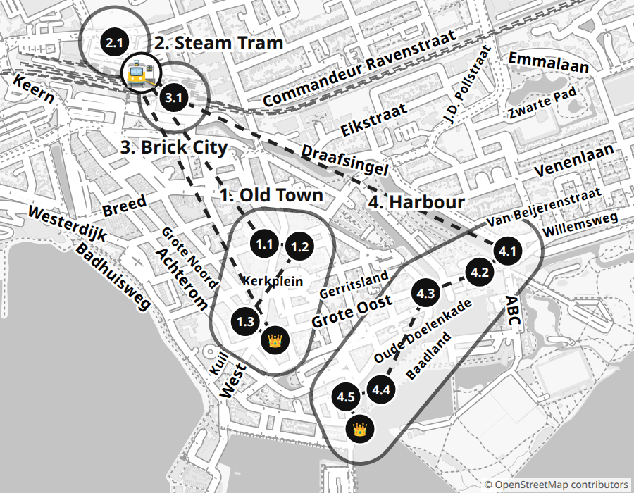

# ⚓ Conquer Hoorn

**City of steam trains, ship's boys, the red unicorn and Sinterklaas**

_Sunday 22 November 2026 · ~9:30–17:00 · ~5 km on foot_

400 years ago ships sailed from Hoorn to the end of the world. A captain from here sailed around the very bottom of America and named the cape after the ship "Hoorn": Cape Horn! And today a steam tram takes you to Sinterklaas himself, and a city made of LEGO is waiting. Conquer all four zones and become the Admiral of Hoorn.

## 📜 How to play

1. We are one team against Hoorn. 4 zones in one day, with a card for each.
2. Challenge done? Tick the box ☐ and colour in the coins 🪙. You lead everyone to all the zone's stops with the map yourself? Another 🧭 +2.
3. Got enough coins to reach the flag 🏁? The zone is CONQUERED! A sticker on the card and on the zone on the map.
4. 👑 Boss: a big challenge. It may not work the first time, so try again! ⚔️ Duel: me against the parents. I get the coins for playing either way; the last one (+1) is only for winning. ⏱ Against the clock.
5. The challenge number (1.2) is a stop on the map. Spend your coins or save them: the more you have left in the evening, the higher your rank!

### 🛒 What coins buy

- 🪙×5 — A hint for a riddle
- 🪙×10 — I choose the snack
- 🪙×15 — A parent does a curse of my choice
- 🪙×20 — Ice cream or a sweet
- 🪙×30 — A small souvenir

### 🌀 City curses

A curse falls when we enter a new zone and the die shows 1, or when we skip a challenge. Roll the die again: the number is the curse. It hits the whole team until we finish the next challenge.

1. We talk like pirates: "Arr!" at the end of every sentence
2. We walk like seagulls, arms as wings
3. See a boat or a train? Shout "Full steam ahead!"
4. One hand behind your back
5. The next challenge on one leg (where you can)
6. We puff like a steam train: "Choo-choo!" at every corner

### 🎖️ End-of-day rank

The coins left at the end of the day give your rank:

- **Deckhand** — under 8 coins
- **Sailor** — 🪙 8+
- **Bosun** — 🪙 20+
- **Captain** — 🪙 31+
- **Admiral** — 🪙 42+ and all 4 zones conquered

## 🦄 Zone 1: Old Town · Day 1

_Hoorn's coat of arms has a red horn, and a red unicorn holds the shield. Legend says a bull from a nearby town rammed Hoorn's gate and lost its horn here!_

- [ ] 1.1 🧭 **Gate Prince** (🪙×2) — Translate "New Street" into Dutch and find it. There's a gate with a prince on the roof. How many town coats of arms are on the front? 📍 [map](https://www.google.com/maps/search/?api=1&query=52.64142,5.05988)
- [ ] 1.2 🔍 **Secret Letters** ⚔️ (🪙×2+1) — Nearby, on Muntstraat, find the house with the letters VOC. Who will be first to find the letter H? And how many little angels hold the letters? 📍 [Former VOC-Kamer, Muntstraat 4](https://www.google.com/maps/search/?api=1&query=52.64139,5.06054)
- [ ] 1.3 📸 **Unicorn from Afar** (🪙×2) — On Roode Steen square, find the red unicorn. Walk away from it until, with your arm stretched out, it hides behind your little fingernail — and take a photo from there! 📍 [Roode Steen](https://www.google.com/maps/search/?api=1&query=52.63941,5.05913)
- [ ] 👑 **Zone boss: Unicorn Shield** (🪙×6) — Hop on one foot along the whole Weigh House on the square side, from corner to corner. Then say what's on the unicorn's shield. Foot down — start again! 📍 [Waag, Roode Steen 8](https://www.google.com/maps/search/?api=1&query=52.63925,5.05955)

Coins needed: **8** 🏁

## 🚂 Zone 2: Steam Tram · Day 1

_Today a steam tram takes us to Sinterklaas himself! The stoker fires up the engine, and the steam warms the carriages. And the Piets ride with us!_

- [ ] 2.1 🔍 **Engine Number** (🪙×2) — Find the number on our engine and write it down: ______. If it's 7742, that's Bello, the last engine of its kind in the country! 📍 [Tramstation Hoorn, Van Dedemstraat 8](https://www.google.com/maps/search/?api=1&query=52.64563,5.05451)
- [ ] 2.2 🗣️ **Piet Translator** (🪙×2) — Piets ride on the tram. Ask one in Dutch what their name is and what they're carrying. What did they say? Translate for us!
- [ ] 2.3 🚋 **Whistle!** ⚔️ (🪙×2+1) — Guess how many times the engine will whistle on the way to Wognum. A parent guesses too. We count together: whose guess is closest?
- [ ] 2.4 🍽️ **Tiny Pancakes** (🪙×2) — Hand over the voucher at the buffet yourself and order the poffertjes in Dutch. What did they say? Translate it for us! Rate the little pancakes ⭐⭐⭐⭐⭐.
- [ ] 👑 **Zone boss: Song for Sint** (🪙×6) — Sinterklaas loves songs! At the stop in Wognum, sing us all of «Sinterklaas kapoentje» on one foot: foot down or a mistake — start again. Done it? Sing it to Sint!

Coins needed: **9** 🏁

## 🏙️ Zone 3: Brick City · Day 1

_A whole LEGO city is hiding in the old station hall, even Hoorn's streets! And you can build things yourself and race little cars there._

- [ ] 3.1 🔍 **LEGO Quay** (🪙×2) — Find the LEGO Veermanskade quay and count its houses. Later we'll go to the real one and check if they built them all! 📍 [Brick City, Hoorn station hall](https://www.google.com/maps/search/?api=1&query=52.64545,5.05485)
- [ ] 3.2 🎒 **Brick Hunt** (🪙×3) — Ask the volunteers in Dutch yourself for the search sheet (speurtocht). What did they say? Translate! Finish the search: the sheet goes in your collection.
- [ ] 3.3 📏 **Station of Bricks** (🪙×2) — Find the LEGO Hoorn station — the biggest model. Stand next to it: is it taller than you? By how many hands? Taller than Dad or Mum?
- [ ] 👑 **Zone boss: One-Hand Tower** (🪙×6) — Your other hand goes behind your back! Build a tower half an arm tall that stands on its own for 5 seconds. Hand came out or tower fell? Start again!

Coins needed: **8** 🏁

## ⚓ Zone 4: Harbour · Day 1

_Ships that sailed to India for pepper were moored here. Captain Bontekoe from Hoorn nearly died on such a voyage, and his ship's boys became the heroes of a book!_

- [ ] 4.1 🔍 **The Last Gate** (🪙×2) — Walk to the gate with a house sitting on top. It's Hoorn's last city gate! Count the arches of the bridge in front of it. Is the passage inside straight or curved? 📍 [Oosterpoort, Bij Oosterpoort](https://www.google.com/maps/search/?api=1&query=52.64103,5.06869)
- [ ] 4.2 ⚔️ **Heel to Toe** (🪙×2+1) — Walk through the curved gate passage heel to toe without a slip. The parent too! Slip — start again. Who makes it in fewer tries? 📍 [Oosterpoort, passage](https://www.google.com/maps/search/?api=1&query=52.64098,5.06858)
- [ ] 4.3 🔍 **Sea Battle** (🪙×2) — On Slapershaven a sea battle is carved on the houses — like a comic! Count the ships. What year is written on the corner house? 📍 [Bossuhuizen, Slapershaven / Grote Oost 132](https://www.google.com/maps/search/?api=1&query=52.64025,5.06593)
- [ ] 4.4 🏃 **⏱ Cabin Boy Training** (🪙×2) — Baadland playground! In 3 minutes, touch 15 different things: the slide, a swing, a tree, a post… and run back to the parent. Not in time — try again! 📍 [Baadland playground](https://www.google.com/maps/search/?api=1&query=52.63791,5.06414)
- [ ] 4.5 📏 **Houses and LEGO** (🪙×3) — Over the iron bridge to Veermanskade. Count the houses: as many as in LEGO? Then pace out the narrowest and the widest. How many narrow houses fit into the wide one? 📍 [Veermanskade, houses](https://www.google.com/maps/search/?api=1&query=52.6376,5.06286)
- [ ] 👑 **Zone boss: Fourth Ship's Boy** (🪙×6) — Stand next to the three bronze ship's boys (don't climb!) and freeze in the pose of one of them for 20 seconds. Moved? Start again! Who are you copying? 📍 [Scheepsjongens van Bontekoe, Hoofd](https://www.google.com/maps/search/?api=1&query=52.6371,5.06321)

Coins needed: **11** 🏁

---

## 👨‍👩‍👦 For parents

**Start:** Hoorn station (Station Hoorn), train from Amsterdam ~35 min

### Plan

- **Day 1:** 9:30 Hoorn station → 9:30–10:45 zone 1: Statenpoort, Muntstraat, Roode Steen → 10:50–11:20 lunch at Turf (Gedempte Turfhaven 19) → 11:25 steam tram station (engine number) → 11:40 boarding → 12:00–14:00 Pieten Expres to Wognum and back (Piets, poffertjes, Sinterklaas) → 14:00–14:50 Brick City in the station hall → 14:50–16:30 harbour via the eastern edge of town: Oosterpoort, Bossuhuizen, Baadland playground, Veermanskade, Bontekoe's ship's boys → ~16:50 station → train home. Sunset around 16:45.

### 🎟️ Tickets and bookings

🎟️ **🚆 Train Amsterdam ↔ Hoorn** _(no booking)_

- When: Direct Intercity, ~35 min; fewer trains on Sunday morning, so pick one arriving ~9:30; back ~17:00
- Where: Amsterdam Centraal → Hoorn
- How: Adult: tap a bank card (OVpay) on the reader when entering and leaving, or buy a ticket in the NS app. Kid aged 4–11: a Railrunner day ticket from the machine or the NS app.
- Price: ~€10 adult one way, Railrunner ~€3 per day (check on ns.nl)
- https://www.ns.nl

### 🛍️ Bring / buy

- Pieten Expres e-tickets and vouchers (printed or on the phone)
- A sheet of stickers (~2 cm) for conquering the zones and the map
- A pen, a die (curses), a stopwatch on the phone
- A kid's camera or a phone (challenge 1.3)
- A glue stick or tape for the collection
- Warm clothes: November, wind by the water

### 💡

- The kid speaks Dutch, so they are the team's interpreter where there are definitely people: the Piets on the tram, the Brick City volunteers.
- Lunch is before the tram, at Turf (Sun from 10:00, check); the tram only has poffertjes. Kibbeling at the harbour in the afternoon is a bonus.
- ⚔️ Duels: the card shows "🪙×2+1": the kid gets 2 coins even when losing; +1 only for winning.
- 🌀 A curse lasts until the next finished challenge. A failed boss attempt is not a skip: try again.
- 🧭 Give the kid the zone map and follow; "warmer-colder" is allowed. Zone 2 (tram): navigation from the station to the platform.
- Sunday: shops in Hoorn open ~12:00; no challenge depends on shops.
- The Westfries Museum on Roode Steen is closed for renovation (until 2027, check).
- There's a statue of Jan Pieterszoon Coen on the square, a controversial figure of colonial history; he's not part of the game.
- There are no railings by the harbour or at Bontekoe's ship's boys: hold the kid's hand; the challenges are on the house side.
- Tired after the tram? Take the shortcut: from the station straight down Grote Noord → Roode Steen → Veermanskade (1.3 km), skipping tasks 4.1–4.4.

### 🔑 Answers and hints

#### 🦄 1. Old Town

_Hoorn is one of the seven towns of West Friesland; their representatives met here in the Statencollege on Roode Steen (1632) and stayed in the Statenlogement on Nieuwstraat. In the 17th century Hoorn was one of the six "chambers" of the East India Company (VOC) and grew rich on long voyages, then on cheese: the Waag on the square was the centre of one of North Holland's main cheese markets._

- Station → Gedempte Turfhaven → Nieuwstraat (Statenpoort) → Muntstraat 4 → Kerkplein → Roode Steen → lunch at Turf → station. ~2.3 km, 9:30–11:25
- Everything outdoors; shops are closed on Sunday morning, but the zone doesn't need them
- Free
- Lunch: Turf, Gedempte Turfhaven 19 (Sun 10–18 — check; sandpit inside, sausage rolls) — on the way to the station
- Cafés on Roode Steen (if open) or the station
- **1.1 Gate Prince:** [Statenpoort, Nieuwstraat 23](https://www.google.com/maps/search/?api=1&query=52.64142,5.05988) — ✔ Nieuwstraat → Statenpoort (no. 23). According to the ANWB, 7 coats of arms: Medemblik, Edam, Alkmaar, Hoorn, Enkhuizen, Monnickendam, Purmerend; Prince Maurice on the gable. Count them together.
  The Statenpoort is the entrance to the former Statenlogement: from 1385 there was a monastery here, then the guest house of the "College of Commissioned Councillors", the government of the seven towns of West Friesland and the Northern Quarter: Alkmaar, Medemblik, Enkhuizen, Hoorn, Monnickendam, Edam and Purmerend. The Renaissance front was made in 1613–1618, with the coats of arms of these towns in the frieze and Prince Maurice of Orange on the gable. Guests were received here until 1796. Since 2023, while the Westfries Museum is being renovated, "Ontdek het verhaal van Hoorn" is shown here. For the kid: "Seven towns, seven coats of arms: like a team of seven players!"
- **1.2 Secret Letters:** [Former VOC-Kamer, Muntstraat 4](https://www.google.com/maps/search/?api=1&query=52.64139,5.06054) — ✔ Muntstraat 4. In the gable 4 little angels (putti) hold the VOC monogram; the H (Hoorn) is in the gable and above the door.
  The VOC is the East India Company, founded after the first voyages to Asia (Cornelis de Houtman, 1595); Hoorn was one of its six "chambers". At first the chamber sat in an old monastery on Nieuwstraat, and in 1676 it bought this mansion. The house stands on the site of the West Frisian mint, hence the street name Muntstraat ("Mint Street"). In the gable four putti hold the VOC monogram with the letter H. The company went bankrupt in 1799; today artists live and work in the house. For the kid: "The street is called Mint Street: coins used to be made here!"
- **1.3 Unicorn from Afar:** [Roode Steen](https://www.google.com/maps/search/?api=1&query=52.63941,5.05913) — ✔ The unicorn with the coat of arms is on the Weigh House (Waag), on the north-east side of the square. Usually that's the far side of the square; check by the photo.
  Roode Steen ("Red Stone") is the main square, where four streets and two alleys meet. The name comes from the executions once held here; the old stone is kept in the Westfries Museum, and there's a copy on the square. In the Golden Age the square was simply called "Cheese Market". Since 1893 a statue of Jan Pieterszoon Coen, a controversial figure of colonial history (not in the game), has stood in the middle. Opposite the Waag is the Statencollege of 1632, now the Westfries Museum (under renovation). For the kid: "The unicorn on Hoorn's coat of arms has been red for more than 400 years!"
- **👑 Unicorn Shield:** [Waag, Roode Steen 8](https://www.google.com/maps/search/?api=1&query=52.63925,5.05955) — ✔ Hop on the paving along the front, not through a café terrace; feet may only switch at a corner. On the shield: a red horn on silver (white). It usually takes 2–3 tries.
  The Waag was built in 1609 to a design by the Amsterdam master Hendrick de Keyser, from Belgian stone. The red unicorn with the coat of arms was probably designed, and maybe carved, by de Keyser himself; it was already red in 1609. From the second half of the 17th century cheese was weighed here every week: about 3 million kg a year in the best years. Around 1900 there was a drawing school above the scales. Since 2003 the building has belonged to the Hendrick de Keyser society; inside there's a restaurant. Legend: a bull from Monnickendam lost its horn ramming Hoorn's gate, and the sheriff put the horn in the coat of arms. For the kid: "Cheese was weighed here: 3 million kilos a year!"

#### 🚂 2. Steam Tram

_The Hoorn–Medemblik steam tram ran from 1887; passenger service stopped in 1941. Since 1968 the Museumstoomtram enthusiasts have kept ~20 km of the line, the engines and the carriages, and run them for visitors. In November the "Pieten Expres" goes to Wognum station: there the Piets take the kids to the SinterCircus to see Sinterklaas, kids under 12 get a present, and the round trip takes ~2 h._

- Tramstation Hoorn, Van Dedemstraat 8, next to the NS station. Wognum only by tram
- Boarding ~11:40, departure 12:00, back ~14:00
- Paid
- Poffertjes and chocolate at the buffet (paid, vouchers)
- At the station

🎟️ **🎅 Pieten Expres** _(booked ✓)_

- When: Sun 22.11.2026, departs 12:00, ~2 h (Hoorn → Wognum → Hoorn); arrive by ~11:30
- Where: Tramstation Hoorn, Van Dedemstraat 8, next to the NS station
- How: Bring the e-tickets (printed or on the phone; don't fold the QR): child + 1 adult (in the order email). Show the vouchers for poffertjes and hot chocolate with a biscuit at the buffet.
- Price: Paid: €19.95 child + €24.00 adult + €5.00 poffertjes + €5.50 chocolate = €54.45
- https://www.stoomtram.nl/pieten/

🎟️ **🚂 Steam tram station and museum** _(to be checked)_

- When: Before boarding, ~10:45–11:40
- Where: Van Dedemstraat 8, at the tram station
- How: 1) On stoomtram.nl → "Veelgestelde vragen", check whether the exhibition at the station is open on Pieten Expres days. 2) On the spot, ask at the ticket desk whether a Pieten Expres ticket gets you in. The zone's challenges don't need the exhibition, only the engine on the platform.
- Price: Probably included in the ticket; Museumkaart valid
- https://www.stoomtram.nl/museum/

- **2.1 Engine Number:** [Tramstation Hoorn, Van Dedemstraat 8](https://www.google.com/maps/search/?api=1&query=52.64563,5.05451) — ✔ The number is on the side or on the cab. Which engine will pull the Pieten Expres isn't known in advance; on the normal timetable LTM 26 and NS 7742 "Bello" run.
  The Hoorn–Medemblik line opened on 3 November 1887; passenger trains were cancelled in 1941. Since 1968 the Museumstoomtram museum has been saving it: 10 steam engines, 7 of them official railway monuments. The star is NS 7742 "Bello" (Berlin, 1914): the local little engines were called "Bello" because they rang a bell when passing through villages. This one stood as a monument in the village of Bergen; in 1978 it was given to the museum and by 1985 it was restored. Of the many "Bellos" only this one survived: the only remaining light steam engine in the Netherlands. For the kid: "Bello because of 'bell': ding-ding through the village!"
- **2.2 Piet Translator:** ✔ Piets ride on the tram and are in Wognum, so there are definitely people. Any honest translation counts.
- **2.3 Whistle!:** ✔ Count together; the closest guess wins. Departure 12:00 from Tramstation Hoorn.
- **2.4 Tiny Pancakes:** ✔ Poffertjes and hot chocolate with a biscuit are paid for — the vouchers (QR) go in the kid's hand. Counts: the order + translating the answer.
- **👑 Song for Sint:** ✔ Standing only: on the platform in Wognum or in the SinterCircus queue, next to the parent; not in a moving carriage. The condition is singing to us; singing to Sint is a bonus if the programme allows. Gift for children under 12.
  Wognum-Nibbixwoud is a restored station on the old line. On the "Pieten Expres" the Piets meet the train and take the kids into the SinterCircus to see Sinterklaas; every child under 12 gets a present, then the tram takes everyone back to Hoorn. For the kid: "Sint loves songs: sing loudly and he'll hear you!"

#### 🏙️ 3. Brick City

_Brick City opened on 30 May 2025 in Hoorn's station hall, which had stood empty for many years. It is a branch of the Museum van de 20e Eeuw; adult LEGO fans (AFOL) help out. Inside: models of Hoorn's buildings, a big diorama with trains, a race track, mountains of bricks for building, a search trail (speurtocht) and BrickBieb, a library of sets._

- Hoorn station hall, next to the tram station
- Sun afternoon, ~12:00–17:00 (check)
- ~€5 per person
- At the station

🎟️ **🏙️ Brick City Hoorn** _(no booking, check hours)_

- When: Sun 22.11, ~14:00–14:50. Open Wednesday, Saturday and Sunday afternoons (12–17 in school holidays)
- Where: Hoorn station hall (Stationsplein), entrance from the station building
- How: 1) A week before, check the hours on brick-city.nl or museumhoorn.nl; no answer — info@museumhoorn.nl, 0229-214001. 2) No booking: ticket at the entrance. 3) If closed: zone 3 counts as claimed (stick the sticker; Admiral stays possible), skip its tasks without a curse; more time at the tram station and the harbour.
- Price: €5 per person (RODI, 2025); the Museumkaart is not valid
- https://www.brick-city.nl

- **3.1 LEGO Quay:** [Brick City, Hoorn station hall](https://www.google.com/maps/search/?api=1&query=52.64545,5.05485) — ✔ The Veermanskade model is in Brick City's description (RODI, 2026). Count the houses together; write down the number and compare in zone 4.
  Brick City opened on 30 May 2025 in the monumental station hall, which had stood empty for years; the first thing on show was a 1.8 m tall LEGO model of Hoorn station itself, built by fans Peter Tol and Peter de Vries (still unfinished then). Here you'll also find LEGO copies of Hoorn's houses, including Veermanskade, a diorama with trains you can run, and almost every train LEGO has ever made. For the kid: "A city of bricks stands right inside the station, and real trains run on the other side of the wall!"
- **3.2 Brick Hunt:** ✔ The volunteers at the entrance have the sheet. It counts with the translation + the finished search.
- **3.3 Station of Bricks:** ✔ According to RODI (2025) the station model is ~1.8 m — taller than most adults. Count the hands together (the «Hand» measure); don't step behind the model.
- **👑 One-Hand Tower:** ✔ Height: from the elbow to the fingertips (half an arm). The bricks are in the big boxes in the building area. It usually takes 2–3 tries.

#### ⚓ 4. Harbour

_Hoorn's harbour was the heart of the Golden Age town: VOC ships and the whalers of the Northern Company sailed from here (from 1614 the company sat in the 1532 Hoofdtoren). The way there follows the eastern edge of the old town: past the Mariatoren (1508, part of the town wall, later a gunpowder store), through the park along the Draafsingel canal to the East Gate. Merchant houses line Veermanskade, and on the Hoofd sit the boys from the book about Captain Bontekoe, whose 1646 journal was a Dutch bestseller._

- Station → Noorderstraat → Koepoortsplein (Mariatoren) → Oosterplantsoen park along the Draafsingel canal → Oosterpoort → Slapershaven (Bossuhuizen) → Grote Oost → Baadland playground → Hoogebrug bridge → Veermanskade → the boys on the Hoofd → Grote Noord back to the station (~20 min). ~2.5 km, 14:50–16:30; no street of the morning is walked twice
- All outdoors, always open. Sunset ~16:45 — leave Brick City by 14:50
- Free. Bonus if open: kibbeling (fried fish) by the harbour ~€6–8
- Free public toilet on the Hoofd by the Hoofdtoren (per OSM — check), cafés on the quay
- **4.1 The Last Gate:** [Oosterpoort, Bij Oosterpoort](https://www.google.com/maps/search/?api=1&query=52.64103,5.06869) — ✔ The passage is curved (monument register). Wikipedia says the bridge has 7 arches (1763) — count them together. Stone cannons are carved next to the columns on the outer side.
  The Oosterpoort ("East Gate") was built in 1578 to a design by J.J. Bilhamer; in 1601 a gatekeeper's house was added above the passage. It is Hoorn's only surviving city gate. It was less for defence than for checking visitors and collecting tolls. The passage is curved — one theory says so that a cannon could not fire straight into town. No cars since 1957; the Hendrick de Keyser society has owned it since 2003. For the kid: "A gate with a house on top — the gatekeeper lived right above the road!"
- **4.2 Heel to Toe:** [Oosterpoort, passage](https://www.google.com/maps/search/?api=1&query=52.64098,5.06858) — ✔ No cars in the passage, but bikes do ride through — let them pass. Everyone counts their own tries; a tie — one more round.
- **4.3 Sea Battle:** [Bossuhuizen, Slapershaven / Grote Oost 132](https://www.google.com/maps/search/?api=1&query=52.64025,5.06593) — ✔ Count the ships together. On the corner house (Grote Oost 132) the stones of the front say 1612.
  The Bossuhuizen are named after the "Battle of Bossu": on 11 October 1573, on the Zuiderzee, small West Frisian ships beat the Spanish fleet and captured its admiral, Count Bossu, who was held in Hoorn for three years. The carved frieze above the ground floor tells the battle (monument register). The corner house, Grote Oost 132, is dated 1612 in the stones on its jutting upper floor. For the kid: "Little boats beat the big ships — and brought the admiral himself here as a prisoner!"
- **4.4 ⏱ Cabin Boy Training:** [Baadland playground](https://www.google.com/maps/search/?api=1&query=52.63791,5.06414) — ✔ The parent times 3 minutes and counts out loud. Playground from OpenStreetMap, equipment not checked: no playground — do it with the trees and benches of the green.
- **4.5 Houses and LEGO:** [Veermanskade, houses](https://www.google.com/maps/search/?api=1&query=52.6376,5.06286) — ✔ Compare with the number of houses from task 3.1. Division: steps for the wide one ÷ steps for the narrow one (help out). Walk on the house side, not at the water's edge.
  The iron drawbridge Hoogebrug (1930) links Oude Doelenkade with Veermanskade: a 6 m opening, the lifting part ~7 m long and 4.5 m wide. Hoorn chose iron over the wooden bridge the heritage experts wanted — wood costs more to maintain. Veermanskade is the inner-harbour quay; veerman means ferryman. The houses were merchants': the ground floor was a warehouse and the owners lived at the back and upstairs; warehouse no. 16 has been a listed monument since 1965, and one guidebook says Captain Bontekoe lived at no. 15. For the kid: "Whoever built the widest house was probably the richest merchant!"
- **👑 Fourth Ship's Boy:** [Scheepsjongens van Bontekoe, Hoofd](https://www.google.com/maps/search/?api=1&query=52.6371,5.06321) — ✔ A parent counts to 20 and guesses who the kid is copying. The statue is at the edge of the quay with no railing: stand on the land side, hold hands, don't climb the statue.
  The three bronze boys are Hajo, Rolf and Padde from Johan Fabricius's children's book "The Ship's Boys of Bontekoe" (1924). The book is based on the real journal of Captain Willem Bontekoe of Hoorn (1587–1657): his ship "Nieuw Hoorn" blew up on the way to Java, and the survivors starved and were saved on Sumatra; the 1646 journal was reprinted many times. The statue is by Jan van Druten and has stood here since 1968. Three footballers from Hoorn posed for it without knowing why, until Fabricius himself pulled off the cover: "That's us!" For the kid: "The boys the statue was modelled on only recognised themselves at the unveiling!" Next to it is the Hoofdtoren (1532): the Northern Company's whalers sat there from 1614, and it has been a restaurant since 1968. About 80 m away stands a statue of Captain Bontekoe himself — show it after the boss.

### Sources

- https://www.anwb.nl/wandelen/routes/stadswandeling-hoorn
- https://www.hollandbovenamsterdam.com/details/en/statenpoort-en-logement--affff037-6f9a-48f7-8731-44ccbb8c0a0e
- https://www.hollandbovenamsterdam.com/details/en/het-oost-indisch-huis--9d4bf61a-3a68-4bea-86f8-acaa69ff799f
- https://www.dbnl.org/tekst/_voo016voor05_01/_voo016voor05_01_0044.php
- https://www.rodi.nl/hoorn/nieuws/505026/muntstraat-hoorn-wordt-kunstroute-met-achttien-ateliers
- https://nl.wikipedia.org/wiki/Waag_(Hoorn)
- https://monumentenregister.cultureelerfgoed.nl/monumenten/22564
- https://en.wikipedia.org/wiki/Roode_Steen
- https://www.hollandbovenamsterdam.com/details/en/de-waag--353c1618-3be1-4f26-94e8-b11c3bd82844
- https://en.wikipedia.org/wiki/Coat_of_arms_of_Hoorn
- https://nl.wikipedia.org/wiki/Westfries_Museum
- https://en.wikipedia.org/wiki/Willem_Schouten
- https://www.stoomtram.nl/pieten/
- https://www.stoomtram.nl
- https://go-kids.nl/westfriesland/agenda/pieten-expres-een-spannende-tijdreis-van-hoorn-naar-wognum-bij-museum-stoomtram-1
- https://en.wikipedia.org/wiki/Hoorn%E2%80%93Medemblik_heritage_railway
- https://www.museum.nl/en/museumstoomtram-hoorn-medemblik/showpiece/loc-bello
- https://internationalsteam.co.uk/trams/steamtram23.htm
- https://www.rodi.nl/hoorn/nieuws/448965/brick-city-geeft-hoorn-nieuwe-trekpleister
- https://www.rodi.nl/hoorn/uit/508664/brick-city-in-hoorn-tijdens-herfstvakantie-alle-middagen-open
- https://www.museumhoorn.nl/bv-5548-1/bedrijven/museum_van_de_twintigste_eeuw.html
- https://www.viamichelin.pl/maps/tourist-attractions/poi/hoorn-1621-09cf9700f08b
- https://monumentenregister.cultureelerfgoed.nl/monumenten/22411
- https://nl.wikipedia.org/wiki/Hoofdtoren
- https://www.nhnieuws.nl/nieuws/299307/hoe-kwamen-beelden-van-de-scheepsjongens-van-bontekoe-tot-stand-wij-stonden-daar
- https://nl.wikipedia.org/wiki/Willem_IJsbrantsz._Bontekoe
- https://nominatim.openstreetmap.org (coordinates)
