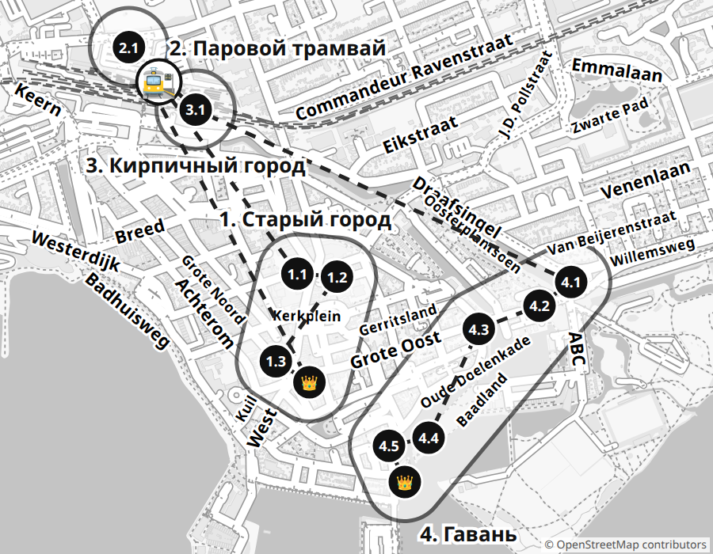

# ⚓ Захват Хорна

**Город паровозов, юнг, красного единорога и Синтерклааса**

_Воскресенье, 22 ноября 2026 · ~9:30–17:00 · ~5 км пешком_

400 лет назад из Хорна уплывали корабли на край света. Капитан отсюда обогнул самый юг Америки и назвал мыс в честь корабля «Хорн» — мыс Горн! А сегодня тебя ждёт паровой трамвай к самому Синтерклаасу и город из LEGO. Захвати все четыре зоны и стань Адмиралом Хорна.

## 📜 Как играть

1. Мы одна команда против Хорна. 4 зоны за один день — на каждую своя карточка.
2. Задание выполнено — галочка ☐ и закрась кружки 🪙. Ведёшь всех по карте ко всем точкам зоны сам — ещё 🧭 +2.
3. Набрали монет до флажка 🏁 — зона ЗАХВАЧЕНА! Наклейка на карточку и на зону на карте.
4. 👑 Босс — большое задание, с первого раза может не выйти — пробуй ещё! ⚔️ Дуэль — я против родителей: за игру монеты мои в любом случае, последняя (+1) — только за победу. ⏱ На время.
5. Номер задания (1.2) — это точка на карте. Монеты можно тратить или копить: чем больше останется вечером, тем выше звание!

### 🛒 Что купить за монеты

- 🪙×5 — Подсказка к загадке
- 🪙×10 — Я выбираю перекус
- 🪙×15 — Родитель выполняет проклятие по моему выбору
- 🪙×20 — Мороженое или сладость
- 🪙×30 — Маленький сувенир

### 🌀 Проклятия города

Проклятие падает, когда: входим в новую зону и на кубике выпало 1 — или пропускаем задание. Бросаем кубик ещё раз: номер = проклятие. Действует на всю команду, пока не выполним следующее задание.

1. Говорим только как пираты: «Арр!» в конце каждой фразы
2. Идём, как чайки, — руки-крылья
3. Видишь лодку или поезд — кричи «Полный вперёд!»
4. Одна рука за спиной
5. Следующее задание — на одной ноге (где можно)
6. Пыхтим, как паровоз: «Чух-чух!» на каждом повороте

### 🎖️ Звание в конце дня

Сколько монет осталось в конце дня — такое и звание:

- **Юнга** — меньше 8 монет
- **Матрос** — 🪙 8+
- **Боцман** — 🪙 20+
- **Капитан** — 🪙 31+
- **Адмирал** — 🪙 42+ и все 4 зоны захвачены

## 🦄 Зона 1: Старый город · День 1

_На гербе Хорна — красный рог, а держит герб красный единорог. Легенда говорит: бык из соседнего города таранил ворота Хорна и потерял тут свой рог!_

- [ ] 1.1 🧭 **Принц на воротах** (🪙×2) — Переведи «Новая улица» на голландский и найди её. Там ворота с принцем на крыше. Сколько гербов городов на фасаде? 📍 [карта](https://www.google.com/maps/search/?api=1&query=52.64142,5.05988)
- [ ] 1.2 🔍 **Тайные буквы** ⚔️ (🪙×2+1) — Рядом, на Muntstraat, найди дом с буквами VOC. Кто первым найдёт букву H? И сколько ангелочков держат буквы? 📍 [Бывшая VOC-Kamer, Muntstraat 4](https://www.google.com/maps/search/?api=1&query=52.64139,5.06054)
- [ ] 1.3 📸 **Единорог издалека** (🪙×2) — На площади Roode Steen найди красного единорога. Отходи от него, пока на вытянутой руке он не спрячется за ноготь мизинца, — и сфотографируй оттуда! 📍 [Roode Steen](https://www.google.com/maps/search/?api=1&query=52.63941,5.05913)
- [ ] 👑 **Босс зоны: Щит единорога** (🪙×6) — Проскачи на одной ноге вдоль всех Весов со стороны площади, от угла до угла. Потом скажи, что на щите у единорога. Нога вниз — сначала! 📍 [Весы (Waag), Roode Steen 8](https://www.google.com/maps/search/?api=1&query=52.63925,5.05955)

Нужно монет: **8** 🏁

## 🚂 Зона 2: Паровой трамвай · День 1

_Сегодня паровой трамвай повезёт нас к самому Синтерклаасу! Кочегар топит паровоз, а пар греет вагоны. И с нами едут Питы!_

- [ ] 2.1 🔍 **Номер паровоза** (🪙×2) — Найди номер на нашем паровозе и запиши: ______. Если 7742 — это Белло, последний такой паровоз в стране! 📍 [Tramstation Hoorn, Van Dedemstraat 8](https://www.google.com/maps/search/?api=1&query=52.64563,5.05451)
- [ ] 2.2 🗣️ **Переводчик Питов** (🪙×2) — В трамвае едут Питы. Спроси одного по-голландски, как его зовут и что он везёт. Что он ответил? Переведи нам!
- [ ] 2.3 🚋 **Свисток!** ⚔️ (🪙×2+1) — Угадай, сколько раз свистнет паровоз по дороге до Вогнума. Родитель тоже угадывает. Считаем вместе — чья догадка ближе?
- [ ] 2.4 🍽️ **Блинчики-крошки** (🪙×2) — Сам отдай ваучер в буфете и закажи поффертьес по-голландски. Что тебе сказали? Переведи нам! Поставь блинчикам оценку ⭐⭐⭐⭐⭐.
- [ ] 👑 **Босс зоны: Песня для Синта** (🪙×6) — Синтерклаасу поют песню! На остановке в Вогнуме спой нам «Sinterklaas kapoentje» целиком на одной ноге: нога вниз или сбился — сначала. Получилось — спой Синту!

Нужно монет: **9** 🏁

## 🏙️ Зона 3: Кирпичный город · День 1

_В старом зале вокзала спрятался целый город из LEGO — даже улицы Хорна! А ещё там можно строить самому и гонять машинки._

- [ ] 3.1 🔍 **LEGO-набережная** (🪙×2) — Найди LEGO-набережную Veermanskade и сосчитай на ней дома. Потом пойдём на настоящую — проверим, все ли построили! 📍 [Brick City, зал вокзала Hoorn](https://www.google.com/maps/search/?api=1&query=52.64545,5.05485)
- [ ] 3.2 🎒 **Кирпичная охота** (🪙×3) — Сам спроси по-голландски у волонтёров листок поиска (speurtocht). Что тебе сказали? Переведи! Пройди поиск — листок в коллекцию.
- [ ] 3.3 📏 **Вокзал из кубиков** (🪙×2) — Найди LEGO-вокзал Хорна — самую большую модель. Встань рядом: он выше тебя? На сколько ладоней? А выше папы или мамы?
- [ ] 👑 **Босс зоны: Башня одной рукой** (🪙×6) — Вторая рука — за спиной! Построй башню высотой в полруки, чтобы простояла сама 5 секунд. Рука вышла или башня упала — сначала!

Нужно монет: **8** 🏁

## ⚓ Зона 4: Гавань · День 1

_Здесь стояли корабли, которые плыли в Индию за перцем. Капитан Бонтекуу из Хорна чуть не погиб в таком плавании, а его юнги стали героями книжки!_

- [ ] 4.1 🔍 **Последние ворота** (🪙×2) — Иди к воротам, под которыми стоит дом. Это последние городские ворота Хорна! Сосчитай арки у моста перед ними. Проход внутри прямой или кривой? 📍 [Oosterpoort, Bij Oosterpoort](https://www.google.com/maps/search/?api=1&query=52.64103,5.06869)
- [ ] 4.2 ⚔️ **Пятка к носку** (🪙×2+1) — Пройди через кривой проход ворот пяткой к носку, не сбившись. Родитель тоже! Сбился — с начала. Кто пройдёт с меньшего числа попыток? 📍 [Oosterpoort, проход](https://www.google.com/maps/search/?api=1&query=52.64098,5.06858)
- [ ] 4.3 🔍 **Морской бой** (🪙×2) — На Slapershaven на домах вырезан морской бой — как комикс! Сосчитай корабли. Какой год написан на угловом доме? 📍 [Bossuhuizen, Slapershaven / Grote Oost 132](https://www.google.com/maps/search/?api=1&query=52.64025,5.06593)
- [ ] 4.4 🏃 **⏱ Юнга на тренировке** (🪙×2) — Площадка Baadland! За 3 минуты потрогай 15 разных вещей: горку, качели, дерево, столб… и вернись к родителю. Не успел — ещё раз! 📍 [Детская площадка Baadland](https://www.google.com/maps/search/?api=1&query=52.63791,5.06414)
- [ ] 4.5 📏 **Дома и LEGO** (🪙×3) — Через железный мост — на Veermanskade. Сосчитай дома: столько же, сколько в LEGO? Потом измерь шагами самый узкий и самый широкий. Сколько узких влезет в широкий? 📍 [Veermanskade, дома](https://www.google.com/maps/search/?api=1&query=52.6376,5.06286)
- [ ] 👑 **Босс зоны: Четвёртый юнга** (🪙×6) — Встань рядом с тремя бронзовыми юнгами (не залезай!) и замри в позе одного из них на 20 секунд. Шевельнулся — сначала! Кого копируешь? 📍 [Scheepsjongens van Bontekoe, Hoofd](https://www.google.com/maps/search/?api=1&query=52.6371,5.06321)

Нужно монет: **11** 🏁

---

## 👨‍👩‍👦 Для родителей

**Старт:** Вокзал Хорн (Station Hoorn), поезд из Амстердама ~35 мин

### План

- **День 1:** 9:30 вокзал Хорн → 9:30–10:45 зона 1: Statenpoort, Muntstraat, Roode Steen → 10:50–11:20 обед в Turf (Gedempte Turfhaven 19) → 11:25 станция парового трамвая (номер паровоза) → 11:40 посадка → 12:00–14:00 Пиитен-экспресс до Вогнума и обратно (Питы, поффертьес, Синтерклаас) → 14:00–14:50 Brick City в зале вокзала → 14:50–16:30 гавань через восточный край города: Oosterpoort, Bossuhuizen, площадка Baadland, Veermanskade, юнги Бонтекуу → ~16:50 вокзал → поезд домой. Закат около 16:45.

### 🎟️ Билеты и бронирование

🎟️ **🚆 Поезд Амстердам ↔ Хорн** _(без брони)_

- Когда: Прямой Intercity, ~35 мин; в воскресенье утром поезда реже — выбрать поезд с прибытием ~9:30; обратно ~17:00
- Где: Amsterdam Centraal → Hoorn
- Как: Взрослый: приложить банковскую карту (OVpay) к валидатору на входе и выходе или купить билет в приложении NS. Ребёнку 4–11 лет — дневной Railrunner в автомате или приложении NS.
- Цена: ~10 € взрослый в одну сторону, Railrunner ~3 € в день (проверить на ns.nl)
- https://www.ns.nl

### 🛍️ Взять с собой / купить

- E-билеты Пиитен-экспресса и ваучеры (распечатка или телефон)
- Лист наклеек (~2 см) для захвата зон и карты
- Ручка, кубик (проклятия), секундомер в телефоне
- Детский фотоаппарат или телефон (задание 1.3)
- Клей-карандаш или скотч для коллекции
- Тёплая одежда: ноябрь, ветер у воды

### 💡

- Ребёнок говорит по-голландски — он переводчик команды там, где точно есть люди: Питы в трамвае, волонтёры Brick City.
- Обед — до трамвая, в Turf (вс с 10:00, проверить); в трамвае только поффертьес. Кибелинг у гавани днём — бонус.
- ⚔️ Дуэли: на карточке «🪙×2+1»: 2 монеты ребёнок получает и при проигрыше, +1 — только за победу.
- 🌀 Проклятие — до следующего выполненного задания. Неудачная попытка босса — не пропуск: пробуйте ещё.
- 🧭 Дайте ребёнку карту зоны и идите следом; «теплее-холоднее» можно. Зона 2 (трамвай) — навигация от вокзала до платформы.
- Воскресенье: магазины в Хорне открываются ~12:00; ни одно задание от магазинов не зависит.
- Westfries Museum на Roode Steen закрыт на реконструкцию (до 2027 г. — проверить).
- На площади стоит памятник Яну Питерсу Куну — спорная фигура колониальной истории; в игре его нет.
- У гавани и у юнг Бонтекуу нет ограждений — держите ребёнка за руку, задания на стороне домов.
- Устали после трамвая? Срежьте: от вокзала прямо по Grote Noord → Roode Steen → Veermanskade (1,3 км), без заданий 4.1–4.4.

### 🔑 Ответы и подсказки

#### 🦄 1. Старый город

_Хорн — один из семи городов Западной Фрисландии; их представители заседали здесь в Statencollege на Roode Steen (1632) и жили в Statenlogement на Nieuwstraat. В XVII веке Хорн был одной из шести «палат» Ост-Индской компании (VOC) и богател на дальних плаваниях, потом — на сыре: Весы на площади были центром одного из главных сырных рынков Северной Голландии._

- Вокзал → Gedempte Turfhaven → Nieuwstraat (Statenpoort) → Muntstraat 4 → Kerkplein → Roode Steen → обед в Turf → вокзал. ~2,3 км, 9:30–11:25
- Всё снаружи; воскресным утром магазины закрыты — для зоны не нужны
- Бесплатно
- Обед: Turf, Gedempte Turfhaven 19 (вс 10–18 — проверить; песочница внутри, булочки с сосиской) — по дороге к вокзалу
- Кафе на Roode Steen (если открыто) или вокзал
- **1.1 Принц на воротах:** [Statenpoort, Nieuwstraat 23](https://www.google.com/maps/search/?api=1&query=52.64142,5.05988) — ✔ Nieuwstraat → Statenpoort (№ 23). По ANWB — 7 гербов: Медемблик, Эдам, Алкмар, Хорн, Энкхёйзен, Монникендам, Пюрмеренд; на фронтоне — принц Мориц. Посчитайте вместе.
  Statenpoort — вход в бывший Statenlogement: с 1385 г. здесь был монастырь, потом гостевой дом «Коллегии уполномоченных советников» — правления семи городов Западной Фрисландии и Северной четверти: Алкмара, Медемблика, Энкхёйзена, Хорна, Монникендама, Эдама и Пюрмеренда. Ренессансный фасад сделали в 1613–1618 гг., во фризе — гербы этих городов, на фронтоне — принц Мориц Оранский. Гостей принимали тут до 1796 г. С 2023 г., пока Westfries Museum на ремонте, здесь показывают «Ontdek het verhaal van Hoorn». Ребёнку: «Семь городов — семь гербов: это как команда из семи игроков!»
- **1.2 Тайные буквы:** [Бывшая VOC-Kamer, Muntstraat 4](https://www.google.com/maps/search/?api=1&query=52.64139,5.06054) — ✔ Muntstraat 4. Во фронтоне 4 ангелочка (путти) держат монограмму VOC; H (Хорн) — во фронтоне и над входом.
  VOC — Ост-Индская компания, созданная после первых плаваний в Азию (Корнелис де Хаутман, 1595); Хорн был одной из шести её «палат». Сначала палата сидела в старом монастыре на Nieuwstraat, а в 1676 г. купила этот особняк. Дом стоит на месте Западнофризского монетного двора — отсюда и имя улицы Muntstraat («Монетная»). Во фронтоне четыре путти держат монограмму VOC с буквой H. Компания разорилась в 1799 г.; сейчас в доме живут и работают художники. Ребёнку: «Улица называется Монетная — тут раньше чеканили монеты!»
- **1.3 Единорог издалека:** [Roode Steen](https://www.google.com/maps/search/?api=1&query=52.63941,5.05913) — ✔ Единорог с гербом — на Весах (Waag), северо-восточная сторона площади. Обычно это противоположный край площади; проверка по фото.
  Roode Steen («Красный камень») — главная площадь, где сходятся четыре улицы и два переулка. Имя — от места казней, которые тут когда-то проводились; старый камень хранится в Westfries Museum, на площади — копия. В Золотой век площадь звали просто «Сырный рынок». С 1893 г. в центре стоит памятник Яну Питерсу Куну — спорной фигуре колониальной истории (в игре его нет). Напротив Весов — Statencollege 1632 г., сейчас Westfries Museum (на ремонте). Ребёнку: «Единорог на гербе Хорна красный уже больше 400 лет!»
- **👑 Щит единорога:** [Весы (Waag), Roode Steen 8](https://www.google.com/maps/search/?api=1&query=52.63925,5.05955) — ✔ Скакать по плитке вдоль фасада, не по террасе кафе; ногу можно сменить только на углу. На щите — красный рог на серебре (белом). Обычно выходит со 2–3 попытки.
  Весы построены в 1609 г. по проекту амстердамского мастера Хендрика де Кейзера из бельгийского камня. Красного единорога с гербом, вероятно, придумал и, может быть, вырезал сам де Кейзер; красным он был уже в 1609 г. Со второй половины XVII века здесь каждую неделю взвешивали сыр — в лучшие годы около 3 млн кг в год. Над весами около 1900 г. была школа рисования. С 2003 г. зданием владеет общество Hendrick de Keyser, внутри ресторан. Легенда: бык из Монникендама потерял рог, таран ворота Хорна, и шериф взял рог в герб. Ребёнку: «Здесь взвешивали сыр — 3 миллиона килограммов в год!»

#### 🚂 2. Паровой трамвай

_Паровой трамвай Хорн — Медемблик ходил с 1887 г.; пассажиров перестали возить в 1941-м. С 1968 г. энтузиасты Museumstoomtram сохраняют ~20 км линии, паровозы и вагоны и возят на них туристов. В ноябре «Pieten Expres» едет до станции Вогнум: там Питы ведут детей в SinterCircus к Синтерклаасу, дети до 12 лет получают подарок, поездка туда и обратно ~2 ч._

- Tramstation Hoorn, Van Dedemstraat 8 — рядом с NS-вокзалом. Вогнум — только на трамвае
- Посадка ~11:40, отправление 12:00, возвращение ~14:00
- Оплачено
- Поффертьес и шоколад в буфете (оплачено, ваучеры)
- На станции

🎟️ **🎅 Пиитен-экспресс** _(забронировано ✓)_

- Когда: Вс 22.11.2026, отправление 12:00, ~2 ч (Хорн → Вогнум → Хорн); приходите к ~11:30
- Где: Tramstation Hoorn, Van Dedemstraat 8, рядом с NS-вокзалом
- Как: Взять e-билеты (распечатка или телефон; QR не сгибать): ребёнок + 1 взрослый (письмо с заказом). Ваучеры на поффертьес и горячий шоколад с печеньем показать в буфете.
- Цена: Оплачено: 19,95 € ребёнок + 24,00 € взрослый + 5,00 € поффертьес + 5,50 € шоколад = 54,45 €
- https://www.stoomtram.nl/pieten/

🎟️ **🚂 Станция и музей парового трамвая** _(уточнить)_

- Когда: До посадки, ~10:45–11:40
- Где: Van Dedemstraat 8, на станции трамвая
- Как: 1) На stoomtram.nl → «Veelgestelde vragen» проверить, открыта ли выставка на станции в дни Pieten Expres. 2) На месте спросить на кассе, пускают ли с билетом Pieten Expres. Для заданий зоны выставка не нужна — только паровоз на платформе.
- Цена: Вероятно входит в билет; Museumkaart действует
- https://www.stoomtram.nl/museum/

- **2.1 Номер паровоза:** [Tramstation Hoorn, Van Dedemstraat 8](https://www.google.com/maps/search/?api=1&query=52.64563,5.05451) — ✔ Номер на боку или на будке паровоза. Какой паровоз поведёт Pieten Expres — заранее неизвестно; в обычном расписании ходят LTM 26 и NS 7742 «Bello».
  Линию Хорн — Медемблик открыли 3 ноября 1887 г.; в 1941 г. пассажирские поезда отменили. С 1968 г. её спасает музей Museumstoomtram: 10 паровозов, 7 из них — официальные железнодорожные памятники. Звезда — NS 7742 «Bello» (Берлин, 1914): «Белло» называли местные паровозики, потому что они звонили в колокол, проезжая деревни. Этот стоял памятником в деревне Берген, в 1978 г. его подарили музею, к 1985 г. восстановили. Из многих «Белло» уцелел только он — единственный сохранившийся лёгкий паровоз Нидерландов. Ребёнку: «Белло — потому что “белл”, колокол: дзынь по деревне!»
- **2.2 Переводчик Питов:** ✔ Питы едут в трамвае и в Вогнуме — люди точно есть. Засчитывается любой честный перевод.
- **2.3 Свисток!:** ✔ Считайте вместе; выигрывает самая близкая догадка. Отправление 12:00 с Tramstation Hoorn.
- **2.4 Блинчики-крошки:** ✔ Поффертьес и горячий шоколад с печеньем уже оплачены — ваучеры (QR) у ребёнка в руках. Засчитывается заказ + перевод ответа.
- **👑 Песня для Синта:** ✔ Только стоя: на платформе в Вогнуме или в очереди SinterCircus, рядом с родителем; в едущем вагоне не играем. Условие — спеть нам; спеть Синту — бонус, если позволит программа. Подарок детям до 12 лет.
  Станция Вогнум-Нибиксвауд — отреставрированная станция старой линии. В «Pieten Expres» Питы встречают поезд и ведут детей в SinterCircus к Синтерклаасу; каждый ребёнок до 12 лет получает подарок, потом трамвай везёт всех обратно в Хорн. Ребёнку: «Синт любит песни — спой погромче, он услышит!»

#### 🏙️ 3. Кирпичный город

_Brick City открылся 30 мая 2025 г. в зале вокзала Хорна, который много лет пустовал. Это филиал Museum van de 20e Eeuw; помогают взрослые фанаты LEGO (AFOL). Внутри — модели зданий Хорна, большая диорама с поездами, гоночная трасса, горы деталей для стройки, поиск (speurtocht) и BrickBieb — библиотека наборов._

- Зал вокзала Hoorn, рядом со станцией трамвая
- Вс после обеда, ~12:00–17:00 — уточнить
- ~5 € с человека
- На вокзале

🎟️ **🏙️ Brick City Hoorn** _(без брони, уточнить часы)_

- Когда: Вс 22.11, ~14:00–14:50. Открыт по средам, субботам и воскресеньям после обеда (в каникулы 12–17)
- Где: Зал вокзала Hoorn (Stationsplein), вход из здания вокзала
- Как: 1) За неделю проверить часы на brick-city.nl или museumhoorn.nl; нет ответа — info@museumhoorn.nl, 0229-214001. 2) Брони нет: билет на входе. 3) Если закрыто: зона 3 считается захваченной (наклейку клеим, Адмирал остаётся возможным), её задания пропускаем без проклятия; больше времени на станции трамвая и в гавани.
- Цена: 5 € с человека (RODI, 2025); Museumkaart не действует
- https://www.brick-city.nl

- **3.1 LEGO-набережная:** [Brick City, зал вокзала Hoorn](https://www.google.com/maps/search/?api=1&query=52.64545,5.05485) — ✔ Модель Veermanskade есть в описании Brick City (RODI, 2026). Дома считайте вместе; запишите число и сравните в зоне 4.
  Brick City открыли 30 мая 2025 г. в монументальном зале вокзала, который годами стоял пустым; первым показали LEGO-модель самого вокзала Хорна высотой 1,8 м, её строили фанаты Петер Тол и Петер де Врис (тогда ещё недостроенную). Здесь же — LEGO-копии домов Хорна, в т.ч. Veermanskade, диорама с поездами, которые можно запускать, и почти все поезда, которые выпускал LEGO. Ребёнку: «Город из кубиков стоит прямо в вокзале — а настоящие поезда ездят за стеной!»
- **3.2 Кирпичная охота:** ✔ Листок — у волонтёров на входе. Засчитывается перевод + пройденный поиск.
- **3.3 Вокзал из кубиков:** ✔ По RODI (2025) модель вокзала ~1,8 м — выше большинства взрослых. Ладони считайте вместе (мерка «Ладонь»); за моделью не заходить.
- **👑 Башня одной рукой:** ✔ Высота — от локтя до кончиков пальцев (полруки). Детали — в больших ящиках зоны стройки. Обычно нужно 2–3 попытки.

#### ⚓ 4. Гавань

_Гавань Хорна — сердце города Золотого века: отсюда уходили корабли VOC и китобои Северной компании (с 1614 г. она сидела в башне Hoofdtoren 1532 г.). Путь к ней идёт по восточному краю старого города: мимо башни Mariatoren (1508, часть городской стены, потом пороховой склад), по парку вдоль канала Draafsingel к Восточным воротам. Вдоль Veermanskade — купеческие дома, на Hoofd — юнги из книги о капитане Бонтекуу, чей дневник 1646 г. был голландским бестселлером._

- Вокзал → Noorderstraat → Koepoortsplein (башня Mariatoren) → парк Oosterplantsoen вдоль канала Draafsingel → Oosterpoort → Slapershaven (Bossuhuizen) → Grote Oost → площадка Baadland → мост Hoogebrug → Veermanskade → юнги на Hoofd → по Grote Noord к вокзалу (~20 мин). ~2,5 км, 14:50–16:30; утренние улицы не повторяются
- Всё снаружи, всегда. Закат ~16:45 — выйти из Brick City не позже 14:50
- Бесплатно. Бонус, если открыто: кибелинг (жареная рыба) у гавани ~6–8 €
- Бесплатный общественный туалет на Hoofd у Hoofdtoren (по OSM — проверить), кафе на набережной
- **4.1 Последние ворота:** [Oosterpoort, Bij Oosterpoort](https://www.google.com/maps/search/?api=1&query=52.64103,5.06869) — ✔ Проход изогнутый (по реестру памятников). Арок у моста по Википедии 7 (мост 1763 г.) — посчитайте вместе. Каменные пушки высечены у колонн с внешней стороны.
  Oosterpoort («Восточные ворота») построены в 1578 г. по проекту Й.Й. Билхамера; в 1601 г. над проходом надстроили дом привратника. Это единственные уцелевшие ворота Хорна. Они служили не столько для обороны, сколько для проверки приезжих и сбора пошлин. Проход изогнут — по одной версии, чтобы пушка не могла стрелять прямо в город. С 1957 г. машины тут не ездят, с 2003 г. воротами владеет общество Hendrick de Keyser. Ребёнку: «Ворота с домом сверху — привратник жил прямо над дорогой!»
- **4.2 Пятка к носку:** [Oosterpoort, проход](https://www.google.com/maps/search/?api=1&query=52.64098,5.06858) — ✔ Проход закрыт для машин, но тут ездят велосипеды — пропускайте их. Каждый считает свои попытки; ничья — ещё раунд.
- **4.3 Морской бой:** [Bossuhuizen, Slapershaven / Grote Oost 132](https://www.google.com/maps/search/?api=1&query=52.64025,5.06593) — ✔ Корабли считайте вместе. На угловом доме (Grote Oost 132) в камнях фасада — 1612.
  Bossuhuizen названы по «битве у Боссю»: 11 октября 1573 г. на Зюйдерзее маленькие корабли западных фризов разбили испанский флот и взяли в плен его адмирала, графа Боссю; три года его держали в Хорне. Резной фриз над первым этажом рассказывает эту битву (реестр памятников). Угловой дом Grote Oost 132 датирован 1612 г. в камнях на выступающем этаже. Ребёнку: «Маленькие лодки победили большие корабли — и привезли сюда в плен самого адмирала!»
- **4.4 ⏱ Юнга на тренировке:** [Детская площадка Baadland](https://www.google.com/maps/search/?api=1&query=52.63791,5.06414) — ✔ Родитель засекает 3 минуты и считает вслух. Площадка по OpenStreetMap, снаряды не проверяли: нет площадки — то же у деревьев и скамеек сквера.
- **4.5 Дома и LEGO:** [Veermanskade, дома](https://www.google.com/maps/search/?api=1&query=52.6376,5.06286) — ✔ Сравните с числом домов из задания 3.1. Деление: шаги широкого ÷ шаги узкого (помогите). Шагайте по стороне домов, не у края воды.
  Железный разводной мост Hoogebrug (1930) соединяет Oude Doelenkade с Veermanskade: пролёт 6 м, подъёмная часть ~7 м длиной и 4,5 м шириной. Хорн выбрал железо вместо деревянного моста, за который стояли охранители памятников, — дерево дороже в уходе. Veermanskade — набережная внутренней гавани; veerman — паромщик. Дома здесь бывшие купеческие: первый этаж служил складом, хозяева жили сзади и наверху; склад № 16 — памятник с 1965 г., по одному путеводителю в № 15 жил капитан Бонтекуу. Ребёнку: «Кто построил дом шире всех — тот, наверное, и был самым богатым купцом!»
- **👑 Четвёртый юнга:** [Scheepsjongens van Bontekoe, Hoofd](https://www.google.com/maps/search/?api=1&query=52.6371,5.06321) — ✔ Родитель считает до 20 и угадывает, кого копирует ребёнок. Статуя на краю причала без ограждения — стоять на стороне суши, держать за руку, на статую не залезать.
  Три бронзовых мальчика — Хайо, Рольф и Падде из детской книги Йохана Фабрициуса «Юнги Бонтекуу» (1924). Книга основана на настоящем дневнике капитана Виллема Бонтекуу из Хорна (1587–1657): его корабль «Nieuw Hoorn» взорвался по пути на Яву, выжившие голодали и спаслись на Суматре; дневник 1646 г. переиздавали много раз. Статую сделал Ян ван Друтен, стоит она с 1968 г. Позировали трое футболистов из Хорна — и не знали зачем, пока Фабрициус сам не сдёрнул покрывало: «Это же мы!» Ребёнку: «Мальчики, с которых лепили статую, узнали себя только на открытии!» Рядом башня Hoofdtoren (1532): с 1614 г. в ней сидели китобои Северной компании, с 1968 г. внутри ресторан. Метрах в 80 стоит статуя самого капитана Бонтекуу — покажите её после босса.

### Источники

- https://www.anwb.nl/wandelen/routes/stadswandeling-hoorn
- https://www.hollandbovenamsterdam.com/details/en/statenpoort-en-logement--affff037-6f9a-48f7-8731-44ccbb8c0a0e
- https://www.hollandbovenamsterdam.com/details/en/het-oost-indisch-huis--9d4bf61a-3a68-4bea-86f8-acaa69ff799f
- https://www.dbnl.org/tekst/_voo016voor05_01/_voo016voor05_01_0044.php
- https://www.rodi.nl/hoorn/nieuws/505026/muntstraat-hoorn-wordt-kunstroute-met-achttien-ateliers
- https://nl.wikipedia.org/wiki/Waag_(Hoorn)
- https://monumentenregister.cultureelerfgoed.nl/monumenten/22564
- https://en.wikipedia.org/wiki/Roode_Steen
- https://www.hollandbovenamsterdam.com/details/en/de-waag--353c1618-3be1-4f26-94e8-b11c3bd82844
- https://en.wikipedia.org/wiki/Coat_of_arms_of_Hoorn
- https://nl.wikipedia.org/wiki/Westfries_Museum
- https://en.wikipedia.org/wiki/Willem_Schouten
- https://www.stoomtram.nl/pieten/
- https://www.stoomtram.nl
- https://go-kids.nl/westfriesland/agenda/pieten-expres-een-spannende-tijdreis-van-hoorn-naar-wognum-bij-museum-stoomtram-1
- https://en.wikipedia.org/wiki/Hoorn%E2%80%93Medemblik_heritage_railway
- https://www.museum.nl/en/museumstoomtram-hoorn-medemblik/showpiece/loc-bello
- https://internationalsteam.co.uk/trams/steamtram23.htm
- https://www.rodi.nl/hoorn/nieuws/448965/brick-city-geeft-hoorn-nieuwe-trekpleister
- https://www.rodi.nl/hoorn/uit/508664/brick-city-in-hoorn-tijdens-herfstvakantie-alle-middagen-open
- https://www.museumhoorn.nl/bv-5548-1/bedrijven/museum_van_de_twintigste_eeuw.html
- https://www.viamichelin.pl/maps/tourist-attractions/poi/hoorn-1621-09cf9700f08b
- https://monumentenregister.cultureelerfgoed.nl/monumenten/22411
- https://nl.wikipedia.org/wiki/Hoofdtoren
- https://www.nhnieuws.nl/nieuws/299307/hoe-kwamen-beelden-van-de-scheepsjongens-van-bontekoe-tot-stand-wij-stonden-daar
- https://nl.wikipedia.org/wiki/Willem_IJsbrantsz._Bontekoe
- https://nominatim.openstreetmap.org (координаты)
